# R1-core-loop-and-launch-cadence.md

## Executive verdict

The strongest provisional canon for **Obsolescence, Inc.** is a **quarterly lineup loop** built around a **public launch event for a family of two new core products plus one optional ecosystem slot, with the low end often filled by a carried-over prior model rather than a freshly designed budget SKU**. In plain language: every cycle, the player decides what this quarter’s company face will be, pushes a shared platform through development and production readiness, chooses what to cut or promise, stages a visible showroom launch under deadline, then lives with the consequences while the next quarter begins. That recommendation best matches the durable strengths seen in *News Tower*’s weekly edition, *Turmoil*’s short bounded extraction rounds, *Game Dev Tycoon*’s “ship, review, learn, repeat” rhythm, and *Against the Storm*’s repeatable-but-persistent run structure, while avoiding the menu drag and micromanagement overload that players and developers regularly identify in more sprawling office and logistics sims. citeturn20view0turn20view2turn17view9turn18view1turn17view8turn19view2turn19view4turn19view6

The recurring public object should therefore be **a quarterly showroom lineup**, not a single hero device and not a vague business quarter. The lineup needs to be legible to customers and press in one glance, but internally costly because its members compete for the same engineering effort, testing time, factory setup, launch attention, spare parts, and future support burden. The loop stays satisfying because every quarter asks the player the same high-level question in a newly complicated context: **what do we launch now, what do we delay, what do we keep alive, and what future pain are we buying to make today’s launch look coherent?** That question remains fertile across many cycles because old products do not disappear, market windows and incidents keep changing, and delegation can remove chores without removing authorship. citeturn17view0turn20view1turn21view0turn18view5turn11search2turn19view0turn18view2

A quarterly cadence is also the best fit for the stated campaign target. It supports roughly **ten to fourteen meaningful launches** in an eight-to-fifteen-hour first campaign if early quarters resolve faster and later quarters become denser. That is enough repetitions for pattern learning, bad launches, recovery, and installed-base history, but not so many that the campaign becomes a treadmill. By contrast, a weekly or monthly cadence risks flattening each launch into a series of minor optimizations, while an annual generation produces too few “finished objects” for a first campaign and pushes too much drama into one mega-release. This conclusion is a design inference grounded in how bounded repeats create momentum in *News Tower*, *Turmoil*, *Game Dev Tycoon*, and *Against the Storm*, and how larger-scope office/logistics sims become harder to finish cleanly without aggressive automation. citeturn20view2turn17view9turn18view1turn15search14turn19view4turn19view2

### Canonical cadence comparison

| Cadence | Likely active session | First-campaign release count | Tension quality | Mobile fit | Verdict |
|---|---:|---:|---|---|---|
| Weekly or monthly compressed | 8–15 minutes | 20–40+ | Strong short-term pressure, but not enough room for meaningful product history | Good for check-ins, weak for identity | Too thin for durable lineup authorship |
| Quarterly | 25–35 minutes | 10–14 | Best balance of deadline urgency, consequences, and recoverable mistakes | Good if pause-heavy and phase-based | **Recommended canon** |
| Seasonal event | 20–30 minutes | 8–12 | Strong if tied to external windows, but risks feeling scenario-driven | Good | Better as a modifier on quarterly play, not the base rhythm |
| Annual generation | 45–75 minutes | 4–8 | Big payoff, but long stretches between public judgments | Mixed | Too sparse for first-campaign learning and replay |
| Contract-based | 10–25 minutes | Variable | Great local focus, weak long-term identity | Strong | Best as side content or scenario mode |
| Variable deadline windows | Highly variable | Variable | Can create excitement, but can also create waiting and unreadability | Weak unless heavily abstracted | Use as spice on top of quarterly cadence, not as canon |

That table is an inference rather than a directly proven fact, but it follows the comparative evidence consistently: loops stay sticky when they are frequent enough to say “one more,” bounded enough to finish, and persistent enough that the next run is meaningfully shaped by the last one. *Against the Storm* gets replayability by making settlements finishable and then carrying rewards and conditions forward; *Turmoil* gets strong round tension from one-year extraction windows; *Game Dev Tycoon* gets compulsion from repeated ship-and-learn cycles; *News Tower* gets pressure from a weekly hard cutoff; and the more sprawling sims add depth but also document the need for automation and simplification to keep iteration tolerable. citeturn17view8turn18view2turn17view9turn18view1turn20view0turn19view0turn11search2

## What News Tower actually contributes

The transferable insight from *News Tower* is **not** “make a building with lots of little workers,” and it is **not** merely “have deadlines.” Its real contribution is a sharper structure: a **recurring public object** that must be composed from a larger field of possibilities under a hard cutoff, using shared resources, while outside pressures distort what “should” be included. In *News Tower*, every week ends in a Sunday edition; you choose which leads to chase, which articles and ads to fit, what editorial tone to signal, and what to leave on the floor. The building, staff, and politics matter because they all feed into that one publishable thing. citeturn17view0turn20view0turn20view1turn20view2

That structure maps cleanly to **a product lineup launch** if the lineup is treated the same way an issue is treated: as a finite package with visible omissions. The equivalent of column inches is **finite launch bandwidth**—showroom space, keynote time, demo stations, production setup, marketing attention, retailer slots, and support readiness. The equivalent of “too many stories, too little paper” is “too many plausible models, too little capacity to make them all launch-ready without poisoning the next quarter.” The player does not need infinite product ideation; the player needs too many viable possibilities and too little time, labor, and shelf space to do all of them. That is the directly reusable pattern. citeturn20view1turn20view0turn17view0

Just as important are the *non*-transferable lessons. *News Tower* also demonstrates how easily the elegant edition loop can be diluted if too much player attention is consumed by low-level building maintenance and comfort management. Reviews and community guides praise the weekly edition structure, but also describe the game as panicked, hyper-intensive, and at times overwhelmed by employee-needs management and side systems. That is a warning: in **Obsolescence, Inc.**, departments, conveyors, floors, and support desks should exist to dramatize the lineup cycle, not to replace it as the real game. If the player feels more like a facilities manager than a launch director, the design has drifted. citeturn19view6turn20view2

So the clean inheritance from *News Tower* is this sentence: **every cycle must end in a public object whose omissions hurt**. For *Obsolescence, Inc.*, that means the launch cannot be a score modal or buried report. It has to be a legible event where customers, staff, inventory, old products, and promises collide in public. citeturn20view0turn20view1turn17view0

## Comparative patterns

### Pattern table

| Comparable | Recurring object or deadline | What the player includes or excludes | Shared resources and work flow | Pressure, judgment, persistence | Long-run lesson |
|---|---|---|---|---|---|
| **News Tower** | Weekly Sunday newspaper edition | Which stories, ads, graphics, tones, and layouts make the paper; what gets dropped or arrives too late | Telegraphers find leads, reporters chase them, typesetters and assemblers convert them into a printed issue; floor space, time, and money are the core shared constraints | Pressure comes from the Sunday deadline, factions, morale, lawsuits, and building efficiency; persistence comes from readership and editorial identity across weeks | Excellent proof that a finite recurring public object can anchor an entire sim; also a warning that building-care and staff-comfort layers can overtake the release fantasy if they grow too dominant. citeturn20view2turn17view0turn20view0turn19view6 |
| **Turmoil** | One-year extraction round within a campaign | Which land plot to lease, when to sell, when to store, and whether to invest in upgrades, gas boosts, and stocks | A compact flow: auction land, find oil, build rigs and pipes, store and sell, then take town upgrades and stock positions | Pressure is immediate and real-time: price swings, finite map time, transport bottlenecks; persistence comes from upgrades, shares, and campaign standing | Strong evidence that short, repeatable, deadline-based rounds feel great when the verbs are legible; also shows that transport micromanagement becomes annoying enough that players ask for smarter wagon behavior. citeturn17view9turn6search10turn6search12 |
| **Game Dev Tycoon** | A shipped game release | Which topic, genre, platform, sliders, engine features, and later team setup to commit to; what not to research yet | Shared technology, staff quality, engine investment, and research points; each release feeds reports, then future releases | Pressure is mostly opportunity cost and market timing, not minute-to-minute crisis; judgment comes from reviews, sales, fan growth, and reports; persistence is franchise history and unlocked options | Useful proof that repeated releases can support a whole game and even mobile ports, but also a warning that opaque scoring formulas can make the loop feel like “guess the sliders.” citeturn18view1turn18view0turn5search14turn0search12 |
| **Software Inc.** | Software and hardware product releases, plus parallel support and contract work | Which products to pursue, which teams to dedicate, which features and follow-up work to assign, and when to automate via project management | Shared office space, teams, skills, specialization, marketing, support, and reputation; contracts enter as outside work | Pressure comes from competition, support load, staffing limits, and multi-project juggling; persistence is franchises, reputation, buildings, and market position | Extremely relevant for delegation ladders and persistent support burden, but also a cautionary example of how quickly multi-product office sims become “micromanagement hell” without simplification and project automation. citeturn17view1turn18view7turn18view6turn18view5turn19view0turn19view4 |
| **Mad Games Tycoon 2** | Game releases, sequels, ports, bundles, remasters, and platform strategy | Which game types, licenses, follow-ons, languages, and sequel content to carry forward | Shared staff, amenities, technologies, IP, and multi-project planning across a long studio history | Pressure comes from chart competition and platform/market shifts; persistence comes from franchises and inherited sequel content | Strong evidence that **carryover matters** in repetitive release games; the fact that the game later automated sequel carryover for features and languages is a design clue for Obsolescence: continuity should save clicks, not multiply them. citeturn17view2turn11search2 |
| **Mad Television Tycoon** | The broadcast schedule and ad-selling day | Which programs, news blocks, and contracts fill a finite schedule; what repeats too often | Shared licenses, office upgrades, news sourcing, production, and schedule slots | Pressure comes from keeping ratings and ad revenue up while creating a diverse schedule; persistence comes from reputation and expansion | Useful analogue for a finite public surface, but current player reviews also show how quickly room-to-room traversal and repetitive setup can become drag. That argues against making elevator-and-office walking the core friction in Obsolescence. citeturn17view7turn14search13turn19view1 |
| **Hollywood Animal** | Film production and release within a studio sim | Which plots, talent, distribution choices, and darker business options to take | Shared studio capabilities, research, talent, and political compromise across film slates | Pressure comes from the full chain from plot to theater distribution and the game’s darker incident layer | Valuable because it insists the public artifact is produced through a messy institution, but some player discussion frames research pacing and economic punishment as friction points; that supports keeping Obsolescence’s incident layer sharp but not sluggish. citeturn17view5turn13search8turn13search16 |
| **Big Pharma** | A medicine production line responding to a shifting market | Which effects to amplify, which side effects to accept or transform, and which products to chase seasonally | Shared factory space, ingredients, transform machines, patents, and market demand | Pressure comes from puzzle optimization and a dynamic marketplace; persistence comes from improved setups and scenario progress | Excellent for “same inputs, painful transforms, profitable compromise,” but mixed player reactions show the risk: if the joy collapses into factory-line optimization alone, the loop becomes repetitive for some players even while others love the puzzle. citeturn17view4turn19view3 |
| **Good Company** | Tech product design plus production-line fulfillment | Which products to invent, which logistics layouts to build, which stock and labor to support | Shared employees, materials, logistics rules, zones, policies, and automated machines across one growing company | Pressure comes from keeping goods flowing, matching market demand, and untangling supply problems; persistence lives in buildings, lines, and workforce growth | Very relevant for visible operations and automation, but reviews show that tracing production chains too often becomes tedious. Obsolescence should borrow the visibility, not the constant need to manually inspect logistics spaghetti. citeturn17view3turn10search18turn19view2 |
| **Against the Storm** | A settlement run inside a larger cycle toward long-term seals and city progress | Which blueprints, orders, glades, races, and perks to commit to; what to ignore because the run cannot support everything | Shared resources, villagers, blueprint draws, orders, and storm pressure within each settlement; meta resources carry between runs | Pressure is both immediate and structural: storms, impatience, dangerous events, limited choices; persistence is meta progression and cycle conditions | The most useful non-genre comparable. It proves that shortish repeatable runs can feel fresh if every run asks the player to adapt under constraint, and that failure can end an expedition without ending the whole game. It also shows that order generation and pacing need curation to avoid stale or impossible runs. citeturn17view8turn18view2turn18view4turn3search2turn15search4turn19view5 |
| **The Executive** | A movie release and franchise slate with back-catalog management | Which themes, genres, cast, budget, distribution route, release date, and follow-on franchise entries to commit to | Shared talent, budgets, research, studio growth, distribution choices, and back-catalog exploitation | Pressure comes from release timing, competition, incidents, and franchise fatigue; persistence comes from the studio library and ancillary revenue | This is the closest proof that recurring public entertainment products can stay interesting when old hits remain economically active. Its back-catalog and franchise-fatigue systems are directly applicable to old products and lineup cannibalization in Obsolescence. citeturn21view0turn19view9 |

### Cross-comparable lessons

Across these systems, the proven pattern is not “more features create depth.” It is the opposite: **depth comes from a bounded release object sitting at the intersection of too many legitimate claims on shared capacity**. *News Tower*’s issue, *Turmoil*’s yearly extraction round, *Game Dev Tycoon*’s shipped game, *Against the Storm*’s settlement, and *The Executive*’s film release all work because they give the player one thing to complete and judge, not a blur of parallel progress bars. citeturn20view2turn17view9turn18view1turn17view8turn21view0

The second pattern is that **players tolerate repetition when the game helps them carry forward intent, not chores**. That is why *Mad Games Tycoon 2* added automatic sequel carryover, why *Software Inc.* has project management systems and even removed some older feature-dependency complexity to declutter creation, and why *Against the Storm* kept revising order generation to avoid impossible or stale objectives. The lesson for Obsolescence is straightforward: templates, continuity, and policy automation should preserve the authorship of a lineup while stripping out re-entry labor. citeturn11search2turn18view5turn19view0turn3search2

The third pattern is a warning. As soon as the player must personally manage too many low-level logistics steps or building traversals, the release fantasy weakens. That warning shows up in *News Tower*’s building-layer stress, *Good Company*’s production-chain tedium, *Software Inc.*’s micromanagement complaints, *Mad Television Tycoon*’s early room-to-room drag, and even in *Turmoil* discussions about wagon priorities. Obsolescence therefore needs a living building, but not one that forces the player to repeatedly do clerk work to prove the building exists. citeturn19view6turn19view2turn19view4turn19view1turn6search12

## Candidate release loops

### Quarterly lineup

This version treats one cycle as **one quarter, one shared platform, two new core models, and one optional ecosystem slot**, with a prior-generation model often retained as the budget anchor. The player spends the opening minutes choosing what the quarter is for: margin, market share, retailer appeasement, compatibility repair, or reputation recovery. Work then flows through concept, prototype, test, supply lock, pilot production, and launch staging. The hard choices come from shared engineers, scarce parts, finite test rigs, and a finite public launch surface. Old products matter because the player may keep one alive as the low-end offer, borrow its parts stream, or inherit its defect reputation. Launch payoff is immediate and visible in the showroom, and consequences bleed into the next quarter through installed-base support, inventory leftovers, compatibility promises, and returns. This structure is much closer to the *News Tower* edition model than the annual alternatives because it gives the player a recurring visible object often enough to build rhythm. citeturn20view0turn20view2turn17view9turn17view8turn21view0

Its biggest strengths are cadence and clarity. The player can finish a whole arc in one focused session; short check-ins can still resolve prototype failures or supplier decisions; and every quarter gives enough room for the building to visibly change without requiring a full reset. Its main repetition risk is that the lineup becomes an obvious “good/better/best” ladder. The fix is not adding more SKU slots; it is making the **third slot conditional** and making the budget offer frequently a carry-over rather than a fresh design. Mobile-wise, this is the best option because it can be broken into phases and because strong pause-and-alert discipline can let a player do meaningful work in a two-to-five-minute check-in without losing the longer 20–40 minute arc. citeturn18view1turn17view9turn5search14turn6search9

### Annual generation

This version makes one cycle a big yearly keynote or generation shift. The player chooses a strategic direction, spends a long middle phase on platform and manufacturing readiness, then stages one major launch whose consequences dominate the next year. Old products matter a lot here, because they become the everyday revenue base while the new generation is being prepared. The payoff is dramatic: one large reveal, one big wave of customer and press reaction, one major installed-base handoff. This has clear thematic appeal and maps naturally to real-world product mythology and keynote culture. citeturn21view0turn17view5

But as the canonical loop, it is weaker for this project. A first campaign would contain too few finished objects, so a bad annual launch could feel either catastrophic or undercooked. The player would spend too much time inside preparation systems before getting the emotional payoff of a visible release. That works in broader studio and office sims, but those games also accumulate a lot of administrative overhead and player-reported micromanagement burden. For Obsolescence, the annual model is better kept as an **era climax**—the final quarter of a year can be a bigger event—rather than the base rhythm. citeturn19view4turn19view2turn19view6

### Short contract or seasonal cycle

This version compresses the loop into ten-to-twenty-minute bursts: back-to-school, holiday retail, a carrier-exclusive wave, a retailer rescue contract, or a region-specific seasonal drop. The player works from a narrower brief, usually reusing more of the existing platform and focusing on what can be shipped quickly. It is attractive because it is mobile-friendly, replayable, and efficient to teach. Comparables like *Turmoil* and *Game Dev Tycoon* prove that short bounded rounds can stay sticky when each run ends cleanly and teaches the next one. citeturn17view9turn18view1turn5search14turn6search7

Its weakness is identity. If the canonical cycle is too brief and too contract-like, the game stops feeling like a flagship company shaping its own lineup history and starts feeling like a sequence of efficient assignments. That would be a viable pivot if the lineup concept proves too content-hungry, but it is not the best first answer because it underuses the showroom, the installed base, and the promise of old products lingering in the building. Use this structure for tutorial chapters, special contracts, or post-campaign scenarios—not as the main loop. citeturn17view9turn18view1turn17view8

### Selection

The quarterly lineup wins because it preserves the strongest qualities of the comparables simultaneously: a bounded object you can finish, enough persistence for history to matter, enough frequency for “one more quarter,” enough time for the building to animate causality, and enough surface area for delegation to feel meaningful rather than premature. It is the only option in this set that is both **finishable** and **institutional**. citeturn20view2turn17view9turn18view1turn17view8turn21view0

## Recommended canonical loop

### The recurring public object

The public object should be called **the quarterly lineup**. Internally, it is a package of promises and capacities. Publicly, it appears as a showroom event with a coherent family identity. Its canonical structure is:

- **One retained or retired carry-over slot** from the previous generation, most often the budget or “SE” offer.
- **One new standard model** built for volume and compatibility sanity.
- **One new premium or halo model** built for margin, attention, and brand aspiration.
- **One optional ecosystem slot** that can be an accessory, dock, bundle, subscription, retailer-exclusive colorway, or experimental side product.

That structure is intentionally asymmetric. It avoids the content burden of always minting three fully new devices, uses old-product persistence as design material rather than cleanup, and still gives the player a visible lineup that can be praised as focused or mocked as confused. The optional ecosystem slot is where humor and trouble emerge: the accessory that needed more support than the flagship, the service bundle that forces day-one compatibility promises, the cheap variant that steals demo space from the product that actually pays the bills. This is a design recommendation, but it is strongly supported by the way franchise and back-catalog systems keep older artifacts alive in *The Executive*, by sequel carryover in *Mad Games Tycoon 2*, and by the broad recurring-release logic of *News Tower*. citeturn21view0turn11search2turn20view1turn20view2

### One complete cycle

A full quarter should resolve in four visible phases.

**Concept and triage.** The quarter opens with inherited reality: support queues from old products, leftover inventory, price pressure, regulator or retailer demands, customer complaints, and a small set of new opportunities such as component deals, tech unlocks, or market trend shifts. The player chooses the quarter’s brief and approves the lineup skeleton: keep the old budget model or kill it, push standard or premium harder, and decide whether the ecosystem slot exists. This is the phase where painful omissions are identified early, not discovered by accident at the end. The building shows departments receiving briefs, previous products still moving through service and clearance, and suppliers arriving at the loading dock. The evidence for this opening design comes from how *Against the Storm* makes each run begin with new order/blueprint choices under inherited meta conditions, and from how *Software Inc.* and *The Executive* tie current product choices to old reputation and back-catalog realities. citeturn18view4turn17view8turn18view6turn21view0

**Prototype and promise.** Teams prototype the new models, test benches expose defects, industrial design and compliance consume scarce specialists, and marketing begins drafting claims. This is where work should become interesting in real time: a supplier offers cheaper displays with longer lead time, a failed drop test forces casing changes, an old model’s battery recall steals lab capacity, a retailer offers a guaranteed order for an exclusive configuration, or a competitor rumor suddenly makes your premium pricing look foolish. The player’s job is not to solve every subtask; it is to decide which queue wins, which compromise is accepted, and which promise is withdrawn. The building should show these decisions materially—prototype rooms backed up, crates rerouted, staff converging on a problem floor—rather than only in abstract cards. This is a synthesis of the visible flow in *News Tower* and *Good Company* with the adaptation pressure of *Against the Storm*. citeturn20view2turn17view3turn19view2turn18view4

**Lock and load.** A quarter needs a point of no return. At a defined lock milestone, tooling, pilot production, launch marketing, showroom staging, training, spare-parts reservation, and update policies must be frozen or paid for with a penalty. This is where the hardest choices live: ship one model late, cut a feature, downgrade materials, accept a known defect with a day-one patch plan, divert scarce parts from the old model, or downgrade the optional ecosystem slot into a quiet website-only accessory. Pressure rises because each late change now has cross-department cost. The best related evidence comes from *News Tower*’s deadline behavior, *Turmoil*’s “sell now or wait” tension, and *The Executive*’s emphasis on distribution timing and production incidents. citeturn17view0turn17view9turn21view0

**Launch and aftershock.** The launch is not a modal score screen. The showroom fills, press and retailers appear, demo units are placed, old products may still sit on clearance tables, and customers make visible comparisons. Some want the premium model, some choose the carry-over bargain, some are confused because the accessory does not work with the old dock you promised to support. In the basement and service areas, support staff prepare scripts, returns desks receive the first defects, and spare-parts stock visibly drains if the player underprepared. Judgment arrives through a layered reading: press sentiment, foot traffic, conversion, stockouts or overhang, support load, and brand expectation drift. Then the quarter rolls forward, carrying unresolved pain into the next concept phase. This mirrors *News Tower*’s visible edition payoff more closely than a traditional tycoon review score and uses *The Executive*’s back-catalog logic to keep launches from being disposable. citeturn20view1turn17view0turn21view0

### The thirty-second, five-minute, and twenty-to-forty-minute experience

At the **thirty-second scale**, the player should almost always have one interesting intervention available: approve a supplier substitution, re-prioritize a test queue, pull a marketing claim that engineering cannot safely support, reserve rare parts for the premium model, keep the prior budget model alive for one more quarter, or tell support to absorb pain now so engineering can ship. If the player’s most common action is opening a spreadsheet and reading tiny percentages, the loop has failed. This recommendation is supported negatively by the opacity complaints around *Game Dev Tycoon* and positively by the crisp, immediate verbs in *Turmoil* and *Against the Storm*. citeturn0search12turn17view9turn18view4

At the **five-minute scale**, something visible should have changed in the building and in the lineup argument. A prototype should have moved from sketch to bench failure to revised shell; an old recall should have stolen support capacity; a retailer deal should have transformed the wildcard slot from “maybe” to “must ship”; or a price cut on the carried-over model should have changed what the new standard model needs to be. The quarter should feel like a developing story, not a static setup slowly filling bars. This is where *News Tower* and *Against the Storm* are especially instructive: both use short horizons in which choices quickly become observable state changes. citeturn20view0turn18view4turn15search10

At the **twenty-to-forty-minute scale**, the player should have finished a complete dramatic arc: inherited problems, chosen a lineup, made at least two painful cuts or risky commitments, accepted or rejected one outside pressure, locked the launch, watched it play out, and entered the next quarter with legible consequences. That is what makes this a whole game rather than a polished prototype. The player is not merely solving one product once. The player is building a company that can never fully reset, and each finished lineup becomes both a trophy and a liability. The closest comparative proof is the way *Against the Storm* settlements, *Turmoil* rounds, and *News Tower* issues each deliver a full arc before handing the player back to a changed strategic layer. citeturn17view8turn17view9turn20view2

### Lineup anatomy and shared constraints

The best constraints for Obsolescence are the ones that create **interesting substitutions**, not mere waiting. The strongest set is:

1. **Shared engineering and industrial design time.** This decides whether the premium model can be genuinely differentiated or must piggyback on the standard shell.
2. **Prototype and test capacity.** Shared rigs create visible queue conflict; this is better than abstract “R&D points” because it makes late changes hurt.
3. **Scarce components and lead times.** These produce dilemmas like “premium gets OLED, standard gets LCD, or old budget model gets one more quarter.”
4. **Manufacturing setup and pilot lot time.** This makes too many variants meaningfully expensive.
5. **Launch surface.** The showroom, keynote stage, demo tables, and retail attention are finite, just as newspaper space is finite.
6. **Support and spare-parts burden.** Every extra SKU and compatibility promise creates future load.
7. **Compatibility inheritance.** The player cannot casually break cables, chargers, app support, or docks without consequences.
8. **Retailer or regulator demands.** These introduce external pressure that can be tempting but malformed.

The weak constraints are the ones that mostly add interface weight: per-employee click assignment every few seconds, over-detailed feature dependency trees, manually routing every box, and maintaining full simulation detail for more than two active older generations. The evidence is broad: *Software Inc.* literally removed feature-tree clutter to simplify software creation, *Mad Games Tycoon 2* automated sequel carryover, *Good Company* reviews complain once the player is constantly tracing flows, and *Mad Television Tycoon* reviews complain once basic scheduling requires too much physical back-and-forth. citeturn19view0turn11search2turn19view2turn19view1

### Real-time work flow, pause, speed, alerts, and automation

Possibilities should enter the game through **departments that own them**, not as a detached card wall. Market research generates briefs and red flags. Supplier relations generate offers and shortages. Testing generates failures and confidence. Support generates complaints and trend reports from old products. Retail and PR generate launch opportunities and backlash. Regulation generates compliance checks. Competition generates rumors and reactive pricing pressure. These inputs should reach the player through a compact queue sorted by consequence, while remaining visibly tied to the floors and rooms producing them. That preserves the “living building” thesis without making the building the click target for every single task. citeturn20view0turn17view3turn18view6

Pause should be a first-class design tool. *Against the Storm* explicitly pauses when orders are opened, but still lets the player unpause behind the panel if desired; that is a good model. Obsolescence should support free pause at any time, speeds at 1x/2x/4x, optional auto-pause on red alerts, and optional phase-gate pauses when lock deadlines hit. Alerts should come in three severities: **FYI**, **decision soon**, and **decision now**. Anything lower than “decision soon” should be batchable or auto-resolved by policy once that system is unlocked. citeturn18view4

Delegation should follow a deliberate ladder. Early on, the player manually sets the quarter brief, lineup role of each slot, key feature priorities, supplier exceptions, launch claims, and go/no-go decisions. Midgame, the player unlocks department policies: default testing thresholds, component substitution rules, support scripts, automatic reorder rules, and launch-readiness criteria. Late game, standard work becomes templated: product families inherit prior policies, old budget models autotransition to clearance, and routine support incidents route themselves. The player should **never** stop authoring the lineup identity; the player should stop doing repetitive clerical confirmation. That is exactly the lesson implied by *Software Inc.*’s project management systems and simplification patches, *Mad Games Tycoon 2*’s carryover patch, and the general shape of long-run complaints in these genres. citeturn18view5turn19view0turn11search2turn19view4

### Launch-day presentation and judgment

Launch day should be staged as a **public scene**, not a score reveal. The showroom should visibly transform: branded walls go up, staff wheel demo units onto plinths, press gathers, old stock moves to clearance or disappears awkwardly behind curtains, customers queue by segment, and the basement hum changes because priority shifts from build to replacement and service. What the player sees should answer the question “did this lineup make sense?” before any metric does. If the lineup is confusing, customers should literally hesitate, compare, and peel away. If inventory is too thin, demo excitement should coexist with empty stock shelves. If support is not ready, the returns desk should fill almost immediately. citeturn20view1turn17view0turn21view0

Judgment should arrive through several channels at once. A compact post-launch dashboard is fine, but only as a digest of what the player has already watched. The canonical judgment stack should be: **press narrative**, **showroom conversion**, **sell-through and stock quality**, **support-load shock**, and **brand expectation drift**. That preserves ambiguity and recovery space. A lineup can be praised by press but kill support. It can sell through because of scarcity while quietly poisoning trust. It can flop publicly but establish a platform that makes the next quarter stronger. That kind of multi-axis judgment is crucial if humor is meant to emerge from sensible local decisions turning ridiculous later. citeturn20view0turn21view0

### One-page loop diagram

```mermaid
flowchart LR
    A[Inherited reality from last quarter<br/>old models, support load, inventory, complaints, regulator pressure]
    B[Quarter brief<br/>choose carry-over, new standard, new premium, optional ecosystem slot]
    C[Allocate shared platform resources<br/>engineering, test rigs, scarce parts, setup time, marketing attention]
    D[Prototype and test loop<br/>failures, supplier offers, competitor rumors, retailer deals]
    E[Lock decisions<br/>cut features, accept risk, reserve spare parts, freeze launch claims]
    F[Pilot production and showroom staging<br/>inventory build, training, demo placement, clearance plan]
    G[Launch day<br/>press, customers, conversion, stockouts, confusion, acclaim]
    H[Aftershock<br/>support spikes, returns, patches, recall choices, price cuts, compatibility debt]
    I[Next quarter starts with changed reality]

    A --> B --> C --> D --> E --> F --> G --> H --> I
    I --> B

    D -. outside pressure .-> E
    H -. old products remain live .-> A
```

## Persistence, failure, and downstream implications

### Old-product persistence and the transition to the next cycle

Old products should remain active, but not at full simulation detail forever. The right model is **foreground persistence for the last two generations, abstraction beyond that**. The immediately previous lineup can continue selling, consuming support, demanding spare parts, and affecting compatibility. The generation before that should mostly exist as aggregate installed-base obligations plus occasional incidents, trade-ins, refurbishment supply, and collector or regulator quirks. Anything older should collapse into summary effects unless a special event pulls it forward. This is the minimum amount of history that still feels like history. It borrows the spirit of *The Executive*’s back-catalog monetization, *Against the Storm*’s carry-forward meta state, and the project’s own desire for previous products to remain materially active without forcing five simultaneous subgames. citeturn21view0turn17view8

That persistence should drive specific next-cycle tensions. A carried-over budget model may save engineering time but tie the whole quarter to an old connector standard. A premium model that shipped with a known defect may sell well on launch day but clog test benches and support staffing next quarter. An accessory that looked hilarious and flashy at launch may become a support sinkhole. Those are the kinds of consequences that make the company feel like a physical archive of decisions rather than a set of disconnected rounds. citeturn20view1turn21view0

### Failure, recovery, campaign structure, and replay

A failed cycle in Obsolescence should not mean instant bankruptcy unless the player is already in a tailspin. A more interesting bad quarter looks like this: one model slips; another ships compromised; the lineup is publicly confusing; old stock cannibalizes new sales; repairs flood in; a retailer charges penalties; and the next quarter opens with less cash, worse goodwill, and fewer free specialists because everyone is firefighting. That kind of failure teaches the player something concrete and immediately creates the next interesting quarter. *Against the Storm* is especially useful here: a failed settlement can end an expedition without ending the whole metagame, and that makes recovery part of the fun rather than a reload prompt. citeturn17view8turn15search8turn15search7

Hard failure should exist, but as a **campaign pressure valve**, not the main dramatic device. Board removal, lender intervention, or strategic collapse is enough. The first campaign probably does not need true bankruptcy screens unless repeated bad quarters drive debt and trust into a final red zone. Replay should come instead from changed technology pools, different market modifiers, competitor behaviors, regulatory climates, and scenario hooks that distort the same strong core loop. The lesson from *Against the Storm* is that replay comes from recombining constraints and incentives, not from inflating the same economy forever. citeturn18view2turn17view8turn15search10

### Mobile and desktop implications

The clearest positive evidence for mobile suitability in this comparative set comes from the short, bounded release loops of *Game Dev Tycoon* and *Turmoil*, both available on mobile storefronts. That does **not** prove that a richer quarterly lineup sim will be trivially portable, but it does support the broader conclusion that finishable cycle structures adapt better to phones than sprawling continuous-management sandboxes do. citeturn5search14turn6search7turn6search9

For desktop, the quarterly loop supports a wide cutaway with simultaneous visibility: upstairs planning, ground-floor launch staging, basement production and repair. For mobile, the same loop remains viable only if the interface is **pause-heavy, floor-sliced, and queue-centric**. The user should be able to do three fast things easily: clear urgent alerts, adjust one department priority, and inspect launch readiness. Anything that depends on reading multiple tiny room widgets simultaneously will fail on phone. That is another reason not to canonize either the annual mega-loop or a hyper-detailed logistics loop: they both create too much state that “wants” to be visible at once. The quarterly structure, by contrast, naturally decomposes into short check-ins and longer active sessions. That is an inference from the cadence analysis and from where comparables become unwieldy. citeturn19view2turn19view4turn19view1turn19view6

### Risks, kill criteria, and prototype questions

The biggest design risk is that the lineup degenerates into stat soup: three products that differ numerically but do not produce visibly different queues, customer reactions, support loads, or launch tradeoffs. If that happens, the game will feel like a dressed-up product spreadsheet. The first prototype must therefore prove that at least three kinds of compromise—**feature cuts, supply substitution, and carry-over versus replacement**—change what the player sees in the building and on launch day. If they do not, the design should pivot away from lineup authorship toward a narrower seasonal catalog or contract system. That is the closest viable fallback. The genre evidence for this risk is the way players complain when loops collapse into opaque scoring or repetitive optimization. citeturn0search12turn19view3turn19view2

The second risk is chore creep. If the living building requires too much room-by-room labor, the lineup loop will be drowned by facilities work. Kill criterion: if an internal prototype can only stay interesting by making the player manually assign or route more than a handful of routine tasks per phase, the automation layer is arriving too late. *Software Inc.*, *Good Company*, *Mad Television Tycoon*, and some *News Tower* feedback all point the same direction here. citeturn19view4turn19view2turn19view1turn19view6

The third risk is over-persistence. If old products remain so active that each new quarter feels like running several full companies at once, history becomes sludge instead of texture. Kill criterion: if the player must personally monitor more than two foreground generations every quarter to stay solvent, abstraction needs to happen sooner. *The Executive*’s library systems are useful here because they keep old releases economically alive without demanding full re-production of their original development loop. citeturn21view0

Prototype questions should focus on falsification, not breadth. Can a quarter produce two painful omissions with only three SKU slots? Does keeping last quarter’s budget model alive feel like a real strategic choice? Does launch day visually explain success and failure before the dashboard does? Does a support spike from a prior generation make the next launch more interesting rather than just more annoying? If the answer to any of those is “no,” the canonical loop should be reconsidered before deeper work on R3–R6. citeturn20view1turn21view0turn18view4

### Final decisions for R3–R6 to inherit

R3 through R6 should inherit the following provisional canon.

- **Core cadence:** one quarter per release cycle, targeting roughly 25–35 minutes of active play for a full cycle.
- **Recurring public object:** a **quarterly lineup launch** staged in the showroom as a visible public event.
- **Canonical lineup structure:** one carried-over-or-retired low end, one new standard model, one new premium model, and one optional ecosystem slot.
- **Primary design tension:** shared platform resources under a hard lock date, not infinite ideation or freeform factory optimization.
- **Primary old-product rule:** last two generations stay foregrounded; older generations collapse into aggregate installed-base effects unless surfaced by events.
- **Player-authored decisions that must remain manual:** lineup brief, slot roles, key feature priorities, supplier exceptions, compatibility promises, launch claims, slip/cut/ship choices, and discontinuation or recall policy.
- **Delegation target:** routine purchasing, testing thresholds, support scripts, stock rules, and default department priorities.
- **Launch judgment model:** visible showroom behavior plus press, sell-through, and support aftermath—never a single review score.
- **Failure model:** bad quarters create inherited pain and recovery opportunities; hard failure is campaign-level, not the default outcome of one bad launch.
- **Fallback pivot if disproven:** seasonal or contract-based catalog curation built from more carry-over and less full-fresh development per cycle.

Those handoff decisions are provisional, but they are strong enough to let subsequent research treat the recurring launch loop as the center of gravity rather than continuing to search for one. The evidence from the comparison set is mixed on many implementation details, but it is clear on the main point: a durable management game needs a repeatable public artifact, a hard moment of judgment, and enough persistence that finishing the artifact creates the next problem. For **Obsolescence, Inc.**, the quarterly lineup is the best current answer. citeturn20view0turn20view2turn17view9turn18view1turn17view8turn21view0