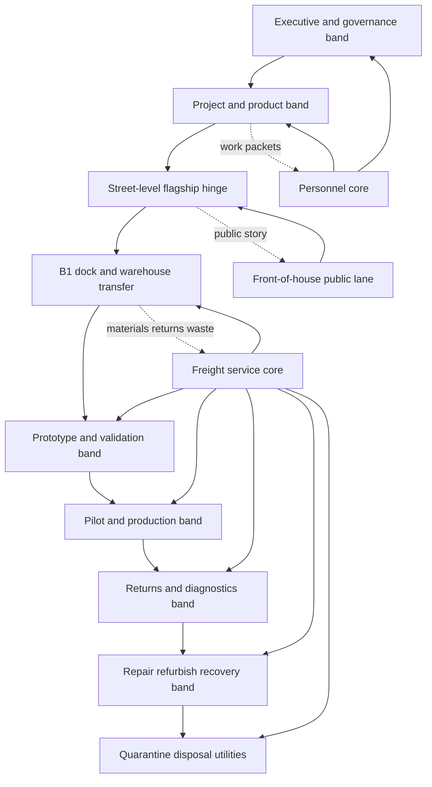
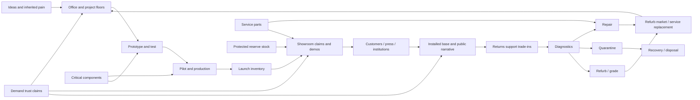
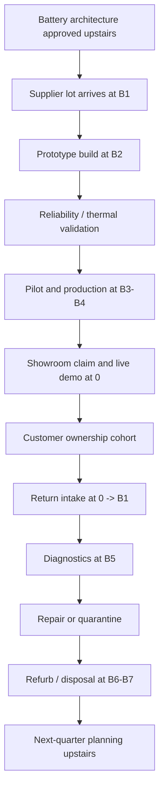

# R3 Flagship Building and Flow

## Executive summary

The fixed-width vertical flagship **is viable** as Obsolescence, Inc.’s main board, but only if it is treated as a **persistent, retoolable section of one institution** rather than as a stack of bespoke room toys. The winning form is not a pure SimTower clone, a freeform factory, or a zoomed-out tower plus separate floor minigames. It is a **side-on cutaway with shallow depth lanes**, a **street-level showroom hinge**, **separate personnel and freight logic**, and **modular operational floors below street level** that reuse a fixed circulation skeleton inherited from R4. That form best satisfies the R3 brief, the available R4 and R5 contracts, and the strongest comparable patterns from vertical management, institutional service, and retail-flow games. fileciteturn6file2 fileciteturn6file1 fileciteturn6file0 citeturn34search5turn34search7turn35search0turn36search0turn37search0turn39search7turn38search0

The decisive recommendation is a **three-lane, fixed-width vertical section** with one canonical macro-topology: **front-of-house public strip + central programmable work field + rear service strip + dedicated freight/service core + narrower personnel core**, all anchored by a **double-height showroom at street level** and a **B1 ramp/dock transfer floor** below it. Above street level, the building carries project and decision work in configurable office bands. Below street level, it carries prototype, pilot, production, diagnostics, repair, refurbishment, quarantine, and recovery as modular bay floors. The building grows **upward by adding configurable project capacity and institutional complexity**, and **downward by adding lifecycle and throughput depth**, while keeping the same structural rhythm and avoiding horizontal sprawl. fileciteturn6file2 fileciteturn6file1 fileciteturn6file0

The key falsifiable claim is this: players should be able to trace a major product choice such as **battery architecture** from office decision to supplier intake, prototype/test, production, showroom claim, ownership, return, diagnostics, repair/quarantine, and next-quarter planning **without needing a spreadsheet-first explanation**. If gray-box testing cannot make that causal chain readable on a constrained laptop and on a phone with stable anchors, the building premise should be simplified toward **stronger selected-floor emphasis, heavier offscreen aggregation, and more explicit cause-chain overlays**, not widened into a campus map. fileciteturn6file2 fileciteturn6file1 fileciteturn6file0

A practical access caveat matters. In this run, the available primary project material consisted of the R3 brief plus the attached R4 and R5 reports; standalone R1, R2, R7, and R8 files were not separately attached, so inherited canon for those streams is taken from the R3 brief’s settled-findings section and the attached R4/R5 reports. That is sufficient to recommend provisional canon, but a future reconciliation pass should still compare this report against the full standalone R1, R2, R7, and R8 texts once all are attached. fileciteturn6file2

## Inherited contract and research base

The inherited game contract is unusually strong, and it sharply narrows what the building is allowed to be. The R3 brief fixes the quarter as the release unit, makes the flagship showroom the recurring public object, defines the product family as old/low-end plus new Standard plus new Premium plus optional accessory/service, requires recent generations to stay vivid while older ones collapse into cohorts, and explicitly says the building should spatialize reusable lifecycle verbs rather than one-off smartphone gimmick rooms. R4 further fixes the operations model around **modular bays within a fixed macro-structure**, while R5 fixes the showroom around a **transforming flagship observatory** that must support three simultaneous product comparisons, two demo bays, one launch stage, pickup, returns, consultation, and readable phone anchors. R8, as inherited through the brief, fixes the technical framing around an Angular shell, a PixiJS scene, fixed-width fit-to-width play, primary vertical scrolling, and offscreen aggregation. fileciteturn6file2 fileciteturn6file1 fileciteturn6file0

That inherited contract rules out several tempting but wrong directions. It rules out a freeform campus because the building must stay fixed-width and vertically scrolled. It rules out a conveyor-grid factory because R4 explicitly rejects per-item routing as the canonical interaction. It rules out a pure selected-floor minigame structure because the brief requires the building itself to remain the visible bridge between launch promises and lifecycle residue. It also rules out a decorative boutique sim, because R5 explicitly says plants, wall finishes, arbitrary prestige objects, shelf density, cleaning, and long walking routes should not become main multipliers. fileciteturn6file2 fileciteturn6file1 fileciteturn6file0

The comparative evidence also points decisively away from those false solutions. Project Highrise frames the skyscraper as an “intricate ecosystem” and “complex machine,” which is useful for a fixed-width vertical section, but its tenant mix points toward lease logic rather than product lifecycle depth. News Tower demonstrates the power of a recurring public deadline in a vertical building, but it resolves judgment primarily through editorial outcomes rather than living customer ownership. Two Point Hospital and Two Point Museum show how individual journeys, queues, destinations, and room identities can stay readable in a management sim. Good Company and Little Big Workshop show the value of retoolable production and visible logistics, but also show how quickly “factory feel” expands into routing complexity. Tiny Tower proves that vertical navigation can work on phones, but also shows the danger of turning floors into finite collectible stamps. Prison Architect and Another Brick in the Mall show how crowd flow becomes legible only when path classes and chokepoints are readable. Oxygen Not Included is a warning: highly expressive, deeply causal systems become hard to read when too many equally urgent physical interactions compete in one view. citeturn34search5turn34search7turn35search0turn34search0turn36search0turn37search0turn38search0turn39search7turn34search4turn39search1turn37search1

That same evidence suggests the right player fantasy. The player is not primarily an architect drawing walls, nor a worker-avatar walking through the building. The strongest fantasy is **operator-curator of a vertically integrated institutional machine**: someone who assigns functions to a legible structural skeleton, repeatedly retools the same visible institution for new generations, and reads the company’s public face and hidden operational residue as one continuous board. Construction matters, but in the sense of **capacity state, bays, priorities, conversion, and upgrades**, not in the sense of bespoke corridor CAD. That fits the brief’s executive-committee fiction, R4’s fixed macro-structure, and R5’s representative-customer showroom. fileciteturn6file2 fileciteturn6file1 fileciteturn6file0

### Comparative matrix

| Comparable | Dominant projection | Key lesson for R3 | What to reject |
|---|---|---|---|
| Project Highrise | Side-on cross-section | Fixed-width vertical readability; services make the tower legible | Tenant abstraction replacing product/lifecycle identity citeturn34search5turn34search6 |
| News Tower | Side-on vertical management | Strong recurring public deadline and vertical workplace causality | Judgment arriving mostly in reports instead of embodied ownership evidence citeturn34search7turn34search8 |
| Two Point Hospital | Isometric room network | Queues, diagnosis, treatment, and room bottlenecks can remain readable | Overgrowth of bespoke room types and décor buffs citeturn35search0turn35search2 |
| Two Point Museum | Isometric attraction floor | Curated visitor journeys, bounded exhibit anchors, staffed demonstrations | Global floor sprawl and non-fixed-width building composition citeturn34search0turn34search2 |
| Good Company | Isometric production/office | Tech-corporation fantasy plus visible logistics and retooling | Conveyor-first complexity as the primary game feel citeturn36search0turn36search3 |
| Little Big Workshop | Tabletop production floor | Reconfigurable station packages and production identity | Wide-floor workshop presentation, not laptop-fit tower play citeturn37search0turn37search2 |
| Software Inc. | Freeform office building | Team-centered delegation and support/manufacturing coexistence | Freeform, multi-story office architecture burden citeturn37search1 |
| Another Brick in the Mall | Top-down retail complex | Queue geometry, throughput visibility, stocking and abandonment | Giant generic retail crowd as the primary simulation object citeturn34search4 |
| Megaquarium | Isometric attraction floor | Demonstrations and guest routing as interpretive evidence | Large decoration-driven exhibit layout as a core optimization axis citeturn35search4turn35search6 |
| Tiny Tower | Mobile vertical tower | Stable vertical navigation and floor memory on phones | Finite cute-room accumulation and weak cross-floor consequence depth citeturn38search0turn38search4 |
| Oxygen Not Included | Side view colony | Deep physical causality and offscreen burden propagation | Too many simultaneous system interactions for calm tower readability citeturn39search1turn39search4 |
| Prison Architect | Top-down institution sim | Flow classes, crowd choke points, incidents, and policy choices | Constant crisis whack-a-mole and pathfinding misery citeturn39search7turn39search10 |
| TCG Card Shop Simulator | First-person retail floor | Hands-on product interest, events, inventory, smooth shopping experience | Literal cashier/shelf labor and room-scale retail chores citeturn39search0turn39search2 |

Real-world patterns reinforce the same recommendation. Apple’s flagship retail model explicitly combines product browsing, pickup, service support, learning/events, and specialist help in the same public institution, while Google’s store format similarly combines demos, in-store pickup, and repair/service. Fairphone publicly emphasizes repair guidance and spare parts, while Apple’s repair ecosystem emphasizes genuine parts, structured procedures, and post-repair system steps; both demonstrate that repair posture becomes spatially and operationally meaningful. The FAA, FMCSA, CPSC, and NTSB all document that damaged or defective lithium batteries create special handling and shipping constraints, which makes quarantine and reverse flow more than thematic flavor. Finally, official PixiJS and Angular documentation supports the technical side of this report’s structure: fixed-width rendering, lazy loading, and offscreen simplification are reasonable expectations for a browser-native tower scene rather than evidence that every floor must remain equally simulated at full fidelity. citeturn16search8turn17search2turn14search3turn32search1turn32search5turn33search0turn33search4turn32search4turn25view2turn25view3

## Recommended building architecture

### Projection and depth model

The recommended projection is a **side-on cutaway with three shallow depth lanes**, not a pure single-lane section and not an isometric slab map. The three lanes are:

- **front lane** for public-facing reading: customers, queue fronts, hero objects, visible stock handoffs, returned devices entering the system;
- **middle lane** for primary interaction: product tables, workstations, bays, review tables, prototype benches, active machine/staff interactions;
- **rear lane** for service and buffer logic: stock buffers, service carts, returns, staff transit, utility handoffs, and visible cause-chain pulses.

This preserves the strongest virtue of SimTower/Project Highrise-style readability while giving the showroom enough non-linear path capacity to support R5’s “three simultaneously comparable product tables” requirement, readable repeated comparison loops, and visibly divergent celebratory versus service traffic. It also keeps width bounded in a way that an isometric showroom or freeform hospital-like floor plan would not. fileciteturn6file2 fileciteturn6file0 citeturn34search5turn35search0turn38search0

A pure single-lane cutaway fails because the showroom would collapse into one forced route, demo audiences would occlude product comparison, and service/pickup would visually merge with launch traffic. A 2.5D slab or isometric floor would make the showroom richer, but it would also widen the scene, complicate phone framing, and increase art and pathfinding burden beyond what the R8 constraints make attractive. A “tower overview plus always-expanded selected floor” hybrid is useful as a zoom tier, but it becomes dangerous if it turns the showroom and factory into disconnected subgames. The recommended answer is therefore a **hybrid only at zoom tier**, not at world structure: the building always remains one section, but zoom tier three may temporarily emphasize one floor while still leaving neighboring floors and shaft pulses partially visible. fileciteturn6file2 citeturn34search5turn35search0turn39search1turn25view2turn25view3

### Projection scoring

| Model | Tower readability | Showroom comparison | Queue clarity | Phone viability | Pathfinding burden | Art burden | Overall |
|---|---:|---:|---:|---:|---:|---:|---:|
| Pure single-lane cutaway | 5 | 2 | 3 | 4 | 2 | 3 | 3.3 |
| Three-lane cutaway | 5 | 5 | 4 | 4 | 3 | 4 | **4.4** |
| 2.5D slab / isometric | 2 | 5 | 4 | 2 | 4 | 5 | 3.1 |
| Tower overview plus expanded selected floor | 4 | 3 | 4 | 4 | 2 | 3 | 3.6 |

Scores are design judgments derived from the inherited R3, R4, and R5 requirements and the observed strengths and weaknesses of the comparable games above. fileciteturn6file2 fileciteturn6file1 fileciteturn6file0 citeturn34search5turn34search7turn35search0turn36search0turn37search0turn38search0turn39search7

### Canonical macro-topology

The recommended topology is a **street-level hinge with asymmetric dual-core service logic**.



In plan terms, the building is not bilateral symmetry. It is a **front-of-house public strip** facing the street, a **central programmable field** where the visible work or comparison actually happens, and a **rear service spine** backed by a dedicated freight/service core. A narrower personnel core runs separately so that people-moving never has to be simulated as the same capacity problem as pallets, returned devices, quarantine carts, or waste. The showroom is the hinge because it is where public interpretation meets stock, service, and reverse flow; B1 is the industrial hinge because it is where inbound, outbound, live pickup support, and reverse logistics conflict. fileciteturn6file2 fileciteturn6file1 fileciteturn6file0

This topology beats the alternatives for three reasons. First, it makes the showroom/basement contradiction legible without reducing the building to a simplistic “good above, evil below” morality diagram. Second, it keeps public, personnel, and freight movement visibly related but not mechanically merged. Third, it makes extension survivable: adding a new test, diagnostics floor, printer line, or trade-in surge changes bands and bay packages rather than forcing a new world map. fileciteturn6file2 fileciteturn6file1 fileciteturn6file0

### Macro-topology scoring

| Topology candidate | Customer readability | Freight clarity | Expansion survivability | Phone clarity | Satirical contrast | Overall |
|---|---:|---:|---:|---:|---:|---:|
| Central mixed-use core, work both sides | 3 | 3 | 3 | 3 | 3 | 3.0 |
| Opposite-edge public and freight cores | 4 | 4 | 4 | 3 | 4 | 3.8 |
| Front public strip + continuous service spine | 5 | 5 | 5 | 4 | 5 | **4.8** |
| Stacked bands with transfer floors only | 4 | 4 | 4 | 4 | 3 | 3.9 |

### Permanent bones and structural rhythm

The permanent bones should be fixed very early and almost never redrawn:

- **fixed scene width**: one canonical width that always fits a constrained laptop at default zoom;
- **three depth lanes** on all ordinary floors;
- **one showroom double-height street hinge** at level 0;
- **one visible diagonal ramp** from the street to B1;
- **one B1 transfer floor** with dock, warehouse interface, protected service reserve branch, and quarantine branch;
- **one freight/service core** continuous from roof mechanicals to deep basement;
- **one personnel core** continuous from lobby to office and project bands;
- **one rear service strip** on all programmable floors for buffers, carts, and visible transfer;
- **one structural bay rhythm** reused across office floors and operations floors;
- **one service-lift handoff** from showroom returns/pickup into the reverse-flow system;
- **one emergency isolation / quarantine edge condition** low in the stack, with visible status change rather than a new map. fileciteturn6file2

The player can change **what sits in sockets, what teams occupy project bands, what priorities elevators use, what floor packages are upgraded, and whether empty capacity is built out**, but the player should not redraw corridors, widen the building, move the ramp, or repeatedly demolish service infrastructure. That preserves the fantasy of stewarding and retooling a persistent institution rather than playing floorplan Tetris every quarter. fileciteturn6file2 fileciteturn6file1

### Canonical floor taxonomy

| Floor class | Fixed vs configurable | Main verbs | Retooling frequency |
|---|---|---|---|
| Iconic fixed floors | fixed footprint, transformable fixtures | launch, browse, pickup, returns, dock transfer, executive review | low |
| Configurable office and project floors | configurable teams within fixed structure | planning, engineering, design, compliance, marketing, support planning | medium |
| Modular operations-bay floors | socket-based within fixed trunks | prototype, test, pilot, production, diagnostics, repair, refurb, recovery | high |
| Shared transit/service floors | mostly fixed with upgrade packages | warehousing, reserve storage, elevator logic, utilities, break/support | low-medium |
| Temporary event states | overlay on fixed floors | launch prep, recall intake, incident hold, major trade-in campaign | episodic |
| Aggregated/background systems | mostly UI/state, some visible anchors | market cohorts, remote channels, old installed base, offsite outsourcing | continuous |

### Canonical building elevation

```text
                 CANONICAL MATURE FIRST-CAMPAIGN SECTION

   Roof   [Mechanical / signage / brand residue / optional solar satire layer]

   +7     [Executive committee / board review / crisis room]
   +6     [Legal / compliance / institutional support planning]
   +5     [Marketing / launch prep / press materials / customer research]
   +4     [Engineering / software / industrial design / test review]
   +3     [Program management / platform planning / quality governance]
   +2     [Project floor A / configurable teams]
   +1     [Project floor B / configurable teams]

 Street   [DOUBLE-HEIGHT FLAGSHIP SHOWROOM / stage / demos / pickup / returns]
          \ visible ramp down

   B1     [Dock + cross-dock + service reserve + quarantine fork + warehouse handoff]

   B2     [Prototype benches + reliability/compliance labs]
   B3     [Pilot assembly + end-of-line test]
   B4     [Production assembly + kitting + packout]
   B5     [Diagnostics + board/subassembly repair]
   B6     [Refurbishment + wipe + grading + parts recovery]
   B7     [Quarantine + damaged battery isolation + disposal / recycling]
   B8     [Utilities / offsite abstraction gateway / long-tail overflow]

 Cores    [Personnel core]                               [Freight/service core]
 Lanes    [Front public lane] [Work lane] [Rear service strip]
```

### Spatial programs by capacity state

| Capacity state | Approximate visible stack | What is foregrounded |
|---|---|---|
| Gray-box prototype | +2 to B4 | one project floor, showroom, B1, one prototype/test floor, one pilot/production floor, one repair/refurb floor |
| Opening company | +3 to B5 | lean office band, small showroom, dock, 3–4 basement floors |
| Established company | +5 to B6 | dedicated marketing/compliance and distinct diagnostics/repair |
| Mature first campaign | +7 to B8 | full office stack, complete lifecycle banding, one overflow/service floor |
| Stress / long-tail | up to ~24–32 total floors | more project floors above, more specialized bays below, but stronger aggregation and transfer logic |

The mature first-campaign state should remain well below the 32-floor technical review trigger inherited from the brief; beyond that point, more floors should usually mean **more aggregation and new strategic options**, not more always-urgent simulation. fileciteturn6file2

### Canonical showroom floor plan

```text
FRONT / STREET GLASS
┌──────────────────────────────────────────────────────────────────────────┐
│ [Old / Low]      [Hero + Standard/Premium sightline]       [Premium]   │
│   table                    entrance axis                     table      │
│                                                                      ↘  │
│ [Consult nook]   [Comparison rail]   [Demo Bay A]   [Demo Bay B]       │
│                                                                  crowd  │
│ [Accessory / service wall] [Pickup / backorder] [Service / returns]    │
│                               stock handoff        queue + service lift │
└──────────────────────────────────────────────────────────────────────────┘
REAR / BACK-OF-HOUSE STRIP -> showroom stock door -> service lift -> freight core
```

This plan intentionally keeps the three product tables simultaneously comparable without forcing a single clockwise circulation route. The old/low, Standard, and Premium anchors form a **comparison triangle** around a shared evidence surface. Demo bays sit to one side so that demo crowds do not block browsing. Pickup/backorder sits behind comparison, because it is operationally connected to stock and the dock. Service/returns is distinct, visibly queued, and directly connected to the reverse-flow lift so that returned devices do not disappear into magic UI. Consultation sits near but not inside service, so institutional or complex support appointments can exist without requiring private-room sprawl. fileciteturn6file0 fileciteturn6file2

### Showroom transformation across four states

```text
ORDINARY OPERATION
Hero modest    Tables active    Demos scheduled    Pickup steady    Service steady

LAUNCH PREPARATION
Hero amplified  Queue barriers appear  Stage lights test  Press markers appear
Stock buffers fill  Pickup reserve separates

LAUNCH THEATER
Stage active  Hero dominates  Demo A/B promoted  Overflow at entrance
Pickup bounded  Service lane protected from crowd

AFTERMATH / SERVICE RECOVERY
Stage retracts  Hero de-emphasized  Service/returns expands visibly
Pickup/backorder dominates  Returned devices route to service lift
```

The floor should transform with **lighting, signage, rope/barrier logic, staff positions, activated stage hardware, and queue routing**, not through rebuilding. That keeps the same footprint legible quarter after quarter and respects R5’s observatory model. fileciteturn6file0

### Office and project floors

Above-ground floors should not be “desks = bonus.” They should be organized into **project bands** with a few persistent anchors and many configurable team neighborhoods:

- **persistent anchors**: executive committee room, compliance/legal review room, launch prep/media wall, prototype review gallery, customer research or support-evidence wall;
- **configurable neighborhoods**: platform planning, engineering/software, industrial design, marketing, support planning, institutional deployment prep. fileciteturn6file2

The visible verbs above ground are meetings, approvals, prototype review, work-packet movement, and response to public evidence flowing up from the showroom and back from returns/diagnostics. That makes “ideas” and “approvals” spatial without requiring cubicle micromanagement. Teams can be resized or reassigned between floors, but the persistent anchors should stay where the player learns to find them. fileciteturn6file2

### Canonical operations-floor template

```text
OPERATIONS FLOOR TEMPLATE

Front lane:  inbound visibility / labeled bins / inspection frontage
Middle:      [Socket A][Socket B][Socket C][Socket D][Socket E][Socket F]
Rear lane:   returns spine / buffers / carts / hold zones / service strip
Right edge:  freight-service core + service stair + utility riser

Bay sizes:
- small  = 1 socket
- medium = 2 adjacent sockets
- large  = 3 adjacent sockets

Internal snap slots per bay:
- prototype/test      = benches / chamber / instrument rack
- pilot/production    = assembly / calibration / packout
- diagnostics/repair  = triage / bench / parts cage
- refurb/recovery     = wipe / grading / donor teardown / salvage cage
```

The player never draws belts. The player chooses package composition, staffing, product assignment, reserve rules, automation packages, and retooling. Adjacency matters at a high level only: prototype should sit near labs, pilot near end-of-line test, diagnostics near repair/refurb and quarantine access. Anything more granular risks becoming a hidden optimization puzzle that cuts against the brief. fileciteturn6file1 fileciteturn6file2

## Movement, camera, and causality contract

### Loading ramp, B1 dock, warehouse, quarantine, and returns model

The visible diagonal ramp is both signature image and mechanical queue. It should operate as **one visible shared access route feeding multiple internal dock states** rather than as a drivable parking game. Inbound and outbound do not need fully separate surface ramps; instead, B1 should split the ramp’s traffic into **timed dock windows and internal staging lanes**: inbound materials, outbound launch freight, service parts, returns/trade-ins, and quarantine transfer. This makes congestion legible but keeps the street readable. fileciteturn6file2

B1 needs four clearly differentiated branches:

- **production stock branch** for kitting and launch inventory;
- **service replacement / protected reserve branch** for showroom pickup and exchanges;
- **reverse-flow intake branch** for returns, recalls, and trade-ins;
- **quarantine branch** for damaged, suspect, or battery-risk items. fileciteturn6file1 fileciteturn6file2

That recommendation is grounded by the real-world fact that stores and repair ecosystems do separate public browsing from pickup and service, and that damaged lithium devices trigger special handling constraints. Apple and Google both expose pickup and service as distinct public functions; battery safety and incident documentation from the FAA, CPSC, FMCSA, and NTSB shows why reverse flow cannot simply dissolve into a generic “returns number.” citeturn16search8turn17search2turn33search4turn32search1turn32search4turn32search5

### Passenger, staff, freight, service, and information transport

The building should not treat elevator management as a daily commuting tax. The right rule set is:

- **customers never use the building’s vertical system** in ordinary play; the public game is on the showroom floor;
- **personnel core** moves office/project staff and occasional escorted prototypes;
- **freight/service core** moves materials, products, returns, carts, waste, and service technicians;
- **showroom service lift** is visually linked to the freight system but has its own marked handoff point;
- **elevator scheduling is mostly policy-driven**, with direct intervention only during visible incidents or special launch states;
- **transfer time is represented through shaft pulses, occupancy lights, and ETA badges**, not through the player waiting for routine commuting to be fun. fileciteturn6file2

As the building deepens, vertical transport should remain meaningful by creating **occasional shared-capacity conflicts** rather than constant micro-obstruction. Examples: trade-in flood competes with outbound launch freight; quarantine hold delays repair jobs despite available stock; a freight outage starves production and service simultaneously; personnel ride priority hurts prototype review timing. That is enough to make lifts strategic without turning the game into elevator dispatch simulation. fileciteturn6file1 fileciteturn6file2

### Complete physical and information flow map



| Flow | Representation | Shared capacity used | Offscreen rule |
|---|---|---|---|
| Ideas / approvals / work packets | symbolic pulses + visible meetings | personnel core, project anchors | aggregated when not selected |
| Customers / press / institutions | individual representatives on showroom floor | public floor only | cohorts elsewhere |
| Prototypes / demo units | individual | personnel or freight depending on context | batched once no longer foregrounded |
| Pilot batches / production lots | batch objects | freight core, B1, operations floors | aggregated by lot |
| Returns / trade-ins / high-consequence repair jobs | individual cases | showroom service lift, freight core, diagnostics, quarantine | low-value bulk returns batched |
| Critical component stock / service parts | labeled batch units | dock, warehouse, freight core, bay buffers | aggregated by stock family |
| Demand / trust / narrative | UI and visible badges/pulses | no physical capacity, but tied to physical evidence | always aggregated |

### Golden Quarter spatial choreography

| Phase | Primary floors | Why the camera goes there |
|---|---|---|
| Opportunity and lineup framing | +3 to +5 | product role and architecture decisions happen above ground |
| Prototype and reliability | B2 | first concrete evidence, failures, and review artifacts appear |
| Pilot and setup | B3 | retooling and throughput confidence become visible |
| Production ramp | B4 + B1 | stock, dock, queue, reserve, and freight pressure appear |
| Showroom prep | 0 + B1 + +5 | launch story, staff briefing, inventory allocation, promises |
| Launch theater | 0 | quarter payoff and immediate judgment |
| Immediate aftermath | 0 + B5 | returns, support, and first reverse-flow evidence |
| Early recovery | B5 to B7 + +3 | diagnosis, repair, quarantine, and next-quarter learning |

The choreography rule is important: the game should **invite** the camera across the building through meaningful evidence, not yank it constantly. In active play, the player should usually focus on one band at a time while seeing badges, shaft pulses, and floor lights that explain why another band matters now. fileciteturn6file2

### Desktop camera contract

For constrained desktop play, the default contract should be:

- **fit full width by default** with no page-level horizontal scrolling;
- at ~1024×640, show the full width and about **4 ordinary floors** or **the double-height showroom plus two neighbors**;
- at 1366×768, show about **5 ordinary floors**;
- at 1440×900, show about **6 ordinary floors** with calmer overlay density;
- **vertical wheel / trackpad movement scrolls floors**, not browser page;
- zoom has **three tiers**:
  - **Tier A** tower context: 4–6 floors visible, no horizontal pan;
  - **Tier B** floor readability: 2–3 floors visible, still no default pan;
  - **Tier C** close inspection: 1 floor or 1 double-height anchor, horizontal pan now enabled after zoom only. fileciteturn6file2

Alert jumps must preserve orientation. Clicking an alert should move to the relevant floor, highlight the exact anchor, and leave a one-click breadcrumb back to the previous view. Reports and dialogs should reopen into the same scene anchor the player left unless an explicit “jump to source” action is chosen. The desktop UI may include a slim floor navigator and a tiny overview thumbnail, but those are support tools; the main navigation remains vertical scene movement. fileciteturn6file2

### Phone navigation contract

Phone play should **never** present the whole tower at once. The canonical contract is:

- default view = **one ordinary floor** or **one meaningful double-height anchor**;
- persistent **right-side building rail** marks street, selected floor, active alerts, and critical bands;
- tapping the showroom enters **showroom focus mode** with stable anchors for hero/stage, comparison tables, demos, pickup/stock, and service/returns;
- bay or object selection opens **bottom sheets**, not hover states or tiny inspector windows;
- important actions should be reachable in **no more than roughly three taps** from the main floor view, consistent with the brief’s phone requirement;
- reduced-motion mode replaces long animated trails with badges, summaries, and snaps between anchors. fileciteturn6file2 fileciteturn6file1

### Cross-floor causality language

The player needs a visual language that makes hidden cause feel earned rather than arbitrary. The recommended stack is:

- **generation / product-family color coding** for pulses, lot tags, and incident highlights;
- **shaft pulses** showing whether freight, service, or information is moving up or down;
- **floor badges** for hold, congestion, incident, reserve conflict, and trust-sensitive public state;
- **cause-chain cards** linking an upstream floor to a downstream symptom;
- **selected-object path overlays** for a prototype, return case, or stock lot;
- **residue objects** such as boxes, returned devices, exhausted demo units, blocked quarantine carts, depleted service reserve bins;
- **incident replay** for post-launch diagnosis, including before/after snapshots where useful. fileciteturn6file2

A concrete battery-causality tour should look like this:



That exact cross-band trace is required by the brief and is where the whole building premise either succeeds or fails. fileciteturn6file2

### Level-of-detail and aggregation contract

| Camera state | Individual | Batched | Hidden / summarized |
|---|---|---|---|
| Selected floor | workers, representative customers, prototypes, return cases, machines, queue fronts | production lots, low-value stock | ambient offsite demand |
| Adjacent visible floors | highlighted crews, major queue heads, active lots | secondary workers, buffers | fine machine cycles |
| Distant onscreen floors | incidents, lot icons, lift pulses, floor lights | most workers and small stock | individual gestures |
| Offscreen floors | none by default | floor summaries, ETA, queue counts, incident badges | all ambient animation |
| Launch theater | representative customers, stage staff, queue heads, demo units | crowd body, online/channel demand | routine minor service motions |
| Stress conditions | incidents and affected exemplars | overflow counts, digested alerts | decorative ambient traffic |

This contract aligns with the brief’s insistence that the design aim for **causal readability**, not for the maximum visible entities the renderer could theoretically support. fileciteturn6file2

## Worked studies, stress tests, and handoffs

### Cross-floor incident chains

| Incident | First visible clue | Root cause | Player intervention | Residue next quarter |
|---|---|---|---|---|
| Hidden thermal issue at launch | demo unit dims and service questions appear | battery / sustained-load interaction | qualify claim, rotate demos, reserve exchange stock, open diagnostics | trust scar, test recipe change, possible redesign priority |
| Launch stock shortage vs service reserve | pickup line grows while exchange stock is protected | Standard demand underforecast and reserve policy conflict | release reserve or accept backorders / channel penalty | channel trust or service trust changes |
| Trade-in flood vs outbound freight | B1 queue backs up while showroom still celebrates | aggressive trade-in campaign collides with launch shipping | stagger intake, add overflow grading, offsite low-value batches | larger refurb channel and more old-generation residue |
| Freight core outage | several floors starve despite stock existing | lift breakdown or quarantine block | reprioritize shaft, reroute critical lots, overtime alternate floors | maintenance burden and stronger transfer-floor priority |

### Expansion and extension stress tests

| Stress case | Structural change | Does topology survive |
|---|---|---|
| Battery-diagnostics floor inserted between quality and repair | add one modular floor between B4 and B5, or repackage B5 | yes; no macro-topology change needed |
| Printer / home-office category later | larger 2–3 socket bay packages, consumables cage, new showroom comparison/demo fixtures | yes; floor grammar expands, topology survives |
| Reverse-logistics flood | B1 overflow logic, stronger B6/B7 use, more aggregation for low-value bulk | yes; may require offsite grading abstraction after threshold |
| Institutional launch | consultation anchor on showroom, documentation/support floor above, protected stock logic below | yes; showroom and office anchors already support it |

### Gray-box prototype scope and kill criteria

The **smallest ugly falsifier** should include: one project floor, one double-height showroom, B1 dock, one prototype/test floor, one pilot/production floor, one diagnostics/repair floor, one battery-related architecture decision, one supplier fork, one launch, one return wave, one cause-chain overlay, desktop fit-to-width, and one phone anchor flow. Anything beyond that should be explicitly deferred. fileciteturn6file2 fileciteturn6file1

The prototype should fail the premise if any of the following occur:

- fewer than **80%** of testers can correctly identify the dominant cause of 2 out of 3 prepared cross-floor incidents after play;
- median active launch requires **more than 6 meaningful interventions** or **more than 10 floor jumps**;
- constrained-laptop players cannot keep full width in view without horizontal browser scrolling;
- phone testers cannot resolve a prepared alert path in about **3 taps** after the jump;
- players describe the mature building as “more floors to babysit” rather than “more strategic options and visible history”;
- players cannot explain why the showroom and basement belong to one game without an external essay. fileciteturn6file2

The ordered simplification ladder should be:

1. combine low-value operations into fewer active floors;
2. increase batching of production lots and trade-in bulk;
3. convert some continuous transfers into scheduled pulses;
4. strengthen stable floor anchors and selected-floor emphasis;
5. reduce ambient agents before removing representative evidence;
6. offload low-value long-tail bulk processing to offsite abstractions;
7. if necessary, make launch crowd behavior more phase-based;
8. only then consider a more explicit selected-floor expansion mode. fileciteturn6file2

### Formal handoffs

| Handoff | What R3 must freeze |
|---|---|
| R6 | opening / established / mature spatial capacity states; what expansions are permanent vs reconfigurable; max clearly foregrounded generations; where old obligations collapse into cohorts |
| R8 | canonical three-lane cutaway; fixed scene width; ordinary and double-height floor heights; zoom tiers; showroom anchors; active-floor budgets; freight vs personnel core behavior; offscreen aggregation ladder |
| R9 | deterministic fixtures: ordinary quarter, launch prep, busy launch, confusing lineup, dock shortage, return wave, battery quarantine, trade-in flood, freight outage, phone alert jump, floor addition / retool, later-category extension |

### Annotated desktop and phone wireframes

```text
CONSTRAINED LAPTOP OVERVIEW (~1024x640)

┌────────────────────────────────────────────────────────────────────┐
│ floor badges / tiny overview / pause speed / report button        │
├────────────────────────────────────────────────────────────────────┤
│ +4  [project floor]                                               │
│ +3  [project floor]                                               │
│ +2  [project floor]                                               │
│ +1  [project floor]                                               │
│  0  [DOUBLE-HEIGHT SHOWROOM HINGE .................]  <selected>  │
│ B1  [dock / ramp / reserve / quarantine split ......]             │
├────────────────────────────────────────────────────────────────────┤
│ inspector drawer for selected anchor / breadcrumb / alert source  │
└────────────────────────────────────────────────────────────────────┘
```

```text
DESKTOP SELECTED-FLOOR VIEW

┌─────────────────────────────────────────────────────────────────────┐
│ neighbor floor summary                                             │
├─────────────────────────────────────────────────────────────────────┤
│ selected floor         cause pulse -> freight shaft                │
│ [old] [hero/std] [premium] [demo]                                 │
│ [consult] [comparison rail] [pickup] [service queue]              │
│ rear strip: stock handoff -> service lift -> freight core         │
├─────────────────────────────────────────────────────────────────────┤
│ inline panel: why this queue? / why this product? / jump upstream  │
└─────────────────────────────────────────────────────────────────────┘
```

```text
PHONE SHOWROOM ANCHOR

┌──────────────────────┐
│ hero / stage anchor  │
│ current beat         │
│ queue badge          │
│      selected zone   │
├──────────────────────┤
│ ◄ tables  demos  ►   │  <- anchor rail
├──────────────────────┤
│ bottom sheet         │
│ why this product?    │
│ switch to service    │
│ jump to stock floor  │
└──────────────────────┘
```

```text
PHONE OPERATIONS FLOOR

┌──────────────────────┐
│ right-side floor rail│
│ B4 ●                 │
│ B5 !                 │
│ B6                   │
├──────────────────────┤
│ Socket A  Socket B   │
│ Socket C  Socket D   │
│ rear strip + shaft   │
├──────────────────────┤
│ bottom sheet         │
│ bay state            │
│ staffing / retool    │
│ upstream / downstream│
└──────────────────────┘
```

```text
PHONE CROSS-FLOOR ALERT

Alert: "Studio heat signal now affecting returns"

[Cause]
B2 test recipe missed sustained-load case

[Effect]
0 showroom demo instability
B5 diagnostics queue forming

Actions:
- qualify claim
- reserve exchange stock
- open sustained-load test
- jump to diagnostics
```

## Recommendation

The canonical board for Obsolescence, Inc. should be a **fixed-width, three-lane, side-on vertical section** with a **street-level showroom hinge**, **B1 ramp/dock transfer floor**, **modular lifecycle bands below**, and **configurable decision/project bands above**. That is the smallest structure that preserves R4’s modular bay logic, R5’s transforming flagship requirements, R7’s institutional satire, and R8’s browser-native camera constraints while remaining falsifiable and implementation-ready. fileciteturn6file2 fileciteturn6file1 fileciteturn6file0

If the first gray-box prototype fails, the correct pivot is **not** “replace the tower with a city map.” The correct pivot is: keep the same macro-topology, preserve the same fixed width, and simplify by increasing batching, strengthening selected-floor emphasis, and making cause-chain overlays more explicit. Only if those steps still fail should the team consider a stronger overview-plus-selected-floor presentation mode inside the same flagship premise. fileciteturn6file2