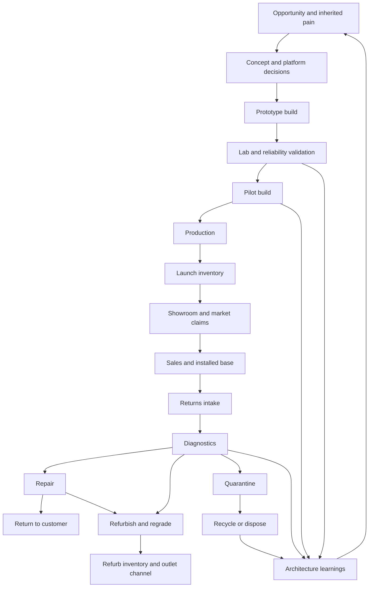
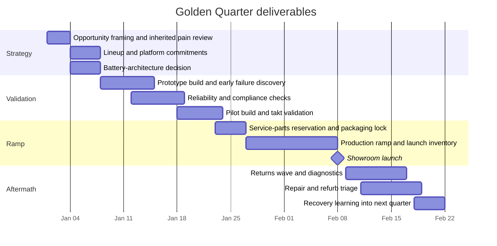

# R4 Development Factory and Operations

## Executive summary

The attached brief defines R4 as the report that must determine what the player actively manages inside Obsolescence, Inc. during a single quarter, why that work remains interesting across repeated launches, and how factory operations, product decisions, and lifecycle consequences should become one coherent playable system. It also inherits settled canon from prior reports: a quarter-based launch cadence of roughly 25–35 minutes, a flagship quarterly lineup, a fictional smartphone or handheld-device family built from shared platform plus variant promises plus lifecycle obligations, a satirical focus on institutional incentives, and technical constraints that favor a browser-native living 2D scene rather than unconstrained freeform simulation. fileciteturn0file0

The strongest single operational model for R4 is **modular bays with fixed service trunks and limited internal snap slots**. Fixed-department games make buildings readable and mobile-friendly, while conveyor/grid games create satisfying automation; however, the brief explicitly rejects player responsibility for routing every item or assigning every worker, and R4 also has to support returns, diagnostics, repair, and refurbishment rather than only forward production. A bay model therefore captures human-scale factory work, preserves a vertical-building fantasy, supports multiple lifecycle phases, and keeps the player focused on high-leverage configuration rather than low-level routing chores. Official/store descriptions of *News Tower*, *Project Highrise*, *Two Point Hospital*, *Good Company*, *Software Inc.*, *Factorio*, *shapez 2*, *Automachef*, *GearCity*, *Automation*, and *Lobotomy Corporation* collectively point to the same lesson: room- and team-based clarity scales better for management readability, while full-grid automation is powerful but expensive in UI and cognitive load. citeturn30view0turn30view1turn23view1turn30view2turn31view2turn23view2turn31view1turn30view4turn30view6turn30view5turn31view4turn30view9turn30view11

The canonical chain should be explicit and physical: **opportunity → concept/platform decisions → prototype → pilot → production → launch inventory → sales/claims → returns → diagnostics → repair → refurbishment → recycle/dispose**, with feedback from failures and obligations feeding the next quarter. This is consistent with the brief’s demand that the factory make product strategy physical, with electronics-industry stage-gate practice around EVT/DVT/PVT, with line-balancing literature that treats bottlenecks as the determinant of throughput, and with PLM research that emphasizes product-family structures, master-variant models, and unified bill-of-materials-and-operations views for high-variety operations. fileciteturn0file0 citeturn13search0turn12search6turn14search10turn19search4turn19search6turn19search8

R4 should also treat lifecycle obligations as first-class systemic levers rather than post-launch flavor. Official Apple support materials show that repair at scale can require genuine parts, manuals, specialized tools, post-repair software steps, serial/IMEI-linked processes, and parts/service-history tracking. Fairphone’s official repair guidance shows the opposite pole: accessible spare-part replacement, publicly documented repair flows, and long support commitments. Google’s official Pixel policy makes software support duration explicit for years after launch. EU common-charger, battery, and right-to-repair rules reinforce that charging, replaceability, repair access, and lifecycle transparency have become product-design constraints, not optional aftercare. CPSC, USPS, UPS, and IATA materials further show that reverse logistics and damaged-battery handling are operationally real and sometimes highly constrained. citeturn22view1turn25view0turn23view4turn22view2turn35search0turn35search5turn22view3turn9search3turn8search0turn15search5turn26search0turn23view5turn24view0turn10search1turn10search9

The practical implication is that the first vertical slice should not try to be “the whole factory.” It should prove one falsifiable claim from the brief: **a high-level product choice must create downstream operational consequences that the player can see, diagnose, mitigate, and later inherit**. The cleanest slice is one family with Standard and Premium variants, one accessory, one inherited prior-generation cohort, one critical architecture decision such as battery design, one supplier fork, one launch deadline, and one post-launch return wave. The brief makes external staffing, production budget, and final balance curves unspecified; the only explicit implementation staffing constraint is that the first complete slice must be small enough for one AI-assisted developer. This report therefore gives bounded gameplay-side operational recommendations and a scope ladder, while marking non-briefed production estimates as unspecified. fileciteturn0file0

## Settled inputs and evidence base

### Settled inputs inherited from the brief

The brief is unusually clear about what R4 should and should not decide. It says R4 should inherit prior canon unless a concrete contradiction appears; it frames the recurring public object as a quarterly lineup launch; it defines the first category as a fictional smartphone or handheld-device platform; it says the player should make high-leverage decisions rather than micromanage routine purchasing and routing; it insists that repair, support, refurbishment, and waste must be mechanically and visually real; and it explicitly keeps final topology, campaign length, renderer/hosting stack, exact economy numbers, and complete content trees out of scope. That makes R4 less a “full factory simulator” spec and more a **playable operational grammar** for downstream design and implementation. fileciteturn0file0

The most important inherited constraints for operations are fivefold. First, the product system is about **shared platform plus differentiated promises plus lifecycle obligations**, which means operations must reveal where shared components help or hurt. Second, the player should feel deadline pressure from launch commitments and limited capacity, not from manually pushing every crate. Third, recent generations should remain foregrounded while older generations aggregate unless a defect or recall resurfaces them. Fourth, workers and customers must remain humanly legible, because the satire is about incentives and optimization, not disposable people. Fifth, mobile readability and low input burden are mandatory design filters, not polish tasks for later. fileciteturn0file0

### Comparative game-system matrix

| Reference game | What the official description demonstrates | Borrow for R4 | Avoid for R4 |
|---|---|---|---|
| *News Tower* | A vertical management game where layout tools like walls, elevators, and pneumatic tubes directly affect team efficiency under deadline pressure | A quarter-like public deadline, vertical tower readability, transport bottlenecks as visible management problems | Full building-detail obsession replacing product decisions |
| *Project Highrise* | The building as an “intricate ecosystem” and “complex machine” of people and services | The tower as a legible systems diagram | Tenant-style abstraction that weakens product identity |
| *Good Company* | Tech-corporation fantasy with product invention, logistics, employee management, and automated manufacturing | Product + operations + market loop in one frame | Conveyor-first identity becoming the core fantasy |
| *Two Point Hospital* | Room-based treatment flow, machine upgrades, staff skills, and strong info screens | Room/bay readability, diagnostics as explicit rooms, statistics as explanation tools | Overproliferation of room types and “more rooms = more depth” |
| *Prison Architect* | Flow breakdowns create riots, floods, fights, and cascading failure if crowd movement is constrained | Traffic/congestion as incident source, policy-plus-layout interaction | Constant crisis whack-a-mole as the main loop |
| *Automachef* | Programming machinery and optimizing spatial logic in small automated facilities | Template-based automation packages and snap-slot logic | Puzzle-level line scripting as mandatory play |
| *Factorio* / *shapez 2* | Strong automation fantasy, redesign freedom, item routing, and production chains | Late-game automation fantasy and clarity of cause/effect | Full-grid routing as canonical play model, especially on phone |
| *Software Inc.* | Teams, delegation, manufacturing, repair staff, and free-form offices with management delegation | Team-based staffing, delegation progression, support/repair as coequal functions | Free-form construction burden and architecture micromanagement |
| *GearCity* / *Automation* | Deep product-family decisions tied to factories, supplies, employees, and historically grounded market dynamics | Product strategy must change factory consequence; variants and shared components matter | Spreadsheet depth that obscures visual state |
| *Lobotomy Corporation* | Cross-system chain reactions where one disaster leads to another and must be suppressed or contained | Failure chains with readable escalation and recovery | Punishing opacity or sadism for its own sake |

The matrix above draws only on official/store or developer descriptions and then converts them into design relevance for R4. The repeated pattern is that **legible facilities plus explicit bottlenecks plus team-scale management** work well when the player is making policy and launch decisions, while freeform grids and exact routing are strongest when the entire game is about throughput engineering. R4 is not that game. citeturn30view0turn30view1turn23view1turn23view2turn30view2turn31view2turn30view3turn31view3turn30view4turn30view5turn30view6turn31view1turn31view4turn30view9turn30view11

### Useful real-world development and lifecycle patterns

**Observed evidence.** Electronics development commonly uses staged validation passes that resemble EVT, DVT, and PVT: early engineering validation to catch design-level flaws, later design/specification validation, and finally production validation to prove repeatable manufacture. Assembly-line literature consistently treats bottleneck balance and station loading as central to production performance. PLM and product-family research likewise emphasizes master-variant structures, shared components, and unified BOM-and-operations models so that families can differentiate without losing control of manufacturing and service complexity. citeturn13search0turn12search6turn14search10turn19search4turn19search6turn19search8turn14search9

**Interpretation.** R4 therefore needs a model in which product decisions are not just cosmetic modifiers on a single invisible recipe. Shared platforms, variant-specific modules, supplier substitutions, and testing gates all need explicitly modeled operational consequences, because that is how real product families create both savings and fragility. A bay-based operational chain can represent that with much less UI cost than a per-item grid. fileciteturn0file0 citeturn19search4turn19search6turn19search8

**Observed evidence.** Official Apple repair and battery documentation shows repair systems requiring manuals, tools, serial-linked parts, Repair Assistant/System Configuration, service-history records, and accepted part-return/recycling loops. Official Fairphone materials show batteries and other spare parts designed for much easier replacement, coupled with explicit repair guidance and long software-support commitments. Google’s official Pixel update policy makes years of software obligation public. EU rules now require USB-C common charging for relevant devices, phase in battery-removability requirements, and create a formal right-to-repair framework. Reverse-logistics research finds that repair service quality depends heavily on accurate service-parts planning; one open study specifically warns that uncertain return volumes create either returned-device backlogs or excessive parts inventory. citeturn22view1turn24view3turn25view0turn22view2turn35search0turn35search5turn22view3turn9search3turn8search0turn15search5turn26search0turn28view0turn28view3

**Interpretation.** In R4, the player’s architecture choices should therefore affect not only launch metrics but also service tooling, diagnostics complexity, spare-parts forecasts, reverse logistics, resale/refurb value, and regulatory exposure. If the game stops at launch inventory, it will miss the real systems leverage that the brief wants. fileciteturn0file0 citeturn25view0turn22view2turn22view3turn28view0

**Observed evidence.** Official CPSC guidance for fast-track recalls requires not just a remedy but also a reverse-logistics plan. Apple’s trade-in guidance includes explicit instructions against shipping loose batteries, discharging units to below 30%, and shipping swollen or damaged batteries. UPS and USPS guidance likewise restricts or limits shipment of damaged, defective, recalled, or improperly packaged lithium-battery devices, while IATA guidance continues to update battery-air-transport rules. citeturn23view5turn24view0turn10search1turn10search5turn10search9

**Interpretation.** Returns in R4 cannot be a refund number on a dashboard. They need their own dock, triage, quarantine, repair, refurb, and disposal logic, because reverse flow competes with forward production for labor, space, and parts. That competition is what makes “obsolescence” operational rather than thematic. fileciteturn0file0 citeturn23view5turn24view0turn28view0

## Recommended canonical operational model

### Four candidate operations models

| Model | Strengths | Weaknesses | Best precedents | Fit to R4 |
|---|---|---|---|---|
| Fixed departments | Very readable; easy to teach; strong room identity; good on phone | Hard to express retooling and variant differences; can become “place the right room” optimization | *Two Point Hospital*, *News Tower*, *Project Highrise* | Good but too static by itself |
| Modular bays | Reconfigurable; lifecycle-friendly; supports visible workers and machines; easy to scale by bay packages | Needs careful grammar so it does not become abstract or repetitive | Mix of *Good Company* product fantasy, *Two Point Hospital* room legibility, *Software Inc.* delegation | **Best overall** |
| Snap-point micro-lines | Strong “factory” feel; good at showing station adjacency and machine packages | Higher micromanagement; can drift toward puzzle programming; weaker on phone | *Automachef*, small-line portions of *Good Company* | Useful internally, but not as the whole model |
| Limited grid | Maximum expressiveness; excellent automation fantasy; high replayability for routing fans | Heavy cognitive/UI burden; identity drift toward *Factorio*/*shapez*; conflicts with brief’s delegation/mobile constraints | *Factorio*, *shapez 2* | Powerful late-game influence, poor canonical base |

This comparison is a design synthesis grounded in the brief’s anti-micromanagement and mobile-readability requirements plus the official descriptions of comparable management and factory games. The key tradeoff is not realism versus accessibility; it is **high-leverage management versus low-level routing burden**. fileciteturn0file0 citeturn30view0turn30view1turn23view2turn30view2turn31view2turn30view4turn30view5turn30view6turn31view1

### Recommendation

**Recommendation.** Use **modular bays as the single canonical operational model**, with two important constraints.

The first constraint is a **fixed macro-structure**. Floors have fixed circulation and service trunks: elevators, freight access, utilities, and corridor spines are part of the floor template, not player-built from scratch. This preserves the tower fantasy from room-based management games and keeps pathing, load, and readability controllable. fileciteturn0file0 citeturn30view1turn23view1

The second constraint is **limited internal snap logic rather than free routing**. Each bay allows a small number of internal station modules or machine packages to snap into known slots. That preserves enough of the satisfying “factory” feel to show retooling, automation, and adjacency choices, but it stops well short of a conveyor-grid game. The player configures the bay; the simulation handles internal worker choreography and inter-bay routing within the canonical process chain. fileciteturn0file0 citeturn30view4turn23view2turn31view1

### Construction and configuration grammar

| Element | Exact rule |
|---|---|
| Floor structure | Operations floors use a fixed template with one inbound dock spine, one outbound/returns spine, and elevator capacity shared across the floor. Player does not redraw corridors or utilities. |
| Bay sockets | Each floor exposes a finite number of bay sockets. Small bays occupy one socket, medium bays two adjacent sockets, large bays three. |
| Allowed bay families | Receiving, component storage, kitting, prototype bench, reliability lab, pilot assembly, production assembly, end-of-line test, packaging, shipping, repair triage, board/subassembly repair, refurb/wipe/grade, quarantine, recovery/disposal. |
| Internal snap slots | Every bay has 2–4 internal slots for machine/station packages specific to the bay family. Example: a production bay might snap assembly, calibration, and pack-out packages. |
| Routing | Material routing between bays is automatic along the canonical chain. The player never draws conveyors or per-item paths. |
| Player configuration knobs | Product family/SKU assignment; staffing level; shift/overtime policy; test recipe; service-parts reservation; priority band; expedite/hold policy; automation package; supplier exceptions; rework authorization. |
| Shared-service bays | Labs, diagnostics, repair, and recovery bays can serve multiple product generations. Production bays are usually family-bound for the quarter unless explicitly retooled. |
| Retooling rule | Switching a bay’s package or assigned family incurs setup time, temporary yield loss, and/or worker-learning penalty, but not a full rebuild. |
| Worker representation | Workers are visible as crew pods and specialists in bays; pathing is real at floor scale; individual personality simulation is shallow and role-based. |
| Forbidden interactions | No manual crate pushing, no hand-drawn belts, no per-worker patrol setup, no per-item recipe graphs, no need to clear every minor blockage manually. |

**Recommendation.** This grammar is the right compromise because it makes the factory spatial and legible while obeying the brief’s explicit warning against manually routing every item, assigning every worker, or creating invisible formulas no one can diagnose in the world. It also lines up with a manufacturing hierarchy more like factory → floor → bay → station than with an unrestricted puzzle grid. fileciteturn0file0 citeturn14search9turn30view1turn31view1

## Canonical lifecycle and player rules

### Canonical end-to-end operational chain

**Observed evidence.** The brief explicitly demands lifecycle coverage from opportunity through disposal, not just forward assembly. Real product development and after-sales systems also work best when NPI, service parts, repair, and reverse logistics are linked rather than isolated. fileciteturn0file0 citeturn13search0turn28view3turn23view5

**Recommendation.** The canonical chain for R4 should be:

1. **Opportunity framing.** Market signal, inherited generation pain, competitor event, or platform refresh requirement creates a project card.  
2. **Concept and architecture.** The player decides lineup roles, shared platform, critical architecture choices, support promise, repair posture, and supplier posture.  
3. **Prototype.** Prototype bays and labs create a small number of engineering units and uncover design/assembly/test issues.  
4. **Pilot.** Pilot bays validate repeatability, takt/cycle assumptions, station packages, and packaging/service-part preparation.  
5. **Production.** Production bays create launch inventory under staffing, material, and quality constraints.  
6. **Launch inventory and showroom.** Devices become physical launch stock, visible claims, and public performance.  
7. **Returns and diagnostics.** DOA, warranty, damage, and recall traffic enter reverse flow.  
8. **Repair or refurbish.** Good units return to customers or become refurb stock; bad units consume parts, labor, and trust.  
9. **Recovery/disposal.** Irrecoverable units enter quarantine, material recovery, or compliant disposal.  
10. **Next-quarter inheritance.** Defect knowledge, service burden, and reputational consequences feed the next opportunity set. fileciteturn0file0 citeturn13search0turn28view3turn23view5turn24view0

The chain above is the minimum one-page flow that makes the brief’s intended satire and systems depth legible: promises become objects, objects become support burden, and support burden becomes next-quarter leverage or pain. fileciteturn0file0 citeturn25view0turn22view2turn28view3turn23view5

### Units of work, jobs, queues, staff, and machines

| Simulation object | Represented individually or aggregated | Why it matters |
|---|---|---|
| Opportunity/project card | Individual | Lets architecture and promise decisions precede throughput |
| Prototype unit | Individual | Needed for visible failure, test results, and rework learning |
| Pilot batch | Batch object | Lets the player validate repeatability without simulating every screw |
| Production lot | Batch object | Best compromise for launch inventory and floor throughput |
| Critical component stock | Lot + inventory count | Shared components must create cross-variant competition |
| Service-part stock | Count + dated reserve | Required for repair backlog and warranty planning |
| Return ticket | Individual case | Needed for diagnostics, blame, and customer-facing consequence |
| Repair/refurb job | Individual case with job recipe | Provides visible downstream consequence of architecture choice |
| Worker | Visible pooled crew pod | Human scale without personality-sim bloat |
| Lead specialist | Individual named specialist | Gives the player a human-scale lever for quality, service, or ops |
| Machine/station package | Individual | Defines bay capability, throughput, and test coverage |

**Recommendation.** The minimum staff model should use **broad crew roles plus a few named leads**, not fully individual workers with deep traits. A good first pass is: Product Engineering crew, Supply/Materials crew, Assembly crew, Quality/Test crew, Service/Repair crew, and one managerial/expedite layer. Machines and station packages should matter because they change capability, cycle time, and failure-discovery timing, while crews matter because they define available labor and recovery flexibility. That human-scale balance is consistent with the brief, with *Software Inc.*’s team-centered delegation model, and with room-based management games that keep workers visible but not overwhelming. fileciteturn0file0 citeturn31view1turn30view2turn30view3

### Suppliers, inventory, loading dock, shipping, and service burden

**Observed evidence.** Official and industry literature on service-parts planning stresses that returns are uncertain, that rolling launch/NPI plans need to feed service preparation, and that poor forecasting creates either returned-device backlog or expensive oversupply. Shipping guidance for lithium-battery devices adds real constraints to how damaged products can move. citeturn28view0turn28view3turn24view0turn10search1turn10search5

**Recommendation.** Suppliers should enter R4 as a small number of **critical-component contracts**, not a universal sourcing spreadsheet. Each contract has lead time, yield volatility, cost, compatibility, compliance confidence, and service-parts availability. The inbound dock converts supplier deliveries into kits or quarantines; the outbound dock handles launch shipments, channel replenishment, refurb inventory, and recall/repair logistics. Warehouses should reserve distinct pools for production kits, field service parts, and reverse-logistics quarantine so that the player can see cannibalization decisions rather than having them disappear into one generic stock value. fileciteturn0file0 citeturn28view3turn23view5turn24view0

### Desktop and phone interaction requirements

The brief is correct to treat phone input burden as a systems filter. A grid-routed factory can be enjoyable on desktop and miserable on a phone. R4 should therefore assume that the **core interaction is selection and configuration, not drawing**. On phone, the default should be portrait-friendly floor cards, a vertical elevator/floor strip, bay tap targets that open compact state cards, and explicit policy toggles for overtime, reservation, testing depth, rework approval, and expedite/hold. No primary action should require more than three taps from the main floor view; no essential dashboard should rely on hover; and large operational data should collapse into card stacks with one-tap drill-down to the offending bay, queue, or supplier. fileciteturn0file0

Desktop can expose denser overlays, richer comparison tables, and drag placement of bays into sockets, but it should not become a different game. The invariant should be that any meaningful player action is also possible on phone, with desktop merely offering faster bulk editing and broader simultaneous visibility. That recommendation follows directly from the brief’s insistence on mobile readability and from the observed difference between room/bay games and grid/factory games in UI burden. fileciteturn0file0 citeturn30view2turn23view2turn30view5turn30view6

### Operational-load contract

The brief asks for a design contract rather than an engine benchmark. The table below is therefore a **recommended readability and simulation budget**, not a claim about technical maxima.

| Metric | Prototype target | Normal first-campaign target | Stress-test target | Why this is enough |
|---|---:|---:|---:|---|
| Visible workers per active floor | 4–6 | 8–12 | 14–18 | Enough to read bustle, shifts, and congestion without ant-farm noise |
| Active teams | 4–6 | 8–10 | 12–14 | Gives specialization without requiring HR simulation |
| Work items and queues | 20–35 | 60–100 | 140–200 | Supports multiple simultaneous bottlenecks and carry-over pain |
| Prototypes or product batches | 4–8 | 10–18 | 24–32 | Keeps family/variant distinction legible |
| Component/package representations | 20–30 | 50–80 | 100–140 | Enough to make shared parts and service parts matter |
| Stations and machines | 10–16 | 24–36 | 45–60 | Distinct capabilities without over-rooming the map |
| Concurrent incidents | 1–2 | 2–4 | 4–6 | Preserves recovery play rather than chaos spam |
| Active foreground generations | 2 | 3 | 4 | Matches brief: recent generations vivid, older cohorts aggregated |
| Offscreen aggregation | Heavy | Moderate | Heavy outside focused floors | Lets the game keep consequences without simulating every sold unit |
| Pathfinding/elevator demand | One notable choke point | 2–3 meaningful choke points | 4 or more during crunch | Congestion becomes visible and solvable rather than constant |
| Player alerts per minute in normal state | 0.3–0.8 | 0.5–1.0 | — | Enough to sustain decisions without harassment |
| Player alerts per minute in launch-crunch | 1.2–2.0 | 1.5–2.5 | 2.5 max before digesting | Crunch should feel urgent, not unreadable |

These numbers are intentionally modest because the brief prioritizes reusable interactions, visible state, and mobile readability over “more simulated things.” If a prototype needs an order of magnitude more entities to feel deep, the design is probably confusing quantity for consequence. fileciteturn0file0

## Deliverables and worked studies

### The Golden Quarter plan

**Recommendation.** The Golden Quarter should be the canonical tutorial and benchmark quarter, because it can demonstrate the full causal chain in a single release cycle:

- **Opening phase:** inherited service pain and one market opportunity force architecture and lineup choices.
- **Prototype phase:** one or two early design issues surface in labs or prototype assembly.
- **Pilot phase:** supplier variability, test coverage, or cycle-time mismatch appears before launch.
- **Production phase:** the player cuts, slips, expedites, or lowers test scope under a visible date lock.
- **Launch phase:** showroom behavior and claim fulfillment reveal the quarter’s public result.
- **Aftermath phase:** returns and service parts expose whether the “won” launch was actually sustainable. fileciteturn0file0

The timeline above is not a balance prescription; it is a quarter-structure proposal that aligns with the brief’s launch cadence and with real staged validation/ramp logic. fileciteturn0file0 citeturn13search0turn30view0

### Battery-architecture case study

This is the most valuable first architecture case because battery design has unusually wide downstream consequences across manufacturing, thermal risk, repairability, shipping, support, trade-in/refurb, and regulation.

| Dimension | Sealed high-density battery pack | Removable or screw-fastened battery module |
|---|---|---|
| Launch appeal | Better thinness, stronger premium-marketing story | Slightly bulkier, less “hero” industrial design |
| Assembly | Potentially faster once process is tuned, but more pairing/calibration pain if tightly integrated | Slightly slower direct assembly, but easier replacement and rework |
| Repairability | Higher tool/process burden; more post-repair steps | Faster service, easier diagnostics and battery swap |
| Reverse logistics | Worse if more packs emerge damaged/swollen; stricter handling/quarantine pressure | Better refurb and battery-refresh potential |
| Regulatory resilience | More exposed to replaceability pressure over time | Stronger alignment with repairability/replacement norms |
| Refurb value | Lower if battery state is hard to verify or replace cheaply | Higher if battery-refresh is straightforward |
| Satirical value | Strong short-term “premium” metric at cost of long-tail burden | Forces player to confront why better lifecycle design can underperform in marketing optics |

**Observed evidence.** Apple’s official repair system shows battery replacement as a controlled, tool-heavy, software-supported process with service history and verification steps. Fairphone’s official documentation shows much easier battery and spare-part replacement, while Google and Fairphone make long support windows explicit public commitments. EU battery and right-to-repair policy reinforce that replaceability and repair access are not fringe issues. Apple’s own trade-in guidance and shipping guidance around battery condition reinforce that battery state changes logistics, not just support cost. citeturn25view0turn22view1turn24view3turn22view2turn35search0turn22view3turn8search0turn26search0turn24view0

**Recommendation.** In the first vertical slice, battery architecture should affect at least these seven systems: prototype yield, pilot takt, launch thickness/performance promise, service-parts reservation, post-launch repair time, refurb yield, and reverse-logistics burden. If the player changes battery architecture and fewer than five of those downstream states visibly move, the slice has failed to prove R4’s thesis. fileciteturn0file0

### Early, mid, and late automation progression

| Phase | What the player does manually | What becomes delegable | What remains strategic |
|---|---|---|---|
| Early | Assign bay roles, resolve supplier exceptions, tune test depth, choose reserve rules, approve rework | Basic stock reorder, default staffing, routine kit movement | Architecture, lineup role, cut/slip/ship, risk acceptance |
| Mid | Configure multi-bay templates, set auto-triage and service rules, manage exception queues | Routine diagnostics, spare-parts restock, default scheduling, shift starts | Warranty posture, launch claims, variant mix, expedite vs reserve |
| Late | Mainly intervene in exceptions, architecture changes, crises, and policy shifts | Closed-loop dispatch, forecast-assisted service-parts prep, standard rework flows, bay-level managers | Portfolio risk, recall policy, support promise, when to retire or cannibalize generations |

**Recommendation.** Maximum automation must not be universally optimal. Late automation should improve throughput and stability, but it should also create new failure modes: brittle dependence on forecasts, slower response to edge cases, higher switching cost during pivots, and a temptation to underinvest in service because dashboards look clean until incidents spike. That keeps the satire aimed at incentive structures rather than at “manual work bad, automation good.” fileciteturn0file0 citeturn23view2turn23view3turn31view1turn33view0turn33view1

### Cross-system failure and recovery chains

| Failure chain | Visible symptoms | Player recovery lever |
|---|---|---|
| Aggressive thin battery design → poor serviceability → slow swaps → repair backlog → refurb starvation | Repair bays fill, service-part reserve empties, refurb outlet dries up | Reallocate reserve stock, add repair capacity, authorize easier refurb substitutions |
| Single-source premium display → late incoming shortage → pilot underfill → launch inventory miss → showroom disappointment | Premium line sits idle, launch podium half empty | Slip premium, swap supplier, cut accessory slot, alter lineup messaging |
| Shared charging/controller module bug → defect across Standard and Premium → returns spike → diagnostics clog → support promise turns costly | Same fault signature floods triage | Issue software workaround, narrow recall, prioritize board-repair package |
| Overcommitted long software support promise → engineering/support burden persists → old generation resurfaces during new launch → staff contention | Prior-generation cohort suddenly consumes quality/service teams | End support sooner at reputational cost, dedicate service pod, reduce new-product ambition |
| Underreserved service parts to maximize launch stock → strong opening weekend → warranty deadlock → customer anger and queue spillover | Great showroom, awful repair SLA | Cannibalize finished goods, emergency buy parts, throttle channel restock |
| Quicker pilot with reduced test coverage → hidden thermal or charging issue survives → post-launch return wave → shipping/quarantine choke | Return dock and quarantine bays jam | Expand diagnostics, create field fix, widen hold/quarantine policy |
| Large trade-in promotion on old model → inbound refurb flood competes with outgoing launch shipping | Docks and elevators congest in both directions | Stagger intake, outsource grading abstraction, delay refurb processing |
| High automation with brittle default routing → one elevator outage or floor blockage cascades across intake, build, and service | Multiple bays show starvation despite stock existing | Manual override priority, temporary bay reassignment, overtime on alternate floor |

These are original design recommendations, but they are grounded in the brief’s demand for cross-system causality, in comparable management games where flow or incidents cascade, and in real electronics-lifecycle patterns around service parts, repair burden, and reverse logistics. fileciteturn0file0 citeturn30view3turn30view11turn28view0turn28view3turn23view5turn24view0

### Prototype, vertical slice, and first-campaign scope ladder

| Scope level | Must include | May omit |
|---|---|---|
| Smallest ugly prototype | One family; Standard and Premium variants; one critical architecture choice; one supplier fork; one prototype bay; one pilot/production bay; one repair bay; one launch; one return wave; one cause-chain overlay | Showroom polish, broad content variety, rich worker art, multiple floor types |
| First visually credible vertical slice | Add readable tower floor art, one accessory, inherited prior-generation cohort, service-parts reserve, launch podium behavior, basic phone UI | Full market model, broad event library, multiple product categories |
| First-campaign operations scope | Three variants + one accessory + one service slot, 3 active generations max, retooling, supplier exceptions, repair/refurb/disposal, automation progression baseline | Full tech tree, all defect types, final campaign pacing, every room family imaginable |

**Brief-bound staffing and tooling estimate.** External staffing count, production budget, and implementation calendar are otherwise unspecified in the brief. The only explicit scope staffing constraint is that the slice must be small enough for **one AI-assisted developer** while still proving the chain from product decision to operational consequence. Renderer, hosting, save architecture, and implementation stack are inherited from earlier work and explicitly not for R4 to reopen. fileciteturn0file0

## Risks, metrics, and handoffs

### Principal risks and mitigation

| Risk | Why it matters | Mitigation |
|---|---|---|
| Factory optimization overwhelms product identity | The game becomes anonymous throughput | Keep lineup/architecture cards upstream of bay play and require visible product-specific tests and promises |
| Too many room or bay types | Complexity feels broad but shallow | Limit bay families and vary them by package, not by endless bespoke room classes |
| Returns feel bolted on | Satire and lifecycle depth collapse after launch | Make services, reserves, and refurb channels visible in the same quarter |
| Hidden formulas drive outcomes | Player cannot diagnose or learn | Require every alert to expose a cause chain, impacted bays, and one actionable lever |
| Maximum quality or maximum automation becomes dominant | Decisions flatten into one obviously correct choice | Price them with time, throughput, flexibility, and support-burden tradeoffs |
| Phone UI cannot carry the system | The browser-native premise weakens | Favor tap-to-configure bay grammar and policy controls over drawn routing |
| Vertical slice proves only throughput | R4’s thesis remains untested | Force one architecture choice to propagate into launch and after-sales burden |

The mitigation strategy follows the brief’s methodological standard: do not equate realism with fun, do not equate more stations with depth, and require every player-facing system to create a meaningful decision, visible state, reusable interaction, or later consequence. fileciteturn0file0

### Metrics for success

R4 succeeds if the prototype produces all of the following results during a single quarter:

A change in one critical product decision such as battery architecture, connector policy, or software-support promise should alter at least **five downstream operational states** within the same quarter and at least **one inherited state** in the next quarter. The player should be able to read at least **one major bottleneck visually** on the floor before consulting dashboards. At least **one launch-winning strategy** should create a meaningful post-launch burden, and at least **one more conservative strategy** should sacrifice launch sparkle for downstream stability. Repair/refurb/recovery should account for a meaningful share of operational decision-making by the quarter’s second half rather than appearing only in edge cases. And the same slice should remain playable on phone without requiring long drag operations, hover dependencies, or per-item routing. fileciteturn0file0

### Kill criteria and fallback simplifications

The project should fail fast if any of these falsifiable criteria are not met:

If product choices do not visibly change factory behavior, the slice is not proving R4. If bay placement plus configuration cannot replace grid routing without feeling empty, the design needs one more layer of bay-package consequence, not a reversion to full conveyors. If the returns loop does not create meaningful pressure on labor, parts, and space, it is too abstract. If phone play requires a different operational model from desktop, the model is too input-heavy. If the player spends most of launch crunch clearing granular blockages rather than making policy calls, the system has ignored the brief’s anti-micromanagement requirement. The correct fallback is to **simplify toward fewer bay types, more explicit overlays, and stronger automatic routing**, not to increase routing freedom. fileciteturn0file0

### Requirements handed to adjacent workstreams

| Downstream report or team | What R4 should hand off |
|---|---|
| R3 spatial design | Fixed service-trunk assumption; bay socket sizes; active-floor readability targets; elevator load as a meaningful but bounded bottleneck |
| R5 market/customer model | Required outputs from launches and public claims; installed-base cohorts; defect/return hooks; refurb channel needs |
| R6 campaign/progression | Quarter cadence assumptions; active-generation limits; automation/delegation milestones; inherited-pain structure |
| R9 content/system expansion | Product-family kernel expectations; how later categories swap tests, demonstrations, and repair visuals without replacing the bay model |

**Final recommendation.** Build R4 around **modular bays with fixed trunks, automatic routing between lifecycle phases, and explicit architecture-to-aftercare consequences**. That is the most rigorous reading of the brief, the best fit to browser-native and phone constraints, and the clearest way to make Obsolescence, Inc. about institutional incentives rather than about conveyor choreography. The falsifiable prototype target is simple: **in one quarter, one product architecture decision must visibly reshape prototype yield, pilot confidence, launch inventory, service-parts reserve, return diagnostics, and refurb or disposal outcomes**. If the slice cannot prove that chain, it has not yet found the real R4. fileciteturn0file0