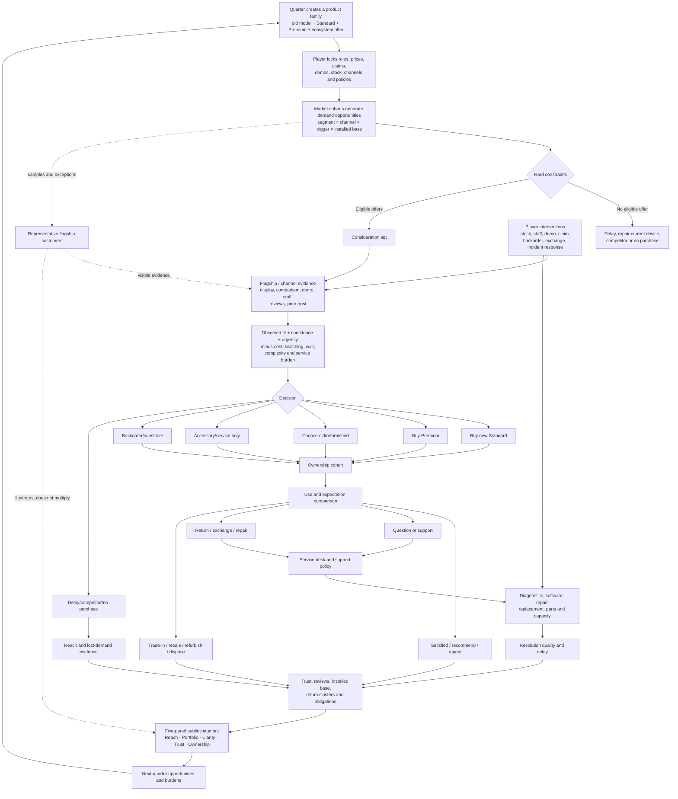

# R5 — Showroom, Customers, Market, and Public Judgment

**Project:** *Obsolescence, Inc.*  
**Date:** July 26, 2026  
**Status:** Recommended provisional canon for later R3/R4/R6/R8/R9 work  
**Requested filename:** `R5-showroom-market-and-customers.md`

---

## How to read this report

This report uses three evidence labels:

- **Observed evidence** describes a documented game system, research finding, regulation, or official requirement.
- **Interpretation** translates that evidence into implications for *Obsolescence, Inc.*
- **Design recommendation** is an original proposal. It is not presented as an empirical fact.

Inline references such as **[G04]** and **[C08]** point to the source list at the end. Project-source references **[P01–P05]** identify the supplied brief and completed R1/R2/R7/R8 reports.

---

# 1. Executive verdict

## The decision

Build the showroom and market as a **transforming flagship observatory**:

1. **The flagship is always operating**, but its ordinary job is not to generate all company sales. It is a public-facing diagnostic floor where representative customers browse the current lineup, ask questions, attend short demonstrations, collect or return devices, and expose product confusion, compatibility trouble, stock problems, and support consequences.
2. **At the end of each quarter, the same floor transforms into launch theater.** Display roles lock, the stage activates, press and invited customers arrive, inventory is allocated, selected demonstrations run, and a controlled demand surge produces the quarter’s emotional payoff.
3. **The wider market is simulated as cohorts by segment and channel.** Online buyers, partner-retail customers, carrier customers, institutions, and prior-generation owners do not all walk through the flagship. Their outcomes are calculated in aggregate from the same product, price, trust, stock, compatibility, and service rules.
4. **Visible customers are representative evidence, not tiny gods whose purchases are multiplied into global sales.** The simulation deliberately surfaces examples from important outcome groups—purchases, substitutions, delays, abandonments, support cases, and returns—so the player can watch why the market moved.
5. **The showroom can influence the wider market, but only through bounded and named effects:** direct flagship sales, demonstration credibility, press attention, launch-story formation, and learning. It does not magically determine all demand.

This model preserves the strongest thing a live store can contribute—people visibly comparing, hesitating, buying, leaving, returning, and complaining—without turning the project into a cashier, shelf-stocking, or interior-decoration tycoon.

## Canonical first-category segment set

Use **seven conflict-bearing groups**, six of which commonly appear as individual walk-in representatives and one of which usually appears as an appointment or contract actor:

1. **Value Planners** — optimize total cost and reliable basics.
2. **Mainstream Upgraders** — want a safe, low-friction default and easy transfer.
3. **Prestige and Novelty Seekers** — want visible distinction and a launch-worthy object.
4. **Capability Enthusiasts** — pursue a particular camera, performance, workflow, or accessory capability.
5. **Long-Horizon Owners** — prioritize durability, repair, battery replacement, support years, and predictable ownership.
6. **Control and Privacy Guardians** — prioritize local processing, clear permissions, data control, and verifiable claims.
7. **Institutional Operators** — procure fleets around security, management, accessibility conformance, service, parts, support dates, and supply reliability.

Accessibility, urgent replacement, budget, financing eligibility, installed accessories, and current-device condition should be **cross-cutting constraints**, not demographic identities. Any segment can have an accessibility must-have or an urgent broken-phone trigger.

## Canonical choice model

Every choice follows the same visible pipeline:

> **Trigger → hard constraints → consideration set → inspection/demo → confidence → friction → purchase, substitution, delay, competitor, accessory-only, or no purchase → later satisfaction/support/return**

The core calculation is deliberately plain:

> **Choice strength = observed fit + confidence + urgency − total burden**

But it runs only after hard must-haves have vetoed unsuitable options. “Observed fit” uses the customer’s two or three salient needs—not an all-purpose demand for every good statistic. “Confidence” comes from prior trust, demonstrable evidence, staff knowledge, and credible social proof. “Burden” includes total cost, switching and compatibility effort, waiting and stock risk, complexity, and expected service trouble. A small deterministic-seed variation may break genuine near-ties; it may not rescue a product that fails a must-have.

## Canonical launch-day payoff

Launch day should occupy roughly **seven to nine real-time minutes** inside the 25–35-minute quarter, plus a short briefing and immediate report. It should be pausable, run at 1× or 2× speed, and require no more than **four to six strategic interventions**. The player should choose among actions such as releasing reserve stock, redirecting a channel allocation, suspending a risky claim or demonstration, changing the backorder/substitution policy, redeploying trained staff, or improving the return response. The player should never click every sale, refill every shelf, or manually answer every question.

## Judgment without one score

Summarize each launch through five persistent outcomes:

1. **Reach** — which segments and channels considered, bought, delayed, or were excluded.
2. **Portfolio performance** — sell-through, margin, product mix, substitution, and stock efficiency.
3. **Lineup clarity** — whether customers understood the purpose and differences of the old, Standard, Premium, and ecosystem offers.
4. **Promise and trust** — whether claims, demonstrations, availability, compatibility, and public interpretation held together.
5. **Ownership health** — satisfaction, returns, support/repair burden, update obligations, and installed-base consequences.

There is no overall grade. A quarter can be commercially excellent and lifecycle-dangerous, clear but understocked, beloved by enthusiasts and rejected by institutions, or weak at launch but recoverable through support.

## Falsifiable prototype target

The showroom concept passes its first ugly prototype only if, after watching a three-to-five-minute simulated launch:

- at least **80% of testers can name three of the four main causal reasons** for observed customer outcomes;
- at least **80% can distinguish a bad product from poor display, wrong inventory, or temporary launch chaos** in four of five prepared scenarios;
- at least **70% can predict the direction of one stock, claim, demonstration, or placement change before a rerun**;
- at least **60% voluntarily want to rerun the launch with a different strategy**;
- no more than **25%** describe the activity as “waiting for customers,” “watching random people,” or “retail whack-a-mole”;
- and the launch remains legible with no more than four required decisions in a seven-minute prototype event.

If exaggerated visual cues plus a “why this choice?” inspector still do not let players explain behavior, the representative-agent showroom should be cut back to a **turn-based launch audience test plus cohort report**, retaining customer traces, service returns, and public narrative while dropping ordinary live-store simulation.

---

# 2. Settled inputs inherited from R1, R2, R7, and R8

The supplied R5 brief explicitly instructs this project to inherit the completed reports unless direct evidence creates a contradiction [P01]. The research found no contradiction requiring those decisions to reopen.

## R1: recurring release and cadence [P02]

- One quarter is one release cycle, targeting roughly **25–35 minutes of active play**.
- The recurring public object is a **quarterly product-lineup launch** in the flagship showroom.
- The canonical lineup contains:
  - one carried-over or retired low-end model;
  - one new Standard model;
  - one new Premium model;
  - one optional accessory, service, or ecosystem offer.
- The player directly owns high-leverage choices: lineup roles, important feature priorities, compatibility promises, launch claims, cut/slip/ship decisions, stock strategy, and discontinuation or recall policy.
- Routine purchasing, ordinary restocking, common support scripts, routine testing thresholds, and default allocation should become policy-driven or delegated.
- A bad quarter creates inherited pain and recovery opportunities rather than immediate game over.
- Recent generations remain explicit; old generations become cohorts unless an incident resurfaces them.

## R2: product grammar and first category [P03]

- The first category is a fictional **smartphone or handheld-device platform**, not a direct parody of one real manufacturer.
- A product family is **shared platform + variant promises + lifecycle obligations**.
- High-value player-visible traits include battery architecture, connector standard, display class, repair policy, software-support promise, and component sharing.
- The minimum credible family includes three differentiated variants, an accessory, a service, critical supplier choices, several tests and defects, more than one repair path, and a prior-generation installed-base cohort.
- The same product should be able to delight one customer group, confuse another, and cannibalize another model.

## R7: satire, player role, and human treatment [P04]

- The primary thesis is **institutional incentives**; lifecycle satire is the structural frame.
- Manufactured desire and ecosystem power are major secondary themes.
- The player represents the company’s continuing operating logic through an executive committee rather than a lone moustache-twirling founder.
- Customers are not the joke. Wanting affordability, attractiveness, convenience, accessibility, privacy, performance, or durability must remain understandable.
- Humor should target segmentation rituals, euphemism, incompatible promises, manufactured scarcity, metric-chasing, and the player’s own optimizing instinct.
- Consequences should arise from earlier product and policy choices and remain traceable.
- The human scale belongs in queues, body language, excitement, hesitation, frustration, service encounters, and visible residue.

## R8: technical and visual contract [P05]

- The likely presentation is accessible Angular UI around a stylized modular PixiJS building scene driven by a deterministic TypeScript simulation.
- Representative customer agents may be simulated individually in the active showroom; the wider population should use cohorts and aggregation.
- Phone play should show the showroom at a useful floor scale, not a microscopic full-building overview.
- Offscreen behavior may sleep or aggregate.
- The design must not require hundreds of unique character designs or literal simulation of every buyer and every sold device.
- R5 must specify the customer behaviors and load ranges that later spatial and technical work must support.

## Explicit assumptions added by R5

1. **One abstract market for the first campaign.** Multiple geographic regions are deferred; channel and segment differences provide enough first-version variety.
2. **The flagship is one store, not a world-market model.** Its literal sales are small; its value is observation, credibility, public narrative, service, and direct interaction.
3. **All counts in the load contract are design targets, not final balance values or renderer promises.**
4. **Customer appearance never determines needs.** Needs are generated from segment, trigger, installed-base state, and cross-cutting constraints.
5. **The simulation is deterministic under a saved seed.** Near-tie variation is repeatable and inspectable.
6. **A launch can always be paused.** Optional critical-event auto-pause is part of accessibility and fairness.
7. **The first version has reference competitors, not a full competitor-company AI.**
8. **The exact R9 remit was not supplied with this brief.** This report treats R9 as the later prototype/integration/economy-validation handoff and states requirements accordingly.

---

# 3. Comparative game-system matrix

## What the comparable set says in aggregate

**Observed evidence.** Retail and service-management games reliably make stock, queues, staffing, and layout visible. *Another Brick in the Mall*, *King of Retail 2*, *TCG Card Shop Simulator*, *Tavern Master*, and *Recipe for Disaster* all put customer throughput and product or service availability near the center [G03–G06, G10–G11]. Institution games such as *Two Point Hospital* and *Megaquarium* make individual journeys readable through queues, destinations, visual needs, talks, and staff actions [G07, G09]. Release games such as *News Tower* and *Game Dev Tycoon* create strong recurring payoffs around a finished public artifact, but their judgment tends to arrive through readership, reviews, fans, or reports rather than visibly embodied customers [G01, G12]. *Software Inc.*, *GearCity*, and smartphone-tycoon games show the strength and danger of deep market abstraction: broad product and market scope can become remote, difficult to diagnose, or stat-driven [G13, G15–G16]. *Hollywood Animal* explicitly argues that human choices and stories matter more than landscaping minutiae, a particularly useful scope principle for this project [G14].

**Interpretation.** No single comparable supplies the answer. The right system combines the readable individual journeys of a service institution, the bounded product-space decision of a recurring-release game, and the scale of a cohort market—while rejecting continuous cashier work, freeform shop construction, and one-number reviews.

| Comparable | Representation of customers/audience/market | What makes types or states readable | Choices that visibly matter | How judgment arrives and whether causality is clear | Failure mode or content burden | R5 lesson and phone translation |
|---|---|---|---|---|---|---|
| **News Tower** [G01–G02] | Readership is mostly aggregate; staff are individual; the newspaper is a weekly public object | Article topics, factions, reader districts, Sunday deadline, finite page space | Story selection, editorial direction, ads, staffing, workflow | Strong weekly payoff; causes are tied to what made the paper, though readers are not physically present | Weekly formula can become icon matching if audience logic is too mechanical | Preserve the hard public deadline and painful omission; make customers physically show what readership cannot |
| **TCG Card Shop Simulator** [G03] | Individual shoppers and players in a literal store | Shelf visits, checkout, game tables, cleanliness and stock | Product assortment, prices, ordering, shelf arrangement, events | Immediate sales and departures are readable | Easily becomes restock/cashier labor; customer reasons are shallow | Borrow visible browse/stock/leave behavior, automate handling and never make checkout the core |
| **Another Brick in the Mall** [G04] | Large numbers of individually moving shoppers in a mall | Paths, queues, shelf availability, cleanliness, satisfaction | Layout, staffing, shelf stock, opening hours | Congestion and stock failures are visible; personal motives are less distinctive | Generic throughput agents; large-scale layout optimization dominates | Use queue and abandonment body language, but cap crowd size and surface motive-specific traces |
| **Big Ambitions** [G05] | Individual customers inside businesses plus broader business metrics; player directly controls a character | Store capacity, queues, stock, popularity, daily routines | Site, capacity, product availability, staffing, logistics | Business metrics are clear but customer choice is mainly demand/capacity | Broad life-sim chores and direct-character logistics dilute product authorship | Reject direct character and daily errands; retain named capacity and stock limits as policies |
| **King of Retail 2** [G06] | Detailed individual customers and employees with preferences/habits | Product mix, nearby customer types, staff, flow, shelves | Floor plan, product selection, shelf stock, staff roster, design | Immediate sales and store appeal; many levers are visible | Wall/floor/style and freeform store building risk becoming dominant multiplier work | Treat its breadth as the boundary not to cross; use fixed functional showroom slots |
| **Two Point Hospital** [G07] | Individual patients move through diagnosis/treatment queues | Illness visuals, destinations, needs, queue length, staff skill | Room capacity, corridors, staffing, training, prices | Patient routes expose bottlenecks; statistics diagnose system-wide issues | Facility optimization can bury the individual, and décor can become a numeric buff | Borrow readable journey states, queue inspection, and “follow this person”; make décor mostly cosmetic |
| **Project Highrise** [G08] | Individual tenants/visitors exist within a building-wide demand and satisfaction model | Tenant category, needs, elevator/service access, complaints | Tenant mix, services, vertical circulation, placement | Building consequences are legible but choice is mainly lease/need satisfaction | Vertical transport and adjacency can dominate all other strategy | R3 must preserve access and sightlines without turning showroom success into elevator math |
| **Megaquarium** [G09] | Hundreds of guests and staff; exhibits and talks shape visits | Exhibit destinations, guest needs, scheduled talks, staff skills | Exhibit mix, layout, talks, amenities, staffing | Guests visibly move and react; broader objectives summarize outcomes | Facility and attraction placement can eclipse subject-matter strategy | Strong model for short demos and representative flows; use station anchors rather than freeform maze design |
| **Tavern Master** [G10] | Individual guests in a service venue | Seats, order/serve flow, staff movement | Capacity, drinks, seating, staff | Empty seats, queues, and service delays are immediately clear | Customers become interchangeable demand packets | Use only its clean capacity language; every R5 exemplar must carry a reason for its choice |
| **Recipe for Disaster** [G11] | Individual diners with demands and staff/recipe interactions | Menu preferences, orders, wait states, incidents | Menu, ingredients, recipes, dining layout, staffing | Failures visibly propagate from kitchen to guest | High operational drama can become constant reactive triage | Borrow structured preference plus visible service failure; cap showroom emergencies and automate routine cases |
| **Game Dev Tycoon** [G12] | Audience and market are aggregate | Genre/topic/platform fit, fans, reviews, post-release reports | Product focus, features, staffing, release timing | Fast “ship, review, learn” loop; reports reveal relationships | Star scores can feel opaque and collapse a product into one verdict | Keep the report-as-learning device, remove universal review score, and show causes before report time |
| **Software Inc.** [G13] | Deep aggregate market and competitors; individual employees | Product categories, features, release/support/marketing, team roles | Design, development, release, updates, support, marketing, delegation | Broadly causal but often remote from the physical world | High learning burden, numerous menus, long production chains | Use cohort depth and delegation principles but keep market state to a few inspectable channels and segments |
| **Hollywood Animal** [G14] | Audience and distribution are aggregate; workers and counterparties carry individual stories | Film themes, distribution, contracts, human conflicts, consequences | Creative package, talent, timing, distribution, compromises | Choices produce identifiable stories rather than décor multipliers | Content-writing burden is high; complexity can sprawl | Adopt its priority: choices and human consequences matter more than bushes, wall textures, or shop furniture |
| **GearCity** [G15] | Large global aggregate market across models, cities, factories, dealers, competitors | Detailed specifications, regions, prices, production and distribution | Vehicle design, price, production, marketing, regional allocation | Powerful but demanding; causality requires extensive reports and expertise | Extreme learning curve and spreadsheet distance | Use as a hard warning: do not model every region, dealer, trim, or market equation in the first campaign |
| **Smartphone Tycoon** [G16] | Product success and market are mostly abstract | Technology/spec selection and broad popularity | Device design, price, production | Simple product-to-success loop | Risks “choose strongest parts, receive fans” and weak customer explanation | R5 exists specifically to avoid this: no stat soup, no universal audience, no isolated review score |

## Comparative conclusion

The useful pattern is not “simulate a shop.” It is:

> **Give a small number of people visible missions and paths; let their actions expose a product-line decision; use aggregate systems for scale; and resolve each quarter around a finite public event.**

The showroom should therefore contain enough literal retail behavior to make price, stock, staff knowledge, compatibility, and service visible—but not enough routine retail labor to become the genre.

---

# 4. Useful consumer-choice, assortment, retail, and service evidence

## Evidence boundaries

Real consumer behavior is heterogeneous, context-sensitive, and difficult to reduce to one utility equation. This report uses research only to establish robust design ingredients and important cautions. It does **not** claim that one laboratory effect universally predicts smartphone buying, and it does not recommend hidden manipulation of real consumers.

| Evidence area | Observed evidence | Design translation | Simplification and caution |
|---|---|---|---|
| **Choice overload and assortment** | A famous set of studies found that extensive options can reduce motivation or satisfaction, but a later meta-analysis of 50 experiments found an average effect near zero with large variation and no universal sufficient condition [C01–C02]. | Confusion should arise from unclear roles, difficult comparisons, missing bridges, and preference uncertainty—not from a magic “more than three products” penalty. | The game may use four visible offers because R1 already defines them. A fifth option is not automatically harmful; incoherence is. |
| **Context, compromise, and decoy effects** | Choice shares can change when a dominated option is introduced, and compromise alternatives can become easier to justify under uncertainty [C03–C04]. | Customers evaluate products relative to the lineup. A clear Standard can become a defensible compromise; an old model can make a new Standard look weak or a Premium look excessive. | Do not hardcode “middle always wins.” Effects depend on needs, evidence, and context. Show comparison trails so the player can see the changed frame. |
| **Evaluability and salience** | Research on joint versus separate evaluation shows that attributes can be valued differently depending on whether they are easy to compare [C05]. | A demo, repair label, side-by-side sign, or staff explanation can make brightness, support years, connector differences, or battery replacement salient. Engineering quality and perceived quality must be separate states. | A product is not “bad” merely because shoppers cannot see its advantage. Poor presentation should be a distinct diagnosis. |
| **Price as cost and signal** | A meta-analysis found positive relationships between price/brand cues and perceived quality, with important variation by design and manipulation [C06]. | Premium price can create prestige and quality expectations while also increasing burden. Old-model discounts can create strong value and cannibalization. | Never make price a pure quality buff. Experienced or informed segments should rely more heavily on demonstrated evidence. |
| **Switching and ecosystem friction** | Economic work distinguishes learning, transaction, and firm-created switching costs [C07]. | Data transfer, accessory replacement, account migration, connector changes, app compatibility, and retraining become explicit frictions. | “Brand loyalty” should not be an unexplained percentage. The inspector must say what the customer would have to replace, learn, or risk. |
| **Stockouts** | Retail research models several possible responses to an unavailable item, including substitution, delay, switching location or brand, and abandoning the purchase [C08]. | When a model is unavailable, agents visibly choose among a substitute, backorder, channel switch, competitor, or no purchase based on urgency and substitutability. | Do not use one flat lost-sale multiplier. A Capability Enthusiast may wait; an urgent Mainstream buyer may substitute or leave. |
| **Hands-on trial and demonstration** | Touch and demonstration research supports the idea that direct or vividly diagnostic experience can reduce uncertainty for attributes that are difficult to evaluate remotely [C09]. | Demos should reveal a specific capability or failure mode and increase evidence/confidence for relevant segments. | A demo is not a universal conversion aura. It affects only attributes it actually demonstrates, and it may expose heat, complexity, cloud dependence, or incompatibility. |
| **Staff knowledge and interaction** | Retail studies consistently treat product knowledge, responsiveness, and interaction quality as consequential service attributes, though effects vary by setting [C10]. | Trained staff reduce uncertainty, explain compatibility and support, and rescue some near-ties. They cannot make a product pass a hard requirement or invent stock. | Staff should not be sales-magic units. Their visible contribution is explanation, routing, and honest resolution. |
| **Bundles** | Bundling research distinguishes product and price bundles and emphasizes that different structures work in different contexts [C11]. | A bundle can reduce setup friction, create an ecosystem commitment, or make total cost harder to understand. The game should show its components and total price. | One bundle at a time is enough for the first slice. Do not build a combinatorial coupon optimizer. |
| **Reviews and word of mouth** | Empirical work on online reviews found relationships between review changes and relative sales, with negative information particularly consequential in the studied context [C12]. | Owner outcomes should feed later demand and confidence. Review comments are structured evidence from real satisfaction, defects, compatibility, support, and claim accuracy. | No universal star score. Different segments and outlets should disagree for traceable reasons. |
| **Waiting and service queues** | Service research finds that duration, perceived control and responsibility, information, and uncertainty shape reactions to delays [C13–C14]. | Queue length matters, but honest wait estimates, progress information, filled time, and clear responsibility can mitigate anger. | Good communication cannot erase an excessive delay or missing repair part. It changes trust and abandonment, not physics. |
| **Returns** | Returns are part of the exchange process rather than simply a supply-chain evil; return-policy leniency can affect both purchase and return behavior [C15–C16]. | A generous policy can increase purchase confidence while raising service load. Return reasons become diagnostic evidence about product defects, lineup misunderstanding, compatibility, claims, and buyer’s remorse. | Do not punish every return equally. A fast exchange can preserve trust; a clustered defect return is a different problem from a changed mind. |
| **Repairability and support** | EU smartphone rules applying from June 20, 2025 make durability, battery performance, spare-part availability, operating-system support, and repairability more visible; the FTC has documented repair restrictions as a consumer-policy concern [R01–R02]. | Repair score, support end date, battery replacement, parts lead time, and repair policy can be customer-facing purchase evidence and later ownership burdens. | Regulations vary by era and market. The game should use fictionalized standards and clearly named obligations rather than simulate current law line by line. |
| **Financing and subscriptions** | CFPB analysis describes both benefits and risks of buy-now-pay-later products, including data use and overextension; the FTC documents dark patterns such as buried fees and difficult cancellation [R03–R04]. | Financing must show monthly and total cost. Service subscriptions must show included benefits, renewal, and cancellation. Aggressive tactics may create visible trust/regulatory debt, not hidden optimal multipliers. | The first version needs one transparent installment policy and one service offer, not a credit-underwriting simulator. |
| **Institutional procurement** | NIST treats deployment, centralized management, use, and disposal as a mobile-device lifecycle; federal accessibility rules affect ICT procurement; Android Enterprise requirements make update end dates and frequency explicit [R05–R07]. | Institutional buyers use a gated checklist: management, security updates, published support dates, accessibility conformance, stock continuity, repair/replacement, and total cost. | Institutions are not simply “very large consumers.” Their purchase is a contract/pilot decision with hard gates and delayed volume. |

## Key design implications

### 1. The game should model **comparison difficulty**, not generic irrationality

A coherent lineup lets a customer state a reason: “The Standard has the support I need without the Premium price.” A confusing lineup creates repeated loops, staff questions, hesitation, and abandonment because the reason is hard to form. That is both more respectful and more legible than an invisible choice-overload debuff.

### 2. Perception and reality must be separate but connected

The product has actual traits. Customers observe only traits made available through prior reputation, claims, labels, demos, staff, ownership experience, or third-party evidence. Marketing can increase notice; it cannot permanently rewrite reality. The gap between promise and observed ownership is where delayed trust, return, and support consequences emerge.

### 3. A customer’s stated preference is not the final choice

The game should not spawn a bubble saying “I want battery” and then execute that command. The customer may trade some battery for lower cost, discover a connector problem, react to stock, or delay because the support promise is uncertain. The inspector should distinguish **initial mission**, **new evidence**, **hard veto**, and **final deciding reason**.

### 4. Frontline staff should reveal product strategy

A good employee cannot repair a bad lineup, but staff questions reveal what the product line asks people to explain. If the Standard and Premium are indistinguishable, staff become occupied with repetitive differentiation questions. If the accessory compatibility is unclear, the wall and service desk become bottlenecks. Training is therefore a way to allocate explanation capacity—not a generic sales percentage.

### 5. Service is part of launch judgment

The launch is not complete when the last keynote slide ends. Returns, setup failures, missing features, parts shortages, and repair waits are public evidence about what the company actually sold. That evidence must flow back into the building and the next quarter.

---

# 5. Four candidate showroom/market models

## Scoring method

Each model is scored from 1 (poor) to 5 (excellent) against the brief’s decision criteria. The weighted total is a design judgment informed by the comparable and consumer evidence, not an empirical measurement.

Weights:

- connection to quarterly loop — 20%
- visual payoff — 15%
- meaningful player decisions — 15%
- communicates customer choice — 15%
- avoids retail micromanagement — 10%
- ordinary-week usefulness — 10%
- post-launch returns/service — 5%
- phone readability — 5%
- manageable content/character burden — 5%

| Model | Quarterly loop | Visual payoff | Decisions | Choice legibility | Avoids retail micro | Ordinary use | Returns/service | Phone | Content burden | Weighted total |
|---|---:|---:|---:|---:|---:|---:|---:|---:|---:|---:|
| A. Always-live literal store | 3 | 4 | 4 | 3 | 1 | 5 | 4 | 2 | 2 | **3.20 / 5** |
| B. Launch-day event vignette | 5 | 4 | 3 | 3 | 5 | 1 | 2 | 4 | 4 | **3.55 / 5** |
| C. Representative-agent showroom + aggregate cohorts | 4 | 4 | 4 | 5 | 4 | 4 | 4 | 4 | 4 | **4.15 / 5** |
| D. Transforming flagship observatory | 5 | 5 | 5 | 5 | 4 | 5 | 5 | 4 | 3 | **4.70 / 5** |

## Model A — Always-live literal store

**Description.** Every visible customer is a literal store visitor. Sales occur continuously. The player sets shelves, prices, staffing, stock, queues, cleaning, restocking, and service. Market performance is the sum of store transactions plus perhaps abstract branches.

**Strengths.** It is alive in ordinary weeks, gives immediate feedback, naturally supports returns, and makes stock and queues obvious. The genre is well proven [G03–G06].

**Weaknesses.** The showroom becomes a retail business in its own right. Continuous restocking, staffing, checkout, décor, and pathing compete with product design for attention. A flagship’s literal foot traffic cannot credibly stand for a consumer-electronics company’s whole market. On phone, the number of small tasks and moving targets becomes burdensome.

**Verdict.** Reject as the canonical model. Borrow its visual vocabulary, not its job description.

## Model B — Discrete launch-day event vignette

**Description.** The showroom is mostly dormant or decorative. Once per quarter it activates for a scripted or lightly simulated event in which a limited set of customers and press react to the new lineup.

**Strengths.** Strong deadline connection, low ordinary-week micromanagement, manageable art burden, and excellent mobile focus. It is easy to make each event feel authored.

**Weaknesses.** The building loses an important living public floor for most of the quarter. Returns, repairs, and old-model ownership have nowhere to appear naturally. Repeated launch vignettes risk feeling like a judgment cutscene rather than an operating system. Scripted reactions can feel preordained.

**Verdict.** Good fallback if live behavior fails prototyping; too thin as the first recommendation.

## Model C — Representative-agent showroom plus aggregate market cohorts

**Description.** The wider market is simulated in cohorts. A subset of agents appears in the showroom to illustrate cohort decisions and direct flagship traffic. The showroom is active at all times but not heavily transformed.

**Strengths.** Honest scale, strong causality, manageable agent counts, clear segment inspection, and good support for installed-base cohorts. It directly matches R8’s architecture constraint.

**Weaknesses.** Without a dramatic state change, launch day may feel like “more customers than usual.” The flagship can become a neutral dashboard with animated examples rather than the quarter’s theatrical payoff.

**Verdict.** This is the correct simulation foundation, but it needs a stronger temporal and visual structure.

## Model D — Transforming flagship observatory

**Description.** Model C plus four named showroom states—ordinary operation, launch preparation, launch theater, and post-launch evidence. The floor’s functional slots change priority and presentation at the quarter boundary. The same rules govern all states, but customer mix, press presence, inventory pressure, demonstrations, and available decisions intensify.

**Strengths.** It connects daily evidence to quarterly payoff; lets the player see old models, service, and returns all quarter; supports a memorable launch without a cutscene; makes a small number of display and demonstration slots feel scarce; and remains honest about market scale.

**Weaknesses.** It requires more state art and animation than Model C, a careful representative-sampling system, and strong UI language so players understand that visible traffic is evidence rather than total demand.

**Verdict.** **Recommend.** The extra complexity directly serves the game’s core thesis and public/private building contrast rather than adding generic retail depth.

---

# 6. Recommended canonical showroom and market model

## Plain-language definition

The showroom is where the company’s product strategy becomes human behavior. It has three simultaneous jobs:

1. **Direct public operation:** a small amount of literal sales, pickup, setup, service, returns, and demonstrations.
2. **Representative observation:** selected customer journeys make wider segment and channel outcomes visible.
3. **Public narrative production:** demonstrations, press access, availability, incidents, and claim accuracy influence how the launch is framed beyond the room.

The broader market is not “the showroom multiplied.” It consists of segment-by-channel cohorts with their own demand, installed-base, trust, stock, and ownership states.

## Market architecture

### Cohort unit

The normal unit is:

> **segment × channel × relevant generation/installed-base state**

Examples:

- Mainstream Upgraders × online direct × eligible to upgrade from Generation 2;
- Long-Horizon Owners × partner retail × current device still healthy;
- Capability Enthusiasts × flagship/direct × urgent camera upgrade;
- Institutional Operators × contract channel × pilot-qualified;
- prior-generation owners × support state × battery-failure risk.

Not every theoretical combination needs a live record. Create cohorts only when they are material to the current campaign state.

### What the cohort simulation owns

- cohort size or demand opportunity;
- trigger rate: broken device, contract refresh, upgrade desire, feature need, price event;
- channel access and stock;
- awareness and consideration;
- distribution of hard constraints and budgets;
- expected choice outcomes and uncertainty;
- satisfaction, reviews, support, returns, repair, trade-in, and installed-base evolution;
- prior trust and known incidents;
- competitor/reference-offer pressure.

### What an individual representative owns

- one concrete trigger and current-device state;
- budget and time urgency;
- two or three salient needs;
- hard must-haves and tradeable preferences;
- observed evidence collected in this journey;
- route through displays, demos, staff, checkout/backorder, and service;
- visible actions and body-language states;
- final choice and reason trace;
- if retained, one later ownership, support, or return follow-up.

### How representative agents are selected

Do not take the first random twelve people from the market and imply they are statistically sufficient. Use a **representative evidence scheduler**:

1. The cohort simulation determines material outcome groups for the current moment.
2. The scheduler selects examples across those groups—strong purchase, substitution, delay, abandonment, confusion, support, and exceptional cases.
3. Selection is weighted toward outcomes the player can act on or has not yet seen, while the UI labels whether an agent is common, emerging, or exceptional.
4. The cohort inspector can say, for example, “This journey resembles 18 recent Mainstream cases” without claiming the one animation literally caused those sales.
5. Exceptional viral or defect cases are explicitly marked as exceptions, not silently presented as the norm.

### How the flagship affects the market

The flagship creates only four named effects:

- **Direct sales:** literal transactions and reservations in the building.
- **Evidence:** what customers, staff, press, and reviewers can directly observe.
- **Attention:** the launch stage and hero display alter which claims or models enter consideration.
- **Learning:** repeated questions, comparison loops, abandonment reasons, and service clusters reveal information to the player and may improve staff scripts or future product briefs.

A press demonstration can increase attention to a real feature. It cannot manufacture long-term satisfaction. A beautiful launch can boost initial confidence. It cannot suppress a later defect indefinitely. A poorly explained excellent feature may underperform until evidence improves.

## Why this is not a generic store tycoon

The player does **not**:

- place every shelf or chair;
- operate checkout;
- order daily consumables;
- click to restock each display;
- clean the floor;
- schedule every shift;
- chase individual shoplifters;
- set minute-by-minute prices;
- build an arbitrary retail maze;
- or optimize wall materials for conversion bonuses.

The player **does**:

- assign scarce functional slots;
- choose the hero product and comparison story;
- decide whether and where the old model remains visible;
- choose two or three prime demonstration promises;
- train staff on the difficult questions created by the lineup;
- allocate scarce launch inventory and protected reserves;
- lock pricing, bundles, financing, and channel terms;
- choose claims and respond when reality challenges them;
- set returns, exchange, repair, and goodwill policy;
- and decide which early signal deserves intervention.

That difference is the genre boundary.


---

# 7. Showroom states across an ordinary quarter and launch day

The showroom should have four canonical operating states. These are changes in purpose and intensity, not four separate minigames.

| State | Approximate place in a 25–35 minute quarter | Showroom job | Typical visible traffic | Player decisions | What should be automated |
|---|---:|---|---|---|---|
| **A. Ownership evidence** | First 3–5 minutes after the previous launch; continues in background | Show returns, setup questions, first repairs, satisfaction, reviews, and stock residue from the last lineup | Owners, service cases, exchange customers, old-model shoppers, staff debrief | Set incident response, exchange/goodwill stance, replacement-stock priority, whether a signal merits escalation | Routine triage, common answers, normal refunds within policy, ordinary repair routing |
| **B. Ordinary flagship** | Middle 12–18 minutes while the next lineup is developed | Keep current products public; reveal installed-base needs, competitor pressure, old-model value, recurring confusion, and service burden | Moderate browse traffic, scheduled demos, pickup, partner visits, service/returns | Change one comparison priority, training focus, old-model prominence, discount band, or evidence-gathering question | Shifts, restocking, standard demonstration cadence, routine queue balancing |
| **C. Launch preparation** | Final 4–6 minutes before lineup lock/doors | Convert product strategy into a public plan; rehearse demos; brief staff; allocate inventory; finalize claims | Staff, reviewers under embargo, invited testers, delivery teams, a few preview customers | Hero product, table roles, comparison language, two or three demo priorities, claims, staff training, channel/reserve allocation, backorder policy | Physical transformation, signage installation, ordinary stock movement, invitation handling |
| **D. Launch theater** | Roughly 7–9 real-time minutes | Deliver the quarter’s public payoff; reveal demand, confusion, stock, claims, press framing, and first service signals | Press, invited customers, general visitors, staff, institutional appointment, launch crowd | Four to six bounded interventions: stock, claim/demo, staff, backorder/substitution, goodwill, channel allocation | Every transaction, ordinary questions, routine replenishment, camera choreography, comment aggregation |

## State A — Ownership evidence

The next quarter should open with residue, not a blank slate. A successful launch may leave pickup lines, setup requests, accessory demand, trade-ins, and positive owner demonstrations. A troubled launch may leave returns, confused customers clutching mismatched accessories, replacement-stock demand, and a repair intake queue. The service desk is therefore the bridge between quarters.

The player should receive no instant omniscient diagnosis. Early cases are tagged **isolated**, **repeating**, or **clustered** as evidence accumulates. The player may:

- monitor;
- publish clarification;
- improve a staff script;
- reserve exchange stock;
- open a diagnostic investigation;
- pause a claim;
- offer a goodwill remedy;
- or escalate toward a recall.

Those choices should affect trust, cost, queues, and evidence quality. “Wait for more data” is sometimes sensible and sometimes dangerous.

## State B — Ordinary flagship

The ordinary showroom has four ongoing functions:

1. **Current-lineup storefront.** It performs a modest amount of direct sales and pickup, enough for stock and price to remain visible.
2. **Installed-base listening post.** Existing owners ask about support, accessories, battery replacement, trade-ins, and compatibility.
3. **Demonstration lab.** Short scheduled demonstrations reveal what customers understand and which promises are credible.
4. **Service face.** Setup, returns, exchanges, and repair intake keep lifecycle consequences on the public floor.

Ordinary traffic should not demand constant attention. The player sees trend markers such as “Premium differentiation questions rising” or “old-model value comparisons repeating.” A notification should surface only when a pattern crosses a threshold, conflicts with a policy, or creates an actionable exception.

## State C — Launch preparation

The transformation should be visually satisfying but mostly preset. Staff roll out the stage, lighting, crowd barriers, demo props, press positions, and launch signage. Product tables stay in fixed functional anchors so R3 does not need a freeform planogram editor.

The player locks a **launch brief**:

- hero product;
- one-sentence role for each offer;
- old-model visibility and price;
- two or three prime demos;
- one comparison sign or bridge;
- staff knowledge priorities;
- flagship, online, partner, institutional, service-replacement, press, and demo stock allocations;
- approved claims;
- bundle and financing presentation;
- backorder/substitution policy;
- and the threshold for pausing a demo or claim.

A rehearsal should expose known risk without guaranteeing the live outcome. The local-AI demo may succeed in a quiet test but still be vulnerable to heat under repeated use; a repairability demo may be accurate but too slow for a keynote slot; a connector demonstration may reveal that the old model needs an adapter. Rehearsal gives the player a chance to change the public plan, not a binary readiness score.

## State D — Launch theater

The floor should feel different through:

- denser but capped crowd animation;
- press cameras and reviewer stations;
- stage lighting and a timed demonstration board;
- inventory movement from the dock/pickup area;
- visible reservation, stockout, and backorder states;
- segment and channel waves;
- and a live public-narrative strip showing evidence-backed story candidates.

The player remains an executive operator, not an event usher. They decide whether to protect the story, protect customers, protect margin, or protect future obligations when those goals diverge.

## Transition back to ordinary operation

At event end:

1. crowd intensity falls;
2. the immediate launch report appears;
3. unresolved reservations and stockouts become ordinary queues;
4. press narratives remain provisional;
5. service and return signals begin;
6. the stage retracts or becomes a smaller scheduled-demo space;
7. and the next quarter starts with the ownership evidence the player created.

There should be no “launch score, fade to black, products disappear” transition.

---

# 8. Final customer-segment model

## Segment-design rules

A useful segment must:

- have one dominant reason to care;
- have one or two supporting needs;
- willingly trade away something another segment values;
- recognize evidence differently;
- create at least one lineup conflict;
- produce a visible action, not just a hidden weight;
- and remain separable from age, gender, race, disability, income, or clothing stereotypes.

Each representative customer also receives a **trigger**, **budget**, **urgency**, **current-device state**, **installed accessories/services**, and zero or more **cross-cutting must-haves**. This prevents all members of a segment from behaving identically.

## Segment matrix A — needs, trust, hesitation, demonstrations, and visible behavior

| Segment | Primary need | Secondary needs | Will trade away | Trust builders | Hesitation/rejection | What it notices in a demo | Non-caricature visual behavior | Likely channels |
|---|---|---|---|---|---|---|---|---|
| **Value Planners** | Dependable function at a defensible total cost | Battery endurance; predictable service cost | Prestige, newest design, peak camera/performance | Transparent full price, support horizon, old-model comparison, honest financing total | Surprise fees, required accessory replacement, short support, weak warranty, expensive repair | Battery/charging, durability, basic camera, cost of completing setup | Reads total-cost card; moves between old and Standard; opens financing details; counts required accessories | Partner retail, online direct, flagship during promotions |
| **Mainstream Upgraders** | A safe default with low switching and setup friction | Familiarity; dependable battery/camera; clear support | Extreme performance, specialist control, repair idealism | Easy transfer demo, clear “who this is for,” trained staff, broad availability | Confusing tiers, incompatible accessories, uncertain transfer, stock delay during urgent replacement | Transfer/setup, everyday camera, accessibility setup, reliable daily workflow | Starts at Standard; asks one practical question; follows staff comparison; checks pickup time | All consumer channels; especially partner/carrier and online direct |
| **Prestige and Novelty Seekers** | Visible distinction and a device that feels meaningfully new | Finish/design; camera or signature feature; immediate availability | Price efficiency, repair ease, mature stability | Hero treatment, compelling live feature, social proof, limited-but-credible availability | Premium looks like Standard, launch feature absent, public demo failure, ordinary design | Signature camera/AI/display moment, finish, performance spectacle | Approaches hero first; records or shares demo; inspects finish; watches stock counter | Flagship, online launch, premium partner retail |
| **Capability Enthusiasts** | A particular advanced workflow or measurable capability | Accessory compatibility; performance; control | Simplicity, low price, thinness if capability requires bulk | Detailed proof, repeatable demo, technical staff, transparent limits | Missing port/mode, throttling, unstable feature, vague claim, locked accessory | Camera workflow, external display, sustained performance, local processing, accessory chain | Repeats demo; plugs in accessory; compares output; asks edge-case question | Flagship, specialist online/direct, selected retail |
| **Long-Horizon Owners** | A device that remains useful, supported, and repairable | Battery replacement; parts; durable connector/accessories | Thinness, rapid novelty, some peak performance | Published support end date, repair/parts evidence, replaceable battery path, honest trade-in/refurb | Sealed design, short support, serialized parts, uncertain spares, forced accessory churn | Repairability, drop/durability, battery replacement, support label | Scans lifecycle label; visits old model; asks service desk before purchase; compares repair time | Flagship, direct, repair-conscious retail, refurbished channel |
| **Control and Privacy Guardians** | Verifiable control over data, permissions, accounts, and local/cloud behavior | Long support; open or universal compatibility | Seamless cloud convenience, personalization, some novelty | Data-flow evidence, local-mode demo, clear opt-outs, security update promise, technically honest staff | “Local” claim with hidden cloud step, forced account, opaque telemetry, proprietary lock-in | Local processing, permission controls, offline mode, security-management screen | Opens privacy panel; interrupts scripted demo with data question; asks for written claim | Direct, flagship, specialist online; some institutions overlap |
| **Institutional Operators** | Deployable, supportable fleet with predictable lifecycle risk | Security/management, accessibility conformance, supply, replacement and repair | Launch novelty, fashion, consumer-only features | Published update dates, management compatibility, documentation, pilot results, service-level terms | Unclear support, inconsistent stock, inaccessible workflow, consumer account dependency, unmanaged repair | Provisioning, accessibility, security controls, fleet setup, battery/service replacement | Arrives by appointment with checklist; requests pilot units; observes staff/service process | Institutional contract/pilot; occasionally flagship appointment |

## Segment matrix B — offer responses, service risks, and conflicts

| Segment | Carried-over/low-end response | New Standard response | New Premium response | Accessory/service response | Return or support risk | Principal conflict created |
|---|---|---|---|---|---|---|
| **Value Planners** | Strong if price, support remainder, and accessory cost remain sensible | Strong if total cost and support justify step-up | Weak unless financing or longevity clearly changes value | Buys only when it replaces a real need; suspicious of recurring fees | Bill shock, hidden accessory need, repair cost, financing regret | A durable discounted old model can cannibalize Standard and slow forced refresh |
| **Mainstream Upgraders** | Acceptable for urgent replacement if transfer/support remain easy | Intended default; wins when role is obvious | Upgrades only for an easily explained everyday benefit | Convenience bundle can work; service plan works if simple | Setup/transfer failure, tier confusion, stock substitution regret | Demands simplicity that can conflict with enthusiast configurability and complex segmentation |
| **Prestige and Novelty Seekers** | Usually rejects as insufficiently new | May accept if Premium unavailable but feels like compromise | Intended target when Premium has visible reason to exist | High attach potential if accessory reinforces distinction | Buyer’s remorse after hype, missing launch feature, visible defect, scarcity frustration | Pushes launch spectacle and frequent novelty against longevity and claim discipline |
| **Capability Enthusiasts** | Chooses only if old device uniquely retains a port or feature | Buys if it meets the must-have without artificial restriction | Buys when Premium contains real capability, not cosmetic segmentation | High attach when accessory completes workflow; rejects forced bundle | Edge-case defects, heat/throttling, missing mode, compatibility | Wants expensive capability and openness that may undermine simple tier boundaries |
| **Long-Horizon Owners** | Often attracted by known reliability, replaceable parts, and low price; support remainder can veto | Strong if support/repair are clear | Rejects sealed or fragile Premium even if otherwise superior | Values repair, battery, case, adapter, and protection—not recurring fluff | Parts delay, repair denial, update sunset, battery degradation | Durable old products and generous support deliberately cannibalize new launches |
| **Control and Privacy Guardians** | May prefer older mature behavior if still patched | Strong when local controls and support are credible | Buys Premium only if added capability does not add opaque cloud dependency | Rejects account-tied service; may buy local storage/security accessory | Claim discrepancy, forced login, telemetry, cloud outage | Conflicts with data monetization, seamless defaults, and cloud-dependent marquee features |
| **Institutional Operators** | Useful only as cheap replacement if support window and management remain valid | Usually best fleet candidate | Niche executive/specialist allocation, rarely fleet default | Values provisioning, management, warranty, spares, and service terms | Deployment failure, update slippage, inaccessible setup, parts/stock shortage | Demands long commitments and stable inventory that constrain consumer launch cadence |

## Why retain seven groups

R2’s original seven are not redundant once each receives a real tradeoff. The main consolidation is conceptual:

- “Power User” becomes **Capability Enthusiast**, defined by a particular must-have rather than generalized stat hunger.
- “Status Buyer” becomes **Prestige and Novelty Seeker**, emphasizing visible novelty without mocking aspiration.
- “Longevity Pragmatist” becomes **Long-Horizon Owner**, avoiding a moralized “good consumer” label.
- “Privacy Guardian” becomes **Control and Privacy Guardian**, because account, connector, cloud, and permission control are mechanically linked.

Six consumer groups are enough to make the flagship varied, while the seventh institutional group uses a different appointment and contract pattern. Removing either Long-Horizon or Control/Privacy would make repair/support or cloud/ecosystem choices less visible. Combining Value and Mainstream would erase the important distinction between lowest defensible total cost and lowest-friction default.

## Accessibility and other cross-cutting needs

Accessibility should appear as a hard or high-priority constraint on any journey:

- screen-reader and magnification support;
- hearing-device or caption compatibility;
- motor-control options;
- contrast and display visibility;
- physical reach/grip needs;
- cognitive simplicity and setup clarity;
- documented institutional conformance.

The visible action is testing the relevant accessibility feature, not dressing a sprite to “look disabled.” A failure should be described as a product or process failure, not a customer limitation.

---

# 9. Individual agents, representative behavior, and market cohorts

## The hybrid in one sentence

**Cohorts determine scale; agents reveal causes; the flagship adds bounded public evidence and attention.**

## Individual state machine

A representative customer moves through a readable state sequence:

1. **Arriving** — has a trigger and an initial target or open question.
2. **Orienting** — notices the hero, a familiar product, a price, or a staff greeting.
3. **Considering** — forms a set of one to three company options plus competitor/no-purchase.
4. **Inspecting** — reads comparison evidence, handles a product, or checks a lifecycle label.
5. **Demonstrating** — optionally watches or performs a relevant test.
6. **Questioning** — seeks staff help if uncertainty or compatibility exceeds tolerance.
7. **Committing** — purchases, reserves, signs a pilot, or chooses accessory/service only.
8. **Deferring** — backorders, waits for a feature, or decides to research.
9. **Exiting** — chooses competitor or no purchase with a visible reason.
10. **Owning** — later becomes satisfied, recommends, seeks support, returns, repairs, trades in, or keeps the device.

Not every customer visits every station. A Value Planner may move old model → total-cost card → Standard → staff → old-model purchase. A Prestige Seeker may move hero → stage demo → Premium → checkout. A Control Guardian may move Standard → privacy demo → written claim → delay.

## Visible behavior vocabulary

At ordinary scale, the player should recognize state without text over every head:

- confident direct walk;
- table-to-table comparison line;
- repeated backtrack;
- price-card inspection;
- accessory plug-in or compatibility check;
- demo queue and active participation;
- staff question;
- phone/clipboard checklist;
- satisfied purchase bag or pickup handoff;
- backorder confirmation;
- frustrated exit;
- service ticket, return box, repair handoff, or exchange device.

Hover, selection, or the bottom sheet reveals the full reason trace. A segment overlay may tint paths or station demand only when requested; it should not permanently label people.

## How the game avoids statistical absurdity

### 1. Label the floor honestly

The showroom dashboard should distinguish:

- **Flagship transactions** — literal sales, reservations, pickups, returns;
- **Representative journeys** — selected examples of wider patterns;
- **Market outcomes** — aggregate segment/channel results.

### 2. Show prevalence and evidence class

Each selected journey carries one of three unobtrusive tags in its inspector:

- **Common pattern** — many similar cohort outcomes;
- **Emerging pattern** — a growing but uncertain cluster;
- **Exception** — rare but potentially important.

### 3. Never multiply one person mechanically

One visible Premium purchase does not become 10,000 global sales. Cohort demand is calculated separately. The agent is selected because that outcome occurred in the cohort or because it is a direct flagship visitor.

### 4. Surface counterexamples

If a segment is split, show disagreement. One Capability Enthusiast may buy Premium for the camera while another rejects it because the external-display mode is missing. The cohort panel should show the distribution, not pretend one archetype speaks for all.

### 5. Preserve uncertainty

Early post-launch ownership evidence should include confidence intervals or plain-language uncertainty bands—**too early**, **signal forming**, **well established**—rather than fake precision. The player can know why the visible case happened without knowing the final incidence rate.

## Cohort state

Each active cohort stores a compact set of player-facing states:

- opportunity size and trigger pressure;
- current awareness and consideration;
- purchase mix: old/Standard/Premium/accessory/service/competitor/no purchase;
- delay and backorder share;
- dominant attractions and frictions;
- trust and claim credibility;
- installed-base products and remaining support;
- satisfaction and recommendation direction;
- return/support/repair reasons;
- inventory availability by channel;
- and active narrative or incident modifiers.

The underlying simulation may use additional fields, but the UI should present these in ordinary language.

## Old generations without thousands of agents

Keep the last two generations as explicit installed-base cohorts. Older generations roll into support-era groups unless an event makes one relevant.

An installed-base cohort tracks:

- units still active;
- typical battery/condition distribution;
- remaining software and security support;
- accessory and connector commitments;
- repairability and parts state;
- satisfaction/trust history;
- upgrade triggers and resistance;
- trade-in/refurbishment value;
- and known failure clusters.

A battery issue can surface a representative owner, create repair intake downstairs, increase upgrade interest, and damage trust—all without rendering every owner.

## Representative-customer count principle

Crowd size should be limited by **causal readability**, not just performance. A launch with 120 tiny indistinguishable sprites would be visually busy but analytically empty. The normal target is 24–36 visible customers on desktop and 12–18 on phone during a busy launch, with a smaller number of active highlighted journeys. Section 25 gives the full load contract.

---

# 10. Explainable customer-choice pipeline

## Pipeline overview

```text
1. Trigger or mission
   ↓
2. Hard constraints and current commitments
   ↓
3. Attention and consideration set
   ↓
4. Inspection and demonstration evidence
   ↓
5. Confidence and trust update
   ↓
6. Price, stock, switching, complexity and service friction
   ↓
7. Buy / substitute / old model / accessory only / backorder / delay / competitor / no purchase
   ↓
8. Use, satisfaction, recommendation, support, return, repair or trade-in
```

## Stage 1 — Trigger or mission

A customer does not enter merely because the spawn timer fired. Common triggers include:

- current device broken;
- battery degraded;
- contract or institutional refresh;
- desired camera/workflow/accessibility feature;
- compelling discount;
- social or launch interest;
- support sunset;
- accessory replacement;
- gift or household purchase;
- security/privacy concern;
- or curiosity without purchase urgency.

Trigger sets urgency and determines whether delay is acceptable.

## Stage 2 — Hard constraints and current commitments

Hard constraints create vetoes before soft scoring:

- maximum up-front or total cost;
- required support horizon;
- required accessibility behavior;
- required management/security capability;
- required connector, app, or accessory compatibility;
- minimum storage/camera/performance workflow;
- local/offline/privacy requirement;
- acceptable delivery date;
- repair/replacement requirement;
- or refusal of a mandatory account/subscription.

A product that fails a hard constraint may still be inspected if the customer does not know the failure yet. Once discovered, it cannot win through random chance or sales skill.

## Stage 3 — Attention and consideration set

Attention determines what is examined, not what is automatically preferred. Inputs include:

- hero placement;
- prior brand and product familiarity;
- price/old-model sign;
- launch claim;
- scheduled demo;
- staff routing;
- press or owner evidence;
- and channel availability.

The consideration set should usually contain one to three company options plus competitor/no purchase. A confused lineup can expand the set and increase comparison time; a coherent lineup narrows it through clear roles.

## Stage 4 — Inspection and demonstration evidence

Customers observe only what they encounter. Evidence objects have:

- **attribute:** what they reveal;
- **strength:** how diagnostic the evidence is;
- **credibility:** source reliability;
- **scope:** which product/configuration it applies to;
- **risk:** whether it exposes a tradeoff or failure;
- **persistence:** whether the customer remembers or shares it.

Examples:

- a side-by-side support label makes support years jointly comparable;
- a repeated camera demo reveals output and heat;
- a repair demonstration reveals time, tools, and part access;
- a staff explanation clarifies that an old accessory needs an adapter;
- a press report raises awareness but may not prove everyday battery life.

## Stage 5 — Confidence and trust

Confidence is specific. A customer may trust the company’s hardware but distrust its cloud claim; trust its support promise but doubt launch stock; trust the staff member but not the keynote wording.

Confidence gains:

- credible demonstration;
- consistent comparison sign;
- knowledgeable and honest staff;
- prior satisfactory ownership;
- published support dates;
- clear repair and return terms;
- reliable owner evidence.

Confidence losses:

- contradiction between claim and demo;
- staff uncertainty;
- missing feature;
- discovered incompatibility;
- suspicious scarcity;
- prior support failure;
- vague financing or subscription terms;
- clustered returns.

## Stage 6 — Burden and friction

“Total burden” is wider than sticker price:

- price and financing total;
- accessory replacement;
- subscription/service commitment;
- data transfer and learning;
- account or ecosystem switching;
- waiting, stockout, and backorder uncertainty;
- setup complexity;
- expected repair or support risk;
- and opportunity cost of delaying.

Each burden should have a player-readable source. There is no generic “friction −12” without explanation.

## Stage 7 — Decision

Possible decisions are first-class outcomes:

- buy old/low-end;
- buy Standard;
- buy Premium;
- buy accessory or service only;
- reserve/backorder preferred product;
- accept a substitute;
- delay for a promised feature, price, or more evidence;
- buy a competitor reference offer;
- or make no purchase.

Delay is not always failure. It may preserve future demand, expose uncertainty, or become a lost sale if a competitor resolves the need first.

## Stage 8 — Ownership and feedback

The initial choice creates an ownership expectation. Later experience compares actual use against that expectation. The gap drives:

- satisfaction;
- recommendation or warning;
- support request;
- return/exchange;
- repair;
- trade-in;
- continued ownership;
- or disengagement.

A customer who knowingly bought the old model despite two years of support remaining should not react like someone who was promised five. A Premium buyer attracted by “all-day studio power” should react strongly if the demonstrated workload drains the battery quickly.

## Compact conceptual formula

For option `o` and customer `c`:

```text
if any discovered hard requirement fails:
    option is ineligible
else:
    observed_fit(c,o)
      = evidence-weighted match on c's 2–3 salient needs

    confidence(c,o)
      = prior trust + credible proof + staff clarity + social evidence
        − contradictions − unresolved uncertainty

    burden(c,o)
      = total cost + switching/compatibility effort + wait risk
        + complexity + expected service risk

    choice_strength(c,o)
      = observed_fit + confidence + urgency fit − burden
```

A repeatable taste term may alter outcomes only inside a provisional **near-tie band**. It must not:

- override hard constraints;
- make clearly inferior options win routinely;
- conceal a dominant systemic cause;
- or prevent a counterfactual explanation.

## Example inspector, without decorative mathematics

**Customer:** Mainstream Upgrader; current phone battery failed; needs replacement today.

**Why Standard currently leads**

- **Attraction:** transfer demo completed in six minutes.
- **Attraction:** familiar size and five-year support.
- **Attraction:** in stock today.
- **Friction:** costs $300 more than the old model.
- **Old-model veto:** existing hearing-device accessory requires an adapter and the customer needs same-day certainty.
- **Premium friction:** camera benefit was noticed but not important; $300 additional price.
- **What changed:** trained staff confirmed accessibility setup and stock.
- **Counterfactual:** without Standard stock, this customer would buy the competitor today, not backorder.

That is the level of explanation the game needs.

## Fairness and randomness

- Use deterministic random seeds so event replay is meaningful.
- Tag exogenous events—unexpected influencer attention, competitor outage, weather, transit disruption—separately from product causes.
- Reveal the dominant reason and the deciding reason; they may differ.
- Allow segment disagreement.
- Keep hidden variables limited to uncertainty the player could not reasonably know, not arbitrary punishment.
- After ownership evidence arrives, update explanations rather than retroactively changing the original reason.

---

# 11. Showroom composition, displays, demonstrations, staff, and flow

## The functional-slot model

The first-campaign showroom should use fixed or semi-fixed **functional anchors**, not freeform furniture placement.

| Functional anchor | Normal capacity | What the player chooses | What is cosmetic or automated |
|---|---:|---|---|
| **Window / hero display** | 1 product or campaign | Hero model, main claim, whether scarcity or availability is emphasized | Lighting, animation cycle, decorative prop arrangement |
| **Old/low-end table** | 1 product | Keep, hide, discount, lifecycle label, trade-in/adapter story | Exact device spacing and stock replenishment |
| **Standard table** | 1 product | Role statement, comparison emphasis, staff priority | Furniture style and ordinary demo loop |
| **Premium table** | 1 product | Signature reason to exist, stock presentation, claim risk | Finish props and ambient presentation |
| **Comparison rail** | 1 side-by-side story | Which tradeoff becomes easy to compare: price, support, battery, connector, repair, camera | Sign layout and graphic animation |
| **Demo bays** | 2 normal; stage can add one launch moment | Two prime demonstrations and fallback plan | Routine schedule and queue invitation |
| **Launch stage** | 1 | Keynote order, stage claim, featured demo, press access | Choreography, crowd positions, camera flashes |
| **Accessory/service wall** | 1 ecosystem slot plus service explanation | Featured accessory/service, compatibility disclosure, bundle | Physical stocking and basic signage |
| **Pickup/backorder point** | 1 | Reserve policy, substitution/backorder rules, channel pickup priority | Transaction handling and routine status messages |
| **Service/returns desk** | 1 desk with several service positions | Return/exchange policy, goodwill threshold, replacement stock priority, escalation | Routine check-in, ticket creation, standard triage |

The scarcity comes from **attention and explanation space**, not square footage. Only one product can be the hero. Only two promises can receive full recurring demos. Only one comparison can receive the clearest side-by-side rail. Staff cannot be trained equally deeply on every risky feature before launch.

## Required flow

R3 should preserve a readable but not rigid path:

```text
Entrance / hero
   ↘ old / Standard / Premium comparison triangle
       ↘ demo bays or staff help
           ↘ purchase / reservation / pickup

Separate but visible:
Service / returns desk → service lift or handoff to diagnostics/repair downstairs
Accessory wall sits between comparison and exit/service, not as a hidden checkout trap
```

Customers may backtrack. Those trails are evidence. The game should not punish every nonoptimal path as a layout failure; repeated cross-room loops become a lineup-clarity signal.

## Display effects

A display changes three things only:

1. **Notice** — does the customer consider the product or claim?
2. **Evaluability** — can the customer understand a relevant difference?
3. **Confidence** — is the evidence credible and consistent?

It should not confer a hidden generic sales multiplier because the player selected a more expensive table or lamp.

### Hero display

The hero receives launch attention and press framing. Making Premium the hero can improve novelty attention while making Standard feel secondary. Making Standard the hero can frame the lineup as practical and coherent but reduce prestige excitement. Making the old model the hero during a sustainability or value campaign can move inventory and also visibly cannibalize the new family.

### Old-model placement

Use three discrete policies:

- **Frontline value:** old model fully visible with clear price and remaining support.
- **Bridge:** old model visible on comparison rail but not hero-positioned.
- **Quiet sell-through:** available by request/online but removed from the main floor.

Hiding it does not erase installed-base awareness or partner stock. It changes flagship attention and may create distrust if customers discover a better-value offer elsewhere.

### Comparison rail

The rail can make one difficult relationship legible:

- old versus Standard total cost/support;
- Standard versus Premium camera/workflow;
- universal versus proprietary connector;
- repair and battery replacement;
- privacy/local versus cloud-assisted behavior;
- accessory/service compatibility.

Choosing one means not making another equally prominent.

## Demonstration system

### Canonical format

- **Passive loop:** 6–12 seconds; communicates one visible trait in ordinary browsing.
- **Scheduled staff demo:** 15–30 seconds; allows questions, participation, and a stronger evidence update.
- **Launch-stage moment:** 20–45 seconds of compressed game time; high attention and press reach, with higher failure/narrative risk.

The player selects two ordinary prime demos and one stage sequence. A demo script is a reusable behavior module with product-specific evidence and failure hooks.

### Demonstration library

| Trait | Readable demonstration | What success proves | Product-strategy problem it can expose | Most attentive segments |
|---|---|---|---|---|
| **Camera/media** | Same scene captured on two models; crop/edit/output shown | Output, speed, stabilization, workflow | Heat, processing delay, cloud step, storage limits | Prestige, Capability, Mainstream |
| **Display** | Bright scene, outdoor lamp, motion comparison, text scaling | Brightness, motion, readability, accessibility | Battery draw, Premium/Standard similarity | Prestige, Mainstream, accessibility must-have |
| **Performance** | Repeatable task or game/render sequence | Responsiveness and sustained capability | Throttling, fan/heat, battery drain | Capability, Prestige |
| **Battery/charging** | Timed charge transfer, endurance projection, battery health label | Charge speed, connector behavior, replaceability | Adapter need, heat, misleading “all day,” sealed battery | Value, Long-Horizon, Mainstream |
| **Privacy/local processing** | Network visibly disconnected; task runs; permission/data-flow panel | Offline/local capability and control | Hidden cloud fallback, account requirement, slower local mode | Control/Privacy, Institutional |
| **Repairability/modularity** | Technician opens demo shell and swaps common part | Tool/part access, time, replaceability | Adhesive, serialization, thinness tradeoff, long procedure | Long-Horizon, Institutional, Value |
| **Accessory compatibility** | Dock/cable/case works across models and old generation | Physical and software interoperability | Adapter, reduced function on old model, proprietary mode | Capability, Mainstream, Long-Horizon |
| **Durability** | Controlled drop/water/scratch rig or certification evidence | Named resistance level | Cosmetic damage, heavier design, test not matching real use | Long-Horizon, Value, Institutional |
| **Software/AI** | Specific task with before/after and local/cloud indicator | Actual usefulness, speed, availability | Feature unfinished, regional/account limits, privacy, hallucinated output | Capability, Prestige, Control/Privacy |
| **Accessibility** | Screen reader, caption, magnification, switch/voice control, setup flow | Practical completion of a task | Missing app support, inaccessible setup, performance tradeoff | Any journey with relevant must-have; Institutional |

### Successful demos may create new problems

A strong demo should not be a guaranteed win:

- a brilliant display demo increases Premium attention and reveals high power draw;
- an on-device AI demo wins privacy trust and runs slowly on Standard;
- a repair demo proves replaceability but makes Premium thickness conspicuous;
- an accessory demo shows universal charging but reveals that high-speed video is Premium-only;
- an accessibility demo succeeds but exposes that initial account setup is inaccessible without help.

This is where product strategy becomes visible rather than a sales buff.

### Missing, delayed, or unstable features

A feature can be:

- **available and demonstrated**;
- **available but not launch-safe**;
- **withheld pending update**;
- **shown as preview with a dated promise**;
- **removed from claim and demo**;
- or **overpromised**.

The visual station should change accordingly: disabled prop, “preview” state, staff explanation, updated sign, or empty demo bay. Hiding the station does not remove the feature promise from press or customer memory.

## Staff model

### Staff roles

- **Advisor:** clarifies lineup, price, transfer, support, and compatibility.
- **Demonstrator:** runs selected demos and answers technical follow-ups.
- **Service specialist:** triages setup, returns, exchange, warranty, and repair handoff.
- **Launch lead:** coordinates incident thresholds and press/reviewer access.

A small staff may cover multiple roles. The first campaign does not need cashier, cleaner, stocker, greeter, security, and manager as separate simulation classes.

### Training

Training is topic capacity, not a percentage upgrade. Examples:

- old-to-new transfer and accessibility setup;
- connector and accessory matrix;
- support/repair promise;
- local/cloud privacy behavior;
- Premium camera and thermal limits;
- institutional provisioning.

A trained staff member answers faster and more accurately, lowers uncertainty, and prevents incorrect substitution. They cannot overcome price, stock, or a hard product mismatch.

### Staff-load signal

The most important staff metric is **question burden by cause**:

- differentiation questions;
- compatibility questions;
- setup questions;
- financing/total-cost questions;
- support/repair questions;
- missing-feature questions;
- return/escalation questions.

A lineup that requires staff to explain the same distinction hundreds of times is revealing a product-line problem, not simply a need to buy more employees.

## Queues and abandonment

Use four material queues:

1. demo;
2. advisor/help;
3. pickup/backorder;
4. service/returns.

Checkout itself is abstracted into purchase completion. Customers react to queues based on urgency, expected value, and information. A clear wait estimate and reservation can preserve a customer; a surprise delay and unclear responsibility erode trust. Queue capacity is a visible constraint, but player action should be staff/priority/policy—not clicking each person forward.

---

# 12. Pricing, stock, bundles, services, financing, and scarcity

## Timing model: when decisions are allowed

| Decision | Lineup lock / preparation | During launch | Ordinary post-launch policy |
|---|---|---|---|
| Core MSRP and tier position | **Set here** | Cannot freely change | Revisit only at scheduled review |
| Old-model price | Set markdown or hold | One emergency correction at reputational cost | Adjust inside policy band |
| Bundle/service offer | Set contents, total price, renewal/terms | Suspend or feature; no combinatorial redesign | Change at scheduled review |
| Financing | Set eligibility, term, monthly and total cost | Clarify or suspend | Adjust policy at scheduled review |
| Channel inventory | Allocate by model/channel | Redirect bounded reserve or future batch | Default allocation policy operates |
| Service replacement reserve | Protect amount | Release only by explicit decision | Replenish according to policy |
| Artificial/genuine scarcity stance | Declare allocation and communication | Release reserve, extend backorder, or preserve scarcity | Review after evidence |
| Discounting | Set floor/ceiling and partner promo | No continuous price clicking | Delegated within allowed band |
| Return/exchange policy | Set policy | Emergency goodwill or extension | Routine application delegated |

## Price positioning

Each model needs a reason for its price:

- **Old/low-end:** known product at reduced price with visible remaining obligations.
- **Standard:** best default balance and clearest path from the installed base.
- **Premium:** one or two recognizable capabilities or prestige reasons, not simply every stat slightly higher.

The player sees margin and reach tradeoffs, but price is also part of the product story. A very expensive Premium raises quality and novelty expectations. A cheap Standard may broaden reach and undermine old inventory. A heavily discounted old model may become the rational choice for customers the company hoped to upgrade.

## Reference price and anchoring

The game may model contextual comparison transparently:

- the Premium price changes how Standard feels;
- the old-model markdown changes whether Standard appears worth the step;
- a competitor reference offer changes perceived value;
- a bundle can reveal or obscure the completed-system cost.

The player-facing UI should show those comparisons. Do not hide a “decoy bonus.” If a deliberately weak tier is used to steer buyers, the inspector should show that shoppers rejected it and why; later public narrative may call out the tactic.

## Stock and allocation

Stock exists in three layers:

1. **Launch-ready inventory** by model.
2. **Channel allocation** across flagship, online direct, partner/carrier, institutional/pilot, and service replacement.
3. **Protected reserves** for demos/press, replacements, or incident response.

The player sets policy before launch. During launch, only limited strategic rerouting is allowed. Moving stock has a destination and delay; it is not teleportation.

### Stockout responses

| Customer condition | Likely response to preferred-model stockout | Visible behavior |
|---|---|---|
| Urgent need, close substitute exists | Substitute or competitor | Fast cross-table move, staff confirmation, purchase or exit |
| Urgent need, no acceptable substitute | Competitor or no purchase | Checks delivery estimate, leaves decisively |
| Low urgency, high product commitment | Backorder or wait | Reservation/backorder action, leaves satisfied or uncertain |
| Prestige/launch motivation | May wait if scarcity feels credible; may leave if mishandled | Watches stock counter/social evidence, asks availability |
| Institutional procurement | Pilot delay, reduced order, or contract pause | Appointment negotiation and written supply condition |
| Existing owner needing replacement | Service reserve or severe trust loss | Moves from service to pickup; escalation if reserve unavailable |

## Genuine shortage versus engineered scarcity

The simulation must preserve provenance:

### Genuine shortage

Possible causes:

- supplier delay;
- yield or quality hold;
- conservative production forecast;
- unexpected demand;
- logistics interruption;
- protected service allocation.

Transparent communication, fair queueing, and realistic estimates can mitigate trust loss but not recover immediate sales.

### Engineered scarcity

Possible causes:

- deliberately low flagship stock to create a sellout image;
- withholding inventory for a later price or channel advantage;
- favoring press/influencer allocation over ordinary buyers;
- refusing to release reserve despite known demand.

It may increase prestige attention or press urgency in the short term. If exposed, it creates specific trust and channel consequences. It should never be a secret universal profit button.

## Bundles and accessories

Use one featured bundle structure at a time:

- phone + accessory at a transparent combined price;
- phone + service plan with explicit term and renewal;
- trade-in + phone + transfer/setup;
- institutional device + management/support package.

The bundle can:

- reduce setup friction;
- increase accessory attachment;
- create a complete workflow;
- make the old connector more costly;
- or create recurring obligation.

The customer inspector lists every included and required item. “Accessory not included” and “adapter required” must be visible before purchase if known.

## Services and subscriptions

A service offer should have a concrete operational promise—cloud storage, device protection, priority repair, extended support, local backup, fleet management—not a generic recurring-revenue stat.

It creates:

- immediate confidence or convenience;
- recurring revenue;
- future service workload;
- cancellation and data obligations;
- and potential lock-in.

A service can be attractive to Mainstream and Institutional buyers while repelling Control/Privacy or Value customers. That is useful conflict.

## Financing

The first version needs one simple installment policy with:

- up-front cost;
- monthly amount;
- number of payments;
- total paid;
- late/eligibility terms if any;
- cancellation/return handling;
- and whether approval or data collection creates friction.

Financing improves reach but can produce regret, return complexity, or trust debt. The game should never hide total cost from the player or customer in order to make financing powerful.

## Why there is no continuous repricing

Continuous price clicking would:

- make visible customer behavior hard to interpret;
- reward pause-and-adjust exploitation;
- pull attention from product and lifecycle choices;
- burden phone input;
- and recreate generic retail optimization.

Price should be a lineup promise. Post-launch changes occur in scheduled policy windows or as costly incident responses.

---

# 13. Lineup coherence, confusion, cannibalization, and old-model effects

## Six dimensions of lineup coherence

1. **Role separation:** each offer has a concise reason to exist.
2. **Upgrade logic:** current owners can understand what changes and why now.
3. **Price bridge:** the steps between offers match recognizable benefit steps.
4. **Compatibility story:** connectors, accessories, accounts, and services have a comprehensible continuity or break.
5. **Promise consistency:** claims, demos, staff explanations, and actual availability agree.
6. **Inventory fit:** stock matches the lineup story and likely segment demand.

Coherence is not sameness. A niche Premium can be coherent even if most customers reject it, provided the right customers understand and value it.

## Required visible failure signatures

| Lineup problem | Customer behavior before any report | Staff/space signal | Market and lifecycle consequence |
|---|---|---|---|
| **Standard and Premium too similar** | Repeated back-and-forth; long comparison; many touch Premium but buy Standard or delay | Differentiation questions consume advisors; Premium demo fails to change decision | Premium stock stagnates; margin/mix misses; press calls lineup iterative |
| **Budget/old model too good** | Shoppers enter for Standard, cross to old, calculate support remainder, buy old | Old table crowds; Standard staff idle; trade-in questions rise | Old inventory clears and reach improves, but new platform adoption and accessory transition slow |
| **Premium lacks a reason to exist** | Hero attracts attention but conversion collapses after inspection | Stage excitement without table commitment; repeated “what else?” questions | Prestige narrative fades; Premium price becomes negative evidence |
| **Old model is better value** | Customers compare price/support/battery and return to old; online/partner demand favors old | Comparison rail becomes dominant; Standard substitution rises | Cannibalization may be commercially rational but leaves new platform under-adopted |
| **Features distributed incoherently** | Customers build impossible combinations in their heads; visit all tables; ask why a basic feature is Premium-only or missing there | Staff creates ad hoc explanations; wrong substitutions | Higher delay/no-purchase, more regret, product-specific returns |
| **Accessory or connector incompatibility** | Customers carry accessory between tables, seek adapter, abandon bundle, or buy accessory only | Accessory wall and service desk congest; incorrect advice risk | Returns, adapter demand, e-waste, installed-base resentment |
| **Too many names/variants** | Repeated sign-reading, wrong table/box, inability to repeat difference | Staff spends time translating names; pickup corrections | Choice delay, returns, channel training burden; defer this failure to later category expansion |
| **Missing bridge between price tiers** | Customers cluster at old and Premium or leave; Standard feels poor value | Standard table bypassed | Low mainstream conversion, unstable product mix |
| **Strong niche product confuses mainstream** | Enthusiasts queue and perform deep demos while Mainstream customers cannot find default | Demo bay monopolized; advisor questions split | Niche success plus mainstream delay; not automatically a bad launch if Standard remains clear elsewhere |

## Cannibalization is information, not an automatic penalty

Cannibalization can mean:

- the old product is too attractive because the new Standard is weak;
- the company deliberately supports a durable low-cost option;
- Standard successfully prevents customers from overpaying for Premium;
- Premium’s unique feature has too narrow an audience;
- one model is underpriced;
- or compatibility makes continuity rational.

The report must show **who moved from what to what and why**. It should not simply flash “Cannibalization −18%.”

A durable-company strategy may accept old-model cannibalization in exchange for trust, repair reputation, and broader lifetime value. An aggressive-growth strategy may hide or discontinue the old model, improving new-platform adoption while creating price and support resentment. Both should work under different conditions.

## Old-model policy

At lineup lock, choose among:

- **Carry openly:** full flagship display, published stock and support.
- **Carry as bridge:** comparison presence, limited stock, trade-in/upgrade story.
- **Partner/online sell-through:** removed from hero floor but still available externally.
- **Refurbished only:** new production ends; repaired/refurbished units re-enter market.
- **Retire:** no sales; support obligations remain.

Retirement never deletes the installed base, accessories, repair demand, updates, or reputation history.

## Early visual diagnosis hierarchy

Before the report appears, the player should distinguish:

- **bad product:** customers discover hard mismatches even after good evidence and staff help;
- **good product shown poorly:** relevant customers never notice or cannot evaluate its strength;
- **wrong inventory:** customers decide correctly but cannot obtain the chosen product;
- **confusing lineup:** customers repeatedly compare without forming a defensible reason;
- **unmet segment need:** a coherent lineup simply has no eligible offer for a group;
- **temporary chaos:** queues and delays are high but choices remain clear;
- **delayed ownership problem:** initial conversion is strong; later support/return evidence reverses trust.

The explanation tools in Section 20 formalize these diagnoses.


---

# 14. Launch-day sequence and event design

## Canonical pacing

A launch should feel like the public test of everything the player has done this quarter. It must also remain readable and pausable. The following sequence is the default template; incidents and campaigns may vary its details without replacing its logic.

| Phase | Real-time target | What happens | Information revealed | Player agency |
|---|---:|---|---|---|
| **0. Final brief** | 45–75 seconds | Showroom transformation completes; stock and staff positions appear; readiness exceptions summarized | Known inventory, untrained topics, risky claims, unresolved feature states, channel commitments | Confirm or change one final priority; no surprise hidden failure |
| **1. Press/reviewer preview** | 45–75 seconds | Small press group inspects devices; selected demo rehearsed under public conditions | First interpretation candidates, technical questions, demonstration stability | Clarify claim, change spokesperson/demo, accept risk, or withdraw preview |
| **2. Stage reveal** | 60–90 seconds | Keynote-style reveal and two or three compressed promises/demos | Attention shifts, claim credibility, immediate visual success/failure | Advance, pause, skip risky demo, or disclose limitation; not a long noninteractive movie |
| **3. Doors open: first wave** | 90–120 seconds | Invited customers, enthusiasts, prior owners, and early appointments enter | Initial consideration paths, product-role clarity, advisor burden, first purchases | Staff redeployment, reserve release, comparison emphasis |
| **4. Broad demand wave** | 150–210 seconds | General traffic and external channel cohorts accelerate; online and partner outcomes update | Stock pressure, substitution, backorders, segment disagreement, channel conflict | Reroute stock/next batch, change backorder/substitution policy, protect service reserve |
| **5. Consequence beat** | 60–120 seconds | One meaningful issue becomes actionable: demo instability, claim contradiction, stockout, compatibility confusion, or early service case | Whether the problem is product, presentation, inventory, or uncertainty | Suspend claim/demo, publish clarification, offer goodwill, open investigation, or hold course |
| **6. Provisional narrative** | 45–75 seconds | Press and public story candidates settle provisionally; crowd tapers | Immediate reach, lineup clarity, availability, credibility, first sales mix | One final public response; no ability to erase evidence |
| **7. Immediate aftermath** | 60–90 seconds | Stage closes; pickups/backorders and service continue; report opens | What happened, why, what persists, what remains unknown | Set next-day support, replacement, communication, and investigation priority |

Total active event time: **approximately seven to nine minutes**, plus briefing/report reading. The player may pause at any time. The game should support 1× and 2× speed; 4× should be unavailable or strongly discouraged during the live event because it would defeat readability.

## Launch-day waves

The crowd is not one homogeneous rush. Use waves with different information value:

1. **Press/reviewers** test claims and provide public interpretation.
2. **Invited enthusiasts and prestige customers** seek signature features and create early attention.
3. **Prior-generation owners** test compatibility, transfer, support, and reason to upgrade.
4. **Mainstream and value traffic** reveals lineup clarity, price bridge, and stock fitness.
5. **Institutional appointment** checks hard lifecycle and deployment requirements.
6. **Service/return crossover** may bring a previous-generation issue into the pristine launch floor.

These waves can overlap visually. Their purpose is to let the player read changing causes rather than spawn everyone at once.

## Bounded strategic interventions

A normal launch presents no more than four to six required decisions. Candidate interventions:

### Release protected inventory

- release flagship reserve;
- release service-replacement reserve;
- preserve reserve and extend backorders.

**Tradeoff:** immediate reach and optics versus replacement capacity and later trust.

### Redirect inventory or the next batch

- flagship ↔ online direct;
- partner retail ↔ direct;
- consumer ↔ institutional pilot;
- Premium ↔ Standard production priority for the next arrival.

**Tradeoff:** one channel improves after a real delay; another partner or cohort is disappointed.

### Suspend or qualify a claim

- keep claim unchanged;
- add a visible limitation;
- suspend demo but retain promise;
- withdraw promise and accept immediate narrative damage.

**Tradeoff:** short-term momentum versus later claim accuracy and trust.

### Change fulfillment behavior

- encourage substitute;
- take backorders with honest estimate;
- stop recommending a poor substitute;
- create waitlist priority;
- allow partner pickup.

**Tradeoff:** conversion now versus regret, fairness, and channel relationship.

### Redeploy trained staff

- move demonstrator to differentiation questions;
- move advisor to compatibility;
- protect service desk from launch crowd;
- prioritize institutional appointment.

**Tradeoff:** one queue improves; another loses explanation capacity.

### Set incident response

- monitor;
- open diagnostic investigation;
- offer exchange/goodwill;
- issue clarification;
- pause sales of one configuration.

**Tradeoff:** evidence, cost, public interpretation, and ownership harm.

## Launch alerts

Alerts should be grouped by cause, not per customer:

- **Premium stockout changing behavior** — 11 customers affected; 6 backorder, 3 Standard substitution, 2 competitor exits.
- **Connector explanation overload** — advisor queue driven by old accessory compatibility.
- **Stage claim challenged** — three reviewers observed cloud fallback after “on-device” claim.
- **Service reserve conflict** — two replacement cases and only three protected Standard units.

At most three alerts should be simultaneously actionable on desktop and two on phone. Lower-priority signals remain in the event log.

## Excitement without twitch pressure

The payoff should come from:

- seeing queues form around the feature the player chose;
- watching a customer confidently select the intended product;
- seeing an unexpected old-model cluster;
- hearing/seeing the stage succeed or falter;
- watching stock physically disappear or reserve stock arrive;
- seeing press story candidates shift;
- and making a difficult bounded intervention whose consequences remain visible.

It should not come from rapidly clicking customers, cash registers, restock buttons, or dialogue bubbles.

## Failure should remain recoverable

A confusing launch may still generate sales, reveal a stronger segment than expected, or produce a clear next-quarter repair. A stockout may protect margin but damage partner trust. A failed demo may be contained by honest disclosure. A perfect launch may create an ownership burden that appears later. Launch day is a state change, not a pass/fail exam.

---

# 15. External channels, institutional buyers, regions, and competitors

## First-version channel set

Use four primary market channels and one reverse-flow channel.

| Channel | Literal or cohort representation | What customers value here | Channel demands on player | How the flagship connects | Inventory treatment |
|---|---|---|---|---|---|
| **Flagship/direct** | Literal transactions plus representative journeys | Hands-on evidence, staff help, immediate pickup, launch experience, service | Public presentation, trained staff, floor stock, return handling | The building itself | Small direct allocation plus demo/press/service reserves |
| **Online direct** | Cohort-based; occasional pickup customer appears | Comparison clarity, reviews, price, financing, delivery, trust | Accurate product pages, fulfillment, clear stock and return terms | Flagship demos and press create evidence; online questions may surface as cohort reasons | Large direct allocation; backorder and delivery dates matter |
| **Partner retail/carrier** | Cohort-based; partner representative may visit | Familiar purchase path, financing, local stock, transfer/service | Margin, allocation, staff training, return allowance, bundle/financing terms, launch parity | Flagship materials and training can be reused; partner complaints arrive upstairs or by appointment | Precommitted allocation; rerouting harms relationship |
| **Institutional/fleet** | Gated opportunity, pilot, and contract cohort; appointment visible | Management, security, accessibility, support date, supply continuity, repair/replacement, total cost | Documentation, pilot units, service level, spare parts, stable configuration, update commitment | Appointment/demo in flagship; service desk and basement capability may be inspected | Protected pilot and contract allocation; failure may delay large order |
| **Refurbished/resale** | Mostly cohort-based; trade-in/refurb buyer may appear | Lower cost, known condition, remaining support, repair history | Grading, warranty, parts, data wipe, channel clarity | Returned devices visibly travel from service to basement and back to market | Separate graded stock; competes with old/new low end |

## Flagship/direct

The flagship’s literal sales create local urgency and visible stock, but should remain a modest share of total company volume. Its outsized importance comes from:

- demonstration evidence;
- launch staging;
- press and reviewer access;
- staff-question patterns;
- direct service and returns;
- institutional visits;
- and the ability to see a product decision become a human action.

## Online direct

Online cohorts do not need tiny browser windows in the building. Their choices use the same pipeline with different evidence access:

- comparison page instead of physical rail;
- video or reviewer evidence instead of touch;
- chat/support knowledge instead of floor advisor;
- delivery date instead of pickup stock;
- review and return evidence at greater weight.

A confusing physical lineup will often also be confusing online, but the exact cause can differ. For example, an in-store staff member can rescue connector confusion that causes online abandonment.

## Partner retail/carrier

Partners should create strategic commitments rather than a separate retail-building simulator. Before launch, a partner may request:

- minimum allocation;
- a particular Standard configuration;
- financing or trade-in terms;
- staff training materials;
- return allowance;
- a limited bundle;
- or launch-day stock parity.

Accepting the commitment improves reach and may reduce direct margin or flexibility. Breaking it to rescue a flagship stockout damages partner trust and future channel access.

## Institutional/fleet

Institutional demand should be a **gate-and-pilot sequence**, not a high-volume walk-in multiplier.

### Gate categories

- published security and OS support dates;
- management/provisioning compatibility;
- required accessibility behavior and documentation;
- account/data-control policy;
- repair, replacement, and spare-parts process;
- stable product configuration;
- supply and lead-time commitment;
- total lifecycle cost;
- disposal/data-wipe or refurbishment process.

### Canonical sequence

1. opportunity appears with hard requirements;
2. player decides whether to pursue and reserve capacity;
3. procurement representative visits or receives documentation;
4. pilot units are allocated;
5. pilot produces deployment, support, and user evidence;
6. contract is won, reduced, delayed, or lost;
7. order creates future stock, support, update, and replacement obligations.

The institutional buyer can appreciate a durable Standard and reject a flashy Premium. That disagreement is a major reason to keep it separate from consumer demand.

## Refurbished and resale channel

Refurbished stock makes lifecycle behavior economically visible. Returned or traded devices can be:

- repaired and returned to the same owner;
- exchanged and refurbished;
- graded and resold;
- harvested for parts;
- recycled;
- or warehoused pending policy.

A strong refurbished offer can broaden reach, clear service residue, and cannibalize the new low end. A weak data-wipe or grading process creates trust risk. The first prototype may abstract this channel, but the first campaign should at least show refurbished supply and demand.

## Regions

**Recommendation: one abstract market in the first campaign.** Multiple regions would add:

- duplicated cohorts;
- localized prices and stock;
- different regulation and channel structure;
- more press narratives;
- more UI and balancing;
- and less readable causal linkage.

Later campaigns can add regions as rule packages—hot climate changes battery/thermal evidence, rural service access raises repair logistics, a privacy regime changes claim requirements—once the core choice system is proven.

## Competitors

The first version needs two or three **reference offers**, not full simulated corporations.

Suggested patterns:

1. **Familiar Value:** mature, inexpensive, broadly compatible, unexciting, widely stocked.
2. **Open Specialist:** strong ports/control/repair or privacy, weaker polish and distribution.
3. **Prestige Rival:** strong design and public narrative, expensive, tightly integrated ecosystem.

A competitor offer contains:

- price and availability;
- a few salient strengths/weaknesses;
- switching burden;
- current trust/narrative;
- support horizon;
- and channel presence.

Template events can update these offers each quarter. The competitor is a real alternative in customer traces, but the game does not need to simulate its factory, staff, and finances.

## How flagship evidence spreads outward

A flagship event can change external demand through named pathways:

- press/reviewer evidence changes awareness and confidence;
- a successful or failed demo becomes a public incident;
- stockout and queue imagery change availability perception;
- representative owner comments become word of mouth;
- partner staff receive or lack training;
- institutional visitors observe documentation and service readiness.

The effect must always cite a source event. “Showroom prestige +8% global demand” is not acceptable.

---

# 16. Press, reviews, word of mouth, and public narrative

## Public judgment is an evidence competition

The market does not produce one objective review score. It produces competing stories about what the launch means. Each story is built from real evidence but shaped by an outlet or segment lens.

## Narrative-candidate model

A narrative candidate stores:

- **claim:** the plain-language story, such as “the Standard is the real upgrade”;
- **source evidence:** demo, price, stock, customer behavior, defect, support policy, comparison, prior trust;
- **lens:** technical, mainstream, value, prestige, institutional, lifecycle/repair, privacy;
- **reach:** which channels and cohorts encounter it;
- **confidence:** rumor, early pattern, established evidence;
- **direction:** attractive, concerning, mixed;
- **half-life:** launch flash, quarterly story, or long-term reputation;
- **counterevidence:** known facts that complicate it.

## Immediate versus delayed inputs

### Immediate—minutes to first days

- lineup clarity;
- visible value and novelty;
- claim wording;
- demonstration success/failure;
- reviewer access;
- stock availability and allocation;
- obvious compatibility;
- launch-stage incident;
- first purchase/substitution behavior.

### Delayed—days to next quarters

- satisfaction in actual use;
- battery and durability;
- software feature delivery;
- defect clusters;
- support response;
- repair and parts availability;
- return reasons;
- institutional pilot results;
- update and privacy behavior;
- refurbishment and resale value.

Immediate judgment may be commercially powerful and later wrong. Delayed evidence should not erase history; it should revise or displace the earlier story.

## First-version outlet lenses

Use four fictional public lenses rather than dozens of named publications:

1. **Mainstream desk:** asks whether the lineup is understandable and useful to ordinary buyers.
2. **Technical desk:** focuses on performance, implementation, missing features, and repeatable demonstrations.
3. **Value/consumer desk:** focuses on price, total cost, old-model value, stock, financing, warranty, and returns.
4. **Lifecycle desk:** focuses on support, repair, privacy, compatibility, labor/environmental residue, and institutional obligations.

An outlet can be incomplete or skeptical. It may emphasize the most newsworthy true fact and omit context. It should not invent a failure because a hidden random roll demanded bad press.

## Fair unfairness

Press can feel unfair while remaining causal:

- A technical outlet headlines a failed external-display demo even though the camera is excellent.
- A value outlet praises the old model and barely discusses Premium.
- A mainstream outlet calls the lineup confusing because staff explanations were overloaded.
- A lifecycle outlet challenges “local” processing after observing one cloud fallback.

The player can inspect the evidence chain and outlet lens. They may disagree with emphasis but understand why the story formed.

## Reviews and owner comments

Do not generate comments as detached flavor text. Build each from structured fields:

```text
speaker context
+ product and ownership duration
+ observed event or outcome
+ interpretation
+ resulting action or recommendation
```

Examples:

- “Two days with Standard; transfer worked and the battery is better than my old S2. Keeping it.”
- “Studio’s camera is excellent, but DeskCast was on the launch slide and is not available. Returned.”
- “The old model was half the price and still gets two years of updates. That was enough for me.”
- “Repair estimate was three days; the part arrived in nine. I would not buy this fleet again.”

Comments should be inspectable back to cohort evidence. Repetition is aggregated into reason clusters rather than flooding the player with hundreds of variants.

## Viral incident versus broad sentiment

A **viral incident** is a discrete event with:

- source person or demonstration;
- specific evidence;
- reach curve;
- affected claims/products;
- counterevidence;
- half-life;
- response options.

**Broad sentiment** is a cohort-level change produced by many owner and purchase outcomes. One viral clip may dominate attention temporarily without changing most owners’ satisfaction. Conversely, a widespread repair delay may erode trust without one famous post.

## Social proof

Visible crowding, sellouts, and owner enthusiasm may increase attention or confidence for some segments, especially Prestige and Mainstream buyers. It should not increase actual product fit. Long-Horizon, Capability, Control/Privacy, and Institutional buyers may treat crowds as weak evidence or even as a service-risk signal.

## Segment disagreement

The public panel should show statements such as:

- **Prestige:** “Studio finally looks meaningfully new.”
- **Capability:** “Excellent camera; unfinished desktop workflow.”
- **Mainstream:** “Standard is the sensible one, if it is in stock.”
- **Value:** “Last year’s model is still the deal.”
- **Long-Horizon:** “Five-year support helps; sealed Premium battery does not.”
- **Control/Privacy:** “Local editing is credible; the cloud fallback needs explanation.”
- **Institutional:** “Pilot approved; fleet order depends on provisioning and replacement stock.”

This disagreement is more useful than an 8.4/10 review average.

## Public-response actions

The player may:

- publish clarification or technical documentation;
- correct or narrow a claim;
- provide reviewers access to a repeatable test;
- announce a dated feature update;
- increase support/repair capacity;
- extend return or warranty policy;
- release stock data or backorder estimate;
- ignore a flash story;
- or challenge a misleading interpretation with counterevidence.

Responses change evidence and trust. They do not instantly reset sentiment.

---

# 17. Returns, service, support, repair, and reverse-flow feedback

## Canonical reverse flow

```text
Purchase
  → real use and expectation comparison
  → satisfaction, question, defect, incompatibility or regret
  → support contact / flagship service desk
  → quick resolution, return, exchange, repair, trade-in or abandonment
  → diagnostics / repair / refurbishment / recycling downstairs where relevant
  → trust, review, installed-base, stock and next-quarter evidence
```

## What happens at the service desk

The public desk handles:

- setup and data transfer;
- accessibility setup;
- account and activation trouble;
- accessory/connector compatibility;
- feature explanation;
- policy and eligibility;
- intake and symptom capture;
- quick exchange/refund where policy permits;
- loaner or replacement allocation;
- repair estimate and status;
- trade-in assessment;
- and escalation.

A service interaction should visibly end in one of a few states: resolved on floor, exchanged, refunded, waiting for diagnosis, waiting for part, repaired pickup, trade-in accepted, or customer abandonment.

## What goes downstairs

R4 should receive structured jobs for:

- diagnosis;
- component replacement;
- software/firmware remediation;
- rework of returned stock;
- data wipe and grading;
- refurbishment;
- parts harvesting;
- recycling or disposal;
- and incident containment.

The showroom does not specify detailed factory routing, but it must display handoff status and quoted outcome.

## What remains aggregate

Routine, low-severity contacts can stay cohort-based when they do not create an actionable pattern. Physical representative cases spawn when:

- a threshold is crossed;
- a new reason appears;
- a high-severity incident occurs;
- a policy exception is needed;
- the player has not yet seen the cause;
- or the case materially connects showroom and basement.

This avoids a literal stream of every password reset while preserving meaningful human evidence.

## Return-reason taxonomy

| Reason family | What it diagnoses | Typical visible trace | Likely downstream consequence |
|---|---|---|---|
| **Expectation mismatch** | Product/lineup/claim confusion | Customer points between sign and device; “not what I thought” | Lineup clarity and trust loss; resale stock may remain healthy |
| **Defect or reliability** | Product/manufacturing/quality problem | Symptom shown, diagnostic ticket, clustered boxes | Repair/replacement load, investigation, possible hold/recall |
| **Compatibility** | Connector, accessory, app, account, carrier, or transfer mismatch | Brings old accessory/device; staff matrix check | Adapter demand, returns, installed-base resentment, staff burden |
| **Missing/delayed feature** | Cut/slip/ship or claim problem | Demonstrates unavailable menu/mode; references launch promise | Refund/goodwill, claim correction, update obligation |
| **Value/buyer’s remorse** | Price, financing, substitution, or overbuy | Unused device and total-cost concern | Return stock, financing reversal, Premium narrative damage |
| **Setup/service failure** | Documentation, accessibility, activation, staff or support problem | Repeated desk visit, unresolved ticket | Trust loss despite technically sound product |
| **Changed mind/no fault** | Normal exchange behavior | Clean return, no defect | Inventory/refurbishment cost without product condemnation |
| **Institutional deployment failure** | Management, security, accessibility, fleet configuration | Pilot case and checklist failure | Order reduction/delay; engineering/support obligation |

## Service quality model

Service outcome depends on:

- actual capacity and queue;
- staff knowledge;
- policy flexibility;
- diagnosis accuracy;
- parts/replacement stock;
- quoted versus actual wait;
- progress information;
- and whether the company accepts responsibility.

The customer’s reaction depends on urgency, severity, prior trust, and resolution—not on a generic patience timer alone.

## Queue abandonment and escalation

A customer may:

- wait;
- take a digital queue/appointment;
- accept a loaner;
- return later;
- switch support channel;
- demand escalation;
- abandon the repair;
- replace with a competitor;
- or post a warning.

Clear information can reduce uncertainty, but a three-day promise that becomes nine days is worse than an honest seven-day estimate.

## Repair policy as customer-visible evidence

Before purchase, the player can make visible:

- estimated common repair time;
- battery replacement path;
- spare-parts commitment;
- self/independent repair permission where applicable;
- warranty and accidental-damage terms;
- replacement/loaner policy;
- and support end date.

After purchase, actual performance is compared against that promise. A glossy repairability claim with unavailable parts is a trust failure even if the hardware can technically be opened.

## Refurbishment re-entry

A returned device is not automatically waste. After diagnosis it may become:

- same-owner repair;
- certified refurbished stock;
- lower-grade resale;
- service replacement;
- parts donor;
- recycle stream.

Refurbished products should re-enter a named channel with condition, warranty, support remainder, and price. They may satisfy Value and Long-Horizon customers while competing with new low-end products.

## Cross-floor consequence example

1. Player chooses a sealed shared battery architecture to reduce thickness and production complexity.
2. Premium launch demo runs hot under sustained local processing.
3. Early owners report rapid drain; service desk clusters cases.
4. Diagnostics downstairs discovers heat-driven battery-management throttling rather than immediate hardware failure.
5. Player can issue a performance-limiting patch, replace batteries, revise claim, extend returns, or wait for more data.
6. Each response changes capability satisfaction, trust, support load, and next-quarter product priorities.

The comedy and critique lie in the same celebrated design choice becoming a synchronized public and basement burden—not in mocking the customer or technician.

---

# 18. Launch judgment without a single score

## Five-panel report

Every report answers four questions within each panel:

1. **What happened?**
2. **Why did it happen?**
3. **What persists?**
4. **What remains uncertain?**

### Panel 1 — Reach

Show:

- considered, purchased, delayed, and excluded by segment;
- channel reach;
- competitor/no-purchase losses;
- hard unmet needs;
- and whether the launch broadened or narrowed the installed base.

### Panel 2 — Portfolio performance

Show:

- sell-through by offer/channel;
- margin contribution;
- actual mix versus intended role;
- substitutions and backorders;
- stock efficiency and reserve use;
- accessory/service attachment;
- and old/refurbished cannibalization.

### Panel 3 — Lineup clarity

Show:

- average comparison loops and decision time by segment;
- repeated differentiation questions;
- role comprehension;
- old-to-new movement;
- product-specific abandonment;
- and compatibility misunderstanding.

### Panel 4 — Promise and trust

Show:

- claim credibility;
- demo evidence;
- press/public narratives;
- availability honesty;
- prior trust effect;
- viral incidents;
- and known contradictions.

### Panel 5 — Ownership health

Show:

- satisfaction direction;
- return/support/repair rates by reason, with uncertainty;
- parts and replacement burden;
- update/feature obligations;
- institutional pilot outcomes;
- and installed-base health.

Ownership health is often incomplete on launch day. The panel should visibly fill over the next quarter rather than fabricate an immediate verdict.

## Illustrative sample report: Relay 3 launch

The full worked scenario appears in Section 22. The values below are illustrative design outputs, not tuned economy targets.

### Immediate report — end of launch event

**Reach**

- Strong attention and conversion among Prestige and Capability customers.
- Mainstream interest was high, but same-day Standard availability constrained purchases.
- Value customers disproportionately selected the carried-over S2.
- Long-Horizon customers preferred Standard over sealed-battery Premium.
- Control/Privacy customers split: local editing impressed them; the ambiguous DeskCast data path caused delays.
- Institutional buyer approved a 50-unit pilot, not the 300-unit fleet commitment.

**Portfolio performance**

- Premium flagship allocation sold out; 38% of affected Capability customers backordered rather than substitute.
- Standard demand exceeded its flagship allocation while partner inventory remained protected.
- The old S2 cleared faster than forecast, slowing new-platform and Link-C adoption.
- BeamDock attachment was strong among Premium buyers but produced compatibility questions among S2 owners.
- Gross launch revenue was strong; mix and service-reserve risk were worse than the headline.

**Lineup clarity**

- Standard and Premium roles were generally understood after the camera/workflow demo.
- Old-versus-Standard value comparison was clear and intentionally painful.
- Accessory compatibility was not clear: repeated S2-to-BeamDock questions occupied one advisor.
- The missing DeskCast feature weakened Premium’s “complete studio” story.

**Promise and trust**

- “Private editing on device” gained strong evidence from the successful offline demo.
- “Studio work all day” became contested after repeated demos produced heat and visible battery decline.
- The initial public story is mixed: **“A genuinely powerful studio phone with an unfinished desk promise.”**
- No established defect is known yet; the thermal signal is emerging.

**Ownership health**

- Too early for a broad verdict.
- Six Premium setup/heat questions and one return intent appeared in the first evidence window.
- Standard setup and transfer contacts were below the previous launch.
- Replacement reserve is thin because the player released two protected Standard units during the stockout.

### Delayed update — three in-game days later

- Premium return reasons separate into three clusters: missing DeskCast expectation, battery/heat concern, and ordinary buyer’s remorse.
- The heat cluster is above expected early noise but root cause remains unconfirmed.
- Standard satisfaction is strong among Mainstream and Long-Horizon owners.
- S2 buyers are satisfied with value but generate adapter demand and will face a shorter support horizon.
- Technical press narrows its story from “unfinished” to “excellent camera, questionable sustained promise.”
- Institutional pilot continues, contingent on provisioning documentation and replacement stock.

### Next-quarter inheritance

**Opportunity**

- Strong demand exists for a clearly supported Standard and for a truthful pro-camera workflow.
- BeamDock can become an ecosystem bridge if compatibility is made explicit.
- Institutional pilot could convert into a major order.

**Burden**

- Diagnose Premium thermal/battery behavior.
- Deliver or formally re-scope DeskCast.
- Rebuild service replacement reserve.
- Address S2 adapter and support-sunset expectations.
- Decide whether to patch performance, revise claim, improve cooling next generation, or accept higher return cost.

**Still unknown**

- Long-term battery degradation;
- final defect incidence;
- whether the contested claim remains a short-lived launch story or durable trust problem;
- competitor response;
- and institutional pilot completion.

This report communicates commercial success, product clarity, public controversy, and lifecycle debt without averaging them into one number.

---

# 19. Player actions, policies, delegation, and automation

## Control hierarchy

| Layer | Player controls | Examples | Why it belongs here |
|---|---|---|---|
| **Strategic commitments** | Direct, infrequent | lineup roles; hero; old-model retention; MSRP; support/repair promise; claims; demo priorities; channel commitments; scarcity stance | Defines product strategy and future obligations |
| **Policies** | Direct at scheduled windows | stock allocation rules; discount band; financing; bundle; staff training focus; backorder/substitution; return/exchange; service reserve | Converts strategy into repeatable operating behavior |
| **Exceptions** | Direct when threshold crossed | release reserve; suspend claim/demo; reroute batch; goodwill; investigate defect; pause sales | Creates launch and recovery decisions without constant clicking |
| **Routine execution** | Delegated | shifts, checkouts, standard questions, normal restocking, common returns, queue routing, ordinary repair intake | Necessary activity but not the player fantasy |
| **Never manual** | Abstracted or animated only | scanning every item, taking every payment, moving every box, writing each review response, assigning each customer to staff | Would turn the game into retail chores and overwhelm phone play |

## Direct showroom and market decisions

The player should personally decide:

- which product is hero;
- the one-sentence role of each offer;
- whether and how the old model remains visible;
- which comparison receives the clearest rail;
- two prime demos and one stage sequence;
- which claims are approved, qualified, previewed, or withheld;
- staff training focus and launch surge allocation;
- price, old-model markdown, bundle, service, and financing structure;
- channel allocations and protected reserves;
- backorder, substitution, and fairness policy;
- return/exchange/goodwill policy;
- institutional commitments;
- and response to a material launch or ownership incident.

## Policy-driven work

Policies should govern:

- ordinary restock from available floor inventory;
- standard staff zone coverage;
- routine demo schedule;
- common customer questions;
- ordinary discounting within limits;
- default channel allocation for new batches;
- reservation and queue rules;
- return triage and automatic approvals;
- service ticket prioritization;
- comment/review clustering;
- and threshold-based alerting.

## Automation is not a sales multiplier

Better delegation should provide:

- more reliable execution;
- clearer forecasts;
- better exception grouping;
- safer policy limits;
- faster evidence classification;
- and fewer false alarms.

It should not simply add “+20% sales.” Automated substitution can create regret if the policy is too aggressive. Automated discounting can undermine Premium positioning. Automated support scripts can mishandle a new defect. The player manages the rule and the exception, not each transaction.

## Early game should not manufacture drudgery

Do not make the player manually restock or answer every question for the first two hours merely so an automation unlock feels rewarding. Early progression can unlock:

- additional policy slots;
- more precise thresholds;
- forecast confidence;
- cross-channel allocation;
- automatic escalation rules;
- and specialist staff knowledge.

The baseline game should already respect the strategic scope.

## Alert budget

Normal operation:

- zero to two active actionable alerts;
- no more than one routine trend notification per few minutes;
- grouped by cause.

Launch:

- no more than three actionable alerts at once on desktop;
- no more than two on phone;
- four to six required interventions across the whole event.

Post-launch incident:

- one incident card with evidence, affected groups, uncertainty, and options;
- subsequent updates attach to the same incident rather than spawning duplicates.

---

# 20. Causality, explanation tools, and fairness

## Explanation stack

The player should be able to understand the same outcome at five levels.

### Level 1 — Scene language

Without opening UI, the player sees:

- direct walk or hesitation;
- backtracking between tables;
- demo crowd;
- staff-question queue;
- price inspection;
- stockout/backorder;
- compatible/incompatible accessory action;
- satisfied purchase, delay, competitor exit, return, or repair handoff.

### Level 2 — Selected-customer “why” inspector

Shows:

- trigger and urgency;
- segment and cross-cutting constraints;
- initial target;
- consideration set;
- evidence observed;
- must-have pass/fail;
- top three attractions;
- top three frictions;
- deciding reason;
- final action;
- and one or two counterfactuals.

### Level 3 — Product attraction/friction panel

For each offer, shows:

- which segments notice it;
- what they understand it to be for;
- top purchase reasons;
- top rejection reasons;
- stock/substitution;
- and ownership/return reasons.

### Level 4 — Cohort and channel summary

Shows distributions rather than one exemplar:

- purchase mix;
- delayed/no-purchase;
- common and emerging reasons;
- confidence and uncertainty;
- channel-specific availability;
- and representative journeys that illustrate each major pattern.

### Level 5 — Launch replay and causal report

A post-event replay can:

- jump to a key moment;
- highlight affected customers;
- show the state before and after a decision;
- compare intended versus actual response;
- and run a noncanonical counterfactual for learning.

The replay should not overwrite history unless the player explicitly reloads a save. Its primary job is diagnosis and prototyping.

## Comparison trails

A selected customer’s path can briefly draw:

- entered via hero;
- visited Premium;
- compared Standard;
- checked old model;
- asked staff about support;
- returned to Standard;
- bought.

Aggregate overlays can show repeated trails such as Standard ↔ Premium loops or accessory wall → service desk. Trails should fade and be opt-in to avoid visual clutter.

## Abandoned-purchase and return clusters

Every abandonment and return should enter a reason cluster:

- hard mismatch;
- price/total cost;
- stock/wait;
- confusion;
- compatibility;
- claim/feature;
- trust;
- service;
- competitor;
- changed mind;
- unknown/under investigation.

The “unknown” bucket is legitimate early but should shrink with evidence. If it never shrinks, the explanation system has failed.

## Diagnostic distinction table

| Diagnosis | Evidence pattern | What the player sees | Effective interventions | Interventions that should fail |
|---|---|---|---|---|
| **Bad product for target** | Hard requirements fail; good demo/staff cannot rescue | Decisive rejection after discovery; consistent across channels | Change product, target, price, promise, or future design | More décor, more generic staff, louder claim |
| **Good product shown poorly** | Relevant trait exists but is rarely observed/evaluable | Customers bypass, then convert after evidence | Better comparison, demo, trained staff, credible proof | Manufacturing more stock alone |
| **Wrong inventory mix** | Customers choose product but cannot obtain it | Stockout, backorder, substitution, competitor exits | Reallocate/reschedule stock, improve forecast, change reserve | Rewording product roles alone |
| **Confusing lineup** | Long loops, repeated differentiation questions, unstable choices | Table backtracking, advisor overload, delayed purchase | Clarify roles, price bridge, comparison, simplify future lineup | More variants, generic marketing volume |
| **Unmet segment need** | No eligible offer passes must-have | Short inspection followed by consistent rejection | Future product/policy change or consciously abandon segment | Sales pressure, random discount if must-have is nonprice |
| **Temporary launch chaos** | Choices remain clear but queues/waits spike | Confident customers waiting or reserving | Staff surge, queue information, backorder, stock movement | Redesigning product during event |
| **Delayed defect/support problem** | Strong initial purchase, later clustered ownership issue | Returns/service growth after event | Investigation, repair, patch, exchange, claim correction | More launch advertising |

## Counterfactual explanations

For each material outcome, the simulation should be able to state one bounded counterfactual:

- “With Standard in stock today, this customer would have bought Standard.”
- “Without the transfer demo, this customer would have delayed.”
- “A $50 price reduction would not change the decision because local processing is a hard requirement.”
- “If DeskCast had been disclosed as a preview, return likelihood would fall, but some launch purchases would also be delayed.”

Counterfactuals make the system testable and expose whether it has hidden arbitrary weights.

## Provenance chain

Every public or cohort change should link back through:

```text
outcome
→ deciding reason(s)
→ observed evidence / friction
→ product, stock, policy, claim, staff or event state
→ earlier player decision or external event
```

This chain should exist in simulation data even when the UI summarizes it.

## Fairness rules

1. **No demographic inference.** Appearance does not set preferences.
2. **Hard constraints are disclosed when discovered.** They do not secretly change after the purchase decision.
3. **Randomness is bounded to near-ties and explicit external events.**
4. **Press uses real evidence.** Lens changes emphasis, not facts.
5. **Unknowns remain unknown.** The game does not give fake precision or retroactive certainty.
6. **Player commitments warn about known obligations.** Unforeseeable defects may happen; obvious support and compatibility costs should not be hidden.
7. **The same cause behaves consistently across scene, cohort, report, and later ownership.**
8. **A good recovery can work.** The game should not moralistically force every compromise into irreversible failure.
9. **A commercially successful exploit can remain successful for a while.** Consequences may be delayed, displaced, or institutionalized rather than instantly punished.
10. **The inspector uses ordinary language first.** Numeric detail is secondary and optional.


---

# 21. Desktop and phone interaction implications

The showroom has to remain a useful floor rather than becoming a desktop-only miniature diorama. The phone design should therefore preserve **decision parity without information-density parity**: the player can make the same consequential choices, but the scene, comparison, and report are staged one focal area at a time.

## Desktop interaction contract

At the default fit-to-width building view, the showroom should communicate five things without opening a panel:

1. where attention is concentrated;
2. which product tables customers are comparing;
3. whether queues are caused by demand, confusion, stock, pickup, or service;
4. whether a demonstration is active and working;
5. whether returns or support are beginning to contradict the launch story.

Clicking or tapping a customer, product table, demonstration, queue, or service case opens a docked inspector. The inspector should never cover the selected subject and should preserve time controls. Desktop may support:

- customer-follow mode;
- comparison trails;
- cohort and segment overlays;
- launch-event replay;
- side-by-side offer cards;
- and a compact causal chain from outcome to earlier decision.

The player should not need to keep a panel open to understand the basic floor state. Panels explain and compare; the scene announces.

## The three most important phone actions

A short phone session should support exactly three high-value jobs:

1. **Open an urgent alert and choose the response.** Examples: release Standard reserve stock, suspend the unstable DeskCast demonstration, protect replacement inventory, or approve an exchange policy.
2. **Change one live priority.** The player may redirect one trained employee, adjust one demo priority, move one bounded inventory allocation, or change one backorder/substitution policy.
3. **Inspect launch readiness or understand one outcome.** The player can open the current launch checklist, follow one representative customer, or inspect the dominant attraction/friction for a cohort.

Routine sales, questions, checkout, restocking, and common returns remain automated. A phone session should never require walking a camera across the whole floor to find a tiny actionable object.

## Phone floor-focus mode

The phone should have two clearly separated navigation states:

### Building mode

- Vertical drag moves through floors.
- A persistent floor strip or minimap marks the showroom, active incident, launch stage, and service desk.
- Alerts jump directly to the affected floor and preserve the previous position for return.
- The full building is never shrunk to a technically complete but unreadable overview.

### Showroom focus mode

Tapping the showroom enters a contained floor view. The camera composes one or two adjacent functional zones at a useful scale. A bottom station rail provides direct jumps to:

- **Hero and stage**;
- **Product tables**;
- **Demo bays**;
- **Pickup and stock**;
- **Service and returns**.

Vertical drag within this mode should not accidentally scroll the whole webpage or jump floors. An explicit handle, back control, or edge gesture returns to building mode. Horizontal swipes should be reserved for the station rail or bottom-sheet pages, not for world navigation, so they do not conflict with zoomed horizontal panning.

## Bottom-sheet hierarchy

Phone detail opens in three sheet heights:

- **Peek:** name, current state, one attraction, one friction, and one action.
- **Half sheet:** journey timeline, comparison set, stock/price status, deciding reason, and relevant policy.
- **Full sheet:** side-by-side products, cohort context, causal provenance, and accessible text summary.

The half sheet is the default. The full sheet should pause automatically if opening it would conceal a time-sensitive event.

## Following a representative customer

Selecting **Follow** pins one customer near the center of the showroom focus view while the lower sheet updates through:

```text
arrived → noticed → comparing → demo/question → decision → fulfillment
```

The game should accelerate or skip walking that contains no new decision evidence. On a phone, only the selected customer’s trail remains visible; aggregate movement trails are hidden unless the player opens an overlay.

## Launch-day phone composition

Launch day should use a purpose-built camera state rather than asking the player to frame it manually:

- the stage and hero display occupy the upper portion;
- the three product tables remain reachable by one station jump;
- crowd sprites are capped and layered to preserve silhouettes;
- offscreen crowd density is represented by entrance pulses, queue counters, and cohort summaries;
- the current launch beat and next likely pressure appear in a narrow timeline;
- critical events pause and center the affected station;
- and the action sheet presents two to four strategic responses, not a hidden object hunt.

A launch can remain visually busier than ordinary operation, but the number of simultaneously meaningful states should not exceed what the player can name. More ambient people may appear, but only a bounded subset should carry active journeys.

## States that remain visible at ordinary phone scale

At normal zoom the player must still distinguish:

- browsing versus comparing;
- confident purchase intent versus hesitation;
- ordinary queue versus blocked queue;
- in-stock, low-stock, and unavailable product states;
- demonstration success, waiting, or failure;
- support question, return, and escalating complaint;
- press/reviewer presence;
- and one highlighted cohort or segment state.

These should use pose, direction, station state, queue shape, and small iconography—not text labels above every head. Exact reasons appear in the sheet.

## Aggregation and hiding rules on small screens

Phone mode should aggregate:

- customers who are merely walking;
- repeated identical purchases;
- minor social comments;
- routine pickup and payment;
- ordinary support resolutions;
- and distant/offscreen channel outcomes.

It should preserve individually:

- first occurrence of a major outcome;
- a choice that contradicts the company forecast;
- a stockout substitution or competitor exit;
- a claim-triggered hesitation;
- an institutional decision;
- a return or support signal that may indicate a defect;
- and a customer currently selected by the player.

## Alerts, pause, reduced motion, and accessible summaries

- A critical launch incident may auto-pause according to the player’s setting.
- Routine alerts collect into a digest and cannot stack into a tap queue.
- The player can set **pause on stockout**, **pause on claim risk**, **pause on first return cluster**, and **never auto-pause routine service** independently.
- Reduced-motion mode replaces crowd surges, comparison trails, and animated press pulses with state transitions and counters.
- Every scene state that matters mechanically must have a text equivalent in the Angular UI: “Standard stockout; 7 customers waiting, 3 substituted to S2, 2 left for competitor.”
- Color is redundant with shape, icon, label, or motion state.
- Text sizes and touch targets belong to R8/R9 implementation validation, but R5 requires that no strategic action depend on selecting a moving sprite smaller than a comfortable touch target.

## Phone verdict

The showroom is viable on a phone only if it behaves as a **sequence of inspectable situations**, not a tiny simultaneous dashboard. The phone should preserve causal understanding, intervention, and launch drama while sacrificing ambient population and desktop comparison density.

---

# 22. Complete worked launch-day scenario

This worked study demonstrates the recommended model using one carried-over low-end phone, one new Standard, one new Premium, one accessory, a shared platform, limited inventory, a withheld feature, a strong demonstration, an overclaim risk, and an early support/return signal. All prices and quantities are illustrative design fixtures rather than final economy balance.

## The family: Vector 3 platform

The company is launching its third-generation **Relay** family on the shared **Vector 3** platform.

| Offer | Role and price | Product promise | Important strengths | Important compromises and obligations |
|---|---:|---|---|---|
| **Relay S2** | Carried-over low end, **$349** after a $100 reduction | “The proven compact Relay” | Mature software, compact body, known reliability, service-replaceable battery, plentiful refurbished and new stock | Older **LoopPort** connector, slower processor, two years of promised support remain, BeamDock needs an adapter and cannot output video |
| **Relay 3** | New Standard, **$649** | “Everything most people need, for longer” | New universal **Link-C** connector, five-year support promise, balanced battery/display/camera, easier battery service, reliable transfer tool | Less distinctive finish, 60 Hz display, no pro camera module, modest launch inventory |
| **Relay 3 Studio** | New Premium, **$949** | “A private studio in your pocket” | Pro camera, 120 Hz bright display, local media/AI engine, extra storage, premium materials, full BeamDock video output | Sealed battery, higher heat under sustained local processing, scarce inventory, more expensive repair path |
| **BeamDock** | Accessory, **$139** | “One cable to charge, display, and create” | Full Link-C charging/video on Relay 3 and Studio; makes the Studio workflow demonstrable | S2 requires a $29 adapter and only charges; cannot provide video; compatibility is easy to state badly |

A service plan, **Relay Care**, is offered at $9/month or $99/year. It includes accidental-damage service and battery replacement after a health threshold, but not unlimited instant replacement. The player has chosen transparent month-to-month pricing rather than a teaser rate.

## The withheld feature and risky claim

The Premium model was supposed to ship with **DeskCast**, a desktop-style external-display mode. Testing found intermittent crashes when a high-resolution display and local media engine are used together. The player chose to **ship the phone but hold DeskCast for a later update** rather than delay the whole launch.

The keynote wording approved three days earlier is:

> “Relay 3 Studio does studio work all day, on device.”

The local-processing claim is technically grounded, but “all day” is exposed. Repeated live demonstrations raise temperature and drain the Premium battery faster than the staged rehearsal did. DeskCast also makes “studio work” sound more complete than the shipping feature set.

## The strong demonstration

The launch’s prime demonstration is **Private Studio**:

1. a staff member places the Studio in airplane mode;
2. records a short clip;
3. removes background noise and creates captions locally;
4. edits a portrait without a network connection;
5. exports it through BeamDock to the stage display.

This is an excellent demonstration because it makes camera, display, performance, privacy, accessibility captions, and accessory compatibility evaluable. It also creates operational risk: the same units run repeatedly, BeamDock inventory becomes desirable, and sustained local processing reveals heat.

## Inventory and channel commitments

At launch lock, the player has the following sellable or reserved units:

| Allocation | Relay S2 | Relay 3 | Relay 3 Studio | Purpose |
|---|---:|---:|---:|---|
| **Flagship public stock** | 18 | 28 | 12 | Visible launch-day sales and pickup |
| **Flagship protected service reserve** | 2 | 4 | 3 | Exchanges and early failures; not ordinary sale stock |
| **Online direct** | 60 | 70 | 25 | Immediate orders and backorders |
| **Partner retail/carrier** | 80 | 90 | 20 | Contractual launch allocation |
| **Institutional pilot reserve** | 0 | 50 | 0 | Conditional fleet evaluation |

The demand forecast expects Standard to dominate. Finance has nevertheless protected Premium margin by keeping only twelve flagship units, expecting scarcity to support the launch narrative. The player may release protected or channel stock later, but every transfer has a named cost.

## Showroom setup before doors open

The player locks the floor as follows:

- **Hero/window:** Relay 3 Studio, BeamDock, and the “Private Studio” scene.
- **Product tables:** S2 left, Relay 3 center, Studio right.
- **Comparison rail:** role labels—**Proven value / Best default / Creative flagship**—plus support years, connector, battery service, camera, display, and total starting price.
- **Demo Bay A:** Private Studio, staff-led.
- **Demo Bay B:** Relay 3 transfer, accessibility, battery-service, and Link-C compatibility loop.
- **Accessory wall:** BeamDock with a matrix showing full function on both new phones and charge-only through an adapter on S2.
- **Service desk:** staffed by one experienced representative with access to release notes and DeskCast disclosure.
- **Staff allocation:** two trained on Standard transfer and support; two trained on Studio/media/privacy; one on pickup; one on service.

This setup is coherent but carries a tension: Premium receives the strongest visual attention while Standard has the most expected demand and the thinnest flagship buffer.

## Launch-day sequence

### T−90 seconds: staff briefing and readiness freeze

The player sees a one-screen brief:

- Standard demand forecast high;
- Studio stock scarce;
- DeskCast delayed and disclosed in release notes;
- Private Studio rehearsal passed but thermal confidence is medium;
- institutional pilot expects five-year support, management controls, accessibility documentation, and replacement stock;
- protected service reserve is locked unless the player overrides it.

The player can change one final thing without penalty. They retain the Standard-centered comparison rail rather than switching the hero to Standard. No other placement changes are allowed once press preview starts.

### T−60 seconds: press and reviewer preview

Six visible representatives enter: two general reviewers, one capability-focused reviewer, one privacy-focused reviewer, one partner buyer, and one institutional evaluator. These are not ordinary market samples; they carry narrative and channel roles.

The privacy reviewer immediately asks whether the local edits contact the cloud. The trained demonstrator disconnects the network and completes the workflow. **Trust rises** for Control and Privacy Guardians because the claim becomes verifiable rather than rhetorical.

The capability reviewer asks about DeskCast. The employee accurately says it is planned for a later update. The reviewer’s note becomes: “Excellent local tools; desktop mode is not here yet.” This creates a mixed but fair narrative seed.

### T=0: stage reveal

The stage runs a ninety-second presentation. The player does not control slides. They choose one emphasis from the approved hierarchy:

- private local creation;
- universal connection;
- all-day work;
- or five-year ownership.

The player chooses **private local creation**, which improves alignment between the live proof and the claim but leaves “all day” in existing signage. The first Private Studio demonstration succeeds. Visible excitement forms around Premium; Standard gets fewer stage glances but remains clear on the comparison rail.

### T+1:00: invited customers enter

The first wave is intentionally mixed:

- two Value Planners;
- four Mainstream Upgraders;
- two Prestige and Novelty Seekers;
- three Capability Enthusiasts;
- two Long-Horizon Owners;
- two Control and Privacy Guardians;
- the institutional evaluator.

The floor immediately shows different behavior rather than one line to checkout:

- Value Planners inspect S2 and the total-cost rows.
- Mainstream Upgraders split between the Standard transfer demo and Premium hero.
- Prestige and Capability representatives converge on Studio.
- Long-Horizon Owners compare serviceability and support years.
- Privacy Guardians wait for the staff-led local-processing proof.

### T+2:00: first purchases and the meaning of the lineup

The first five outcomes are deliberately legible:

1. a Value Planner buys S2 after seeing the price reduction and service-replaceable battery;
2. a Mainstream Upgrader buys Relay 3 after the transfer demo removes switching anxiety;
3. a Prestige seeker buys Studio plus BeamDock;
4. a Long-Horizon Owner chooses Relay 3 over Studio because battery service and Link-C outweigh display quality;
5. a Privacy Guardian reserves Studio after the offline demonstration but declines Relay Care until data and service terms are reviewed.

The scene therefore confirms that the family has real roles. The player sees several products succeed for different reasons rather than one product having the highest hidden score.

### T+3:00: broad demand surge and first constraint

Ordinary public customers enter and online/direct cohort ticks accelerate. Relay 3 demand exceeds the forecast. The pickup queue grows, and the flagship has only thirteen public Standard units left after preorders and walk-ins.

The game raises a **forecast variance**, not a crisis:

> Standard is converting 31% above plan. At the current rate the flagship will stock out in 94 seconds. Protected service reserve: 4. Partner transfer available: 10, with channel penalty.

The player may:

- do nothing and accept backorders;
- move ten Standard units from partner allocation;
- release up to four service-reserve units;
- limit same-day Standard sales and preserve pickup promises;
- or recommend S2/Studio substitutions according to policy.

The player transfers **ten partner units** and preserves the service reserve. The consequence is explicit: partner availability falls and channel confidence takes a small hit, but the company does not sacrifice its ability to exchange failures.

### T+4:00: accessory compatibility confusion

A customer carrying an S2 asks whether BeamDock will make the older phone work on a monitor. The wall’s matrix says **charge only**, but the hero signage says “One cable to charge, display, and create.” A less-trained pickup employee starts to say yes before checking.

The customer’s confusion becomes a highlighted near-miss. The game offers no tap-to-correct dialogue. The underlying policy and signage determine routine answers. The trained service representative intervenes, and the customer buys only the adapter, not BeamDock.

The player receives a bounded action:

- keep the broad slogan;
- add an S2 compatibility qualifier to hero and accessory signage;
- or temporarily stop selling BeamDock to S2 owners without staff confirmation.

The player adds the qualifier. Conversion among S2 accessory shoppers falls slightly, but compatibility trust improves and likely returns decline.

### T+5:00: demonstration heat signal

Private Studio has run repeatedly on two demonstration units. One pauses and dims its display because of temperature. The demonstration does not catch fire or become slapstick; a staff member swaps the device while the capability reviewer records the incident.

The game identifies three possible diagnoses with current confidence:

- repeated demo workload on a small pool of devices;
- ordinary launch-floor heat and charging setup;
- or a wider sustained-processing problem.

The player may:

- continue the demo at full cadence;
- alternate Studio and Standard demonstrations;
- remove “all day” signage pending investigation;
- or suspend the local-processing demo.

The player chooses **alternate demonstrations and remove “all day” from live signage**, preserving the strong proof while reducing heat and claim exposure. This action costs some Premium momentum but improves promise accuracy.

### T+6:00: institutional appointment

The institutional evaluator does not join the retail queue. A short appointment card resolves the pilot’s nonnegotiables:

- five-year support: pass;
- device management: pass, with one configuration task;
- accessibility documentation: pass with one pending test artifact;
- replaceable battery path: pass for Standard, weak for Studio;
- stable supply: uncertain because public Standard demand is high;
- local processing and data controls: strong;
- spare-device reserve: protected because the player did not sell service stock.

The evaluator approves a **50-unit Standard pilot** but makes the larger order conditional on the missing accessibility artifact and a supply assurance next quarter. This is both a sale and a future obligation.

### T+7:00: immediate public narrative forms

The public system now has enough evidence to create three simultaneous narrative strands:

- **Broad:** “Relay 3 is the sensible center of the lineup—and harder to get than expected.”
- **Enthusiast:** “Studio’s local tools are real; DeskCast and sustained heat make it feel unfinished.”
- **Ownership:** “Five years and Link-C are meaningful, but the carried-over S2 complicates the one-cable story.”

No universal review score appears. Press cards cite the demo, stock, disclosed delay, and comparison behavior that generated each strand.

### T+8:00: doors remain open; event mode ends

The launch surge falls to ordinary operation. The stage closes, one demo bay remains active, and staff return to normal policy. The immediate launch report opens with:

- strong reach among Mainstream, Prestige, Capability, and Privacy groups;
- S2 retention among Value Planners;
- Standard stock strain;
- Studio claim risk and missing DeskCast;
- a promising institutional pilot;
- and BeamDock confusion among S2 owners.

The player can inspect representative journeys or return to the building. The quarter does not end here; support and ownership signals now begin.

## The first support and return signal

The following morning, three events surface:

1. two Studio owners report unexpectedly high drain during sustained local editing;
2. one Studio buyer requests a return after learning that DeskCast is not available at launch;
3. two S2 owners contact support about BeamDock video output despite the updated store qualifier, because partner-retail packaging still uses the broad slogan.

This is not yet a confirmed defect. The system opens an investigation cluster with three hypotheses:

- launch claim and expectation mismatch;
- demonstration-specific heat that generalizes only to heavy use;
- or a broader thermal/battery issue.

The player must decide whether to:

- issue a prominent clarification;
- offer no-questions exchanges for Studio;
- reduce local-processing performance temporarily;
- expand testing and preserve replacement stock;
- or wait for more evidence.

Every response changes next-quarter burden. A clarification may reduce demand; exchanges protect trust but consume scarce stock; a performance limit contradicts the Premium promise; waiting protects momentum but risks a larger trust collapse.

## Immediate illustrative outcome report

| Outcome surface | What happened | What the player can infer now | What remains uncertain |
|---|---|---|---|
| **Reach** | Strong Mainstream, Prestige, Capability, and Privacy consideration; Value concentrated on S2; Long-Horizon favored Standard | Roles are broadly legible | Whether Premium can retain Capability buyers after heat reports |
| **Portfolio** | Standard demand exceeded plan; Premium sold through early; S2 remained viable; BeamDock attachment high on new models | The family does not collapse into one universal winner | Whether partner channel loss from stock transfer harms later reach |
| **Clarity** | Core three roles understood; S2/BeamDock compatibility created repeated questions | Comparison rail worked; accessory promise needs qualification | Whether partner packaging continues confusion |
| **Promise/trust** | Offline local-processing proof was credible; “all day” and absent DeskCast caused risk | Accurate staff and claim correction prevented worse damage | Whether the heat issue is expectation, environment, or defect |
| **Ownership health** | Too early for broad satisfaction; first Studio drain and DeskCast return signals appeared; service reserve intact | Protecting replacement stock preserved recovery options | Actual return rate and repair burden over the next several days |

## Why this scenario is a valid test of the game

The scenario produces no obviously correct one-line answer. Premium hero placement creates excitement but contributes to overclaim exposure. Standard’s strong product-market fit causes a stock problem, not automatic victory. Keeping S2 serves Value Planners but complicates compatibility. Protecting service reserve reduces launch sales but enables credible recovery. The same Private Studio demo creates trust, accessory demand, thermal stress, press evidence, and a later support hypothesis. The player can see the consequences in people, queues, stock, channel cards, service cases, and public narrative before reading the report.


---

# 23. Representative customer traces

These traces use the launch fixture above. They are illustrative deterministic journeys, not demographic personas. Clothing, age, gender presentation, body type, race, and assistive technology may vary independently from segment and constraints. The player recognizes the journey through destination, comparison behavior, carried device or accessory, questions, body language, and inspector—not through caricature.

## Trace 1 — Value Planner chooses the carried-over model

**Trigger.** Sam’s current phone has a cracked screen but still turns on. Replacement is necessary this week; the total cash budget is $400.

**Consideration set.** Relay S2, a familiar-value competitor at $399, or no purchase until a repair quote arrives. Relay 3 and Studio fail the cash-budget gate; financing is declined because Sam wants no new monthly obligation.

**What happens visibly.** Sam walks past the Premium hero without stopping, reads the S2 price card, checks the battery-service row on the comparison rail, then asks one question at the old-model table. The inspector shows a hard budget icon and a green battery-service attraction.

**Factors.**

| Factor | Effect |
|---|---|
| **Product** | S2 covers reliable calls, camera, and basic apps; no need for the new local media engine |
| **Price** | $349 is below the $400 cap; competitor at $399 leaves little room for a case |
| **Stock** | S2 is available immediately |
| **Display** | Visible old-model placement prevents S2 from disappearing behind the launch story |
| **Staff** | A concise answer confirms two support years remain and battery replacement is available |
| **Compatibility** | Sam owns no Link-C accessories; LoopPort is not a current burden |
| **Trust** | Mature reliability and explicit support date outweigh novelty |

**Decision.** Buys Relay S2 and a low-cost case. Declines BeamDock and Relay Care.

**Why the trace matters.** The old model is not merely “bad budget stock.” It provides a coherent low-cost role, but every S2 purchase grows a legacy-connector and support-tail cohort.

## Trace 2 — Mainstream Upgrader buys Standard after a transfer demonstration

**Trigger.** Morgan’s battery has become unreliable. Budget can stretch to $700, but losing photos, messages, or authentication apps is the biggest fear.

**Consideration set.** Relay 3, Relay S2, and the competitor’s Familiar Value model. Studio is noticed but excluded after the total price appears.

**What happens visibly.** Morgan starts at the hero display, moves to Standard, watches another customer complete the transfer demo, then asks whether an older LoopPort charger can still be used. The journey trail shows **Hero → Standard → Transfer demo → Comparison rail → Standard**.

**Factors.**

| Factor | Effect |
|---|---|
| **Product** | Balanced battery, camera, five-year support, and familiar interface fit the safe-default need |
| **Price** | $649 is acceptable; transparent installment offer is available but not required |
| **Stock** | In stock at decision time |
| **Display** | Center table and “Best default” role reduce comparison effort |
| **Staff** | Transfer specialist demonstrates data migration and explains the adapter transition |
| **Compatibility** | Link-C creates future convenience; one included adapter reduces immediate switching burden |
| **Trust** | Five-year promise plus successful live transfer creates confidence |

**Decision.** Buys Relay 3 and Relay Care annually.

**Counterfactual.** Without the transfer proof, Morgan would delay or choose the familiar competitor despite Relay 3’s stronger specifications.

## Trace 3 — Prestige and Novelty Seeker buys Premium plus accessory

**Trigger.** Jules upgrades often and wants the most visibly new object available during launch week.

**Consideration set.** Studio and a competitor flagship. Standard remains eligible but never becomes emotionally distinctive enough.

**What happens visibly.** Jules photographs the stage, handles the Premium finish, watches the Private Studio output on the large display, and glances at the low-stock indicator. There is almost no movement toward S2 or Standard.

**Factors.**

| Factor | Effect |
|---|---|
| **Product** | Premium materials, bright 120 Hz display, camera, and local media engine signal distinction |
| **Price** | $949 reinforces flagship status but remains within budget |
| **Stock** | “4 remaining today” increases urgency; it does not create eligibility from nothing |
| **Display** | Hero placement and stage proof make Premium the recognizable launch object |
| **Staff** | Staff shows full BeamDock output and accurately calls DeskCast a later update |
| **Compatibility** | BeamDock offers a visible ecosystem ritual; Link-C is convenient |
| **Trust** | Prior brand satisfaction is strong; DeskCast delay is tolerated because it is disclosed |

**Decision.** Buys Studio, BeamDock, and a premium case; declines the service subscription for now.

**Risk created.** High expectation makes later heat or feature disappointment more return-sensitive than for an ordinary buyer.

## Trace 4 — Capability Enthusiast backorders Premium rather than substituting

**Trigger.** Avery needs reliable local captioning and pro camera controls for field interviews. These are functional must-haves, not prestige preferences.

**Consideration set.** Studio and a competitor creator phone. Standard fails the camera/control requirement; S2 fails local processing.

**What happens visibly.** Avery ignores finish samples, tests caption accuracy, checks sustained export, and asks about DeskCast. By decision time, public Studio inventory has sold out. The agent does not bounce to Standard; it moves to the backorder point.

**Factors.**

| Factor | Effect |
|---|---|
| **Product** | Studio passes camera, local captions, and processing must-haves |
| **Price** | $949 is costly but justified by workflow |
| **Stock** | Same-day stockout blocks immediate sale |
| **Display** | Staff-led demo makes capability evaluable rather than relying on a spec card |
| **Staff** | Accurate explanation distinguishes shipping local tools from delayed DeskCast |
| **Compatibility** | Full BeamDock output is useful, but not required for field work |
| **Trust** | Strong demo offsets concern; heat dimming reduces confidence slightly |

**Decision.** Places a backorder with a promised date; does not accept Standard substitution.

**Counterfactual.** A generic substitution policy would lose the sale to the competitor. The right response is a credible wait date, not an upsell or downgrade script.

## Trace 5 — Long-Horizon Owner chooses Standard over Premium

**Trigger.** Priya replaces a five-year-old phone only because security support is ending. The goal is another long ownership period.

**Consideration set.** Relay 3, Studio, and the existing phone plus a temporary battery replacement. S2 fails the desired support horizon.

**What happens visibly.** Priya compares support dates, battery service, connector, and parts policy before touching a camera demo. The trail runs **Comparison rail → Standard battery-service display → Premium → Service desk → Standard**.

**Factors.**

| Factor | Effect |
|---|---|
| **Product** | Both new phones promise five years, but Standard has the easier battery path |
| **Price** | Standard saves $300 that can cover future service |
| **Stock** | Available after partner stock transfer |
| **Display** | Ownership rows make the less glamorous difference visible |
| **Staff** | Service employee explains replacement process and parts window without promising permanence |
| **Compatibility** | Link-C reduces future accessory dependence |
| **Trust** | Transparent support dates and repair path outweigh Premium display/camera |

**Decision.** Buys Relay 3 without subscription, planning to pay for service as needed.

**Conflict revealed.** A repair-friendly Standard competes with Premium and can reduce upgrade frequency. That is a strategic success and a future revenue tension.

## Trace 6 — Control and Privacy Guardian delays purchase

**Trigger.** Lee wants on-device transcription and image editing but will not buy until cloud behavior and account requirements are clear.

**Consideration set.** Studio, Relay 3, and no purchase. A privacy-oriented competitor is also credible.

**What happens visibly.** Lee watches the offline demo, then opens the privacy sheet and asks whether BeamDock/DeskCast requires an account. The employee can answer for shipping features but DeskCast’s future data path is not final. The agent changes from interested to unresolved rather than angry.

**Factors.**

| Factor | Effect |
|---|---|
| **Product** | Shipping local media tools strongly fit; future DeskCast architecture is uncertain |
| **Price** | Acceptable for Studio if control is verified |
| **Stock** | Low stock creates urgency but cannot override the hard trust requirement |
| **Display** | Network-disconnected proof creates real confidence |
| **Staff** | Honest uncertainty prevents a false promise but cannot close the sale |
| **Compatibility** | Link-C is positive; account dependency is the concern |
| **Trust** | Prior trust is medium; future-feature ambiguity remains a veto |

**Decision.** Saves the offer and delays. May buy after documentation or choose the privacy-oriented competitor.

**Counterfactual.** A $100 discount would not change the decision. A verified local/no-account DeskCast policy might.

## Trace 7 — Existing owner buys only an accessory

**Trigger.** Casey already owns Relay 3 from an online preorder and visits the flagship to see whether BeamDock can replace a charger and display adapter.

**Consideration set.** BeamDock, a generic Link-C hub, or no accessory purchase.

**What happens visibly.** Casey goes directly to the accessory wall, scans the compatibility matrix, tests display output, and never visits a phone table. The journey is correctly classified as accessory-only rather than a failed device conversion.

**Factors.**

| Factor | Effect |
|---|---|
| **Product** | BeamDock combines power and verified display output |
| **Price** | $139 is higher than generic hub but acceptable with demonstrated reliability |
| **Stock** | In stock |
| **Display** | Functional compatibility matrix and live station do the selling |
| **Staff** | One question confirms the dock works without Relay Care |
| **Compatibility** | Exact Relay 3 fit is the purchase reason |
| **Trust** | First-party testing and live proof justify premium |

**Decision.** Buys BeamDock only.

**Why the trace matters.** Ecosystem success should not be measured solely as an attachment at phone checkout. Installed-base customers create independent accessory demand.

## Trace 8 — Urgent Mainstream buyer leaves for a competitor after Standard stockout

**Trigger.** Devon’s phone was lost that morning. A functioning replacement is needed before travel tonight.

**Consideration set.** Relay 3, S2, competitor Familiar Value, and competitor flagship. Waiting is not viable.

**What happens visibly.** Devon completes the Standard transfer conversation, reaches pickup after the additional partner units have sold, sees a next-day promise, considers S2, then exits through the competitor comparison path. Body language shows decisive urgency, not general dislike.

**Factors.**

| Factor | Effect |
|---|---|
| **Product** | Relay 3 fits; S2 is acceptable but requires replacing/bridging accessories and has shorter support |
| **Price** | Relay 3 and competitor are both affordable |
| **Stock** | Standard unavailable today is the deciding friction |
| **Display** | Clear lineup helps Devon make a fast choice; it does not overcome stock |
| **Staff** | Honest next-day estimate prevents wasted waiting |
| **Compatibility** | Competitor preserves existing accessories and cloud transfer |
| **Trust** | Company trust is good; urgency and competitor familiarity dominate |

**Decision.** Leaves for the competitor.

**Counterfactual.** One available Standard unit would have converted the sale. A louder launch claim, more décor, or a Standard discount would not.

## Trace 9 — Institutional Operator approves a conditional fleet pilot

**Trigger.** A public-service organization needs to replace 300 aging devices over two quarters. It requires accessibility documentation, security management, five-year updates, service-level commitments, and spare units.

**Consideration set.** Relay 3 fleet, two competitor fleet offers, or extending the current contract.

**What happens visibly.** The evaluator arrives by appointment, observes the offline/privacy and accessibility portions of Demo Bay B, meets a product specialist, and inspects a procurement checklist rather than retail signage. A single agent represents a decision process with multiple stakeholders; the cohort card shows the larger contract.

**Factors.**

| Factor | Effect |
|---|---|
| **Product** | Standard passes support, management, security, accessibility features, and repair-route requirements |
| **Price** | Unit price is acceptable only with volume terms and predictable service cost |
| **Stock** | 50-unit pilot reserve exists; 300-unit continuity is not yet guaranteed |
| **Display** | Live accessibility and management proof builds evaluator confidence |
| **Staff** | Specialist answers documentation and service questions; one conformance artifact remains pending |
| **Compatibility** | Link-C reduces dock/cable complexity; managed migration still requires work |
| **Trust** | Protected spare stock and explicit support dates matter more than launch hype |

**Decision.** Approves a 50-unit pilot. The 250-unit follow-on remains conditional on the missing test artifact, supply assurance, and service-level proposal.

**Obligation created.** The “sale” creates future configuration, documentation, stock, support, and replacement commitments before the full revenue exists.

## Trace 10 — Premium buyer returns after claim and feature mismatch

**Trigger.** Jules from Trace 3 uses Studio for sustained local video editing and tries to connect it as a desktop workstation. The phone becomes warm, battery falls faster than expected, and DeskCast is absent.

**Post-purchase state.** The device is not necessarily defective. The ownership experience conflicts with the combined “studio work all day” and stage narrative.

**What happens visibly.** Jules returns to the service desk with Studio and BeamDock. The queue item carries two reasons: **battery/heat expectation** and **feature not available**. The service employee can see the launch disclosure history and does not blame the customer for missing fine print.

**Factors.**

| Factor | Effect |
|---|---|
| **Product** | Local editing works, but sustained load exposes heat and drain; DeskCast is delayed |
| **Price** | $949 makes tolerance for ambiguity low |
| **Stock** | Replacement stock is protected but would not solve an expectation mismatch |
| **Display** | Strong stage workflow contributed to the broad interpretation of “studio work” |
| **Staff** | Accurate point-of-sale disclosure reduces but does not erase headline claim impact |
| **Compatibility** | BeamDock works for video output, but not as the promised desktop-style mode |
| **Trust** | Claim correction occurred after purchase; trust falls |

**Decision.** Returns Studio and BeamDock within policy. Accepts Relay 3 as an exchange only after a battery/ownership comparison; otherwise requests a refund.

**System consequence.** The return enters both **claim mismatch** and **possible sustained-performance issue** clusters. If similar cases grow, the company must investigate, clarify, patch, exchange, or throttle—not merely absorb a generic return-rate penalty.

## Trace 11 — Capability buyer keeps the product after competent support

**Trigger.** Avery from Trace 4 receives the backordered Studio, then experiences a caption-export crash on one file type.

**What happens visibly.** The case begins online, is represented in the service cohort, and surfaces as one flagship exemplar when Avery comes for a scheduled diagnostic. A technician reproduces the failure, offers a workaround, and provides a dated software-fix commitment.

**Factors.**

- The core capability still performs.
- The issue is reproducible and bounded.
- The employee has technical knowledge and does not force a full factory reset before diagnosis.
- Replacement would not remove the software issue.
- The company’s support promise and transparent fix date restore confidence.

**Decision.** Keeps Studio, uses the workaround, and later posts a mixed-positive review: excellent local capability, rough export edge, unusually good support.

**Why the trace matters.** A complaint is not automatically a return, and support quality can transform an ownership incident into trust—at a real staffing and engineering cost.

## Trace 12 — S2 owner abandons BeamDock after compatibility discovery

**Trigger.** Rowan owns Relay S2 and sees partner advertising that describes BeamDock as one cable for display and charging.

**What happens visibly.** In the flagship, Rowan carries an S2 to the dock station. The compatibility check shows charge-only through an adapter. Rowan folds the accessory card, shakes their head, and leaves the station without approaching checkout.

**Factors.**

- BeamDock itself is not bad.
- The broad cross-channel claim created the visit.
- S2’s LoopPort hardware is a hard compatibility limit.
- Trained staff and corrected flagship signage prevent a mistaken sale.
- Partner packaging remains inconsistent.

**Decision.** Buys nothing and keeps the existing charger.

**System consequence.** The abandonment correctly lowers accessory conversion for the S2 installed base and raises **claim inconsistency**, not device dissatisfaction.

## What the traces prove

Across these journeys, no universal product wins:

- S2 serves constrained value and mature ownership needs but expands legacy obligations.
- Standard wins as the default, long-horizon, and institutional offer but becomes a stock and cannibalization problem.
- Studio wins visible novelty and specialized capability but creates expectation, service, and thermal risk.
- BeamDock succeeds for compatible owners and fails when the ecosystem promise is broader than the hardware relationship.
- Staff, demonstrations, and display can reveal real fit; they cannot legitimately override hard budget, availability, compatibility, privacy, or procurement constraints.

The simulation is therefore explaining a lineup, not assigning customers to predetermined color-coded products.

---

# 24. Coherent-versus-confusing lineup comparison

This study holds the broad development/component envelope roughly constant and redistributes it into two lineups. The exact costs are not balance claims; the purpose is to show how lineup architecture changes behavior even when total engineering ambition is similar.

## Lineup A — coherent roles

The coherent lineup is the worked Relay family:

| Offer | Clear job | Deliberate sacrifice |
|---|---|---|
| **Relay S2 — $349** | Proven low-cost compact phone | Old connector, shorter remaining support, slower platform |
| **Relay 3 — $649** | Safe default and long-ownership center | Ordinary finish/display; no pro camera |
| **Relay 3 Studio — $949** | Distinct local-creation flagship | Sealed battery, higher repair/thermal risk, high price |
| **BeamDock — $139** | Link-C charging/display ecosystem | Limited S2 compatibility is explicitly disclosed |

Engineering money is concentrated into shared Vector 3 fundamentals, Standard durability/support, and Studio’s visible camera/local-processing package. Each price step buys a recognizable use-case change.

## Lineup B — confusing roles with a similar envelope

The confusing family uses comparable total component and development resources but fragments them across shells, finish, storage tiers, and inconsistent controller choices:

| Offer | Price and apparent role | Actual proposition | Confusion created |
|---|---:|---|---|
| **Relay S2 Plus** | **$499**, “Classic, improved” | Old platform, best battery in the lineup, premium finish, LoopPort, three years support | Better battery and acceptable finish make it compete directly with the new middle model |
| **Relay 3 Air** | **$699**, “The light new Relay” | Thin body, weaker battery, same basic camera as S2 Plus, Link-C, four years support | Newer but not clearly better; thinness is not enough for many buyers |
| **Relay 3 Max** | **$899**, “More of everything” | 120 Hz display, more storage, premium finish, same processor/camera class as Air, sealed battery | Expensive without a distinctive workflow; name implies superiority unsupported by salient proof |
| **BeamDock** | **$139** | Full video on Max; charge-only on Air because its display controller was omitted; S2 Plus requires adapter | Shared connector appearance falsely suggests shared capability |

The confusing lineup spends its envelope on three industrial designs, duplicated storage/finish combinations, a large S2 Plus battery, and Max display materials. It withholds the expensive display-output controller from Air and lacks Studio’s coherent local-creation package.

## What players see before any quarterly report

### Coherent lineup scene

- Customers enter different comparison sets quickly.
- Most Standard buyers touch one adjacent table, not all three.
- Premium visitors cluster around a meaningful demo.
- Value buyers can choose S2 without being tricked into a near-Standard price.
- Staff answer “what is the difference?” with one sentence per product.
- The comparison rail has stable rows: cost, support, connector, battery service, camera/display, local workflow.
- Queue pressure emerges from stock or demonstrations, not basic explanation.

### Confusing lineup scene

- Repeated **S2 Plus ↔ Air** loops form because old has better battery while new has a new connector but shorter-than-expected support.
- Repeated **Air ↔ Max** loops form because the visible difference is mostly display/finish/storage.
- Customers carry BeamDock between tables and ask why identical Link-C ports do different things.
- Staff explanation time rises; advisor queues grow even when footfall is unchanged.
- Max attracts touches and admiration but fewer decisive purchases.
- S2 Plus unexpectedly sells well, stranding Air inventory.
- Some buyers leave not because every phone is bad, but because no offer feels like a safe recommendation.
- The hero claim “More of everything” produces live contradiction when Max lacks a better camera or repair path.

## Segment behavior comparison

| Segment | Coherent lineup behavior | Confusing lineup behavior | Visible diagnostic difference |
|---|---|---|---|
| **Value Planners** | S2 is an easy low-cost decision; some stretch to Standard for support | S2 Plus is too close to Air in price; buyers compare longer or choose competitor value | Longer loops, more no-purchase, less stable price anchoring |
| **Mainstream Upgraders** | Relay 3 is the clearly endorsed default | Air looks like the default but has weaker battery; S2 Plus looks safer; Max looks expensive without reason | Advisor questions and delay rise; default share becomes unstable |
| **Prestige/Novelty** | Studio has a visible camera/local-creation story and hero proof | Max offers finish and display but lacks a memorable use-case | High touches, lower conversion; comments focus on price rather than capability |
| **Capability Enthusiasts** | Studio passes defined workflow must-haves | No model has a sufficiently distinctive camera/workflow; Max’s display is not a substitute | Quick technical rejection or competitor exit after spec check |
| **Long-Horizon Owners** | Standard wins on support, serviceability, connector, and cost | S2 Plus has best battery but old port; Air has new port but weak battery; Max is sealed | Triangular backtracking and service-desk questions; no obvious ownership choice |
| **Control/Privacy Guardians** | Offline Studio proof creates a reason to consider Premium | No model has a coherent local/privacy proposition | The segment barely engages with the demo and delays or exits |
| **Institutional Operators** | Standard supports a repeatable fleet recommendation | Air’s battery and four-year horizon are weak; S2 Plus is legacy; Max is expensive and sealed | Pilot shifts to competitor or current-contract extension |

## Cannibalization and inventory consequences

### Coherent lineup

Cannibalization is understandable:

- a very good Standard steals some Premium buyers;
- a discounted S2 steals some price-sensitive Standard buyers;
- durable ownership may defer future replacement.

The player can decide whether those are acceptable strategic costs. Forecast error is diagnosable because each substitution has a reason.

### Confusing lineup

Cannibalization becomes incoherent:

- S2 Plus takes Air buyers because its battery is better, not because the company intentionally retained a clear value tier;
- Max takes some Air buyers through finish and storage but fails to create new capability demand;
- Air takes neither the value nor default role cleanly;
- shared-looking Link-C products create accessory returns and staff load;
- inventory accumulates in Air despite strong total floor traffic.

This is not simply “bad sales.” The lineup has spent money to make offers difficult to recommend.

## Illustrative observed outcomes

| Outcome | Coherent lineup | Confusing lineup |
|---|---|---|
| Median tables visited before decision | 1–2 | 2–3 |
| Repeated differentiation questions | Concentrated on Studio/DeskCast | Spread across every pair of models |
| Mainstream decision | Usually Standard | Split among S2 Plus, Air, delay, and competitor |
| Premium reason to exist | Camera/local/private workflow | Finish, display, storage |
| Accessory clarity | New family full function; old family qualified | Same port, inconsistent function across new models |
| Advisor bottleneck | Launch surge and technical demos | Basic lineup explanation |
| Inventory error | Standard stockout risk | Air overstock plus Max/S2 Plus imbalance |
| Early return pattern | Claim/heat and disclosed feature risk | “Expected this to do X,” port-function mismatch, buyer’s remorse |

## The diagnostic rule

A coherent lineup does not mean every customer buys. It means customers can identify the best offer for their situation and reject the others for comprehensible reasons. A confusing lineup may contain individually competent products, yet generate longer paths, fragile choices, substitution, staff burden, returns, and competitor exits because its promises overlap or contradict one another.

The game should reveal this distinction **during the launch** through path loops, question clusters, demo use, product handling, queue formation, and stock mix. The quarterly report confirms and aggregates what the player has already had a chance to notice.


---

# 25. Customer and market load contract for R3/R8/R9

These are **design requirements**, not renderer benchmarks and not final economy rates. They describe how much simultaneous behavior is sufficient to make the showroom alive, readable, and causally useful. R8/R9 should test whether the chosen implementation can exceed them safely; R3 should design space and sightlines around the normal target rather than the stress target.

## Load tiers

| Requirement | Smallest choice prototype | Normal first-campaign target | Stress-test target | Design reason |
|---|---:|---:|---:|---|
| **Simultaneous visible customers — desktop** | 8–12 | 24–36 | 60–80 | A dozen is enough to show diverging choices; 24–36 creates a busy launch while preserving individual silhouettes; stress proves graceful degradation |
| **Simultaneous visible customers — phone** | 6–8 | 12–18 | Hard cap 24 | Phone must preserve readable agents and stations rather than mirror desktop density |
| **Active evidence-bearing journeys** | 6–8 | 16–24 | 40–50 | Remaining visible people may be ambient or grouped; active journeys are the units that need full reason state |
| **Customer visual variants** | 8 modular combinations | 18–24 readily distinguishable combinations | 32 combinations | Recombined bodies, clothing, hair, carried objects, assistive devices, and poses are enough; needs never derive from appearance |
| **Segments available** | 4 | 7 total: 6 walk-in plus Institutional | 7 | Prototype uses only the most legible conflicts; final set should not expand merely to create content |
| **Customer triggers/constraints in one event** | 3–4 | 8–12 reusable triggers/constraints | 16 | Broken device, planned upgrade, gift, workflow need, urgent replacement, accessibility, installed accessories, privacy, budget, and contract can recombine |
| **Showroom staff visible** | 3 | 6–8 | 12 | Enough for expertise and allocation tradeoffs without a shift-scheduling game |
| **Demo capacity** | 1 station | 2 demo bays plus launch stage | 3 demo bays plus stage | Two simultaneous truths or promises create meaningful launch emphasis; more is rarely readable |
| **Functional product/display stations** | 3 product slots + 1 comparison surface | 6–8 total functional stations | 8–10 | Includes hero, three tables, comparison, accessory/service, pickup, and service desk; not décor props |
| **Maximum meaningful queue at one station** | 4 | Demo 8; advisor 6; pickup 8; service 6 | 10, with overflow aggregated | Long enough to show pressure but short enough for individual abandonment to remain visible |
| **Maximum total visible queued customers** | 8 | About 18 | 20–24 | Beyond this, render an entrance/overflow counter and cohort state instead of a wall of sprites |
| **Concurrent reviews/comments/narrative events** | 3 | 6–10 active, with 3 promoted | 15 active, with 4 promoted | The player sees evidence clusters, not a social-media firehose |
| **Market cohorts** | 8–12 | 28–36 | 50–70 | Normal target covers segment × channel × installed-base states without inventing individuals |
| **Commercial channels** | 2: flagship/direct and online aggregate | 4 commercial channels plus reverse-flow/resale | 5 commercial channels plus reverse-flow | More channels add allocation burden faster than insight; regions are deferred |
| **Ordinary purchase events per minute** | 0.5–1 | 0.5–2 | 3–5 | Ordinary weeks are diagnostic, not a constant launch surge |
| **Launch purchase events per minute** | 1–3 | 6–10 | 15–20 | Event must visibly accelerate; repeated identical purchases may bundle into cohort pulses |
| **Ordinary return/service arrivals per minute** | 0–0.3 | 0.2–0.8 | 1–2 | Enough to maintain lifecycle presence without swamping every week |
| **Issue-spike return/service arrivals per minute** | 0.5 | Up to 1.5 | 3–4 | Above the normal target, use grouped cases and exception exemplars |
| **Launch-day visible-population multiplier** | 1.8× ordinary | About 2.5× ordinary | Up to 4× ordinary | Makes transformation apparent while keeping the active-journey cap separate from ambient crowd |
| **Offscreen cohort update cadence** | 10–30 simulated seconds | About 15 simulated seconds, plus immediate event response | 15–30 seconds for routine states | Market does not need per-frame updates; critical stock/claim/service changes propagate immediately |
| **Simultaneous visible alerts** | 1–2 | Maximum 3 actionable; rest digest | Up to 5 shown, still maximum 3 actionable | The launch should create choices, not notification whack-a-mole |
| **Required player interventions per launch** | 2–3 | 4–6 | Maximum 6 | Extra load tests automation, not player dexterity |
| **Named competitor offers** | 1 | 2–3 reference offers | 4 | Enough to provide an outside option without full competitor companies |
| **Old generations explicit** | 1 prior offer | Current lineup plus one prior generation foregrounded | Two explicit prior offers | Deeper history remains cohort-based until an incident resurfaces it |

## What is fully simulated per active customer

Each active journey needs:

- trigger and urgency;
- segment and cross-cutting constraints;
- budget/financing state;
- installed device, relevant accessories, and compatibility exposure;
- initial awareness and entrance source;
- consideration set;
- observed evidence at each visited station;
- current confidence and friction;
- queue tolerance and time budget;
- decision and deciding reasons;
- later satisfaction/support/return seed when a purchase occurs;
- and deterministic provenance.

Walking animation, small talk, and incidental browsing do not need to be full simulation states.

## What is aggregated per cohort

Each segment × channel × relevant installed-base cohort needs:

- eligible population or demand opportunity;
- trigger mix;
- consideration/awareness shares;
- choice shares across products, competitor, delay, and no purchase;
- stock/backorder/substitution state;
- average and distributional satisfaction;
- return/support reason distributions;
- trust and expectation state;
- word-of-mouth contribution;
- uncertainty/confidence;
- and a queue of exceptional exemplars worth surfacing.

A cohort should not store thousands of phantom customers. It stores distributions and named causal events.

## Sampling contract between cohorts and showroom

The visible customer scheduler should choose exemplars in this order:

1. first occurrence of a materially new outcome;
2. outcome that contradicts forecast;
3. outcome affected by a recent player intervention;
4. emerging issue or return cluster;
5. important segment/channel that has not recently been represented;
6. ordinary weighted sample for atmosphere;
7. ambient filler with no full journey only after the evidence-bearing quota is satisfied.

The scheduler must display an **Observed here / Wider market** distinction. A visible journey can illustrate a cohort result; it does not manufacture that result through an arbitrary multiplier.

## Queue contract for R3

R3’s eventual floor must physically support at normal load:

- one entrance surge without blocking every product table;
- eight people around a demo without hiding the demonstrator or output;
- six people seeking advice with a visible overflow state;
- eight pickup/backorder customers without merging with product browsing;
- six service/return cases with a route toward diagnostics or storage;
- and at least two clear paths between product tables so comparison trails are readable.

Queue geometry can compress visually on phone, but the underlying states remain distinct.

## Alert and intervention contract

The simulation may detect many changes, but a normal launch should promote no more than three concurrent actionable problems. A promoted alert must meet at least one condition:

- the player can still alter the outcome;
- it threatens a promise, safety, protected stock, or major channel commitment;
- it represents a genuinely new causal pattern;
- or it forces a tradeoff between two strategic commitments.

A low stock count without a meaningful alternative belongs in the dashboard, not an interrupt.

## Stress behavior and graceful degradation

At stress load:

- no new strategic systems appear;
- identical purchases combine into short pulses or counters;
- ambient customers use simplified routes;
- only 40–50 journeys retain full evidence state;
- nonselected trails disappear;
- comments group by evidence cluster;
- overflow queues become counted groups after the visible cap;
- and offscreen cohorts remain aggregate.

The stress test passes only if the player can still identify the dominant demand, confusion, stock, and service pattern. A high frame rate with an unreadable crowd is a design failure.

---

# 26. Content-extension grammar and later-category implications

The customer-choice core should survive new content by treating most additions as definitions, evidence modules, and reusable behaviors rather than new branches in a giant customer script.

## Core reusable content objects

A durable implementation should express at least these data-driven objects:

```text
SegmentDefinition
TriggerDefinition
ConstraintDefinition
ProductRoleDefinition
ClaimDefinition
DemoDefinition
EvidenceDefinition
FrictionDefinition
ChannelDefinition
InstitutionalRequirementDefinition
CompetitorOfferPattern
ReturnReasonDefinition
ServiceResolutionDefinition
NarrativeLensDefinition
LaunchEventDefinition
```

Each object should point to shared predicates and outcomes. For example, a new privacy demo adds evidence for a product claim and need; it should not require a “privacy customer AI.”

## Extension-cost classification

| Addition | Data-only | Reusable behavior module | New animation/visual package | New showroom station/prefab | Simulation-kernel change | Recommended treatment |
|---|---|---|---|---|---|---|
| **New segment** | Usually yes: need weights, must-haves, tradeoffs, trust sources, channel mix | Only if it introduces a truly new decision behavior | Optional poses/props; never mandatory demographic skin | No | No, unless it adds a new universal choice stage | Most segments should be data plus tests against the existing pipeline |
| **New cross-cutting constraint** | Usually | Predicate/evidence hook may be reused | Small icon/state | No | Rare | Budget, urgency, installed accessory, accessibility, or account restriction should compose with every segment |
| **New product demonstration** | Definition, eligible traits, evidence strength, risk, duration | Yes: passive, staff-led, scheduled, stress-bearing, or verification module | Usually one reusable animation/effect package | Uses existing bay; new prefab only for a fundamentally new form | No | Favor demos that reveal several systems and can fail in more than one way |
| **New channel** | Channel demand, costs, requirements, trust and stock rules | Allocation/commitment behavior if existing modules do not fit | Usually card/notification art | Only if physically represented | Rare | Do not add a channel unless it changes allocation, evidence, or obligations |
| **New launch event** | Timing, participants, stakes, modifiers | Event-state module | Event-specific crowd/signage/effects | Usually reuses stage and stations | No | Examples: embargo breach, accessibility preview, partner night, repairability demonstration |
| **New claim or marketing tactic** | Claim wording/category, salience, evidence standard, expectation effect | Claim propagation and correction are shared | Signage or campaign visual package | No | No | A claim must connect to demonstrable evidence and later expectation, not a flat demand bonus |
| **New financing option** | Terms, eligibility, total cost, default disclosure, segment/channel availability | Financing-friction module | UI only | No | No | Keep payment complexity abstract; show eligibility, total burden, and trust effects |
| **New service/subscription option** | Coverage, price, exclusions, obligations, cancellation, renewal | Ownership and support module | UI/desk state | Existing service wall/desk | No | Every service creates an obligation and expectation, not just recurring revenue |
| **New review/word-of-mouth behavior** | Lens, evidence thresholds, propagation speed, affected cohorts | Narrative clustering module | Comment card/reviewer pose | No | No | Comments must cite evidence clusters; avoid authored randomness detached from play |
| **New return reason** | Reason, discovery timing, eligible product/claim states, remedies | Existing return/service case module | Carry/desk pose; optional failure visual | Existing service desk | No | Should feed a specific diagnosis and downstream route |
| **New institutional buyer** | Requirements, scale, pilot terms, documentation, service levels | Appointment/procurement module | Optional evaluator props | Existing consultation area | No | Treat as a contract decision, not hundreds of retail agents |
| **New competitor pattern** | Offer roles, price, trust, stock, ecosystem advantage, weakness | Outside-option and response module | Product card/abstract silhouette | Optional comparison surface | No | Competitors are reference offers until a later project justifies company AI |
| **New region** | Segment/channel mixes, law, price, availability, trust | Regional allocation and rule module | Map/UI package | No | Possibly, if taxes/regulation alter universal rules | Defer until one-market play is proven; regions multiply balancing and explanation burden |
| **Later product category** | Category traits, roles, demos, defects, compatibility, ownership rules | Usually several new evidence/demo/failure modules | Yes, substantial product and demo art | Some new stations/prefabs likely | **Should not**, unless the universal model was underspecified | Category passes only if trigger → constraints → evidence → choice → ownership remains unchanged |

## Adding a new segment

A new segment is justified only when it creates a conflict the existing set cannot express. It should define:

- one primary need and one or two secondary needs;
- at least one meaningful tradeoff;
- one must-have or strong veto that is not simply “low quality”;
- evidence it can observe;
- trust and hesitation conditions;
- channel tendency;
- and at least two products it may rationally choose under different states.

Reject a proposed segment if it merely wants every statistic higher, is a disguised demographic stereotype, or always maps to one fixed product tier.

## Adding a new demo

A reusable `DemoDefinition` should specify:

```text
id
stationType
eligibleProducts
promisesTested
needsMadeEvaluable
evidenceStrength
staffSkills
duration
throughput
resourceOrStressEffects
failureModes
secondaryConsequences
accessibilitySummary
animationPackage
```

A battery demo might reveal charging speed and endurance but consume scarce charged units. A repairability demo might build Long-Horizon trust while visibly exposing a fragile cable or making Premium thinness look less impressive. A privacy demo might succeed technically but reveal that a subscription feature still requires an account. Demos should make tradeoffs concrete, not simply add appeal.

## Adding a claim

Claims must carry four linked states:

1. **promise** — what the company says;
2. **proof** — what evidence is available in showroom, documentation, product use, or support;
3. **expectation** — which customers interpret it and how broadly;
4. **residue** — what happens if the experience contradicts it.

A new claim therefore plugs into consideration, confidence, press narrative, satisfaction, return reasons, and regulatory risk without adding a separate marketing minigame.

## Adding a later category

A later category such as a printer, wearable, camera, smart-home hub, appliance, or laptop should retain the universal pipeline:

```text
trigger and context
→ hard compatibility / budget / ownership constraints
→ role-based consideration set
→ observable evidence and demonstrations
→ confidence and burden
→ purchase / substitute / delay / outside option
→ ownership, consumables/service, support, repair, resale, disposal
```

What changes is category content:

- salient traits;
- demos;
- compatibility graph;
- replacement triggers;
- failure and return reasons;
- service obligations;
- and visual packages.

The kernel should not gain special cases such as `if printerCustomer` or `if wearableBuyer`. If a later category requires a new universal choice stage—recurring consumable commitment, household multi-user approval, installation, or regulated safety certification—that stage should be generalized only after a bounded prototype proves it applies broadly.

## Content-authoring safeguards

Each addition should ship with deterministic fixtures showing:

- one attraction success;
- one hard rejection;
- one near-tie;
- one stock or channel interaction;
- one misleading-evidence or confusion case;
- one ownership/support consequence;
- and a complete “why?” provenance chain.

An addition fails review if its effect is only a hidden percentage modifier, requires bespoke behavior for every segment, or cannot be explained in ordinary language.

---

# 27. Prototype, vertical-slice, and first-campaign scope ladder

The showroom should be proven in layers. Art, building integration, and broad market content should not arrive before the customer-choice idea survives an ugly test.

## Stage 0 — spreadsheet/headless rule fixtures

Before animated agents, build deterministic tests for:

- hard constraints;
- role-based consideration;
- observed versus unobserved traits;
- stockout and substitution;
- claim/evidence confidence;
- compatibility burden;
- delay/competitor/no-purchase;
- and later return/support reasons.

Use short readable outputs rather than balance dashboards. A fixture should state:

> “Mainstream Upgrader chose Relay 3 because transfer confidence and five-year support outweighed $250 savings on S2; Studio was excluded after total cost. With Standard out of stock, Familiar Value wins because replacement is urgent.”

This stage validates logic consistency, not fun.

## Stage 1 — smallest ugly customer-choice prototype

### Purpose

Disprove the concept quickly if visible customer behavior cannot communicate product strategy.

### Content

- four segments: Value Planners, Mainstream Upgraders, Capability Enthusiasts, Long-Horizon Owners;
- old model, Standard, Premium, one abstract competitor, and optional accessory;
- twelve agents in one launch wave;
- three product slots, one comparison surface, one demo, one staff role, and one pickup/stock point;
- one simple cohort summary;
- box, icon, or stick-figure visuals;
- deterministic replay.

### Player decisions

- choose hero product;
- assign the one demo;
- set one inventory allocation;
- lock product roles/prices from two prepared alternatives;
- make up to three live interventions.

### Required explanation tools

- current state icon;
- visible trail among stations;
- “why this product?” inspector;
- attraction/friction list;
- one counterfactual;
- and final cohort outcome.

### Prepared scenarios

1. genuinely bad product for its intended target;
2. good product shown poorly;
3. strong product with wrong stock mix;
4. confusing/cannibalizing lineup;
5. delayed feature or support issue.

### Gate

Use the quantitative target in the Executive verdict. Do not add art to rescue a prototype whose causes remain unreadable.

## Stage 2 — first visually credible launch-day slice

### Content

- 20–24 simultaneous visible customers;
- five walk-in segments;
- hero, three product tables, comparison rail, two demos, stage, pickup, and service desk;
- six staff with two expertise groups;
- the Relay worked scenario;
- flagship/direct and online cohorts;
- one competitor exit;
- one institutional appointment;
- one first-day return cluster;
- five-panel judgment report;
- desktop and phone floor-focus interaction.

### Visual requirements

- readable browse, compare, ask, wait, buy, leave, and return poses;
- role-readable product tables;
- one strong demo animation;
- one demo stress/failure state;
- visible stock depletion and pickup queue;
- service return routed toward the basement handoff;
- press/reviewer state;
- and reduced-motion equivalents.

### Gate

The slice passes if the launch is enjoyable to watch, requires no more than four consequential interventions in seven minutes, and users can distinguish product, presentation, stock, and support causes without studying the report first.

## Stage 3 — first-campaign showroom/market scope

### Canonical scope

- all seven segment groups;
- six walk-in representative patterns plus institutional appointments;
- one abstract market;
- flagship/direct, online direct, partner/carrier, and institutional channels;
- refurbished/resale as a reverse-flow route;
- two to three competitor reference offers;
- one current lineup plus one explicit prior generation and deeper installed-base cohorts;
- configurable claims, comparison, two demos, stage, accessory/service offer, pickup, service/returns;
- ordinary-week, preparation, launch, aftermath, and support states;
- five judgment panels;
- returns, support, repair handoff, and refurbishment feedback;
- representative comments and press lenses grounded in evidence;
- delegated routine operation and exception alerts.

### Content minimum

The first campaign should contain enough combinations to test the grammar rather than only the launch fixture:

- at least six reusable triggers;
- at least ten cross-cutting constraints;
- at least eight demonstration definitions or variants across the campaign;
- at least twelve claim templates;
- at least ten return/support reason clusters;
- at least six institutional requirement bundles;
- at least eight competitor offer patterns;
- and several prior-generation/compatibility states.

These are content targets, not a mandate for all content at first playable.

## Explicitly deferred

- multiple geographic regions and currencies;
- a full competitor-company simulation;
- freeform showroom construction;
- manual cash registers, shelf filling, cleaning, shift scheduling, or walking staff to positions;
- continuous live price clicking;
- detailed credit scoring, interest amortization, or collections;
- hundreds of unique character designs;
- voiced or branching keynote cutscenes;
- social-media feed simulation with hundreds of posts;
- per-device simulation for the entire installed base;
- detailed retailer negotiation minigames;
- category-specific household installation flows;
- and simultaneous launches across several product categories.

## Why the ladder is ordered this way

The first risk is not whether PixiJS can draw a crowd. R8 already frames representative agents and cohort aggregation as technically plausible [P05]. The first risk is whether a player can infer the lineup from behavior and enjoy intervening. The scope ladder therefore proves, in order:

1. consistency of the choice rules;
2. visual causality;
3. launch-day interaction;
4. lifecycle feedback;
5. market/channel breadth;
6. and only then content volume and visual polish.


---

# 28. Risks, kill criteria, and fallback simplifications

## Risk 1 — The showroom becomes a generic store tycoon

**Failure symptoms**

- most play time goes to checkout, shelf refill, cleaning, shift schedules, or squeezing one more display into the room;
- décor and walking distance dominate product architecture;
- the best strategy is always more staff, more shelf capacity, and a lower price;
- customer identity disappears into throughput.

**Prevention**

- fixed or semi-fixed functional slots;
- policy-driven routine operation;
- bounded launch decisions;
- staff expertise rather than constant task assignment;
- no generic décor multiplier;
- and a report centered on lineup, trust, ownership, and channels rather than store profit.

**Kill/pivot rule**

If removing manual checkout, cleaning, and shelf refill makes the showroom uninteresting, the concept has failed. Those chores cannot be used as filler.

## Risk 2 — Representative customers feel statistically dishonest

**Failure symptoms**

- one visible sale appears to move national demand;
- the player cannot tell whether an agent caused or illustrated a cohort change;
- repeated exemplars overrepresent dramatic edge cases;
- normal outcomes vanish because only crises are shown.

**Prevention**

- label **Observed here** separately from **Wider market**;
- calculate cohorts independently from the same rules;
- surface sampling reasons in developer tools;
- keep some ordinary weighted exemplars;
- and never use a hidden “one person equals 10,000 buyers” multiplier.

**Kill/pivot rule**

If testers continue to interpret the flagship as the literal whole market after onboarding and UI correction, reduce the showroom’s market role and present it explicitly as a customer laboratory/public event surface.

## Risk 3 — Customer choice becomes a black box

**Failure symptoms**

- players describe outcomes as random despite deterministic replay;
- the “why” inspector lists many tiny modifiers instead of a deciding reason;
- adding a discount produces surprising effects the game cannot explain;
- scene, report, and later support give contradictory diagnoses.

**Prevention**

- hard constraints first;
- only two or three salient needs per journey;
- observed evidence rather than omniscient stats;
- bounded near-tie variation;
- one deciding reason and one counterfactual;
- end-to-end provenance tests.

**Kill/pivot rule**

If players cannot correctly diagnose four of five exaggerated prepared scenarios with the inspector available, replace live free-running choice with a more explicit turn-based comparison sequence.

## Risk 4 — Segments become stereotypes or rigid classes

**Failure symptoms**

- appearance predicts needs;
- all members of a segment make the same choice;
- “older” always means value or durability, “young” always means prestige;
- accessibility becomes one visually marked customer type;
- segment labels substitute for actual triggers and constraints.

**Prevention**

- generate appearance independently;
- combine segment with trigger, budget, installed base, urgency, accessibility, and trust;
- allow the same segment to choose different products in different states;
- display the deciding need, not a floating segment label;
- audit output distributions and authored trace fixtures.

**Kill/pivot rule**

Any segment that can be predicted from demographic art or always maps to one tier should be rewritten or removed.

## Risk 5 — More staff or lower price solves everything

**Failure symptoms**

- sales expertise overrides compatibility, privacy, support, or product mismatch;
- discounting becomes the universal rescue;
- every launch opens with maximum staffing and ends with a price cut;
- product decisions matter less than floor operations.

**Prevention**

- staff reveal evidence and reduce uncertainty; they do not alter hard facts;
- discounts affect total-cost friction, not must-have compatibility or trust;
- temporary staffing has cost and expertise limits;
- price changes are bounded to defined event decisions and policies;
- customers may rationally reject discounted products.

**Kill/pivot rule**

If a generic “more staff + discount” policy dominates across the prepared test set, rebalance or remove those levers before adding content.

## Risk 6 — Launch day becomes either a cutscene or a twitch test

**Failure symptoms**

- the player watches a predetermined crowd and report;
- or must click every alert immediately at normal speed;
- pausing invalidates outcomes or feels like cheating;
- missing a tiny moving customer causes strategic loss.

**Prevention**

- pause is canonical;
- stage presentation is brief and gives one emphasis choice;
- decisions occur at phase boundaries or promoted exceptions;
- max four to six interventions;
- no action depends on chasing a sprite;
- time controls and auto-pause remain available.

**Kill/pivot rule**

If the launch cannot remain exciting with pause and no more than four required interventions in the prototype, redesign its phase structure rather than adding speed or clicks.

## Risk 7 — The market report duplicates rather than clarifies the scene

**Failure symptoms**

- the report repeats sales totals without interpreting behavior;
- or introduces unexplained market outcomes the player never had a chance to observe;
- all five panels trend together and function as one disguised score;
- delayed consequences appear as arbitrary punishment.

**Prevention**

- the scene gives early patterns;
- the report aggregates channels and uncertainty;
- panels can disagree;
- every delayed outcome links to earlier choice/expectation/ownership state;
- representative examples remain accessible from each report row.

**Kill/pivot rule**

If testers learn more by ignoring the showroom and reading the final report, simplify or remove live states that are not carrying causal information.

## Risk 8 — Press and comments become random flavor-text debt

**Failure symptoms**

- comments can be swapped among launches without changing meaning;
- writers must author hundreds of one-off jokes;
- viral incidents occur on random rolls unrelated to products;
- public narrative overrules actual market behavior.

**Prevention**

- generate claims from evidence clusters and narrative lenses;
- write modular phrases around real outcomes;
- reserve bespoke authored text for major incidents;
- allow press to emphasize partial truths, not invent facts;
- store the evidence each narrative cites.

**Kill/pivot rule**

If a narrative card cannot show its evidence trail, it should not affect trust or demand.

## Risk 9 — Ownership and service overwhelm the next launch

**Failure symptoms**

- every old generation produces its own live queue and individual cases;
- support becomes a second full game;
- the player spends most of each quarter clearing old tickets;
- new product work cannot recover from one bad launch.

**Prevention**

- aggregate routine installed-base behavior;
- surface clusters and exceptions;
- delegate ordinary triage;
- give policy responses with tradeoffs;
- preserve explicit recent generations only;
- allow competent recovery to shrink burdens.

**Kill/pivot rule**

If routine support requires more than one major intervention and one policy review during a normal prelaunch phase, increase aggregation and delegation.

## Risk 10 — Institutional buyers become a spreadsheet annex

**Failure symptoms**

- long requirement lists with no visible proof;
- contract negotiation becomes a separate menu economy;
- institutional volume is always optimal;
- one compliance checkbox dominates the campaign.

**Prevention**

- use requirement bundles and live appointments;
- pilots before scale;
- visible documentation/demo evidence;
- real supply, service, and support obligations;
- no full negotiation minigame in first version;
- institutional wins may constrain consumer stock or future support.

**Kill/pivot rule**

If an institutional decision cannot be understood from five to seven requirements and one representative appointment, keep it as an aggregate opportunity rather than expanding the system.

## Risk 11 — Mobile becomes a reduced desktop screenshot

**Failure symptoms**

- the whole showroom fits but customers are illegible;
- panels cover action;
- world scroll, page scroll, and sheet gestures conflict;
- alerts require precise taps;
- phone players cannot follow one journey.

**Prevention**

- floor-focus mode;
- station jumps;
- capped visible customers;
- bottom-sheet hierarchy;
- explicit navigation modes;
- auto-centering critical events;
- accessible summaries and reduced motion.

**Kill/pivot rule**

If phone users cannot complete the three canonical short-session actions without zoom management or target hunting, replace free camera control with stricter station framing.

## Risk 12 — The content grammar silently accumulates exceptions

**Failure symptoms**

- every new segment needs custom AI;
- every demo changes the choice formula;
- later categories add special purchase outcomes;
- “why” explanations become category-specific prose disconnected from state;
- save migrations require rewriting customer histories.

**Prevention**

- shared trigger/constraint/evidence/friction pipeline;
- data registries and reusable modules;
- deterministic extension fixtures;
- explicit rejection of hidden flat modifiers;
- category additions reviewed against the universal stages.

**Kill/pivot rule**

If adding one new segment, demo, or return reason requires editing core choice-stage control flow rather than registering content and behavior modules, stop expansion and repair the architecture.

## Primary kill criteria for the whole showroom model

The live representative-agent showroom should not proceed beyond the ugly prototype if any two of the following remain true after one focused revision:

1. fewer than 80% of testers can identify the dominant causes in prepared scenarios;
2. players cannot distinguish product weakness from poor presentation, stock, or temporary chaos;
3. the same hero/staff/discount setup dominates every lineup;
4. visible examples feel dishonest or disconnected from cohort results;
5. players prefer waiting for the report to watching the floor;
6. interventions feel like alert clearing rather than strategic tradeoffs;
7. users do not want to rerun the launch;
8. the phone interaction requires miniature desktop reading or precise moving targets.

## Fallback simplification ladder

Simplify in this order rather than abandoning all public judgment at once:

1. **Reduce ambient population.** Keep evidence-bearing journeys and cohort state.
2. **Remove ordinary-week free-running customer traffic.** Keep scheduled customer clinics, demos, service cases, and launch day.
3. **Convert live movement into short station-to-station vignettes.** Preserve comparison trails and reasons.
4. **Make launch day phase-based/turn-based.** Present a bounded audience sample, intervention, and response beat.
5. **Retain only representative trace cards plus service-desk exemplars.** Cohorts provide wider market outcomes.
6. **Final fallback:** a public hearing/product clinic in which selected customers and reviewers test the lineup before a cohort market resolves.

Even the final fallback must preserve people, disagreement, claims, compatibility, support, and later returns. The unacceptable fallback is a single review score over an invisible market.

---

# 29. Requirements handed to R3, R4, R6, R8, and R9

## Handoff to R3 — flagship building and flow

R3 should treat the following as hard functional requirements while deciding final topology and camera composition.

### Required showroom functions

The flagship floor must provide, whether as separate areas or transformable fixtures:

1. **one hero/window surface** with clear sightline from entrance;
2. **three simultaneously comparable product tables** for old/low, Standard, and Premium;
3. **one comparison rail or equivalent shared surface** visible from the tables;
4. **two demonstration bays** with staff and small audience capacity;
5. **one launch stage** capable of transforming without replacing the whole floor;
6. **one accessory/service surface** with compatibility evidence;
7. **one pickup/backorder/stock handoff point** distinct from browsing;
8. **one service and returns desk** with visible queue and a path into back-of-house/basement flow;
9. **one consultation position** for institutional or complex service appointments;
10. **one entrance/overflow treatment** that can represent launch demand beyond the visible customer cap.

### Required flows and sightlines

- Customers must be able to move among all three product tables without one mandatory linear path.
- Comparison loops must be visually legible and not hidden behind décor.
- Demo audiences cannot block product access or pickup.
- Returns/service traffic must visibly diverge from celebratory launch traffic while remaining on the same public floor.
- Inventory must arrive from the dock/back-of-house without requiring manual shelf transport gameplay.
- Returned devices need a visible handoff toward diagnostics, repair, refurbishment, or storage.
- Press and institutional visitors need identifiable arrival states without private-room sprawl.
- The normal target of 24–36 visible desktop customers and 6–8 staff must fit without becoming a sprite wall.
- The stress target should degrade through overflow/aggregation, not dictate oversized empty architecture.

### Transforming-state requirements

R3 must support four floor states with the same basic footprint:

- ordinary operation;
- launch preparation;
- launch theater;
- aftermath/service recovery.

The transformation should use signage, lighting, stage activation, queue barriers, display priorities, and staff positions. It should not require the player to rebuild the room every quarter.

### Phone anchors

R3 must identify stable framing anchors for:

- hero/stage;
- product tables/comparison;
- demos;
- pickup/stock;
- service/returns.

Each anchor must make one meaningful situation readable in a phone viewport. No strategic interaction may require viewing the entire floor at once.

### Things R3 should not add as success multipliers

- decorative plants, wall finishes, or arbitrary prestige objects that directly increase conversion;
- freeform shelf density;
- register count as a core bottleneck;
- cleaning as a dominant mechanic;
- long walking routes inserted only to justify layout optimization;
- separate rooms for every customer segment.

Cosmetic customization is welcome, but product evidence, staffing, flow, stock, and service must carry the mechanics.

## Handoff to R4 — development, factory, repair, and reverse flow

R4 should expose the operational states that customer choice and ownership need without making R5 simulate the factory.

### Launch supply interface

For each product/channel, R5 needs:

- sellable inventory;
- protected service/replacement reserve;
- demonstration units;
- promised pickup/backorder dates;
- confidence in future replenishment;
- known quality holds;
- and the cost/consequence of reallocating stock.

R4 determines how those quantities arise. R5 consumes them as visible availability and commitments.

### Demonstration interface

A demo may impose:

- device usage/stress;
- staff skill/time;
- consumables or charged-unit requirements;
- software/build readiness;
- failure probabilities tied to known product state;
- and temporary removal of a demo unit.

R4 should provide the underlying readiness and failure state; R5 decides how customers observe and interpret it.

### Return/service job interface

Every return or support cluster handed to R4 needs:

```text
product and generation
reason cluster
symptom/evidence
severity and safety state
warranty/service eligibility
customer expectation and promised response time
quantity/distribution
preferred remedies
parts/software/diagnostic dependencies
```

R4 should return:

- diagnosis confidence;
- repair, exchange, patch, refurbish, recycle, or no-fault resolution paths;
- capacity and parts burden;
- expected completion time;
- and any new defect evidence.

R5 then updates trust, satisfaction, comments, installed base, and future demand.

### Refurbishment interface

R5 requires aggregate counts and grades of devices that can re-enter as:

- warranty replacement;
- certified refurbished sale;
- parts donor;
- or recycling/disposal.

A refurbished offer must carry product age, battery condition, support horizon, price, warranty, and channel. It should enter the same customer-choice pipeline rather than a separate economy.

## Handoff to R6 — generations, campaign, and long-term progression

R6 should make these R5 states persist across quarters:

- segment and channel trust;
- installed-base size by recent generation and compatibility family;
- support years and sunset dates;
- accessory/service adoption;
- recurring return/support reasons;
- unresolved defect hypotheses;
- public narrative residues;
- institutional pilots and commitments;
- retailer/carrier confidence;
- refurbished stock and resale effects;
- and learned evidence about segment response.

### Progression requirements

- Progression may unlock new channels, demos, service policies, claims, institutional opportunities, and segment complexity.
- It should not unlock basic customer explanation; the “why” inspector is foundational.
- Older generations should collapse into cohorts but remain capable of resurfacing through support sunset, defect, trade-in, repair, or compatibility events.
- A durable strategy must remain viable: older products may cannibalize new launches but build trust, referrals, institutional confidence, and lower return risk.
- Aggressive strategies may create faster reach and ecosystem adoption but accumulate expectation, compatibility, service, and regulatory debt.
- Campaign success cannot be represented by one market-share or review score because R5’s outcomes intentionally disagree.

### Questions R6 must decide

- how long trust and narratives decay;
- when a generation collapses from explicit product to cohort;
- how many unresolved support burdens a campaign can carry before the game becomes unreadable;
- how institutional pilots scale into contracts;
- and how different company strategies transform the composition of future customer cohorts.

## Handoff to R8 — technical and visual architecture

R8’s selected architecture remains intact [P05]. R5 adds the following design load requirements:

- support the normal and stress ranges in Section 25;
- active journeys need deterministic reason state separate from animation;
- ambient customers may use cheaper behavior;
- offscreen cohorts update in aggregate;
- every selected agent, station, cohort, report item, and service case needs stable inspectable identity;
- phone mode caps agents and changes composition without changing strategic state;
- reduced motion and text summaries must expose all mechanically important outcomes;
- launch replay needs command/event history sufficient to reconstruct key state transitions;
- no renderer object should be the source of truth for choice, stock, trust, or ownership outcomes.

## Handoff to R9 — prototype, integration, and validation

Because the exact R9 brief was not supplied, this handoff assumes R9 will sequence prototypes and integrate R1–R8 into an executable product plan.

### Mandatory deterministic prototype fixtures

R9 should implement at least:

1. coherent launch fixture from Section 22;
2. confusing lineup fixture from Section 24;
3. good product shown poorly;
4. correct demand forecast with wrong channel allocation;
5. accessory compatibility mismatch;
6. delayed feature/overclaim return cluster;
7. institutional pilot approval and failure;
8. competent service recovery;
9. phone launch with one urgent intervention;
10. stress crowd with graceful aggregation.

### Required instrumentation

Log semantic events, not just clicks:

- customer trigger generated;
- hard constraint passed/failed;
- offer entered/left consideration;
- evidence observed;
- staff question changed confidence;
- queue abandoned;
- stockout/substitution/backorder;
- final decision and deciding reason;
- intervention offered/chosen;
- narrative evidence cluster formed;
- support/return reason created;
- cohort outcome changed;
- inspector opened and counterfactual viewed;
- and player prediction before rerun.

### Required usability tests

R9 must test:

- cause recognition;
- diagnosis among product/display/stock/confusion/chaos/support;
- prediction after an intervention;
- perceived fairness;
- honesty of showroom-to-market representation;
- desire to rerun;
- alert burden;
- and phone task completion.

Frame rate and load success alone do not validate the showroom.

### Required automated invariants

- same seed and commands produce the same journeys and cohort outcomes;
- no product failing a hard must-have can win through random variation;
- staff cannot change physical compatibility or nonexistent features;
- a discount cannot solve a nonprice veto unless the veto definition permits it;
- visible exemplar reason matches its cohort outcome category;
- public narrative cites existing evidence;
- returns connect to purchase expectation/product state;
- protected stock is not sold without an explicit override;
- and every reported cause resolves through the provenance chain.

## Formal simulation data contracts

The following are conceptual contracts, not production TypeScript.

### `CustomerJourney`

```text
id
seed
segmentId
triggerId
constraints[]
installedBaseState
channelContext
arrivalTime
considerationOffers[]
visitedStations[]
observations[]
confidenceChanges[]
frictions[]
queueEvents[]
decision
choiceReasons[]
counterfactuals[]
ownershipSeed?
cohortLink
```

### `ChoiceReason`

```text
kind: mustHave | attraction | friction | trust | urgency | tieBreak
subject: product | price | stock | claim | demo | staff | compatibility | service | competitor
sourceStateId
plainLanguageSummary
magnitudeBand: decisive | major | supporting
observedAt
playerDecisionLink?
```

### `CohortOutcome`

```text
cohortId
segmentId
channelId
installedBaseBand
eligibleDemand
considerationShares
choiceShares
stockAndBackorder
satisfactionDistribution
supportAndReturnDistribution
trustDelta
uncertainty
representativeJourneyIds[]
```

### `LaunchState`

```text
phase
startAndEnd
floorConfiguration
claims[]
demos[]
staffAssignments[]
inventoryByProductAndChannel
protectedReserves
activeJourneys[]
cohortPulseState
promotedAlerts[]
interventionsRemaining
narrativeSeeds[]
```

### `PlayerIntervention`

```text
id
triggeringEvidence
availableFrom
expiresAt?
options[]
selectedOption
immediateStateChanges
commitmentsCreated
expectedTradeoffs
actualOutcomeLinks[]
```

### `PublicNarrative`

```text
id
lens
headlineClaim
supportingEvidenceIds[]
contradictingEvidenceIds[]
segmentsAndChannelsReached
confidence
velocity
trustAndDemandEffects
correctionHistory[]
```

### `ServiceCase`

```text
id
purchaseOrCohortOrigin
productGeneration
reasonCluster
symptoms[]
expectationSources[]
severity
resolutionState
downstairsJobLink?
customerOutcome
trustEffect
returnOrRefurbishRoute?
```

These contracts establish the central requirement: **the same causal facts must drive world animation, individual explanation, cohort aggregation, public narrative, support, and the next quarter.**


---

# 30. One-page customer-choice and feedback diagram



## Diagram in plain language

1. The player creates and stages a lineup.
2. The wider market generates customers and institutions with different triggers, needs, budgets, installed products, and channels.
3. Hard requirements remove impossible offers before soft preference is considered.
4. Customers can only value traits they know, trust, or can observe. Displays, comparisons, demonstrations, staff, reviews, stock, and prior experience determine that evidence.
5. An eligible offer wins when its observed fit, confidence, and urgency overcome total cost, switching, waiting, complexity, and expected service burden.
6. The outcome may be any product, an old/refurbished offer, an accessory, a backorder, delay, competitor, repair, or no purchase.
7. Purchases create ownership cohorts, expectations, support obligations, and possible return/repair/refurbishment flows.
8. Service and downstream operations change satisfaction, trust, word of mouth, installed-base health, and the next quarter’s costs.
9. Public judgment is summarized through five disagreeing panels, never one grade.
10. Representative flagship customers make important pathways visible; they illustrate the market rather than being multiplied into it.

---

# Final decision memo

## Firm recommendation

Adopt the **Transforming Flagship Observatory** as provisional canon for *Obsolescence, Inc.*

The showroom should remain active throughout the quarter, transform into a seven-to-nine-minute pausable launch event, and serve as the public place where product roles, promises, demonstrations, stock, compatibility, staff knowledge, support, and prior generations become human behavior. The wider market should be simulated through segment-and-channel cohorts using the same explainable choice pipeline. Visible individuals should be deliberately sampled, inspectable representatives of meaningful outcomes—not a literal population and not decorative shoppers.

Use seven conflict-bearing customer groups, with six appearing as ordinary representative customers and Institutional Operators appearing mainly through appointments, pilots, and contracts. Treat accessibility, urgency, budget, financing, installed accessories, and device condition as cross-cutting constraints. Preserve all legitimate outcomes: old model, Standard, Premium, accessory/service only, backorder, delay, repair current device, competitor, and no purchase.

The player should control product roles, hero emphasis, comparison, demonstration priorities, claim wording, bounded pricing/bundle choices, stock/channel commitments, staff expertise allocation, return policy, and exceptional launch responses. Delegate routine checkout, restocking, common questions, standard support triage, and ordinary discount limits. The showroom must explain product strategy; it must never become a cleaning, register, shelf, or decoration game.

Judge launches through **Reach, Portfolio performance, Lineup clarity, Promise and trust, and Ownership health**. Let those panels disagree. A profitable launch may be confusing or fragile; a durable launch may grow slowly; a spectacular Premium may create support debt; a strong Standard may cause stockouts and cannibalize the future. These contradictions are the game.

## Falsifiable target

Build the smallest ugly prototype before committing to final showroom art or building topology. It should simulate twelve visible agents, four segments, three company products, one competitor, one demo, one comparison surface, one staff role, stock limits, and a “why?” inspector across five prepared causal scenarios.

Proceed to the visually credible slice only when:

- at least 80% of testers identify three of four dominant causes;
- at least 80% correctly distinguish product, presentation, stock, confusion, and temporary-chaos failures in four of five scenarios;
- at least 70% predict the direction of a bounded change;
- at least 60% voluntarily want another run;
- no more than 25% describe the experience as waiting, randomness, or retail whack-a-mole;
- and the seven-minute event remains satisfying with no more than four required interventions.

If those conditions fail after one focused explanation revision, pivot to a phase-based or turn-based launch audience test with representative customer traces and cohort outcomes. Do not rescue the live showroom by adding cashier work, décor multipliers, more alerts, or opaque simulation detail.

That target is deliberately severe. The showroom is justified only if people visibly make the lineup understandable before the report appears.

---

# Sources

## Project sources

- **[P01]** User-supplied execution brief, *R5 — Showroom, Customers, Market, and Public Judgment*, July 26, 2026.
- **[P02]** *R1-core-loop-and-launch-cadence.md*, completed project report, July 26, 2026.
- **[P03]** *R2-product-line-content-system.md*, completed project report, July 26, 2026.
- **[P04]** *R7-satire-player-role-and-tone.md*, completed project report, July 26, 2026.
- **[P05]** *R8-browser-architecture-visual-feasibility-and-ai-capability.md*, completed project report, July 26, 2026.

## Game and system sources

- **[G01]** Sparrow Night, [*News Tower* — Steam store page](https://store.steampowered.com/app/1649950/News_Tower/).
- **[G02]** Game Developer, [“News Tower is designed to nourish your inner history freak”](https://www.gamedeveloper.com/design/news-tower-is-designed-to-nourish-your-inner-history-freak-).
- **[G03]** OPNeon Games, [*TCG Card Shop Simulator* — Steam store page](https://store.steampowered.com/app/3070070/TCG_Card_Shop_Simulator/).
- **[G04]** The Quadsphere, [*Another Brick in the Mall* — Steam store page](https://store.steampowered.com/app/521150/Another_Brick_in_The_Mall/).
- **[G05]** Hovgaard Games, [*Big Ambitions* — Steam store page](https://store.steampowered.com/app/1331550/Big_Ambitions/).
- **[G06]** Freaking Games, [*King of Retail 2* — Steam store page](https://store.steampowered.com/app/2425150/King_of_Retail_2/).
- **[G07]** Two Point Studios, [*Two Point Hospital* — Steam store page](https://store.steampowered.com/app/535930/Two_Point_Hospital/).
- **[G08]** SomaSim, [*Project Highrise* — Steam store page](https://store.steampowered.com/app/423580/Project_Highrise/).
- **[G09]** Twice Circled, [*Megaquarium* — Steam store page](https://store.steampowered.com/app/600480/Megaquarium/).
- **[G10]** Untitled Studio, [*Tavern Master* — Steam store page](https://store.steampowered.com/app/1525700/Tavern_Master/).
- **[G11]** Dapper Penguin Studios, [*Recipe for Disaster* — Steam store page](https://store.steampowered.com/app/1492360/Recipe_for_Disaster/).
- **[G12]** Greenheart Games, [*Game Dev Tycoon* — Steam store page](https://store.steampowered.com/app/239820/Game_Dev_Tycoon/).
- **[G13]** Coredumping, [*Software Inc.* — Steam store page](https://store.steampowered.com/app/362620/Software_Inc/).
- **[G14]** Weappy Studio, [*Hollywood Animal* — Steam store page](https://store.steampowered.com/app/2680550/Hollywood_Animal/).
- **[G15]** Visual Entertainment and Technologies, [*GearCity* — Steam store page](https://store.steampowered.com/app/285110/GearCity/).
- **[G16]** Roastery Games, [*Smartphone Tycoon* — Steam store page](https://store.steampowered.com/app/996380/Smartphone_Tycoon/).

## Consumer-choice, retail, service, and ownership research

- **[C01]** Sheena S. Iyengar and Mark R. Lepper, [“When Choice Is Demotivating: Can One Desire Too Much of a Good Thing?”](https://doi.org/10.1037/0022-3514.79.6.995), *Journal of Personality and Social Psychology* 79, no. 6 (2000): 995–1006.
- **[C02]** Benjamin Scheibehenne, Rainer Greifeneder, and Peter M. Todd, [“Can There Ever Be Too Many Options? A Meta-Analytic Review of Choice Overload”](https://doi.org/10.1086/651235), *Journal of Consumer Research* 37, no. 3 (2010): 409–425.
- **[C03]** Joel Huber, John W. Payne, and Christopher Puto, [“Adding Asymmetrically Dominated Alternatives: Violations of Regularity and the Similarity Hypothesis”](https://doi.org/10.1086/208899), *Journal of Consumer Research* 9, no. 1 (1982): 90–98.
- **[C04]** Itamar Simonson, [“Choice Based on Reasons: The Case of Attraction and Compromise Effects”](https://doi.org/10.1086/209205), *Journal of Consumer Research* 16, no. 2 (1989): 158–174.
- **[C05]** Christopher K. Hsee, [“The Evaluability Hypothesis: An Explanation for Preference Reversals between Joint and Separate Evaluations of Alternatives”](https://doi.org/10.1006/obhd.1996.0077), *Organizational Behavior and Human Decision Processes* 67, no. 3 (1996): 247–257.
- **[C06]** Akshay R. Rao and Kent B. Monroe, [“The Effect of Price, Brand Name, and Store Name on Buyers’ Perceptions of Product Quality: An Integrative Review”](https://doi.org/10.1177/002224378902600309), *Journal of Marketing Research* 26, no. 3 (1989): 351–357.
- **[C07]** Paul Klemperer, [“Markets with Consumer Switching Costs”](https://doi.org/10.2307/1885068), *Quarterly Journal of Economics* 102, no. 2 (1987): 375–394.
- **[C08]** Katia Campo, Els Gijsbrechts, and Patricia Nisol, [“Towards Understanding Consumer Response to Stock-Outs”](https://doi.org/10.1016/S0022-4359(00)00026-9), *Journal of Retailing* 76, no. 2 (2000): 219–242.
- **[C09]** Joann Peck and Terry L. Childers, [“Individual Differences in Haptic Information Processing: The ‘Need for Touch’ Scale”](https://doi.org/10.1086/378619), *Journal of Consumer Research* 30, no. 3 (2003): 430–442.
- **[C10]** J. Ricky Fergurson, John T. Gironda, and Maria Petrescu, [“Salesperson Attributes That Influence Consumer Perceptions of Sales Interactions”](https://doi.org/10.1108/JCM-09-2020-4126), *Journal of Consumer Marketing* 38, no. 6 (2021): 652–663. The report uses this source for the narrower proposition that customer-oriented, credible assistance affects the perceived quality of a sales interaction and word of mouth; it does not treat staff as capable of overriding hard product constraints.
- **[C11]** Stefan Stremersch and Gerard J. Tellis, [“Strategic Bundling of Products and Prices: A New Synthesis for Marketing”](https://doi.org/10.1509/jmkg.66.1.55.18455), *Journal of Marketing* 66, no. 1 (2002): 55–72.
- **[C12]** Judith A. Chevalier and Dina Mayzlin, [“The Effect of Word of Mouth on Sales: Online Book Reviews”](https://doi.org/10.1509/jmkr.43.3.345), *Journal of Marketing Research* 43, no. 3 (2006): 345–354.
- **[C13]** Shirley Taylor, [“Waiting for Service: The Relationship Between Delays and Evaluations of Service”](https://doi.org/10.1177/002224299405800205), *Journal of Marketing* 58, no. 2 (1994): 56–69.
- **[C14]** Michael K. Hui and David K. Tse, [“What to Tell Consumers in Waits of Different Lengths: An Integrative Model of Service Evaluation”](https://doi.org/10.1177/002224299606000206), *Journal of Marketing* 60, no. 2 (1996): 81–90.
- **[C15]** J. Andrew Petersen and V. Kumar, [“Are Product Returns a Necessary Evil? Antecedents and Consequences”](https://doi.org/10.1509/jmkg.73.3.035), *Journal of Marketing* 73, no. 3 (2009): 35–51.
- **[C16]** Narayan Janakiraman, Holly A. Syrdal, and Ryan Freling, [“The Effect of Return Policy Leniency on Consumer Purchase and Return Decisions: A Meta-Analytic Review”](https://doi.org/10.1016/j.jretai.2015.11.002), *Journal of Retailing* 92, no. 2 (2016): 226–235.

## Regulatory, accessibility, repair, financing, privacy, and procurement sources

- **[R01]** European Commission, [“Smartphones and tablets” — ecodesign and energy-label requirements](https://energy-efficient-products.ec.europa.eu/product-list/smartphones-and-tablets_en). The requirements applying from June 20, 2025 make repairability, battery durability, spare parts, update availability, and resilience concrete product attributes rather than purely ethical flavor.
- **[R02]** U.S. Federal Trade Commission, [*Nixing the Fix: An FTC Report to Congress on Repair Restrictions*](https://www.ftc.gov/reports/nixing-fix-ftc-report-congress-repair-restrictions) (2021).
- **[R03]** U.S. Consumer Financial Protection Bureau, [*Buy Now, Pay Later: Market Trends and Consumer Impacts*](https://www.consumerfinance.gov/data-research/research-reports/buy-now-pay-later-market-trends-and-consumer-impacts/) (2022).
- **[R04]** U.S. Federal Trade Commission, [“FTC Report Shows Rise in Sophisticated Dark Patterns Designed to Trick and Trap Consumers”](https://www.ftc.gov/news-events/news/press-releases/2022/09/ftc-report-shows-rise-sophisticated-dark-patterns-designed-trick-trap-consumers) (2022).
- **[R05]** National Institute of Standards and Technology, [*Guidelines for Managing the Security of Mobile Devices in the Enterprise*, SP 800-124 Rev. 2](https://csrc.nist.gov/pubs/sp/800/124/r2/final) (2023).
- **[R06]** U.S. General Services Administration, [Section508.gov — Laws and Policies](https://www.section508.gov/manage/laws-and-policies/).
- **[R07]** Android, [Android Enterprise Recommended requirements](https://www.android.com/enterprise/recommended/requirements/).

## Evidence limits

- Store pages and developer descriptions establish advertised systems and scope, not an exhaustive account of every mechanic or player experience.
- Consumer research identifies effects under particular experimental or market conditions; R5 translates those effects into transparent game rules rather than claiming one universal model of human choice.
- The numerical customer counts, event rates, prices, inventories, and usability thresholds in this report are **design hypotheses to test**, not empirical market forecasts.
- The worked Relay products, segments, competitors, narratives, and outcomes are original design fixtures.

