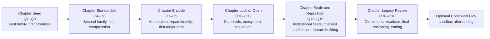
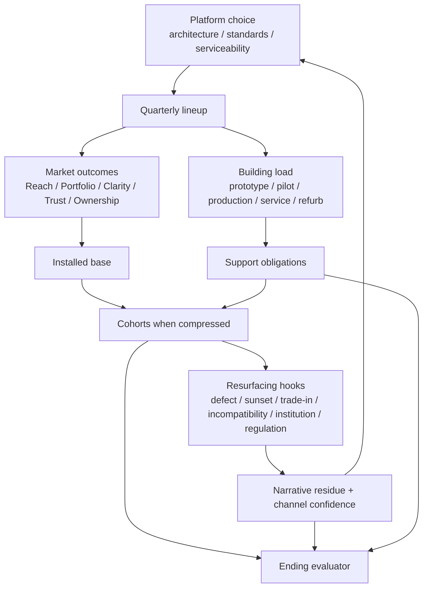

# R6 Campaign Generations and Progression

## Executive summary

The strongest fit for *Obsolescence, Inc.* is a **chaptered permanent-company campaign with hybrid post-completion continuation**: one persistent flagship building and one persistent institution, divided into **six chapters across eighteen quarters**, with a formal ending at the end of Quarter 18 and an optional continued-play state after credits. This structure best preserves the brief’s non-negotiables: a fixed-width persistent flagship, visible cause-and-effect across the product lifecycle, recurring quarterly launches, meaningful long-tail obligations, readable mobile play, and future expansion without turning the first release into an endless sandbox or a roguelite that discards the history players were asked to care about. The core design recommendation is to make the campaign about **building a company that remembers its own promises**. fileciteturn4file5 fileciteturn4file10 fileciteturn4file12

The recommended pacing model is **eighteen quarters, six chapters, one major platform family per chapter**, with each chapter containing three quarterly lineups built around that family. That yields a first-completion target of roughly **nine to twelve hours median**, with an acceptable spread of **eight to fifteen hours** depending on pause frequency, inspection depth, and recovery play. This length sits much closer to the “complete but replayable” range than open-ended historical sandboxes such as *Software Inc.*, *Mad Games Tycoon 2*, and *GearCity*, while still leaving enough time for a flagship building to become legible as an institution rather than a tutorial tower. *Game Dev Tycoon* and *Turmoil* show the power of a short, finishable industrial campaign; *Against the Storm* and *Frostpunk* show the value of clear run or scenario arcs; *Two Point Hospital*, *Project Highrise*, *Big Pharma*, and *Good Company* show how chapters or scenarios can introduce complexity without requiring the player to carry every old object forever. citeturn15search0turn14search0turn0search1turn1search0turn16search0turn17search0turn2search4turn16search5turn1search1turn16search3turn1search6

The central compression rule should be: **keep no more than three generations individually visible at once**—the current family, the previous commercially active family, and one burden family that remains explicit because of support, defects, institutional contracts, or refurb resale. Everything older collapses into cohorts that preserve support horizons, installed base, compatibility family, recurring failure reasons, refurbishment status, and narrative residue. This rule directly follows the brief’s provisional operations envelope of “approximately three active generations at most,” and it also matches real-world lessons from platform strategy and backward compatibility: common platforms create economies of scale and easier upgrades, but they also synchronize defects and carry long-tail installed-base obligations; compatibility can help transfer value across generations, but it can also drag design and content forward if left unconstrained. fileciteturn4file10 citeturn11search1turn11search6turn10search3

The campaign should support **three viable strategic doctrines** rather than one dominant route: a **durable/open company**, a **premium-integrated ecosystem company**, and a **scale-first volume company**. The brief is explicit that durable and aggressive strategies must both be viable, but differently burdened, with endings that express what kind of institution the player built rather than flattening the campaign into a global morality score. The five recommended ending families therefore read as institutional legacies, not alignment verdicts: trusted durable steward, premium fortress, volume titan, managed transition, and public reckoning. fileciteturn4file10 fileciteturn4file18

One important caveat: the workspace contains the full R6 brief and the completed R3 and R5 reports, but not every completed upstream report in full. The brief itself warns that attached standalone reports should take precedence where more precise than condensed summaries, and it notes that some earlier research had already inherited conclusions through summaries. I did not find a material contradiction among the available sources, but any later full upstream report that substantively changes the product schema, factory burden, or tone rules should trigger a targeted R6 reconciliation rather than a silent rewrite. fileciteturn4file9 fileciteturn4file12

## Inherited canon and external lessons

### Inherited canon and material contradictions

Across the available canon, the durable constants are unusually clear. The game is a **pausable real-time management game** about repeatedly designing, producing, launching, supporting, repairing, replacing, refurbishing, and disposing of consumer-device lineups from **one vertically integrated flagship building**. That flagship is a **fixed-width, side-on cutaway** with public functions at the front, configurable operational space in the middle, service/logistics at the rear, and distinct personnel and freight cores. It grows **upward** into project and governance complexity and **downward** into lifecycle depth, but it is not supposed to become a freeform campus, a conveyor-grid puzzle, or a disposable map that resets every few quarters. fileciteturn4file5 fileciteturn4file17

The first category is a **fictional smartphone or handheld-device family** built around shared architectures, variants, compatibility, support, repair, refurbishment, and disposal. R5’s handoff is especially important for R6: campaign persistence must carry forward trust by segment and channel, installed base by generation and compatibility family, support years and sunset dates, accessory and service adoption, recurring reasons for returns and support, unresolved defect hypotheses, public narrative residues, institutional pilots and commitments, retailer and carrier confidence, refurbished stock and resale effects, and learned evidence about segment response. Older generations are explicitly supposed to collapse into cohorts while still being able to resurface through support sunset, defects, trade-ins, repair, incompatibility, institutional contracts, or regulation. fileciteturn4file15 fileciteturn4file10

The campaign must remain finishable, readable, and mobile-usable. The brief rejects solving campaign weakness with more currencies, more content, backend requirements, or idle progression. It asks for one recommended primary structure, one progression grammar, one persistence model, one replay model, and one falsifiable validation target. It also explicitly postpones scenario mode if doing so is necessary to protect launch quality. fileciteturn4file2 fileciteturn4file6

I do **not** see a design contradiction between the available R3, R5, and R6 materials. Instead, there is a strong convergence:

| Canonical constraint | Practical implication for R6 |
|---|---|
| Persistent fixed-width flagship | No roguelite discard loop; no chapter reset that throws away the building |
| Modular bays inside fixed macro-structure | Progression should favor retooling, policy, and structural additions over map replacement |
| Approximately three active generations at most | Compression must be systemic, not cosmetic |
| Launches judged by several disagreeing dimensions | Endings and success cannot collapse to one score |
| Durable strategy must remain viable | Strategic asymmetry must be burden-based, not morality-meter-based |
| Browser-native local persistence | Save model must be serializable, versioned, and migration-safe |

These are all directly stated in the R6 brief and R5 handoff. fileciteturn4file10 fileciteturn4file15

### Comparable-game campaign and progression matrix

The table below records the most transferable campaign patterns from adjacent games. Completion lengths are included only where a credible official or widely used community reference was available; where length is absent, the structural lesson mattered more than the hour count.

| Game | Primary structure | What persists | What resets | Approx. length | Transferable lesson | Warning for Obsolescence | Source |
|---|---|---|---|---|---|---|---|
| *News Tower* | One persistent institution with recurring weekly deadlines | Building, staff, readership, faction relations | Weekly production cycle | Not emphasized by official page | Repeating deadlines work when each cycle changes the institution, not just the score | Weekly cadence alone can become treadmill if obligations do not evolve | Steam page citeturn0search0 |
| *Turmoil* | Career mode made of discrete one-year maps plus town upgrades | Upgrades, town progression, shares | Each drilling map | ~8h main story, community-reported | Discrete rounds can stay readable if a town layer carries permanent consequences | Too much map reset would undermine the flagship-building fantasy | Steam + ITAD/HLTB citeturn14search0turn20search4 |
| *Game Dev Tycoon* | Finishable historical run from garage to office to labs, then optional continuation | Company, staff, unlocks, office progression | Mostly nothing until game-end score | ~9h main story, community-reported | Short, complete company arc with optional post-end continuation is a very strong precedent | It works partly because its internal simulation is abstract; Obsolescence needs more visible causal memory | Official site + ITAD/HLTB citeturn15search0turn20search3 |
| *Software Inc.* | Long-form continuous sandbox with simulated market | Buildings, teams, products, history | Very little | Open-ended | Continuous company simulation can produce rich institutional identity | Too open-ended for first-release arc; risk of maintenance sprawl | Steam page citeturn0search1 |
| *Mad Games Tycoon 2* | Long historical sandbox with century-scale play and many product forms | Company, IPs, engines, consoles, offices | Very little | Open-ended | Strong proof that franchises, engines, and market history can persist meaningfully | Much broader surface area than Obsolescence’s launch scope; easy to overbuild | Steam page citeturn1search0 |
| *GearCity* | Historically grounded deep company simulator across maps and events | Company structure, factories, brands, historical context | Very little | Hundreds of hours to master, per official description | Historical events and contracts can give business sims long memory | Too much systemic density would swamp mobile readability and first-release scope | Steam page citeturn16search0 |
| *Good Company* | Campaign of ranked missions and bonus challenges, plus freeplay | Challenge completion and learned mastery; in freeplay the company persists | Scenario state between missions | Not emphasized by official page | Scenario campaigns are a good way to teach logistics and production ideas | A scenario-first launch would weaken the “one remembered company” thesis | Official site citeturn1search6 |
| *Big Pharma* | Business-puzzle challenges across scenarios, plus freebuild | Challenge completion | Scenario map and setup | Not emphasized by official page | Excellent example of constrained scenario pressure creating clean decisions | Too puzzle-like a structure would flatten long-tail product history | Steam page citeturn16search3 |
| *Project Highrise* | Scenario campaign plus sandbox | Scenario progress and learned planning | Individual building scenarios | Not emphasized by official page | Scenarios can test narrow management skills cleanly | Strong for post-launch missions, weak as the core first-release arc | Steam page citeturn1search1 |
| *Two Point Hospital* | County-spanning sequence of hospitals with local objectives | County progression, unlocks, learned systems | Individual hospital layouts | ~38h main story, community-reported | Chaptering through linked institutions is readable and expandable | Hospital hopping would sacrifice the flagship’s visible memory unless reworked heavily | Steam + ITAD/HLTB citeturn16search5turn21search2 |
| *Against the Storm* | Roguelite expeditions around a persistent meta-city | Meta resources, unlocks, cycle progress | Individual settlements are destroyed between storms | ~38h main story, community-reported | Excellent proof that short runs can sustain long-term progression if meta value is strong | Directly conflicts with Obsolescence’s persistent-building thesis; use only the meta-structure lesson, not the reset loop | Official listing + official wiki + ITAD/HLTB citeturn2search4turn2search2turn12search2 |
| *Frostpunk* | Finite scenario campaigns plus endless mode | Scenario outcomes within a run; endless city within that mode | Separate scenarios are separate starts | ~11h main story, community-reported | Strong evidence that a finite management arc can feel complete if pressure converges toward a reckoning | Endless mode should be optional post-completion, not the primary promise | Steam + ITAD/HLTB citeturn17search0turn21search1 |
| *Lobotomy Corporation* | One long, dangerous, finite management campaign built around accumulating burdens | Facility growth, day progression, narrative burden | Very little until endings | ~55h main story, community-reported | Old decisions becoming operational liabilities is extremely relevant | Its run length and stress level are much higher than the target here; Obsolescence needs stronger compression and shorter first completion | Steam + Eden Office + ITAD/HLTB citeturn14search6turn5search2turn21search0 |

Across these comparables, the pattern is consistent. The structures that best fit *Obsolescence* are the ones that let the player **finish** a company history without erasing the institution every run: *Game Dev Tycoon* for finishable arc plus optional continuation, *Turmoil* for discrete cadence within a career frame, *News Tower* for recurring deadline structure inside one persistent institution, and *Frostpunk* for a campaign that clearly ends while still supporting post-campaign endless or challenge modes. The structures that fit worst as the *primary* release model are scenario anthologies and roguelite resets: they are excellent secondary modes, but weak matches for a game whose satire and system memory depend on the same building remembering what the player optimized. citeturn15search0turn14search0turn0search0turn17search0turn2search4

### Relevant real-world generation, platform, support, and installed-base lessons

Real-world device businesses suggest several rules that matter directly to campaign design.

First, **product platforms** matter because they let firms share components, interfaces, manufacturing processes, and underlying technologies across a family, reducing unit cost and enabling easier upgrades and differentiation—but the same shared architecture can also create overdesign, coupling, and high upfront platform investment. One systems-engineering review notes that platform shared elements commonly include components, interfaces, manufacturing processes, and underlying technologies, and that platform-first development can require substantially larger upfront cost than one-off product development. That maps cleanly onto *Obsolescence*: platform choices should unlock efficiency and future reuse, but they should also risk synchronized debt and synchronized defects. citeturn11search1turn11search3turn11search7

Second, **backward compatibility and interoperability are double-edged**. Strategy and economics research on platform transitions shows that backward compatibility can transfer value from the old generation’s installed base to the new one, but it can also weaken incentives for new complementary products; its value declines when the technological leap is large. Other work finds that interoperability and data portability increase consumer surplus when switching costs are high. In game terms, this means compatibility should never be a universally correct toggle: it should protect trust and old accessories, help institutional renewals, and smooth transitions, while also constraining radical redesign and sometimes slowing the commercial takeoff of the new family. citeturn11search6turn10search3

Third, **rapid release cadence is itself a strategic temptation**, not neutral background noise. Operations research on “digital rollovers” and economic research on upgrade timing both conclude that firms often have incentives to accelerate or strategically time upgrades to manage perceived obsolescence and extract more upgrades from mixed markets. This is exactly the satirical and mechanical territory *Obsolescence* wants to inhabit: the game should present fast rollout as a rational local choice, then make the long-tail support, compatibility, and repair consequences visible later. citeturn10search0turn10search6

Fourth, **support windows and end dates are not abstract flavor**. Google’s Android Enterprise Recommended requirements require manufacturers to publish security update information, including the end date through which devices are guaranteed to receive security updates, and to publish guaranteed OS upgrade information. NIST guidance on enterprise mobile device security explicitly frames devices around deployment, use, and disposal across a lifecycle. In the EU, the smartphone and tablet ecodesign regulation that applies from June 20, 2025, sets obligations around spare parts availability, repair information, and update timing. In other words, support horizon, sunset date, repairability, and replacement parts are all legitimate, public-facing strategic commitments, not back-office clutter. Those commitments deserve to be first-class campaign states. citeturn6search0turn6search2turn7search2turn7search0

Fifth, **repair restrictions and repair programs are strategic choices with public and competitive consequences**. The FTC’s *Nixing the Fix* report identifies common repair restrictions such as limited access to parts, tools, and diagnostic software, and the Commission’s press release says there is “scant evidence” supporting many manufacturer justifications for those restrictions. At the same time, Apple’s repair programs now make genuine parts, manuals, tools, diagnostics, and institutional self-service access available, while Fairphone explicitly markets DIY repair and affordable spare parts without automatically voiding warranty. For *Obsolescence*, the right abstraction is not “repair good, closed bad”; it is that serviceability, parts access, diagnostics, and warranty language create distinct commercial identities, trust effects, and operational burdens. citeturn9search1turn9search6turn9search5turn8search2turn7search4

Sixth, **trade-in, refurbishment, and disposal create real operational chains**. Apple’s trade-in terms describe inspection-based value revision, ownership transfer, data deletion responsibilities, and recycling or reuse flows. Apple’s recycling pages and FAA guidance also highlight that devices with batteries must be packed carefully and that damaged or recalled lithium-battery devices should not simply be shipped like intact stock. This supports a very concrete rule for *Obsolescence*: trade-in and recall events should not be abstract “gain currency” buttons; they should generate sorting, grading, battery-safety, replacement-reserve, and refurbishment capacity pressures in the same building. citeturn8search6turn8search0turn18search5turn18search0turn18search9

Those real-world lessons convert into five design rules:

| Real-world pattern | Campaign rule for Obsolescence |
|---|---|
| Shared platforms lower cost and accelerate family development | Platform decisions should unlock future leverage |
| Shared platforms also synchronize risk | Cross-generation defects must be possible and legible |
| Support end dates are public commitments | Every major family needs an explicit support/sunset clock |
| Repair policy shapes trust and service burden | Serviceability must be a strategic doctrine, not a flavor stat |
| Installed base outlives launch reviews | Ownership health must remain a coequal score dimension |

These are direct support for the campaign model below. citeturn11search1turn11search6turn6search0turn9search6turn7search0

## Architecture decision

### Recommended long-term player fantasy

The recommended long-term player fantasy is:

**Build one flagship institution that launches new lineups faster than it can forget the old ones, and decide what kind of company survives its own installed base.**

This is stronger than “build a big company,” “master a tech tree,” or “beat a scenario chain,” because it fuses the campaign’s three most distinctive promises into one loop: **the building remembers, the market remembers, and the products remember**. That fantasy is directly aligned with the brief’s insistence that the player embodies the company’s continuing operating logic, that earlier generations constrain later ones through support, standards, defects, accessories, and expectations, and that endings should express the kind of institution the player made rather than issue a generic verdict. fileciteturn4file10 fileciteturn4file17

### Candidate campaign structures

I scored five candidate structures against the brief’s actual constraints. Scores run from 1 to 5 and reflect fit, not generic genre quality.

| Structure | Strategic memory | Finishability | Readability at scale | Expansion robustness | Building continuity | Replay value | Total |
|---|---:|---:|---:|---:|---:|---:|---:|
| Continuous permanent sandbox | 5 | 2 | 2 | 4 | 5 | 4 | 22 |
| Chaptered permanent company | 5 | 5 | 4 | 4 | 5 | 4 | 27 |
| Anthology scenario chain | 2 | 5 | 5 | 5 | 1 | 4 | 22 |
| Pure roguelite runs with meta-progression | 3 | 4 | 4 | 5 | 1 | 5 | 22 |
| Hybrid chaptered core plus optional continued play | 5 | 5 | 5 | 5 | 5 | 5 | 30 |

The **continuous sandbox** is attractive because it preserves the building and a full company history, much like *Software Inc.*, *Mad Games Tycoon 2*, and *GearCity*. But it fails the brief’s requirement that the first campaign be a satisfying complete arc instead of a forever-sandbox, and it raises the highest risk of maintenance sprawl. citeturn0search1turn1search0turn16search0

The **anthology scenario chain** is excellent for post-launch content because games such as *Good Company*, *Big Pharma*, *Project Highrise*, and *Two Point Hospital* show how scenario structures can cleanly pace complexity and stay expandable. But as a launch structure it discards the core differentiator of *Obsolescence*: one building and one company physically carrying the residue of earlier choices. citeturn1search6turn16search3turn1search1turn16search5

The **pure roguelite** model is the least appropriate primary structure despite the elegance of *Against the Storm*. Its strongest benefits—short runs, hard resets, easy expansion, meta-over-map play—arise precisely because it is willing to destroy local history. The R6 brief explicitly warns against turning the game into a roguelite that discards the flagship building and product history players were asked to care about. citeturn2search4turn2search2 fileciteturn4file5

The **hybrid chaptered core plus optional continued play** is best because it borrows the finishable arc of *Game Dev Tycoon* and *Frostpunk*, the repeatable cadence of *Turmoil* and *News Tower*, and the post-endless or challenge-mode flexibility that those games also use after the primary arc. citeturn15search0turn17search0turn14search0turn0search0

### Recommended campaign structure and rejected alternatives

The recommended primary architecture is:

**One permanent company and one permanent flagship, divided into six chapters of three quarters each, with a formal ending at Quarter 18 and optional continued play afterward.**

Each chapter centers on **one major platform family**. Each quarter still launches a lineup, but not every quarter is a total platform reset. Instead, the three-quarter rhythm inside a chapter is:

| Quarter role | Player focus | Why it exists |
|---|---|---|
| Foundation quarter | define family promises, architecture, channel intent, service reserve, floor retooling | gives strategic identity to the chapter |
| Market quarter | launch, staff allocation, show-floor heuristics, crisis response, demand surprises | delivers the core fantasy |
| Liability quarter | support wave, returns, trade-ins, repair/refurbish routing, narrative residue, chapter gate | cashes out history before the next family |

This structure is preferable to a “one new major generation every quarter” model because the latter would either compress too aggressively or flood the building with unresolved support debt. It is also preferable to a “one scenario per chapter” model because the physical flagship and its logistics are too central to throw away. The compromise—quarterly lineups, chapter-level platform families, and mandatory compression at chapter boundaries—keeps the cadence of repeated launches while protecting readability. fileciteturn4file10 fileciteturn4file12

### Campaign length, quarter count, chapter count, and session rhythm

The recommendation is:

- **Quarter count:** 18
- **Chapter count:** 6
- **Primary completion range:** 8–15 hours
- **Median target:** 9–12 hours
- **Typical quarter duration:** 25–45 minutes
- **Typical chapter duration:** 90–150 minutes

This pacing is short enough to be finishable, long enough to build institutional memory, and substantially more realistic for first-release scope than the very long management campaigns represented by *Two Point Hospital* or *Lobotomy Corporation*. It also follows the brief’s warning not to equate a longer campaign with a better one. citeturn21search2turn21search0 fileciteturn4file12



That campaign map is the simplest one that satisfies the brief’s request for a full arc, preserves the flagship, and leaves room for post-launch scenarios or alternative doctrines later. fileciteturn4file6

## Recommended progression model

### Complete first-campaign timeline

| Chapter | Quarters | Major unlocks | New pressure | Why earlier history matters |
|---|---|---|---|---|
| Seed | Q1–Q3 | basic showroom staffing, prototype, pilot, repair desk, first support policy | first launch overclaim, first return clusters | initial claims become the baseline for trust |
| Standardize | Q4–Q6 | second structural expansion, accessories, retailer/carrier confidence, first refurbished offers | platform reuse, channel expectations, first cohort compression | Gen A begins constraining Gen B through support and resale |
| Encode | Q7–Q9 | diagnostics lab, manager policies, playbooks, automation stage one | synchronized defect risk, repair backlog, reserve allocation | shared architecture can now injure multiple families |
| Lock or Open | Q10–Q12 | standards/legal/compliance floor, ecosystem policies, institutional pilots | compatibility fights, regulation, sunset politics | older accessories and customers challenge new lock-in bets |
| Scale and Reputation | Q13–Q15 | mature basements, second project band, automation stage two, fleet service | channel promises, large installed base, long support tail | mistakes now hit wider cohorts and contracts |
| Legacy Review | Q16–Q18 | endgame review tools, final board/regulator fork, postgame unlock | legacy cohorts resurface together, final support sunsets, reputational synthesis | the whole campaign cashes out as one institutional portrait |

The shape of this timeline deliberately front-loads **understandability**, mid-loads **structural identity**, and late-loads **synthesis** rather than raw new mechanics. That is the right late-game shape for a management campaign: chapter six should not be a tutorial for systems seven through twelve; it should be the place where the player understands what their earlier choices have made possible or expensive. fileciteturn4file12

### Product-generation visibility and cohort-compression model

The recommended model distinguishes **lineup**, **generation family**, and **cohort**.

- A **lineup** is the quarter’s sellable set of SKUs, bundles, demos, and refurb offers.
- A **generation family** is the underlying platform and compatibility wave that anchors a chapter.
- A **cohort** is an aggregated installed-base block of older devices that no longer needs full SKU-level visibility but still carries future consequences.

The visibility rule is simple:

| State | Individually visible? | Typical duration |
|---|---|---|
| Current family | Yes | Entire current chapter |
| Previous active family | Yes | One chapter after launch |
| Burden family | Yes if still commercially or operationally important | Variable, but only one at a time |
| Older families | No; compressed into cohorts | Until support and narrative residue decay out |

A family compresses when all of the following are true:

1. it is not in the current chapter;
2. it is no longer part of the hero lineup;
3. it has no unresolved severity-critical incident requiring SKU-level visibility;
4. it is not the currently designated burden family;
5. showing it would break the **three visible generations** cap. fileciteturn4file10

Compression should preserve the following fields:

| Field that survives compression | Why it must survive |
|---|---|
| installed base size and attrition | future demand, support load, trade-in volume |
| compatibility family and accessory adoption | breakage, resale, lock-in, upgrade friction |
| support promise and sunset date | contractual and reputational consequences |
| recurring issue mix | determines future support and recall resurfacing |
| unresolved defect flags | allows old families to suddenly matter again |
| channel and segment trust residue | future launches inherit reputation |
| institutional contract tie | renewal and penalty logic |
| refurb grade and resale share | old devices continue shaping value ladders |

A compressed cohort should be able to resurface through exactly the hooks named in the brief: support sunset, defects, trade-ins, repair, incompatibility, institutional contracts, or regulation. That resurfacing should never re-expand the full SKU tree. Instead, it should promote the cohort into a **temporary burden card** with a clear cause chain and a limited menu of responses. fileciteturn4file15 fileciteturn4file10

### Six-lineup worked generation ledger

The first six lineups should work like this:

| Quarter | Chapter family | Hero lineup | Individually visible families after launch | Compressed cohorts | Main surviving obligations |
|---|---|---|---|---|---|
| Q1 | Gen A | A Base / A Pro | A | none | launch promises, first support clock |
| Q2 | Gen A | A Mini / A Pro / demo-refined A Base | A | none | accessory uptake, first recurring complaints |
| Q3 | Gen A | A Refresh / A Refurb pilot | A | none | support reserve, repair capacity, first narrative residue |
| Q4 | Gen B | B Base / B Pro, carry A Lite | B, A | none | A support tail, A resale, B compatibility bet |
| Q5 | Gen B | B Mini / B Pro / A Refurb | B, A | none | mixed-family accessory confusion, channel expectations |
| Q6 | Gen B | B Refresh / B Rugged / A Refurb | B, A as burden family | A-supported-legacy cohort created at chapter end | A sunset clock, A recurring battery/repair reasons, B launch trust |

At the end of Q6, Family A loses full lineup visibility and collapses into one or more cohorts, but it does **not** disappear. It still exists as:

- a supported-legacy installed base;
- a refurbished resale stream;
- a trust residue source;
- a possible defect resurfacer;
- and a compatibility constraint for Gen C. fileciteturn4file15

A helpful quarter ledger can look like this:

```text
Quarter 6 dashboard mockup

Current family
- Gen B: Base / Pro / Rugged
Previous visible burden
- Gen A: Refurb stream + support tail
Compressed history
- none yet, but Gen A will compress at chapter end

Support obligations
- Gen A support ends in 3 quarters
- Recurring reason cluster: battery swelling rumor
- Retailer confidence: cautious
- Accessory family A adoption: 41%
- Refurb stock: 280 graded units

Why this matters now
- If Gen C changes connector standard, 41% accessory adoption becomes a backlash risk
- If Gen A battery rumor hardens into defect evidence, Q7 repair load spikes
```

This is the right level of fidelity: readable without spreadsheet-first UI, but rich enough to cash out several quarters of cause and effect. fileciteturn4file2 fileciteturn4file15

### Persistent company-state ledger

The campaign should persist only states that can create new decisions, visible consequences, or ending conditions. The table below is the recommended persistent-state contract.

| State | Granularity while active | Compression rule | Decay rule | Resurfacing trigger |
|---|---|---|---|---|
| Trust by segment and channel | explicit score plus top reasons | keep only leading positive and leading negative residues per segment/channel | drifts 10–15% toward neutral each chapter without new evidence | new launch in same segment/channel |
| Installed base | explicit for current and previous family | older families aggregate into cohorts | attrition, trade-in, failure, refurb resale reduce counts each quarter | support sunset, defect, recall, accessory break |
| Support promises | explicit promise card per family | never compress away before fulfillment or breach | after sunset, convert to residue for 2 chapters | regulatory review, media event, contract renewal |
| Accessory/service adoption | explicit for active families | old families reduce to adoption percentages by cohort | slow decay; refresh if still compatible | new accessory/service launch |
| Recurring reasons | top three explicit clusters | merge tail into “other” | decays with fixes or cohort retirement | renewed incident cluster |
| Defect hypotheses | max three live investigations | unresolved old ones become latent flags | no decay until resolved, disproved, or written off | new evidence from support, returns, regulation |
| Public narrative residue | max four narrative cards | oldest non-reactivated card drops at chapter end | strong decay unless reinforced | press event, influencer demo failure, recall |
| Institutional pilots/commitments | explicit while active | completed pilots become reputation memories | slow decay by sector | renewal, bid, compliance event |
| Retailer/carrier confidence | channel-level confidence and top issue | no fine-grained history | slow drift with channel behavior | stockout, return spike, broken promise |
| Refurb stock and resale | counts by family and grade | merged by cohort/family | decays through sale, scrap, cannibalization | trade-in event, shortage, replacement wave |
| Team playbooks and evidence | explicit learned rules, not per-worker memories | chapter-end consolidation into institutional playbooks | no decay unless superseded | similar future incident |

This state list is almost one-to-one with the R5 handoff and the R6 brief’s analytical standard that every persistent state must matter mechanically. fileciteturn4file15 fileciteturn4file12

### Building expansion and retooling progression

The building should progress in **three recognizable states**, with chapter-to-chapter retooling inside those states.

| Stage | Quarters | Above street | Ground/B1 | Below street | Player feeling |
|---|---|---|---|---|---|
| Opening | Q1–Q6 | product room, marketing, basic governance | iconic showroom, dock reserve, first backroom service | prototype, pilot, light assembly, repair bench, simple refurb grading | “I can see the whole organism” |
| Established | Q7–Q12 | second project bands, legal/compliance, channel desk, institutional sales | more deliberate reserve/logistics choices | full diagnostics, repair lane split, refurb lane, quarantine, disposal discipline | “The institution now has internal politics and debt” |
| Mature | Q13–Q18 | executive strategy, standards/compliance office, sector account management, institutional memory | launch theater competes with fleet/service reality | specialized basements for service reserve, recall handling, refurb certification, reverse-logistics surge | “I am steering a machine I partly built and partly inherited” |

Three mature flagship configurations should emerge from strategy rather than art duplication:

| Mature configuration | Building emphasis | Strength | Burden |
|---|---|---|---|
| Durable Commons | bigger service/refurb bands, standards/compliance, smaller spectacle spend | trust, refurb margin, institutional confidence, softer failure spikes | slower launch heat, more cannibalization from older devices |
| Velvet Fortress | premium showroom theaters, demo labs, secure service path, accessory vault | halo demand, accessory pull-through, strong margins | regulation, compatibility backlash, expensive recall events |
| Volume Engine | enlarged B1 throughput, fast swap stations, channel ops, carrier floor | reach, cash flow, channel leverage | support load, stock allocation crises, thin reputational buffer |

This is faithful to the fixed-width flagship concept from R3 and to R4’s “retoolable macro-structure” rather than map replacement. fileciteturn4file17

### Staff, team, manager, and institutional-memory progression

The recommended staff model is **hybrid**: a small number of named leadership roles plus pooled teams and institutional playbooks.

| Stage | Manual player control | Delegated by managers | What persists |
|---|---|---|---|
| Opening | direct launch priorities, reserve allocation, key staffing, crisis interventions | ordinary checkout, standard restock, common support triage | a few named leads and basic team traits |
| Established | product doctrine, support policy, channel commitments, quality thresholds | production scheduling, routine diagnostics, baseline hiring/scheduling | team specialization and first playbooks |
| Mature | doctrine shifts, exception handling, final crisis choices, chapter-fork decisions | routine launch prep, standard repair routing, default refurbishment and reserve logic | institutional memory, legal precedent, process books, reputational identity |

The crucial persistence layer is **playbooks**, not large numbers of named employees. That directly supports the brief’s request for explainable persistence without overwhelming ledger count, and it also fits the R7 canon that the player represents the institution’s continuing logic rather than a single founder-hero. fileciteturn4file10

### Technology, platform, knowledge, and standards progression

The game should not use a giant linear tree. The recommended grammar is:

**Each chapter’s family gets four strategic commitments:**
- one **platform architecture** choice;
- one **serviceability/repair** choice;
- one **standards/compatibility** choice;
- one **process/automation** choice.

That grammar is data-driven, extensible, and far more readable than a broad stat-tree. It also reflects real-world platform design: common elements, interfaces, and processes matter more than trivial percentage upgrades. fileciteturn4file17 citeturn11search1turn11search7

The three recommended technology paths are:

| Path | Signature commitments | Main benefits | Main debts |
|---|---|---|---|
| Open Serviceable Platform | replaceable battery, shared standards, public diagnostics, long support branch | trust, institutional renewals, refurb health, smoother generation transitions | thicker devices, slower fashion cycle, lower attach rates for closed accessories |
| Premium Integrated Stack | sealed design, custom packaging, private accessory bus, high-demo features | margins, halo reviews, ecosystem capture, strong flagship theater | compatibility debt, harder repair, stronger regulatory and recall downside |
| Scale Standardized Platform | commonized board and process, outsourced volume discipline, channel-driven variants | high reach, lower unit cost, supplier leverage, fast quarter-to-quarter refresh | synchronized defects, channel overhang, support overload |

These are not morality classes. They are structurally different debts, matching the brief’s insistence that durable and aggressive strategies must both remain viable and imperfect. fileciteturn4file10

### Automation and delegation progression

| Stage | What automation removes | What new decisions it creates | Failure mode |
|---|---|---|---|
| Opening | repetitive routing clicks, obvious queue advancement | priority rules, reserve protection, first exception handling | too little automation creates busywork |
| Midgame | standard support triage, ordinary replenishment, routine repair assignment | policy design, escalation thresholds, risk appetite | bad policies create blind systematic mistakes |
| Late game | launch templates, refurb grading defaults, replacement reserve formulas, channel fulfillment norms | doctrine tradeoffs, audit rules, crisis exceptions, institutional accountability | over-automation hides drift until a shock exposes it |

This follows the R4 canon almost verbatim: automation should remove repetitive handling while creating policy, exception, fragility, and prioritization decisions. fileciteturn4file10

### Campaign pressure and complexity curve

The game needs a **rising-synthesis curve**, not a rising-feature curve.

| Chapter | New systems pressure | Legacy burden | Automation relief | Net complexity |
|---|---|---|---|---|
| Seed | ██ | █ | ░ | ██ |
| Standardize | ███ | ██ | ░ | ███ |
| Encode | ███ | ███ | █ | ████ |
| Lock or Open | ███ | ████ | ██ | █████ |
| Scale and Reputation | ██ | █████ | ███ | █████ |
| Legacy Review | █ | █████ | ███ | ████ |

The hard complexity caps should be:

| Cap | Maximum |
|---|---:|
| Individually visible families | 3 |
| Live defect investigations | 3 |
| Active narrative residue cards | 4 |
| Explicit support obligation cards on main dashboard | 5 |
| High-priority chapter projects | 2 |
| Unique channel commitments requiring quarter-level decisions | 4 |
| Major staff-manager policy dials surfaced at once | 8 |

If a prototype needs more than those caps to stay readable, the structure is failing and should simplify rather than expand. fileciteturn4file2

## Failure, endings, and replayability

### Failure, recovery, and loss structure

The best failure philosophy for *Obsolescence* is **wounding failure, not routine run-death**. A bad quarter should create debt, panic, and future distortion—support spikes, trust residue, forced spending, channel penalties, delayed expansions—but most campaign failures should remain recoverable. Only chapter-end collapse, sustained liquidity failure, or the final legacy review should fully end the run. This is more appropriate than roguelite reset and better aligned with the brief’s demand that a failed quarter create recoverable consequences rather than a hidden death spiral. fileciteturn4file2

### Five multi-quarter failure-and-recovery chains

| Chain | Attractive earlier choice | Delayed consequence | Visible result | Recovery options |
|---|---|---|---|---|
| Shared battery architecture | thinner devices, lower tooling cost, cleaner reviews | degradation issue spans A, B, and refurb stock | repair floors fill, replacement reserve empties, trust cracks | software charging cap, repair expansion, trade-in campaign, narrower warranty threshold |
| Connector break for accessory lock-in | high accessory attach and premium margin | older accessories fail across loyal installed base | angry showroom comparisons, resale value fall, channel hesitation | adapter subsidy, compatibility patch, open-standard pivot, accept backlash for margin |
| Aggressive launch claims | early reach and media heat | support reasons cluster around overpromised feature | returns rise while review quote still hangs on showroom wall | refund quietly, patch publicly, retrain staff script, reframe claim wording |
| Underbuilt service reserve | more launch-day stock and sell-through | first defect wave leaves no replacement inventory | gorgeous showroom, catastrophic service desk | divert stock, slow next lineup, expand refurb, offer downgrade compensation |
| Carrier/institutional overcommit | channel growth and prestige logos | one slipped quarter chains into penalties and renewal risk | B1 becomes hostage to contract commitments while direct customers see stockouts | prioritize contract, buy out clause, launch simplified SLA device, cut a channel |

The first chain is almost exactly the kind of incident R7 expects: one elegant platform decision creates synchronized liability across generations. fileciteturn4file18

### Five ending profiles

Endings should be generated by **state composition plus a final policy choice**, not by a single score threshold.

| Ending | Typical state pattern | Interpretation |
|---|---|---|
| Durable Steward | high trust, strong refurb health, long support kept, slower growth | you built a slower but resilient institution |
| Velvet Fortress | high margin, strong ecosystem adoption, mixed trust, looming interoperability pressure | you built a beautiful machine whose control logic is its identity |
| Volume Titan | enormous reach, thin goodwill, heavy service burden, channel dependence | you won scale by normalizing maintenance debt |
| Managed Transition | moderate success, stable legacy, deliberate sale/spin-off/refocus | you left before the machine consumed itself |
| Public Reckoning | severe support breach, regulatory intervention, narrative collapse, salvageable fragments | the campaign ends with the institution exposed by the history it accumulated |

These ending families are also consistent with the R7 brief’s ending possibilities: durable company, ecosystem lock-in, breakup, planned exit, or installed-base burden becoming the true legacy. fileciteturn4file18

### Three strategic campaign paths

| Path | Early bets | Midgame identity | Endgame advantage | Endgame risk | Most likely ending families |
|---|---|---|---|---|---|
| Durable Commons | generous support, high service reserve, open standards | repair/refurb becomes an asset, trust compounds | strong institutional renewals and soft landings after defects | slower reach, self-cannibalization by old products | Durable Steward, Managed Transition |
| Velvet Fortress | premium hero device, integrated accessories, guided ecosystem | showroom theater and attach rates dominate | very high margin and strong brand-symbol power | compatibility debt, regulator attention, reputational cliff if support slips | Velvet Fortress, Public Reckoning |
| Volume Engine | aggressive channel play, commonized platform, rapid refreshes | throughput and channel leverage become the company’s spine | huge reach and manufacturing power | synchronized defects, service overload, stock/replacement fights | Volume Titan, Public Reckoning |

These paths should also drive the three mature flagship configurations discussed above, so strategy becomes physically legible in the building rather than remaining a spreadsheet doctrine. fileciteturn4file10

### Replayability, scenarios, and secondary modes

Replayability should come from **doctrine, chapter forks, event composition, and ending pursuit**, not unfinished unlock grind. The first release should include:
- one main campaign;
- multiple starting doctrine presets;
- continued play after credits;
- and chapter-level variation in standards, incidents, and contract opportunities.

**Scenario mode should be deferred to post-launch**, exactly as the brief suggests if necessary, because the primary release needs one strong remembered-company arc before it fragments into challenge anthologies. Post-launch scenarios can then borrow from *Big Pharma*, *Project Highrise*, and *Good Company* by isolating narrow dilemmas—recall management, budget austerity, regulation-heavy markets, institutional-service contracts—without replacing the main campaign. fileciteturn4file0 citeturn16search3turn1search1turn1search6

### Expansion and save-compatibility model

Save compatibility should be designed around **stable content IDs, chapter boundaries, and frozen legacy representations**.

| Future change | Safe if… | Migration rule |
|---|---|---|
| add new product category | old campaigns treat it as unavailable unless starting a new campaign or entering a chapter boundary with explicit opt-in | category IDs are versioned and absent content is ignored gracefully |
| add new components/incidents/policies | old saves do not require them retroactively | procedural pools add, never overwrite historical picks |
| rebalance existing components | historical products keep old serialized values or migrate with explicit conversion notes | never silently rewrite shipped legacy devices mid-quarter |
| add new chapter | only new campaigns use it by default; finished campaigns may opt into postgame extension | campaign version stored in save header |
| change support or compatibility rules | old campaigns preserve previous commitments unless player accepts migration at chapter boundary | obligation cards serialize original rule version |
| remove content | saves map old content to tombstone placeholders retaining obligations and narrative references | tombstones remain inspectable but not newly creatable |

The strongest warning example here comes from *Against the Storm*: a 2025 systemic update explicitly closed ongoing settlements because the systems had changed too much, while preserving cycle and meta progress. That is acceptable in a run-reset roguelite; it is a poor fit for *Obsolescence’s* promised persistent building. Therefore, *Obsolescence* should **prefer chapter-boundary migrations and frozen historical content representations** over invalidating mid-campaign saves. citeturn19search1

Finished campaigns should remain playable after major content additions, but they should do so under one of two rules only:
1. **frozen legacy mode**, preserving the old rule set for that finished campaign; or
2. **chapter-boundary migration**, where the player explicitly accepts updated rules before continuing. fileciteturn4file7

## Validation, scope, and handoff

### Campaign compression model and falsifiable test protocol

The brief asks for a falsifiable prototype that can disprove the structure before the full game is built. The best version is a **graybox campaign simulation plus dashboard usability test** covering all 18 quarters with placeholder economics. If execution environment is limited, the same logic can be run as a spreadsheet or paper simulation. fileciteturn4file7

The prototype should model, at minimum:

- 18 quarters and 6 chapter gates;
- 6 major generation families;
- 18 lineups;
- the 3-family visibility cap;
- the full persistent-state ledger above;
- 3 strategic doctrines;
- 5 adverse event chains;
- 5 ending checks;
- building expansions, staff playbooks, and automation stages.

The pass/fail thresholds should be:

| Test | Pass threshold | Fail threshold |
|---|---|---|
| Causal memory | at least 80% of testers can correctly explain two present burdens/opportunities caused by decisions from 3+ quarters earlier | below 60% |
| Compression readability | at least 75% of testers can read current family, prior family, cohort state, support obligations, and main building need without external notes after 6 launches | below 55% |
| Viable strategic paths | all three strategies achieve first-completion in at least 30% of seeded runs with competent play and no one path exceeds another by more than 15 percentage points in completion rate | one path dominates by >20 points |
| Expansion choices create new decisions | at least 70% of testers report later expansions changed priorities rather than only increasing throughput | below 50% |
| Automation preserves agency | quarter-level click or command count drops by at least 30% from early game to late game while testers still identify at least three meaningful policy decisions per late quarter | lower reduction or fewer than three meaningful late choices |
| Failed quarter recoverability | at least 70% of intentionally failed quarter states can recover to a stable campaign within 2 quarters | below 50% |
| Completion time | 80% of first-completion runs finish between 8 and 15 hours | less than 60% in range |
| Replay desire | at least 60% of testers say they would replay for doctrine, ending, or chapter variation rather than “unfinished unlocks” | below 40% |

If the prototype fails, the simplification ladder should be applied in this order:

1. reduce visible support cards from five to four;
2. compress older families one quarter earlier;
3. reduce live defect investigations from three to two;
4. cut total quarters from 18 to 15 while keeping 5 chapters;
5. postpone institutional contracts from midgame to late game;
6. defer scenario mode and extra channels entirely;
7. reduce ending matrix to the strongest five profiles only. fileciteturn4file2

### First-release, post-launch, and deferred-content scope

| Scope band | Include | Exclude |
|---|---|---|
| First release | one smartphone/handheld category; 18-quarter main campaign; 6 chapters; 3 doctrines; 5 endings; continued play; deterministic compression; local saves/import-export | scenario anthology; second product category; multiplayer; cloud/account systems; daily systems; runtime AI |
| Post-launch | challenge scenarios; alternate starting doctrines; additional regulations; extra incident packs; optional chapter variants; second category if save-model is stable | campaign reset structures that discard the flagship |
| Deferred | anthology campaign mode, multiple concurrent categories in one campaign, live-service overlays, online leaderboards, cloud saves tied to backend accounts | all first-release-critical reading and causality tools |

This is closely aligned with the brief’s explicit exclusions and with its suggestion that scenario mode may need to wait until after launch. fileciteturn4file0 fileciteturn4file9

### Risks, dominant-strategy checks, kill criteria, and fallback simplifications

The biggest design risks are not thematic. They are structural:

| Risk | What it looks like | Kill criterion |
|---|---|---|
| Sandbox drift | players never feel campaign convergence | if late chapters do not add ending pressure or synthesis |
| Ledger bloat | dashboard becomes accounting-first | if testers need external notes/spreadsheets after six launches |
| Premium dominance | ecosystem route outperforms on nearly every axis | if premium path wins meaningfully faster with no equivalent downside |
| Durable martyrdom | durable path exists only as self-handicap | if durable path cannot produce competitive endings in competent hands |
| Over-automation | late game becomes policy haze with no interventions | if testers cannot identify meaningful late-quarter decisions |

If either premium dominance or durable martyrdom appears, the likely fixes are:
- increase compatibility and support debt for closed ecosystems;
- increase resale, trust, and institutional-renewal value for durable paths;
- and make channel penalties harsher for service failure than for pure transmission delay. fileciteturn4file10

### Formal reconciliation notes for R7

R7 should inherit the following campaign-facing constraints:

1. **Do not moralize the doctrines by label.** The paths should be seductive in local ways and diverge through burden, not authorial scolding. fileciteturn4file10  
2. **Incidents should remain physically legible.** The funniest and sharpest consequences should appear in queues, repair floors, reserve fights, showroom comparisons, and reverse-logistics pileups, not only in text popups. fileciteturn4file18  
3. **Endings should read as institutional self-portraits.** The campaign is strongest when the ending feels like looking at what the company became, not being lectured by a narrator. fileciteturn4file18  
4. **Workers and customers are not the punchline.** The satire remains aimed at incentive systems and institutional logic. fileciteturn4file10

### Formal handoff to R9

R9 should prototype the following first, before chasing content breadth:

| Prototype need | Why it is non-negotiable |
|---|---|
| 18-quarter campaign graybox with 6 chapter gates | validates pacing and finishability |
| 3-family visibility cap with cohort resurfacing | validates compression |
| persistent-state dashboard with inspectable cause chains | validates readability |
| doctrine presets for the 3 strategic paths | validates strategic asymmetry |
| 5 seeded failure chains | validates recovery philosophy |
| ending evaluator based on state composition | validates legacy framing |
| save header with content-versioning and rule-versioning | validates migration contract |

Instrumentation should log semantic events like launch promise, support commitment, trade-in surge, defect evidence, policy change, and cohort resurfacing, not just clicks. R5’s handoff also implies that selected agents, stations, cohorts, report items, and service cases need stable inspectable identity, and that semantic state must not live only in renderer objects. fileciteturn4file15



That is the full state contract in one picture: platform choices create lineups; lineups create installed base and building burdens; old families compress into cohorts; cohorts resurface through a small number of legible hooks; and those states feed both future quarters and the ending system. It is lightweight enough for browser-native local persistence, but rich enough to fulfill the campaign’s core fantasy. fileciteturn4file8

The decisive recommendation, then, is straightforward: **ship one strong eighteen-quarter remembered-company campaign first, compress history aggressively but honestly, let only three families remain explicit at once, and make the ending a judgment of institutional memory rather than quarterly performance.** That structure fits the inherited canon better than any competitor, scales better than a pure sandbox, and leaves the cleanest runway for R9 prototyping and later expansions.