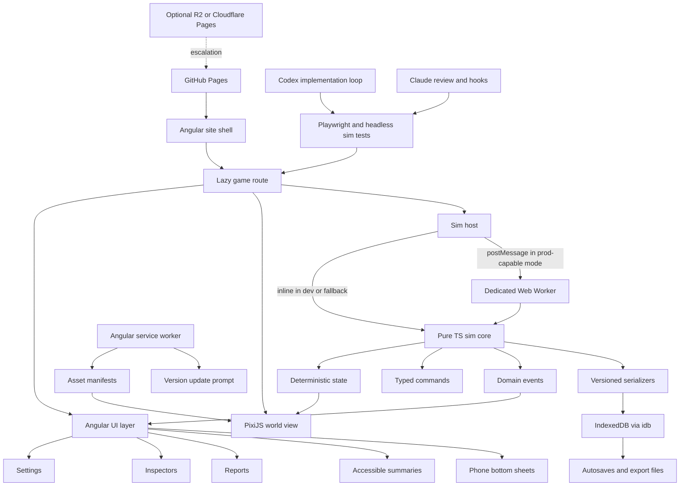

# R8-browser-architecture-visual-feasibility-and-ai-capability.md

## Executive verdict

**Build Obsolescence, Inc. as an Angular-routed, browser-native, static-deployed application with a lazy-loaded PixiJS scene on a dedicated game route, a pure TypeScript simulation core that can run headless and inside a standard Web Worker, Angular DOM for all text-heavy and accessible UI, IndexedDB saves via a very small wrapper, and GitHub Pages as the default host.** That is the least-bloated stack that still fits the project’s actual hard parts: a fixed-width vertically expanding building, many small visible actors and flows, responsive phone composition, deterministic saves and tests, and months of AI-assisted additions without turning the codebase into a bespoke engine accident. Angular already supports lazy route loading, static build output, web workers, and service-worker-driven asset versioning and updates, which makes the “game inside an existing site” requirement realistic rather than awkward. citeturn36search0turn36search1turn36search4turn36search12turn40view1turn36search5turn40view5

The primary renderer should be **PixiJS 8.x, not Phaser 4**, because Obsolescence, Inc. does not need most of the extra engine that Phaser brings. Phaser is a capable and current framework for desktop and mobile web games, with official Angular templates, scale management, particles, audio, and an editor ecosystem; its production bundle on jsDelivr is also materially larger than a lightweight renderer baseline, with `phaser.min.js` listed at **1.31 MB** minified in the official CDN directory. citeturn22search8turn22search1turn22search2turn33search5turn33search11turn26view0 PixiJS, by contrast, is explicitly a fast 2D WebGPU/WebGL renderer with a scene graph, federated mouse/touch events, layout and UI ecosystem packages, high-scale particle containers, and a large showcase of shipped work; it is closer to what this game actually needs: “draw lots of 2D things well, accept inputs cleanly, and get out of the way.” citeturn19search12turn19search0turn19search17turn19search16turn19search6turn19search1turn32search3

The **fallback** should be **Phaser 4**, but only if a tightly-scoped spike proves that the custom camera/input/asset orchestration needed on top of Pixi becomes large enough that you are effectively rebuilding engine services anyway. That is a defined trigger, not a parallel recommendation. Phaser’s official support for framework templates, scene/camera abstractions, particles, and scale management makes it the right escape hatch if Pixi’s “lighter and simpler” promise stops being true in this project’s specific implementation. citeturn22search2turn22search5turn22search10turn33search1turn33search5turn33search11

**The visual recommendation is decisive as well:** do **not** attempt to “ship the mockups” as bespoke, image-model-rich room illustrations for every new floor, machine, product family, queue state, and incident. That would create an unsustainable asset debt. Ship a **stylized modular 2D pipeline** instead: reusable painted/vector floor slices, small sprite atlases for workers/products/vehicles/props, tintable variants, occasional particles and overlays, and strong composition. Use AI image models upstream for concept exploration, paintovers, and occasional source fragments, but not as the canonical runtime asset generator. Kenney’s assets are CC0 and useful for placeholder and utility coverage; OpenGameArt supports CC0 and attribution-bearing licenses; Aseprite supports sprite-sheet export and CLI pipeline use; Krita supports vector layers and scalable shape work. citeturn35search0turn35search4turn35search5turn35search9turn35search2turn35search3turn35search11

**GitHub Pages is sufficient for the default architecture** because the application is single-player, client-simulated, and statically deployable; GitHub Pages supports custom domains and HTTPS, and GitHub’s Pages workflow model can publish built static artifacts. GitHub’s official Pages guidance also documents relevant soft limits: a recommended site size under **1 GB**, soft **100 GB/month** bandwidth, and soft **10 builds/hour**. Git LFS is not a magic escape hatch for giant unoptimized art either, because per-file limits still apply by plan. citeturn30search23turn34search1turn34search2turn45view3turn0search12turn0search13turn0search14

My recommendation, in one sentence: **Angular shell + lazy route + PixiJS world + pure TS deterministic sim + Worker-capable host abstraction + idb-backed saves + GitHub Pages first, Cloudflare only when a concrete trigger appears.**

### Canonical technical target

What is actually being built is not “an Angular page with a giant embedded image” and not “a small custom engine.” It is a **single browser route** that mounts a GPU-backed **fixed-width vertical world view** and pairs it with ordinary responsive web UI. The route owns a renderer canvas, a small simulation bridge, an Angular inspector/navigation shell, and a save/update layer. The simulation is authoritative; the renderer is a projection. Angular owns dialogs, reports, settings, search, paused inspectors, keyboard-friendly control surfaces, and screen-reader-facing summaries. Pixi owns the building slice, characters, objects, movement, particles, and culling. citeturn36search0turn36search1turn19search12turn19search17turn19search0

The browser platform is strong enough for this plan. WebGL is broadly present across modern browsers, service workers and dedicated workers are mature, IndexedDB is the standard browser database for larger structured local data, and OffscreenCanvas exists if later profiling justifies more aggressive worker rendering experiments. WebGPU is real and advancing, but it still has stricter requirements and wider compatibility variance than WebGL; it should remain an optional Pixi capability, not a project dependency. citeturn39view5turn39view3turn39view4turn15search3turn39view1turn15search6turn39view2

### Explicit assumptions

The recommendation below assumes the existing site remains Angular-based, statically deployed, and single-player-first; that no runtime LLM calls are required during play; that accessibility is achieved through web UI and summarized scene state rather than by exposing every decorative sprite; and that the project should remain under roughly the user’s stated low-cost hosting preference unless a later requirement forces otherwise. Where I could not execute a browser framework benchmark in this environment, I say so directly and provide an executable protocol instead of pretending the run happened.

## Evidence and runtime decomposition

### Evidence and comparable implementation canvas

The current technical evidence favors **browser-native 2D** over exported standalone engines. Angular’s current docs show first-class lazy-route loading through `loadComponent` and `loadChildren`, static build output, service-worker manifest versioning, update events via `SwUpdate`, and scaffolded worker support with documented SSR fallbacks. That is exactly the kind of web stack you want when the game must sit inside an existing personal website instead of replacing it. citeturn36search0turn36search3turn36search4turn36search12turn36search5turn40view5turn40view1

PixiJS’s current value is not “it can make games in general,” but that it offers the right primitives for *this* kind of game: a performant 2D scene graph, WebGL/WebGPU rendering, federated pointer events, high-scale particle containers, and an ecosystem that remains optional rather than mandatory. That means you can keep Angular in charge of text-heavy site UI instead of force-fitting everything through an engine HUD stack. citeturn19search12turn19search0turn19search17turn19search16turn32search3

Phaser 4 is also viable, and the current official ecosystem is healthier than “framework glue from the community.” Phaser ships official framework templates, including Angular/Vite work, current Phaser 4 documentation, scale management, particle systems, and a broad catalog of shipped games. That makes it a credible fallback. The problem is not that Phaser is weak; it is that Obsolescence, Inc. would only use a subset of what Phaser adds, while still paying the conceptual and bundle cost of a full game framework. citeturn22search1turn22search2turn22search5turn19search7turn33search5turn33search11turn22search18turn26view0

Evidence for “AI can sustain a serious browser game repository” is mixed but usable. The strongest proof is not marketing demos but the combination of official capabilities and inspectable public repos. OpenAI’s current Codex guidance explicitly supports AGENTS.md instructions, reusable skills, browser/game workflows, screenshot-driven UI iteration, long-horizon task documents, and scored improvement loops. Anthropic’s Claude Code docs explicitly support project memory files, hooks, skills, subagents, MCP, GitHub Actions, and repo-scale codebase operations. Public repos like **webwoven**, **Witness**, and **agent-game-forge** provide inspectable but still self-reported examples of AI-led implementation, QA, and game/tool workflows; they are useful as process evidence, not as impartial validation. citeturn17search4turn17search0turn17search5turn17search1turn17search2turn17search12turn17search13turn17search8turn18search6turn18search12turn18search0turn18search3turn18search4turn18search5turn21view0turn21view1turn21view2

### Mockup-to-runtime decomposition

The decisive gap is between **a mockup that is one beautiful image** and **a game that can survive months of additions**. The mockups are useful as composition canon and mood reference. They are not a sustainable runtime asset spec. A living building needs variant states, path markers, failures, old product generations, dirt, queues, animation loops, alert states, selection states, and responsive cropping. The right translation is not “rebuild the image exactly,” but “preserve the silhouette, composition, hierarchy, and showroom-versus-basement contrast while reducing bespoke per-room art.” That is a stylization problem, not a renderer problem.

| Visible element | Recommended runtime method | Memory cost | Animation need | Interaction need | Asset burden |
|---|---|---:|---|---|---|
| Building shell, façade cuts, repeated floor framing | Reusable baked floor-shell slices, preferably vector-mastered then exported to atlased PNG or WebP | Low to moderate | Minimal parallax and state swaps only | Low | Low once kit exists |
| Street, ramp, dock backdrop, basement walls | Repeating background panels and lane overlays | Low | None to light | Low | Low |
| Office desks, showroom fixtures, repair benches, machines | Modular sprite kit with tint/variant support | Moderate | Light loop states | Medium when selectable | Moderate, amortized across many floors |
| Workers, customers, technicians | Small atlased character sprites with shared rigged-looking loops or 4–8 frame directional cycles | Moderate | Constant but simple | Medium | Moderate |
| Products, packages, pallets, carts | Lightweight sprites or grouped instanced-like renderables | Low | Constant simple movement | Low to medium | Low |
| Trucks and elevator cars | Larger modular sprites; optional separate atlas | Low | Noticeable travel loops | Medium | Low |
| Queues and crowds | Aggregate visual groups beyond near-camera detail, rather than fully independent high-detail actors | Very low per extra body | Light | Low individually | Low |
| Incidents like sparks, smoke, thermal flare, spills | Particle systems and temporary overlays | Low if capped | High but short-lived | Medium via alert selection | Low |
| Room labels, metrics, inspectors, contracts, policy text | Angular DOM | Negligible relative to GPU art | None | High accessibility | Low |
| Selection outlines, route previews, capacity overlays, path debug | Renderer-drawn vector overlays | Very low | Dynamic | High | Very low |
| Historical product lineage, quality summaries, customer complaints | Angular DOM inspectors backed by simulation metadata | Low | None | High | Low |
| Distant floors far offscreen | Not drawn; simulated at aggregate or sleeping level | Near zero render cost | None visible | None | None |

This decomposition is the core reason I do **not** recommend DOM/CSS/SVG as the primary world renderer. It is excellent for the text-heavy affordances, but once dozens of workers, items, overlays, particles, and culling states enter the scene, Canvas/WebGL is the cleaner and safer split. Pixi’s scene graph and event model fit that pattern directly. citeturn19search0turn19search17turn19search12

### What the current mockups overpromise

The mockups overpromise in three specific ways.

First, they imply that every slice of the building can remain **richly bespoke** while still accepting endless additions. That is not realistic for one person plus AI coding agents. Floor kits and machine families must be modular, recolorable, and recombinable.

Second, they imply **full-detail continuity everywhere at once**. A real game must cull, simplify, and sometimes replace individuals with aggregates. Offscreen floors should not keep their full decorative animation budget; only their simulation significance should persist.

Third, they imply that phone play can preserve **desktop density**. It cannot. Mobile needs a different composition: one to two floors at readable scale, navigator jumps, bottom sheets, summarized alerts, and deliberate hiding of peripheral detail.

## Architecture and renderer choice

### Fixed-width vertical world and camera architecture

The building should use a **stable logical width of roughly 1440 world units** with floor pitches around **144–168 world units**, because that keeps a constrained laptop viewport readable while preserving enough cross-section richness to stage the showroom, office rows, vertical transport, and basement process lanes. The initial fit-to-width zoom should ensure **no page-level horizontal scrolling** at roughly **1024×640**. Horizontal pan should exist, but only unlock once the user zooms above the default fit width by a clear threshold. This is a camera rule, not a CSS accident.

The correct scroll owner is a **renderer-owned vertical camera inside a fixed route container**, not normal page scrolling. Browser scrolling would make the game feel like a very tall infographic, complicate phone gestures, and fight Angular overlays. Phaser’s camera/scale docs and Pixi’s viewport ecosystem both confirm that engine-side view management is the standard solution for this class of scene, while Angular handles the rest of the page. citeturn33search5turn33search1turn19search2turn32search1

The world model should use **stable floor instance IDs**, not raw “nth floor from top” assumptions alone. Each floor instance should have a durable ID, a z-order index, a floor type key, and slot IDs for room zones. Saves should refer to these IDs. New floors are inserted by updating order arrays, not by recalculating every saved coordinate. This keeps migrations survivable.

The floor layout model should be a **constrained hybrid**, not fully freeform construction and not a rigid single-tile grid. Each floor should expose:
- a fixed shell,
- a small number of room/service zones,
- lane or station sockets,
- elevator/ramp and utility attachment points,
- optional decorative and process subtiles internal to the zone.

That preserves the “stable flagship building” identity and avoids creating a factory-construction editor by accident.

Culling should be **chunked by floor bands**, with one band above and below the visible region retained for prewarm. Distant floors should keep authoritative simulation but render only aggregate indicators or sleep entirely at the visual layer. Near-camera agents get individual animation; farther ones collapse to cohorts or simplified loops. Pixi’s scene graph, render grouping, and scalable particle/container tooling support exactly this sort of selective visual complexity. citeturn19search0turn19search16

On phone, the same world model should drive a different composition:
- portrait orientation first,
- a persistent mini navigator or floor strip,
- swipe/drag on the world for vertical movement,
- tap-to-jump from alerts and search,
- bottom-sheet inspectors,
- pinch zoom allowed only within bounded min/max ranges,
- no “fit whole building on screen” mode except maybe as a tiny navigator thumbnail.

Playwright’s official device emulation, projects, traces, screenshots, and multi-browser support make this responsive behavior testable instead of eyeballed. citeturn37search0turn37search4turn37search2turn37search6turn37search17turn37search20

### Renderer comparison and selected framework

The table below scores the candidate approaches specifically for Obsolescence, Inc. “High” means “good fit for this project,” not “most features in the abstract.”

| Approach | Many rooms and agents | Camera, zoom, cull | Touch and input | FX and particles | Angular coexistence | Accessibility path | Bundle discipline | AI familiarity | Maintainability | Verdict |
|---|---|---|---|---|---|---|---|---|---|---|
| Angular DOM/CSS/SVG with limited Canvas | Low to medium | Medium | High | Low | High | Excellent | High | High | Low once world gets busy | Reject as primary world renderer |
| Angular + PixiJS | High | High | High | High | High | Strong via DOM sidecar | High | High | High if camera/tools stay bounded | **Select** |
| Angular + Phaser 4 | High | High | High | High | Medium to high | Strong via DOM sidecar | Medium | High | Medium; more engine to carry | Fallback |
| Orthographic Three.js / low-poly 2.5D | Medium | Medium | Medium | Medium to high | Medium | Medium | Low to medium | Medium | Medium to low | Postpone |
| Godot or Unity web export | Medium to high | High inside engine | Medium | High | Low | Low unless duplicated | Low | Medium | Low for this site-embedded use case | Exception only |

**Why Pixi wins:** it gives you the render performance and scene control you actually need, while letting Angular keep doing what the web is already best at. Pixi is explicitly a renderer, not an all-in-one game framework, and that is an advantage here. Pixi’s current docs and ecosystem cover scene graphing, interaction, particles, layout, UI add-ons, and worker-related bundles without requiring you to buy into engine scenes, physics, tilemap doctrines, or engine-native HUDs. citeturn19search12turn19search0turn19search17turn19search16turn19search6turn32search3turn42search7

**Why Phaser does not win by default:** Phaser provides more than this game needs. Its current framework support, scale manager, particles, and broader engine feature set are real strengths, and they are why it is the fallback. But Obsolescence, Inc. does not need integrated physics, arcade collision, scene lifecycle complexity, or a game-framework-first view of the whole application. For this project, those are mostly costs. citeturn22search2turn22search1turn33search5turn33search11turn26view0

**Pixi failure triggers that justify switching to Phaser:**
1. The Pixi spike misses the normal-load frame and input gates even after art simplification.
2. The project ends up needing three or more Phaser-native systems in earnest: scene orchestration, advanced built-in camera/scale workflows, heavy particle authoring, engine audio sequencing, or visual scene authoring.
3. Camera/input/selection plumbing in Pixi becomes core-project infrastructure large enough that AI agents repeatedly damage it when adding content.

### Simulation, worker, and data architecture

The simulation should be a **pure TypeScript domain package** that has **no Angular imports and no renderer imports**. Its API should accept typed commands, a seed, and an initial state, and produce deterministic updated state plus emitted domain events. If the same initial snapshot and command stream are replayed, the same high-level outcome should result. Fixed timestep discipline remains the right baseline for deterministic game logic, and event-sourcing ideas remain useful for debugging and replay, but full event sourcing should stay selective rather than ideological. citeturn38search0turn38search1turn38search8

I recommend a **10 Hz authoritative simulation tick** with renderer-side interpolation to the display framerate. This is a management sim, not a physics platformer. A 100 ms tick gives strong determinism, cheap replay, simple pause/step/speed behavior, and enough temporal resolution for believable worker paths and process lines when progress is interpolated visually between ticks. High-speed simulation becomes straightforward because you are multiplying a low base tick count, not a 60 Hz authoritative engine loop.

The worker architecture should be:

- `@oi/sim-core`: deterministic domain model, reducers, seeded RNG, command types, serialization, migrations.
- `@oi/sim-host`: protocol and host abstraction.
- `DedicatedWorkerSimHost`: production-capable worker host using ordinary `postMessage`.
- `InlineSimHost`: same interface for local dev, SSR fallback, and test harnesses.

Angular’s worker guidance explicitly warns that some platforms do not support workers and recommends fallbacks. That aligns perfectly with an interface-based host design rather than hard-coding one execution mode. citeturn40view1

The data model should be **domain registries and typed content packs**, not a generic ECS framework. Define explicit schemas for:
- floors,
- room shells,
- stations,
- worker roles,
- product families,
- incidents,
- policies,
- routable item types,
- customer cohorts,
- generated product generations.

This makes vibe-coding additions safer because a “new battery diagnostics floor” mostly means adding registries, prefab data, explicit behavioral modules, and tests. It does **not** mean teaching an agent to noodle inside a generic pile of entities and components with project-implicit meanings.

Pathing should be **lane/graph based**, not continuous pathfinding over arbitrary freeform geometry. Floor travel in this game is constrained and theatrical: doorways, lift points, ramp access, service lanes, station sockets, queue points. That favors discrete graphs and precomputed route segments. If a generic grid pathfinder is ever needed for a bounded subproblem, it exists, but the game’s main topology should stay more constrained than a tile-based sandbox. citeturn30search0turn30search22

**Observed benchmark evidence from this execution environment:** I could not complete a stable headless Chromium run for a disposable browser canvas spike inside this container, so I did **not** fabricate browser frame-rate results. I did run a Node-based deterministic simulation stress benchmark over **10 simulated minutes** at **60 simulation updates per second** to test the computational headroom of a pure-TS authoritative core. On this environment, a showcase case with **40 agents / 140 items / 10 floors** averaged **0.0027 ms per tick**, a normal case with **120 agents / 600 items / 16 floors** averaged **0.0054 ms per tick**, a stress case with **260 agents / 1800 items / 28 floors** averaged **0.0126 ms per tick**, and a deliberately extreme case with **500 agents / 5000 items / 40 floors** still averaged about **0.122 ms per tick**. Those numbers are not user-device guarantees, but they strongly support the recommendation to keep the authoritative simulation simple, deterministic, and separate from rendering.

### Asset-production pipeline and visual ceiling

The realistic ceiling for one AI-assisted developer is **stylized, strongly art-directed, modular 2D**, not mockup-perfect miniature illustrations for every room permutation. The canonical pipeline should be:

1. **Vector or layered painted masters** for building shells, floor trims, wall cuts, signage, and large room backdrops.
2. **Small sprite atlases** for workers, products, conveyors, pallets, trucks, elevator cars, stations, and common props.
3. **Code-driven variants** for colors, labels, decals, queue fullness, machine wear, and product generation marks.
4. **Renderer-drawn overlays** for selection, heat, routes, capacity, and incidents.
5. **Particles** only for short-lived incidents and launch-day emphasis.

Krita is suitable for layered paint/vector cleanup; Aseprite is suitable for compact sprite work and export; Kenney is excellent for placeholders and utility CC0 assets; OpenGameArt is only acceptable when license metadata is curated carefully and anything non-CC0 is explicitly tracked. citeturn35search3turn35search11turn35search2turn35search0turn35search12turn35search5turn35search9

I do **not** recommend a low-poly-3D-to-2D canonical pipeline for this project. It looks attractive on paper because it promises infinite rerenders, but it adds another scene authoring world, camera consistency problems, material consistency problems, and AI-tooling complexity. If you use it at all, use it for a few hard-surface objects like trucks or machinery variants, exported into the same 2D atlas pipeline—not as the project’s main visual religion.

**Practical answer to the asset burden question:** one person survives this project by building **families**, not **rooms**:
- one office kit,
- one showroom kit,
- one industrial process kit,
- one service/repair kit,
- one waste/recycling kit,
- one worker body kit with role variants,
- one product-family silhouette grammar,
- one incident FX kit.

Every new content addition should mostly recombine those families. If a later floor requires unique art, that art should still sit on top of the same shell, lane, atlas, and overlay system.

### Responsive desktop and phone implementation

Desktop and phone are not the same scene scaled differently. They are different **compositions** of the same world.

On a constrained laptop near **1024×640**, the default view should fit the full building width and show roughly **3–5 floors** depending on zoom and floor pitch. On a more typical desktop viewport, the same default width fit can expose more altitude while keeping the left and right world edges visible.

On a tall phone near **390×844**, the game should default to a zoom where **1–2 floors** are readable, worker bodies remain legible, and taps hit meaningful targets. The building navigator remains persistent. Inspectors open as bottom sheets. Multi-step controls move into layered sheets or segmented panes. Alert-jump and search-to-object become more important than free scrolling.

Reduced-motion mode should:
- reduce particle count,
- shorten or remove idle loops,
- disable camera easing,
- replace blinking warning states with solid or iconographic states,
- slow nonessential ambient movement.

That is easier when Angular owns the descriptive UI and the scene renderer remains presentational rather than the only source of truth.

## Delivery, persistence, and hosting

### Loading, bundles, caching, PWA, and update behavior

The game route should be **lazily loaded** so ordinary site visitors do not download the renderer or game assets on first visit. Angular’s route loading and preloading controls support exactly that split. The loading sequence should be branded and deliberate:
- a tiny game-shell route bundle,
- a “first playable” asset group containing only the base atlas, fonts, and simulator code,
- background loading of heavier atlases, later-floor kits, optional audio, and noncritical decorative packs. citeturn36search0turn36search7turn36search17

The Angular service worker is sufficient for a static game-site deployment. Angular’s `ngsw-config.json` and `ngsw.json` manifest flow already support hashed asset versioning and update detection, and `SwUpdate` exposes events for “new version ready” prompts. That means you can safely prompt the player before swapping to a new asset/app version instead of silently breaking a long session. citeturn36search2turn36search5turn40view5

My recommended payload targets are:
- **first meaningful visual:** under **3 seconds** on ordinary desktop broadband, under **8 seconds** on an ordinary mobile connection;
- **first playable compressed payload:** **12 MiB target**, **15 MiB warning**, **20 MiB design review**;
- **initial background-loaded product pack total:** **20 MiB target**, **25 MiB warning**.

That is strict enough to protect mobile discipline without forcing absurd austerity.

PWA installation is **optional, not launch-critical**. A service worker already provides the main update/offline/caching value. Only promote a full installable PWA after the phone composition is good enough that installation helps more than it confuses.

### Persistence, saves, migrations, and recovery

Use **IndexedDB**, not localStorage. IndexedDB is the browser’s standard larger structured store, and browser storage APIs treat IndexedDB/Cache data as best-effort by default unless the origin is granted persistence; MDN’s storage guidance also notes that Safari and most Chromium browsers auto-decide `persist()` requests rather than always prompting the user. WebKit’s storage policy updates confirm that IndexedDB, service workers, Cache API, and related storage are subject to quota policies. citeturn15search3turn39view6turn39view0turn39view7

For the save library, choose **`idb`** over Dexie for the initial build. The official `idb` repo describes it as a tiny promise-based wrapper at about **1.19 kB brotli’d**, which is ideal for a single-game local save layer. Dexie is mature and powerful, but I would only adopt it if the save layer evolves into a richer local database with substantial indexing and query ergonomics needs. For tests, use **fake-indexeddb** to run migration fixtures and corruption recovery tests under Node. citeturn45view5turn28search14turn28search0turn28search2turn45view4

The save format should be:
- one canonical snapshot record,
- five rotating autosaves,
- manual named saves,
- export/import as compressed JSON file,
- schema version and content-pack version inside each save,
- migration scripts checked into source control,
- optional short replay/event tail only for debugging, not as the sole persistence layer.

Cloud saves and accounts should stay out of scope unless a later requirement demands **cross-device continuity**, **shared daily challenges**, or **remote telemetry-backed recovery**. Until then, export/import plus local backups is the right complexity level.

### GitHub Pages feasibility and hosting escalation ladder

GitHub Pages remains the right first host because this is a static, client-simulated application with a custom domain and no mandatory backend. GitHub Pages supports custom domains and HTTPS, and Pages deployments can be driven by GitHub Actions-based artifact publishing. citeturn34search1turn34search2turn45view3

GitHub’s published soft limits matter, though: recommended published site size under **1 GB**, soft **100 GB/month** bandwidth, and soft **10 builds/hour**. Those are not immediate blockers for a personal site game, but they are real design constraints. GitHub Free Pages for sites also ties public visibility to plan limitations, which matters if the route lives in a public personal-site repo. citeturn0search12turn0search13turn34search3turn34search9

The recommended hosting ladder is:

| Level | What to use | Use until | Likely annual cost | Trigger to move |
|---|---|---|---:|---|
| GitHub Pages only | Main Angular site, game route, hashed static assets | Site stays comfortably under Pages soft limits and no custom headers are required | $0 | Need custom headers, more aggressive cache control, or asset growth starts hurting deploys |
| GitHub Pages plus external static asset host | Keep app on Pages; move heavy atlases/audio to versioned asset bucket | Main bundle remains lean but assets outgrow convenient repo hosting | Usually $0 at modest use with R2 free tier; low single digits if exceeded | Need custom response headers on the **site itself**, or asset complexity makes split-host awkward |
| Cloudflare Pages | Entire static site on Pages with `_headers`, redirects, previews, analytics | Need better static hosting controls while staying serverless | Often $0 on Free | Need backend logic or save sync |
| Tiny serverless backend | Cloudflare Workers for save sync, telemetry intake, or daily challenge data | Only when a defined online feature exists | Often $0 to low tens; review before exceeding $100 | Real cross-device features or remote observability require it |

Cloudflare Pages is the clean escalation path because its official docs support `_headers` for response-header control, and its Free plan currently documents **500 builds/month**, **100 custom domains per project**, **20,000 files**, and **25 MiB max per static asset**. That is immediately useful if you later need COOP/COEP, immutable cache headers, or path-specific policies that GitHub Pages does not expose in public-hosting docs. citeturn44search0turn44search1

For asset overflow only, **Cloudflare R2** is an economical secondary host: its official pricing docs show a generous free tier with **10 GB** storage, **1 million Class A** operations, and **10 million Class B** operations per month before paid overages. If you keep all asset filenames content-hashed, R2 is a perfectly reasonable static-bucket partner to GitHub Pages. citeturn10search0

If you later need a tiny backend, **Cloudflare Workers** is the sensible first stop. Cloudflare’s official Workers pricing and limits docs document a free tier of **100,000 requests/day** and CPU limits on the Free plan, with a low paid floor above that. That is well within the stated personal-project budget for modest telemetry or cloud-save sync. citeturn11search0turn11search1

For lightweight privacy-friendly instrumentation, Cloudflare Web Analytics is also a good optional add-on: it is available on all plans and can be used even for sites not proxied through Cloudflare, within documented site limits. citeturn29search3turn29search6turn29search8

### Recommended dependencies, tools, and licenses

**Recommended runtime/tooling set**
- Angular route shell and ordinary UI. citeturn36search0turn36search1
- PixiJS 8.x renderer. citeturn19search12
- `idb` for IndexedDB.
- `fake-indexeddb` for tests. citeturn45view5turn45view4
- Playwright for desktop/mobile/browser test projects, screenshots, and traces. citeturn37search0turn37search4turn37search2turn37search20
- Optional `@pixi/ui` only for small renderer-native widgets if truly justified; default to Angular DOM instead. citeturn32search3

**Tools to avoid as default dependencies**
- pixi-viewport as a hard requirement. It is useful, but current issue history shows enough v8-example friction that I would not make it foundational without the spike proving that it saves more code than it adds. citeturn32search1turn32search13turn32search17
- Phaser Editor as a default commitment. It is only useful on the fallback path.
- Spine or a skeletal-animation subscription stack for launch scope.

**License policy**
- Prefer MIT/ISC/Apache libraries.
- Prefer CC0 placeholders and utility art where outside art is used. Kenney is especially safe here. citeturn35search0turn35search12
- Avoid mixing in attribution-bearing art assets unless the repo includes a machine-readable license manifest and credits process.
- Keep AI-generated development art clearly separable from final shipped canonical assets.

### Performance, payload, memory, save, and cost budgets

These are the provisional project budgets I recommend using as acceptance gates for later implementation work.

| Budget | Target | Warning | Hard review trigger |
|---|---:|---:|---:|
| First-playable download | 12 MiB compressed | 15 MiB | 20 MiB |
| Initial total background pack | 20 MiB | 25 MiB | 30 MiB |
| Supported floor count without restart | 32 | 40 | 48 |
| Normal visible agents | 80–140 | 160 | 200 |
| Stress visible agents | 220–300 | 320 | 400 |
| Normal moving items | 400–800 | 1000 | 1200 |
| Stress moving items | 1500–2500 aggregated/lightweight | 3000 | 4000 |
| Desktop framerate target | 60 fps normal | 50 fps stress | below 45 fps stress |
| Phone framerate target | 45 fps normal | 30 fps stress | below 30 fps normal |
| Worst acceptable p95 frame time desktop | 16.7 ms normal | 22 ms | 25 ms |
| Worst acceptable p95 frame time phone | 22 ms normal | 33 ms stress | above 33 ms normal |
| Simulation p95 tick time | <2 ms normal | <5 ms stress | >8 ms stress |
| Tab memory | <220 MB normal desktop | <300 MB | >350 MB |
| Save size per campaign | <5 MB | <10 MB | >20 MB |
| Minimum readable text | 12 px desktop, 14 px phone | — | below these |
| Minimum touch target | 44 CSS px | — | below this |
| Simultaneously active particles | 100–150 normal | 250 | 400 |
| Annual hosting spend | $0–$25 ideal | <$100 | review required above $100 |

These are project budgets, not universal standards. They are intentionally conservative because the requirement is “months of extension by one person,” not “squeeze every last effect into the first prototype.”

## AI workflow, testing, and practical benchmark

### AI-agent capability evidence and recommended workflow

OpenAI’s and Anthropic’s current official guidance now supports the exact kind of workflow this project needs: repository-level instructions, reusable skills, browser inspection, screenshots, long-running tasks, hooks, subagents, and GitHub-integrated review. Codex’s official guidance emphasizes AGENTS.md, skills, browser workflows, screenshot-driven frontend work, long-horizon task files, and scored loops. Claude Code’s official guidance emphasizes CLAUDE.md memory, hooks, subagents, MCP, built-in codebase tools, and GitHub Actions/code review. citeturn17search4turn17search0turn17search1turn17search2turn17search5turn17search12turn17search13turn18search6turn18search12turn18search0turn18search3turn18search4turn18search5turn18search10

The practical split I recommend is:

- **Codex** as the primary **implementation agent** for scoped repository work: feature branches, code edits, tests, browser verification, screenshot comparison, and repetitive content additions.
- **Claude Code** as the primary **architecture/review/refactor agent**: schema sanity checks, repository exploration, test-gap finding, regression review, instructions/hooks/subagent design, and independent review of Codex diffs.
- **Human owner** as mandatory gate for: art direction, whether a scene actually looks good, whether complexity should be removed, policy and economy choices, and any core architecture changes.

That division matches both official capability guidance and the stronger public usage patterns visible in inspectable AI-built repos, while still respecting that the public repos are largely self-reported. citeturn21view0turn21view1turn21view2

Tasks that frontier agents are plausibly strong enough to handle with supervised autonomy:
- framework integration;
- simulation reducers and command schemas;
- worker host wiring;
- content registries and content-pack additions;
- responsive Angular inspector work;
- Playwright scenarios and snapshots;
- save migrations and migration fixtures;
- perf instrumentation and debug panels;
- adding a new floor/module when contracts already exist. citeturn17search1turn17search5turn17search12turn18search6turn18search12turn37search0turn37search2

Tasks that still require strong human judgment:
- deciding whether the art style holds together;
- deciding what the player should notice first;
- balancing visual density against readability;
- satire/tone;
- deciding when a simulation detail should be aggregated or cut;
- shipping/canceling a visual ambition.

### Developer lab, testing, observability, and performance strategy

Before major content production, build a **developer lab** into the game route. It should expose:
- deterministic seed selection,
- pause/step/speed controls,
- direct incident triggers,
- spawn tools for workers/items/queues,
- floor visibility overlays,
- path overlays,
- camera presets,
- save export/import,
- current sim/render/memory telemetry.

That is not premature infrastructure. It is what makes AI-assisted extension manageable.

The minimum automated scaffold should include:
- Playwright desktop and phone projects for core flows and resize/orientation checks. citeturn37search0turn37search4turn37search17
- Screenshot capture and trace collection on failures. citeturn37search2turn37search6turn37search20
- Headless simulation soak tests under Node.
- Save migration fixtures.
- Property tests or invariants for queue counts, product conservation, floor insertion, and deterministic replay.
- Error capture into a lightweight endpoint only if needed later; otherwise keep it simple.

The optional add-on here is an agentic QA layer such as Witness. It is promising, inspectable, and relevant to browser games, but it should remain optional until the first-party Playwright and deterministic test scaffold exists. citeturn21view1

### Flagship Vertical Slice Gauntlet results and exact executable protocol

I could **not** complete the requested two-stage Pixi-vs-Phaser browser prototype execution inside this environment. I attempted a disposable local-browser benchmark harness, but headless Chromium inside this container would not complete a stable local page execution loop suitable for collecting trustworthy interaction/frame data. I therefore do **not** report fabricated renderer comparison numbers.

What I **did** execute was the headless simulation benchmark summarized earlier, which strongly supports the recommendation that simulation cost is not the primary risk; visual complexity, camera composition, and asset burden are. That means the later benchmark must focus on the world-view hard parts, not just on reducer speed.

The exact protocol I recommend for the real **Flagship Vertical Slice Gauntlet** is:

**Thin stage**
- Implement the same scene twice: once in PixiJS, once in Phaser 4.
- Use only code-native or placeholder art.
- Include the canonical building stack: offices, street showroom, ramp, B1 dock, prototype, assembly/QC, repair, recycling, two lifts.
- Include fit-to-width, vertical camera, bounded zoom, horizontal pan only while zoomed, alert jump, pause, 1x/2x/4x speed.
- Measure bundle sizes, implementation complexity, first interaction, pointer/touch behavior, and resize/orientation handling.

**Pass conditions for the thin stage**
- No page-level horizontal scrolling at **1024×640** default fit.
- A readable phone portrait layout at about **390×844**.
- Normal load at target viewports with stable interaction and no architecture hacks that tie the sim to the renderer.
- Content additions confined mostly to data/registry modules.

**Winning stack then receives the fuller benchmark**
- Normal load recommendation: **120 visible agents**, **600 moving items**, **140 particles**, **16 floors available**, with culling and simplification.
- Stress load recommendation: **260 visible agents**, **1800 lightweight moving items**, **360 particles**, **28 floors**, with aggressive offscreen aggregation.

**Measured outputs**
- cold load to first visual;
- cold load to first playable interaction;
- warm load;
- bundle sizes;
- p50/p95/p99 frame times;
- simulation p95 tick time;
- memory;
- visible object counts;
- 10-minute sustain;
- resize/orientation transitions;
- background/resume;
- save/reload;
- reduced motion.

The spike fails if it can produce a static mockup but cannot survive this gauntlet cleanly.

### AI extension-test exact protocol

I did not execute the optional blind Codex-versus-Claude extension exercise here, so the following is the required protocol rather than a claimed result.

**Task**
Add a new battery diagnostics basement floor between assembly and repair. It must:
- accept failed products from quality and returns,
- route through three diagnostics stations,
- trigger a thermal incident,
- send repairable items to repair and unsafe items to recycling,
- add a floor-specific visual treatment,
- support phone navigation,
- introduce one automation policy,
- include deterministic scenarios,
- pass all existing tests.

**Success criteria**
- fewer than 20 files changed unless genuinely necessary;
- no renderer-main-loop rewrite;
- no simulation-core rewrite;
- at least one new content registry entry, one prefab/slice entry, one deterministic scenario, and one Playwright or headless sim test;
- no new one-off camera code;
- screenshots acceptable on laptop and phone;
- no regression in save migration tests.

**Process**
- Give the agent the architecture doc, AGENTS.md or CLAUDE.md, the content schema references, and an example floor addition.
- Require the agent to show touched files and explain why each changed.
- Require browser screenshots and test outputs before review.
- Have the *other* model review the diff before merge.

That is the right way to prove the architecture is truly extensible, because a healthy codebase turns this request into mostly content and module additions.

## Risks, simplifications, and implementation handoff

### Risks, kill criteria, and simplifications

The ambitions below should be treated as follows.

| Ambition | Decision | Why |
|---|---|---|
| Every offscreen floor remains fully animated | **Reject** | Wasteful and fragile |
| Hundreds of unique animated people | **Stylize** | Use role kits, recolors, shared loops |
| Mockup-level bespoke room art everywhere | **Stylize** | Unsustainable asset debt |
| Real-time lighting on every room | **Postpone** | Expensive and rarely worth it in this camera |
| Fully freeform factory construction | **Reject for launch scope** | Turns the game into a layout editor |
| Detailed simulation of every sold device in history | **Aggregate** | Preserve outcomes and cohorts, not literal device-level sim |
| Unrestricted pinch zoom over giant world | **Reject** | Mobile readability will collapse |
| WebGPU-only rendering | **Reject** | WebGL is the safe baseline citeturn39view5turn15search6 |
| Worker-based rendering before profiling | **Postpone** | Sim worker is enough for baseline |
| Server-authoritative accounts | **Reject for now** | No game-design need |
| Runtime LLM content generation | **Reject** | Adds cost, latency, instability, policy complexity |
| Multiple incompatible art pipelines | **Reject** | One pipeline is hard enough |
| Full desktop density on phone | **Reject** | Not actually responsive |

**Kill criteria for the Pixi path**
- normal-load p95 frame time budget fails after style simplification and culling;
- essential camera/input behavior still needs ad hoc patches after the spike;
- AI agents repeatedly must touch core camera/render plumbing to add content.

If any of those happen, switch to Phaser 4 and do not litigate the choice for another cycle.

### One-page architecture diagram

### Implementation handoff for R9

R9 should start from this exact canon:

Build a monorepo or workspace structure with:
- `apps/site` for Angular shell and route integration;
- `packages/sim-core` for deterministic state and commands;
- `packages/game-content` for floor/product/incident registries;
- `packages/game-renderer` for Pixi projection and camera;
- `packages/game-protocol` for shared types;
- `packages/test-fixtures` for saves and deterministic scenarios.

R9’s first implementation milestones should be:
- lazy route and branded loader;
- sim-core with fixed tick and command log;
- floor-band camera and fit-to-width world projection;
- one office floor, showroom, dock, one basement process floor;
- save/load and migration harness;
- developer lab and Playwright smoke tests;
- then the thin Pixi spike;
- only after passing that, content expansion.

Do **not** begin with art polish. Do **not** begin with dozens of room types. Do **not** begin with online accounts. The core risk is architecture and composition, not missing decorative detail.

### Questions to hand back to R3–R6 without solving them

The implementation architecture is ready, but later design tracks should answer these inputs cleanly:

- Which product-line history details must remain individually inspectable, and which can collapse into cohorts?
- Which incidents are load-bearing enough to get bespoke visual treatment in the first year?
- What exact information must remain accessible when the scene is unreadable or reduced on phone?
- Which floor families are canonical enough to deserve reusable kits before prototype content starts growing?
- What parts of product generation history are mechanically important enough to persist in saves rather than derive from summaries?

Those are design inputs to this architecture, not reasons to reopen the architecture.