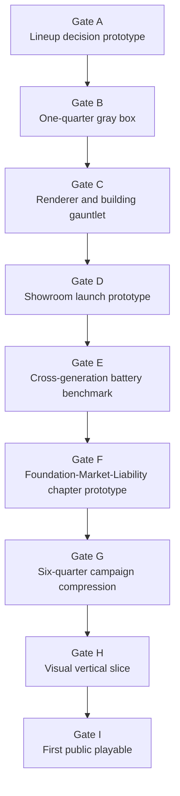
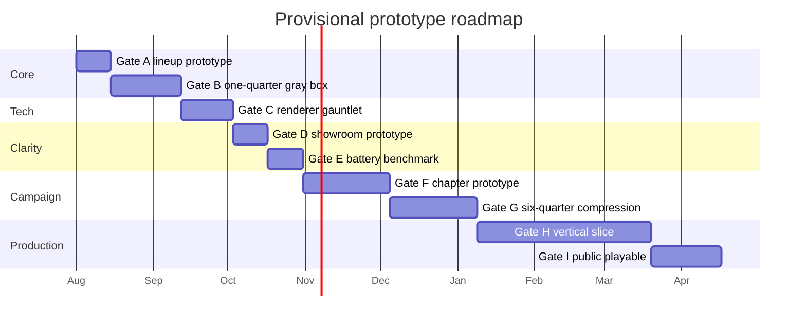

# R9 Prototype and Product Brief Plan

## Executive summary

The synthesis is **feasible in principle**, but only **fully valid if the completed R1–R8 reports are attached to the run as primary sources**. The R9 brief explicitly says the completed R1–R8 reports are the main evidence base, defines a source-precedence order, and warns not to substitute original prompts for the finished reports. That means a relaunch can produce a true R9 synthesis, but a run that lacks those reports can only produce a **provisional** R9 decision system built from the inherited findings summarized in the brief. fileciteturn0file0

My recommended research-phase verdict is **Proceed conditionally with a named simplification**: keep the game thesis, but set the **working first-release assumption** to **one product category, five three-quarter chapters, fifteen quarters total, three visual platform-wave kits, and a provisional Angular + TypeScript + PixiJS stack** that must survive an early scene gauntlet before it is locked. Eighteen quarters, six expensive platform overhauls, and a final renderer lock should all remain hypotheses until they pass named gates. This is the lowest-risk path that preserves the strongest parts of the concept while respecting the brief’s own warnings that campaign length, the Liability quarter, and PixiJS-vs-Phaser are still unproven. fileciteturn0file0 citeturn1search0turn0search9turn1search3turn1search4turn7search0turn6search0

The project’s unusual strength is that it already has a **clear institutional thesis** and a **highly legible spatial metaphor**: the showroom is the story the company tells, and the basement is how that story is produced. The brief also gives unusually concrete inherited canon around quarterly lineup launches, reverse logistics, a fixed-width vertical flagship, smartphone-first product grammar, and a browser-first technical posture. What is still dangerous is not broad ideation but **playable proof**: whether one quarter is fun for 25–35 minutes, whether launch outcomes are legible without dashboards doing all the work, whether reverse logistics adds consequence without chores, whether the Liability quarter is opportunity-rich rather than cleanup duty, and whether a fixed-width flagship remains readable on phone and small laptop hardware. fileciteturn0file0

The strongest evidence from comparable games points toward a **prototype ladder, not a vertical-slice-first approach**. Mini Metro began as a three-day jam game before moving to pre-alpha and Early Access; Papers, Please exposed only a rough first-eight-days beta before full release and later used deterministic auto-play and device-specific layouts to manage complexity; Prison Architect, RimWorld, Oxygen Not Included, Against the Storm, News Tower, and Project Highrise all demonstrate that deep management games succeed when teams validate one live backbone first, then add scenario structure, onboarding, touch adaptation, and public-feedback loops incrementally. citeturn12search0turn13search2turn13search3turn10search1turn15search5turn15search6turn3search6turn3search0turn11search3turn11search8turn14search9turn9search5

The immediate next action is therefore not “build the game,” and not “do more broad research.” It is to **relaunch Deep Research with the actual R1–R8 attachments**, using this report as the gate architecture, and then issue a first implementation brief for **Gate A: the lineup-decision prototype** with deterministic fixtures, zero polished art, and explicit kill criteria. That is the highest learning-per-week move available. fileciteturn0file0 citeturn12search0turn13search2turn16search1turn16search3

| Item | Recommendation | Confidence | Why it matters now |
|---|---|---:|---|
| Research verdict | Proceed conditionally with simplification | High | Preserves the thesis while cutting the biggest production risks early. fileciteturn0file0 |
| Campaign working assumption | 15 quarters, 5 chapters | Medium | Better balance of scope and memory-testing than 12 or 18. fileciteturn0file0 |
| Product breadth | Single category for first release | High | The brief itself says new categories are expensive and should not be first-release default. fileciteturn0file0 |
| Visual breadth | 3 visual platform waves reused across 5 chapters | Medium | Reduces art burden while preserving generational memory. fileciteturn0file0 |
| Renderer | PixiJS provisional, Phaser fallback | Medium | Pixi fits the Angular-shell thesis, but only a real scene can lock it. fileciteturn0file0 citeturn1search0turn0search9turn1search3turn1search4 |
| First implementation task | Lineup-decision prototype | High | If lineup authorship is not compelling, the rest of the building is decoration. fileciteturn0file0 |

## Feasibility, missing inputs, and current canon

The brief makes the missing-input problem very explicit. It requires the completed R1–R8 reports, states that those reports are the primary evidence base, supplies a precedence rule for resolving conflicts, and names additional desirable sources such as the preliminary thesis, News Tower notes, flagship-building concept notes, and current mockups. It also says that if attachment limits force prioritization, the eight completed R1–R8 reports come first. So the relaunch package is not a nice-to-have; it is part of the methodological validity of R9 itself. fileciteturn0file0

The practical implication is straightforward. If the relaunch includes the finished R1–R8 reports, then the synthesis task is feasible and should produce a solid R9. If the relaunch omits one or more of those reports, the output can still be useful, but it should be labeled **provisional** and should avoid claiming a true cross-report reconciliation. The present report therefore treats the inherited findings listed in the brief as **working canon**, but not as final proof of fun or full source reconciliation. fileciteturn0file0

The concept is already coherent enough to justify prototyping. It has a crisp one-sentence identity, a physically expressive core board, a repeatable quarter loop, and a clear “company remembers its promises” persistence thesis. The unresolved questions are at the right stage for prototypes, not ideation: they are interaction, pacing, readability, content-throughput, and implementation tradeoff questions. That is a good sign. Projects are most at risk when the thesis is vague; here the thesis is relatively concrete while execution risk remains high. fileciteturn0file0

The table below converts the current inherited material into a **decision register**. “Locked for prototype” means changing it now would invalidate the research program. “Strong provisional canon” means use it until a named gate overturns it. “Unproven hypothesis” means it must pass a gate before production treats it as true.

| Decision | Current status | Confidence | Source reports | Cost if wrong | Validation gate | Current fallback |
|---|---|---:|---|---|---|---|
| Game frame is a pausable real-time management game | Locked for prototype | High | R1, R3, R4, R5, R6, R8 via brief | Very high | Only overturn after Gate B if quarter play is fundamentally weak | Pivot to chapter-based scenario manager, not idle/offline. fileciteturn0file0 |
| Recurring public object is a quarterly lineup launch | Locked for prototype | High | R1, R5 via brief | Very high | Gate A and Gate B | Pivot only if lineup decisions prove shallow. fileciteturn0file0 |
| First category is a fictional smartphone/handheld platform | Strong provisional canon | High | R2 via brief | Medium | Gate B | If needed, narrow to one handheld family only. fileciteturn0file0 |
| Fixed-width vertical flagship cutaway is the main board | Strong provisional canon | High | R3 via brief | High | Gate C | Keep selected-floor vignettes and abstract other areas if full board fails. fileciteturn0file0 |
| Operations use modular bays with automatic routing | Strong provisional canon | High | R4 via brief | High | Gate B | Increase automation and reduce station variety. fileciteturn0file0 |
| Representative customers explain wider cohort outcomes | Strong provisional canon | High | R5 via brief | High | Gate D | Heavier cohort report layer with fewer individual skits. fileciteturn0file0 |
| Current + previous + burden family memory model | Strong provisional canon | Medium | R6 via brief | Medium | Gate E and Gate F | Default to current + previous only, surface burden by incidents only. fileciteturn0file0 |
| Three doctrine archetypes emerge from shared systems | Unproven hypothesis | Medium | R6, R7 via brief | Medium | Gate F | Keep only soft bias packages and remove “doctrine” framing. fileciteturn0file0 |
| Foundation–Market–Liability chapter rhythm | Unproven hypothesis | Medium | R6 via brief | High | Gate E | Shift to 2-quarter platform cycle if Liability quarter drags. fileciteturn0file0 |
| Eighteen quarters / six platform families first campaign | Unproven hypothesis | Low | R6 via brief | Very high | Gate F | Use 15 quarters / 5 chapters for first release. fileciteturn0file0 |
| PixiJS renderer with Angular shell | Strong provisional canon | Medium | R8 via brief | Medium | Gate C | Fall back to Phaser if engine recreation cost is too high. fileciteturn0file0 citeturn1search0turn0search9turn1search3turn1search4 |
| IndexedDB saves with versioned migrations | Strong provisional canon | High | R8 via brief | Medium | Gate C and slice gate | Local export/import JSON backup if migrations grow brittle. fileciteturn0file0 citeturn6search0turn6search11 |
| GitHub Pages / static hosting first | Strong provisional canon | High | R8 via brief | Low | Gate C | Any other static host; no backend unless a concrete need appears. fileciteturn0file0 citeturn6search9turn7search0 |
| First release should stay single-category | Strong provisional canon | High | R2, scope notes via brief | Very high | Gate G | Post-release expansion only. fileciteturn0file0 |

The most important contradictions can be reconciled without distorting the thesis:

| Tension | Recommended current decision | Confidence | Gate that can overturn it |
|---|---|---:|---|
| 10–14 meaningful launches vs 18 quarters | Use **15 quarters / 5 chapters** as the base production assumption. Every quarter still ends in a lineup event, but only 10–12 quarters need “full-theater” launch spectacle; Liability quarters can use smaller, consequence-heavy launch forms. | Medium | Gate E and Gate F. fileciteturn0file0 |
| Two foreground generations vs three visible families | Default UI foregrounds **current + previous**; the burden family appears only when an incident, contract, defect, or support obligation makes it decision-relevant. | High | Gate E. fileciteturn0file0 |
| Liability quarter fun | Treat it as **salvage, trust-recovery, and evidence-conversion quarter**, not a janitorial quarter. | Medium | Gate E. fileciteturn0file0 |
| Six platform families cost | Implement **five chapters** in the first release, but drive most chapter changes through pressures, suppliers, regulations, support burdens, and market stance rather than six fully bespoke visual/mechanical overhauls. | Medium | Gate F and Gate G. fileciteturn0file0 |
| Operations depth vs lineup authorship | Automation is mandatory early; the player should set policies, reserves, exceptions, and overrides, not manual routes. | High | Gate B. fileciteturn0file0 |
| PixiJS vs Phaser | Pixi remains the starting assumption because the game wants an Angular shell and DOM-heavy explanatory UI, but Phaser becomes the fallback if the actual scene proves that Pixi is forcing too much engine re-creation. This is an implementation inference supported by official framework positioning, not a benchmark result. | Medium | Gate C. fileciteturn0file0 citeturn1search0turn0search9turn1search3turn1search4 |

The relaunch should therefore attach the following inputs in this order:

| Priority | File or data | Why it is required | Recommended format |
|---|---|---|---|
| Essential | Completed R1–R8 reports | Primary evidence base and source-precedence input. | `.md` preferred; searchable `.pdf` acceptable. fileciteturn0file0 |
| Essential | `00-preliminary-thesis-and-research-program` | Clarifies early intent and what changed. | `.md` or searchable `.pdf`. fileciteturn0file0 |
| Important | Current mockups and wireframes | Needed for readability, mobile, and board-composition gates. | `.png`, `.webp`, or `.pdf`. fileciteturn0file0 |
| Important | Any R3/R5 annotated building elevations and phone wireframes | Needed to test floor focus, camera, and anchor-room composition. | `.png` / `.pdf`. fileciteturn0file0 |
| Useful | Notes on News Tower and recurring widget references | Helpful comparative context, but not a substitute for R1–R8. | `.md`. fileciteturn0file0 |
| Useful | Any current spreadsheets or JSON content schemas | Lets R9 reason about actual content throughput and save schema. | `.csv`, `.json`, `.yaml`. |

## Prototype research and the recommended ladder

The clearest lesson from comparable games is that management games gain reliability when they validate the **spine** first. Mini Metro’s official history shows a three-day jam prototype, then pre-alpha, then Early Access, then later content and polish. Papers, Please exposed only a rough first-eight-days public beta, and Lucas Pope later described building deterministic route plans and an autoplayer for full sweep testing on mobile. News Tower launched its Early Access campaign with only 1930–1932 playable before expanding toward 1930–1939. Prison Architect, RimWorld, Oxygen Not Included, and Against the Storm all demonstrate a pattern of incremental public/system validation, additive tutorialization, explicit test branches, and roadmap-driven iteration rather than one giant all-at-once build. Project Highrise’s tablet version is especially relevant because SomaSim explicitly says they rethought touch play into shorter, more intense sessions rather than simply shrinking the PC layout. citeturn12search0turn13search2turn13search3turn14search9turn14search2turn10search1turn15search5turn15search6turn3search6turn3search0turn11search3turn11search8turn9search5

That pattern strongly favors a **mechanics-first, then causality, then scene-readability, then throughput** ladder. It argues against jumping straight to a polished flagship-building slice. A beautiful cutaway can validate taste, but not whether the player enjoys choosing a lineup, feels the consequences, or understands why a later return spike is happening. The comparative evidence is particularly strong here because several of these games either shipped narrow early slices, used public alpha/Early Access to add major systems later, or explicitly separated experimental branches and save files to support aggressive iteration. citeturn10search1turn11search8turn3search0turn15search5turn15search6

The eight most useful comparables for Obsolescence, Inc. are summarized below.

| Game | What the earliest playable or early public form proved | What stayed fake, thin, or later | Lesson for Obsolescence |
|---|---|---|---|
| **Mini Metro** | A very narrow line-drawing loop could carry the game. It started as a 3-day jam and only later gained art, modes, and content scale. citeturn12search0 | Most later content layers and polish arrived after the core loop was already proven. citeturn12search0 | Prove the lineup-decision tension before building the full building. |
| **Papers, Please** | A rough beta covering only the first 8 days was enough to expose the working loop; later work handled breadth, localization, and mobile adaptation. citeturn13search2turn13search9 | The final breadth and platform variants came later. On mobile, deterministic autoplay and route plans became crucial. citeturn13search3 | Build a short, deterministic first-quarter slice first; create replay fixtures early. |
| **Prison Architect** | A public alpha could sustain years of iterative system growth. Planning mode, danger model, deployment, and mod support were layered in over time. citeturn10search1 | Many meta, UI, and advanced simulation systems came well after the first public release. citeturn10search1 | A public web build should come only after the backbone exists, not after full scope exists. |
| **Against the Storm** | A strong central loop can survive rapid, feedback-heavy iteration with an experimental branch and biweekly updates. citeturn11search3turn11search8turn11search13 | Community-shaped systems continued evolving after early public release. citeturn11search3turn11search8 | Use opt-in experimental builds and explicit community feedback channels after internal gates pass. |
| **News Tower** | A partial campaign window was shippable in Early Access. The official EA launch exposed a narrower timespan and core reporting/printing/tower loop first. citeturn14search9 | Full-decade scope and extra depth arrived later, culminating in 1.0 after nearly two years. citeturn14search2turn14search7 | First public playable should be a narrow but honest chapter, not the whole campaign promise. |
| **Project Highrise** | A tower ecosystem works, but touch adaptation required a distinct session/UI interpretation. citeturn9search1turn9search5 | Tablet design shortened and intensified sessions instead of mirroring the desktop experience. citeturn9search5 | Mobile parity means same sim, asymmetric presentation. |
| **RimWorld** | Core sim could grow over years with a tiny team; scenarios and tutorials arrived during alpha rather than before alpha. citeturn15search5turn15search6turn15search8 | A lot of onboarding and structured starts arrived after the backbone existed. citeturn15search5turn15search6 | Don’t overbuild tutorialization before the quarter loop is real. |
| **Oxygen Not Included** | A large alpha audience and separate public-testing branch helped validate content and stability before broader release. citeturn3search6turn3search0 | Branches warned of slower performance and incompatible saves. citeturn3search0 | Keep test branches and saves separate whenever a gate needs raw experimentation. |

Three plausible development sequences emerge from those lessons:

| Sequence | Strength | Weakness | Verdict |
|---|---|---|---|
| **Visual-first**: renderer + building + animated tower before mechanics | De-risks scene composition early | Risks polishing a weak loop; lowest learning-per-week | Reject as default. |
| **Mechanics-first**: abstract lineup spreadsheet/game first, visuals much later | Fastest proof of core decisions | Can delay readability/camera/mobile risks too long | Better, but incomplete alone. |
| **Dual-track**: mechanics-first, then causality benchmark, then renderer gauntlet on a real scenario | Best learning rate while still de-risking scene and mobile before slice | Requires discipline to keep the renderer gauntlet narrow | **Recommended**. |

The ranked critical assumptions, in the order they should be tested, are below. The ordering weights uncertainty, player importance, late-discovery cost, dependency count, and reversibility.

| Rank | Assumption to test | Why it is early |
|---|---|---|
| A | Lineup composition creates painful, legible tradeoffs | If this fails, the game’s thesis collapses. fileciteturn0file0 |
| B | One quarter stays engaging for 25–35 minutes without devolving into chores | Pacing is the backbone of the whole campaign. fileciteturn0file0 |
| C | A building scene can stay readable on laptop and phone | The flagship board is core, but should not be the first thing you build. fileciteturn0file0 |
| D | Showroom customers explain market outcomes clearly enough | The live launch cannot become a theatrical opacity machine. fileciteturn0file0 |
| E | Cross-generation consequences feel earned and understandable | “Company remembers promises” depends on this. fileciteturn0file0 |
| F | Liability quarter is interesting management, not backlog duty | Campaign rhythm stands or falls here. fileciteturn0file0 |
| G | Cohort compression preserves memory without sludge | Needed before writing a long campaign. fileciteturn0file0 |
| H | Pixi remains the simpler renderer in the real scene | Must be answered before the slice is treated as a durable base. fileciteturn0file0 |

The recommended prototype ladder is shown below.



The gate table below is the practical preproduction system.

| Gate | Prototype | Hypothesis | What is real | What is fake | Effort band | Test audience | Pass | Revise | Pivot/stop | Reusable output | Work forbidden before pass |
|---|---|---|---|---|---|---|---|---|---|---|---|
| A | **Lineup decision prototype** | Four-offer lineup, shared capacity, support promises, supplier forks, and deadlines create interesting tradeoffs | Product roles, deadlines, supplier choices, reserves, claim/cut decisions, outcome summary | Building, animations, full market, art polish | 1–2 weeks | Solo + 3–5 strategy players | At least 5/7 plays produce clearly different rationales; at least 4/6 testers want “one more run” | Tradeoffs exist but one role or one metric dominates | If choices collapse to an obvious best build, pivot to narrower scenario-management game | Decision schema, fixture seeds, balance notes | Building art, detailed staff sim, second category |
| B | **One-quarter gray box** | The concept→build→launch→early consequence loop sustains 25–35 minutes | Quarter clock, 4 offers, modular bay logic, launch, early returns, residue into next quarter | Rich visuals, full campaign, many segments | 3–5 weeks | 5–7 target players | Median play 25–40 min; at least 5/7 can explain why their quarter succeeded or failed | Fun exists but routine interventions are too high or consequences too opaque | If 2 iterations cannot remove chore feel, pivot toward more abstract ops model | Core sim slice, event log, baseline telemetry | Vertical slice visuals, chapter writing |
| C | **Renderer and building gauntlet** | A fixed-width flagship scene is readable and performant with the intended web stack | Scroll/jump camera, selected routes, crowd state, queues, bottom sheet, deterministic load | Full content, final art, full AI density | 2–4 weeks | Solo + 3–4 device tests | Meets performance/readability budget on laptop + phone | Functional but requires simplification of density/camera | If adding a floor or incident requires engine-level rewrites, switch to Phaser or simplify scene ambition | Locked renderer decision or clear fallback | Slice art production, final UI skin |
| D | **Showroom launch prototype** | Representative customers can make cohort outcomes legible | 7–9 min launch, 4–6 interventions, cohort outcome panel, visible customer confusion | Full campaign persistence | 2–3 weeks | 5–7 players | At least 5/7 can name one customer-visible reason for the market outcome | Players enjoy launch but cannot read causality well enough | If launch remains opaque, reduce live interventions and strengthen causal inspector | Launch script format, customer templates | More customer segments, extra dialog writing |
| E | **Cross-generation battery benchmark** | One architecture choice can remain legible across design, launch, returns, repair, and next-quarter residue | Battery choice chain, supplier, test signal, launch claim, returns, diagnostics, repair, reserve use, burden family resurfacing | Full chapter breadth, extra incident families | 2–3 weeks | 5–7 players | At least 5/7 can answer all four causality questions after play/watch | Players sense consequence but cannot reconstruct the chain | If comprehension fails twice, reduce system hops and strengthen route/timeline UI | Cause-chain inspector, cohort compression rules | Additional defect families, extra product categories |
| F | **Foundation–Market–Liability prototype** | Chapter rhythm feels distinct and the Liability quarter is fun | 3 quarters, same family history, one burden surfacing, chapter progression | Large campaign breadth | 4–6 weeks | 4–6 campaign-oriented players | At least 4/6 describe each quarter as mechanically distinct and at least 4/6 do **not** call Liability “chores” | Liability quarter works only with facilitator explanation | If Liability consistently reads as cleanup, pivot to 2-quarter or asymmetric cycle | Chapter template, chapter-level pacing data | Full campaign authoring |
| G | **Six-quarter campaign compression** | State compression, resurfacing, automation, and strategic divergence work | 2 platform transitions, automation unlocks, one serious failure/recovery chain | Final art, full chapter count | 4–6 weeks | 4–6 returning testers | Save/state remains understandable; no more than 3 visible families at once; divergence appears without hard classes | Works, but state/explanations are too dense | If state bloat persists, cut campaign length and compress older families harder | Campaign state model, release-length decision | Writing all 15 quarters |
| H | **Visual vertical slice** | Team can hit target quality and repeat it | One representative quarter with intended art/audio/UI pipeline | Full campaign | 8–12 weeks | Small closed group | Slice feels publishable **and** second similar quarter is estimated at ≤70% of first-slice effort | Slice looks good but throughput is too slow | If a second quarter appears unaffordable, cut first release scope further | Durable production pipeline, style guide, asset kit | Promise of full campaign size |
| I | **First public playable** | Public players can onboard, finish a tight slice, and leave useful feedback | Stable build, opt-in telemetry, save/reload, honest scope boundary | Full release promises, durable save compatibility | 3–5 weeks after H | Public website visitors | Acceptable stability, comprehension, and replay interest from public traffic | Build is fun but onboarding or readability still weak | If public confusion overwhelms feedback value, retreat to closed testing | Public deployment practice, support load data | Early-access style marketing claims |

The **canonical one-quarter gray-box scenario** should be built around one handheld platform family, four offers, and one battery chain. A concrete recommended scenario is this:

- **Platform family:** `LARK` handhelds.
- **Carried-over low end:** `LARK M1 Lite`, a discounted prior-generation model.
- **New Standard:** `LARK M2 Standard`.
- **New Premium:** `LARK M2 Pro`.
- **Accessory/service slot:** `DockPass` extended-care + connector accessory bundle.

The high-stakes choices are: a **sealed high-density pouch battery** versus a **thicker, easier-to-service modular pack**; a universal connector versus a proprietary accessory standard; a safe incumbent battery supplier versus a cheaper aggressive supplier; a support promise with generous battery replacement thresholds versus a narrower warranty stance; a decision to cut or overclaim one premium feature; and the reserve choice between launch inventory and service stock. A late test signal should indicate elevated battery swelling or fast-charge degradation risk under heat, but with incomplete certainty. The production conflict should be that battery calibration, final assembly, and diagnostics are all contending for the same limited bay budget late in the quarter. This directly satisfies the brief’s requirement that one architecture decision propagate through at least five downstream states in-quarter and at least one inherited state next quarter. fileciteturn0file0

At the **30-second** level, the player decides posture: battery architecture, connector stance, support promise, supplier, and reserve policy. At the **5-minute** level, the player is dealing with tradeoffs under deadline: cut or slip a feature, accept lower pilot confidence, redirect a bay, rewrite a marketing claim, or protect service stock. At the **25–35-minute** level, the player watches the launch, sees segment-specific reactions, absorbs a return/support cluster, and decides how much short-term pain to take in reserve spending, replacement policy, and trust salvage so that next quarter begins in a meaningfully altered state. This pacing matches the inherited R1 target and creates room for three different viable play styles: durable/service-heavy, premium/integrated, and scale-first. fileciteturn0file0

The **cross-generation battery benchmark** should remain the canonical causality test. The player must be able to follow, on desktop and phone, the chain from design choice → supplier consequences → prototype/test signal → pilot/production yield → launch claim → customer usage → delayed defect → return/diagnostic/repair/quarantine → reserve consumption → refurbishment/recovery → cohort compression → later resurfacing. The comprehension standard should be explicit: after a session or observed playthrough, at least 5 of 7 testers should be able to state **which earlier decision caused the later issue, why it was attractive at the time, what systems it affected, which response they chose, and what obligation remains**. If that threshold is missed in two iterations, the game should simplify the number of hops in the chain and strengthen the cause-chain inspector rather than adding more explanatory text. fileciteturn0file0

## Quarter, chapter, and campaign architecture

The strongest current campaign assumption is **15 quarters**, not 18 and not 12. The inherited findings say one quarter should take roughly 25–35 active minutes, and also warn that repeated launches could become a treadmill. Simple arithmetic therefore puts pure active play at roughly **5.0–7.0 hours for 12 quarters**, **6.25–8.75 hours for 15 quarters**, and **7.5–10.5 hours for 18 quarters** before onboarding, reading, retries, reflection, and failure-recovery overhead. Once those overheads are added, 15 quarters is the most plausible way to land inside the desired “finishable and satisfying” campaign window without forcing 18 distinct content-heavy beats on a solo production schedule. This is an inference from the brief’s quarter-length and target-campaign statements, not a measured playtest result. fileciteturn0file0

| Campaign assumption | Pure active-play range from quarter target | Likely real-world first completion | Production risk | Design risk | Recommendation |
|---|---:|---:|---|---|---|
| 12 quarters | 5.0–7.0 h | ~6–10 h | Lowest | May under-deliver on generational memory | Viable fallback |
| 15 quarters | 6.25–8.75 h | ~7.5–12 h | Moderate | Best balance of memory and finishability | **Base assumption** |
| 18 quarters | 7.5–10.5 h | ~9–14 h | Highest | Highest treadmill risk if Liability quarters sag | Keep as expansion / later proof only |

The **recommended chapter structure** remains Foundation → Market → Liability, but only provisionally. The reason to keep it is that it gives the game three different kinds of quarterly meaning without abandoning the core lineup loop: Foundation asks “what are we building and promising,” Market asks “what happens when we ask people to buy it,” and Liability asks “what survives contact with ownership.” That directly supports the long-term thesis that the company remembers its own promises. But the moment players experience Liability as “clear the backlog before the real fun resumes,” the structure has failed. That is why the chapter rhythm must be prototyped before the campaign is written. fileciteturn0file0

A good Liability quarter must create **positive opportunities**, not just penalties. It should offer at least four of the following in the prototype: profitable refurbishment, trust recovery, support differentiation, learning a platform improvement from returns, converting field failures into better next-family testing, using repair capacity as a competitive advantage, or deliberately abandoning an obligation to free capital for a more aggressive future posture. The point is not moral punishment. It is strategic tension: the player should feel that ugly residue can be turned into leverage, but only by accepting a visible institutional shape. That aligns with the satire brief and the operations/reverse-logistics thesis. fileciteturn0file0

The **cohort compression rule** should be conservative and player-facing. Keep **per-offer detail** only for the current family. Reduce the previous family to **aggregated installed-base cohorts** with visible obligations, known defect flags, compatibility flags, and support cost curves. Reduce anything older to a dormant archive that can resurface only when an incident, contract, regulation, or support promise makes it decision-relevant. That preserves memory while obeying R6’s own anti-sludge intent. The UI should default to showing only current and previous family in the main frame; the burden family appears as a pinned incident card when active. fileciteturn0file0

The three doctrine paths should be tested with deterministic fixtures rather than class buttons. Use the same opportunity pool and the same battery incident, but let three policy sets emerge:
- **Durable/open/service-heavy:** universal connector, modular pack, longer support, stronger repair/refurb, weaker launch margins.
- **Premium/integrated/ecosystem-heavy:** sealed premium battery, proprietary connector, stronger margins, stronger showroom appeal, more support fragility.
- **Scale-first/volume-heavy:** cheapest supplier mix, heavier reuse, thinner reserves, strongest reach, weakest shock absorption.

The balance gate should be qualitative and structural, not a hidden alignment score. If one approach wins the same fixture on **profit, trust, and resilience** at the same time, it is dominant and needs rebalancing. If testers can describe the paths only as “the blue faction / red faction / green faction,” the design has drifted into classes instead of institutions. fileciteturn0file0

A compact roadmap for the prototype program looks like this:



## Technical gate, playtesting, and telemetry

The technical architecture should stay close to the inherited R8 thesis: **Angular as shell and accessibility/text layer, a pure deterministic TypeScript simulation, local persistence, and a canvas renderer that does not force a backend**. Official Angular guidance supports fully static output via `outputMode: "static"`, and GitHub Pages remains a valid static-hosting path for public repositories and action-based deployment. MDN documents that IndexedDB is suitable for significant amounts of structured client-side data and is available in workers, which supports the brief’s local-save approach. Web Workers and OffscreenCanvas are also viable browser primitives for moving heavy work off the main thread. citeturn7search0turn7search6turn6search9turn6search0turn6search1turn8search0turn8search1

The **PixiJS-versus-Phaser** decision should be framed honestly. PixiJS officially offers an opt-in DOM-based accessibility overlay and explicit culling controls/plugins, which are attractive for a simulation that wants an Angular DOM shell plus a rendered world. Phaser officially offers a fuller scene framework with built-in camera manager, display list, update list, and scene systems, and its own official release notes emphasize large renderer and mobile-performance improvements in Phaser 4. The correct conclusion is **not** “Pixi is faster” or “Phaser is better.” The correct conclusion is: Pixi is the leaner fit for the current architectural thesis, but Phaser is the stronger fallback if the gauntlet shows that scene/camera/input scaffolding is eating too much project time. citeturn1search0turn0search9turn0search10turn1search3turn1search5turn1search4turn1search7

| Concern | PixiJS evidence | Phaser evidence | Current recommendation |
|---|---|---|---|
| Renderer role | Rendering-focused library with culling controls and optional accessibility module. citeturn0search9turn0search10turn1search0 | Full game framework with scene systems, display/update lists, cameras. citeturn1search3turn1search5 | Start Pixi if the game keeps Angular for DOM-heavy UI and explanation. |
| UI/accessibility coexistence | DOM overlay accessibility fits mixed DOM/canvas approach. citeturn1search0 | Phaser can certainly coexist with DOM UI, but its center of gravity is a fuller in-engine scene model. citeturn1search3turn1search5 | Favor Pixi if explanatory UI stays outside the renderer. |
| Performance promise | Pixi offers culling primitives but does not make claims about this specific game. citeturn0search9turn0search10 | Phaser 4 official notes claim major renderer/mobile gains. citeturn1search4turn1search7 | Do not lock on paper; run Gate C. |
| Risk of framework re-creation | Higher, if camera/scene/input/tooling keeps being re-implemented | Lower, because more is built in | Switch to Phaser if Gate C exposes too much reinvention. |

The **scene gauntlet** should use one canonical deterministic loadout: several floor bands, a visible showroom crowd state, separate freight/service movement, one ops queue, one incident overlay, zoom + scroll + floor jump, and one phone bottom sheet. The acceptance thresholds should be treated as project gates, not universal standards:
- constrained laptop target view: readable at 1366×768;
- representative phone target view: readable at a modern narrow mobile viewport;
- no critical input delay on tap or scroll;
- no core interaction hidden behind hover-only affordances;
- the developer can add one new floor type and one new incident without core rewrites.

For browser/device verification, official Playwright docs already support device emulation and screenshot capture, making it a good default for the desktop/phone test matrix. citeturn0search0turn0search1

The minimum **development scaffold** should be built in the following order, because each item directly increases iteration speed or trust in agent-written code:

| Build now | Why now | Defer until after Gate B or C | Why defer |
|---|---|---|---|
| Deterministic simulation core | Needed for reproducible quarter tests. | Full save migration UX polish | Useful later, not for proving the loop. |
| Typed commands + event log | Makes replay, telemetry, debugging, and agent review easier. | Large editor tooling | Premature before content format settles. |
| Direct scenario loader | Essential for fast fixture iteration. | Modding support | Not needed for preproduction learning. |
| Headless runner | Supports balance sweeps and regression tests. | Broad content-authoring UI | CSV/JSON + scripts are enough early. |
| Content schemas + validation | Prevents silent drift in data-heavy prototypes. | Full narrative scripting system | Need only minimal incident scripting first. |
| Device test matrix with Playwright | Phone parity is an early constraint, not a shipping-pass problem. | Public analytics dashboards | Too early before public builds exist. |
| AGENTS.md and repo instructions | Official Codex guidance explicitly says performance improves with clear repo instructions, reliable tests, and well-defined environments. citeturn17search6turn17search7 | Fancy multi-agent orchestration | Adds complexity before a reliable harness exists. |

The playtest program should remain small, qualitative, and structured. Microsoft’s long-running Games User Research work emphasizes usability and learnability as development concerns rather than marketing afterthoughts, and the tutorial/first-time-experience literature shows that onboarding matters especially for less-experienced players on mobile. For telemetry, interpretable event traces and action-sequence analysis are more useful than a heap of opaque raw counts. citeturn5search3turn5search7turn5search0turn5search12turn5academia49

| Stage | Sample | Focus | What to capture |
|---|---:|---|---|
| Solo dev inspection | Continuous | Broken logic, pacing spikes, exploit discovery | Full event log, seed, command trace |
| Expert management-game players | 5–8 | Decision quality, strategy texture, dominant paths | Time to first meaningful decision, manual interventions, “what would you do next quarter?” |
| Casual phone players | 5–8 | Tap burden, readability, floor navigation, session comfort | Mis-taps, floor jumps, zoom churn, text legibility complaints |
| First-time unbriefed players | 6–10 | Learnability and causality | Time to understand lineup roles, ignored panels, post-run explanation of outcome |
| Returning-after-gap players | 4–6 | Campaign memory, resurfacing, comprehension of burden family | What they remember unaided, what they misattribute |
| Public website visitors | Larger but opt-in | Stability and broad confusion patterns | Anonymous session seed, device class, exit points, optional feedback form |

A privacy-respecting telemetry design for a personal website should default to **local event logs** and **opt-in export/upload** for testing cohorts. If anonymous remote telemetry is used for a public playable, keep it to session seed, device class, basic interaction counts, timing, user-declared expertise, and outcome choices. Avoid real names, typed free-text without consent, cross-site identifiers, or behavioral advertising junk. The point is to understand comprehension and friction, not to build a surveillance stack. citeturn5search3turn5search0turn5academia49

## Scope, budget, workflow, and relaunch package

The **vertical slice** should prove the full production pipeline, not present a pretty room. The recommended slice is **one complete representative quarter** with:
- one platform family and three offers plus one accessory/service slot;
- one battery chain and one burden-family residue;
- prototype/test/pilot/production/launch/return/repair/refurb route;
- showroom launch with representative customers and market cohorts;
- save/reload, direct scenario load, desktop and phone layouts, final-intent art workflow, and one AI-agent extension task.

What is deliberately missing: full campaign breadth, second category, fully populated supplier ecosystem, final endings, broad narrative incident library, and every segment in full fidelity. If that list starts to creep, the slice is doing the wrong job. fileciteturn0file0

The **first public playable** should not be the vertical slice itself and should not promise a near-complete campaign. The best public structure is a **polished single quarter plus optional preview of next-quarter residue**, because it is honest, replayable, and narrow enough to maintain. News Tower’s Early Access history is the strongest nearby analogue: a narrower campaign window can be legitimate if it is explicit about what exists already and what still does not. citeturn14search9turn14search2

The **first-release cut line** should be: one category, fifteen quarters, five chapters, three visual platform-wave kits, current/previous/burden memory model, one durable battery-residue chain plus a small incident family library, three emergent doctrines, and one complete ending portrait system. The first cuts, if production slips, should be: sixth chapter, extra visual waves, extra customer segments beyond the conflict-bearing essentials, bespoke showroom theatrics, and any second-category ambition. The brief itself argues that new categories and giant art promises are among the most expensive possible additions. fileciteturn0file0

A practical **content and asset budget** is below. These are planning estimates, not facts.

| Milestone | Product offers in scope | Supplier set | Incident/defect set | Stations/prefabs | UI panels/inspectors | Art burden | Notes |
|---|---:|---:|---:|---:|---:|---|---|
| One-quarter gray box | 4 | 3 | 2–3 | 6–8 | 12–16 | Minimal | Mostly data + placeholder visual grammar |
| Visual vertical slice | 4 + 1 burden residue | 4–5 | 5–7 | 10–14 | 18–24 | Moderate | First real floor kits, limited animation set |
| Three-quarter chapter | 4 across 3 quarters | 5–6 | 8–12 | 12–16 | 24–30 | Moderate-high | Reuse should dominate new art |
| Six-quarter campaign prototype | 2 transitions | 6–8 | 12–18 | 14–18 | 28–36 | High | Tests throughput, not final breadth |
| First release | 5 chapters / 15 quarters | 8–10 | 18–28 | 16–22 | 34–44 | High but bounded | Only feasible if chapter differences stay pressure-led, not asset-led |

To keep costs visible, every new idea should be categorized before approval:

| Addition type | Cheap | Moderate | Expensive | Avoid pre-1.0 unless essential |
|---|---|---|---|---|
| Data-only | New supplier, defect flag, market modifier | – | – | – |
| Reuse existing behavior | New component using current test/repair rules | – | – | – |
| New reusable behavior module | New reserve policy logic, new support promise type | Yes | – | – |
| New station/prefab | A new bay or showroom setpiece | – | Yes | – |
| New art/animation package | New visual platform wave | – | Yes | Too many of these |
| Simulation-kernel change | New category, new routing paradigm, new camera philosophy | – | – | **Avoid** |

The **effort estimate** should remain conservative because the comparable games show how long deep sims continue evolving even with teams and public feedback. Papers, Please’s mobile port alone took Lucas Pope about eight months; News Tower spent almost two years in Early Access; Prison Architect and RimWorld accumulated heavily iterative alpha histories; Against the Storm committed to an experimental branch and rapid public iteration cadence. For a solo browser-first project, that argues for a smaller first release and a longer patience curve. citeturn13search3turn14search2turn10search1turn15search8turn11search8

| Phase | Low | Base | High | Main risk |
|---|---:|---:|---:|---|
| Research closure + attachment prep | 1 wk | 2 wks | 3 wks | Missing source hygiene |
| Gate A–B mechanics prototypes | 4 wks | 6 wks | 9 wks | Loop not fun enough |
| Gate C renderer gauntlet | 2 wks | 3 wks | 5 wks | Framework reinvention |
| Gate D–F causality + chapter tests | 5 wks | 8 wks | 12 wks | Liability quarter fails |
| Gate G compression prototype | 3 wks | 5 wks | 8 wks | State bloat |
| Gate H vertical slice | 8 wks | 11 wks | 16 wks | Throughput too slow |
| Gate I public playable | 3 wks | 4 wks | 6 wks | Onboarding and support burden |
| Additional work to first release | 18 wks | 28 wks | 42 wks | Content authoring rate |
| **Total to first public playable** | **~6 months** | **~9 months** | **~14 months** |  |
| **Total to first release** | **~11 months** | **~16 months** | **~24 months** |  |

The **AI-assisted workflow** should be rigorous and modest. OpenAI’s official Codex materials explicitly emphasize isolated task environments, test/lint/typecheck execution, verifiable logs, and the value of `AGENTS.md` plus reliable repo instructions. That suggests a workflow where the human owns thesis, acceptance criteria, architecture direction, curation, and final review, while agents do bounded implementation tasks against deterministic fixtures. citeturn17search6turn17search7turn17search3

A good division of labor is:

| Human-owned | Agent-friendly |
|---|---|
| Thesis decisions, cuts, taste, satire boundaries, balance judgment | Type definitions, validators, replay loaders, telemetry hooks |
| Which metric decides a gate | Unit tests, property tests, fixture creation, content scripts |
| UI information hierarchy and readability review | Routine inspector panels, data-entry transforms, boilerplate state wiring |
| Final renderer choice | Controlled scene implementation against a written gauntlet |
| Playtest interviews and interpretation | Regression harness updates, screenshot-test scenarios, lint fixes |

The **Product Brief v0.1 blueprint** below is the compact handoff that should govern the relaunch.

| Field | Current entry | Gate status |
|---|---|---|
| Title | **Obsolescence, Inc.** | Locked for prototype |
| One-line pitch | A pausable real-time management game about designing, launching, supporting, repairing, replacing, and disposing of consumer product lineups from one flagship building that remembers its own promises. | Strong provisional canon |
| Player fantasy | You are not a heroic founder; you are the company’s operating logic, shaping what gets promised, shipped, subsidized, repaired, spun, and buried. | Strong provisional canon |
| Thematic thesis | The showroom is the story the company tells; the basement is how that story is produced. | Locked for prototype |
| Target audience | Players who enjoy management, strategy, and systems that turn policy choices into visible consequences. | Strong provisional canon |
| Platforms and input | Desktop web and mobile web first; tablet functional, not primary. | Locked for prototype |
| Core quarter loop | Define lineup → allocate capacity and promises → survive production uncertainty → stage launch → absorb consequences → begin next quarter with residue. | Locked for prototype |
| Lineup anatomy | Retiring low-end + new Standard + new Premium + accessory/service slot. | Strong provisional canon |
| Product grammar | Shared platform plus variant promises plus lifecycle obligations. | Strong provisional canon |
| Main board | Fixed-width vertical flagship cutaway with showroom hinge and B1 industrial hinge. | Strong provisional canon |
| Operations model | Modular bays, automatic routing, limited manual overrides. | Strong provisional canon |
| Showroom/market | Representative customers explain cohort outcomes; the showroom is an observatory, not the whole market. | Strong provisional canon |
| Campaign | Base assumption: 5 chapters / 15 quarters / one category. | **Prototype-dependent** |
| Progression | Institutional unlocks: retooling, policies, evidence, relationships, automation. | Strong provisional canon |
| Failure and recovery | Most failures wound the company and alter future quarters rather than hard-ending the run. | Strong provisional canon |
| Visual direction | Stylized modular 2D, reusable floor slices, restrained animated density. | Strong provisional canon |
| UI/mobile rule | Same simulation, asymmetric presentation; phone focuses on one floor/anchor with rail + bottom sheets. | Prototype-dependent |
| Tech architecture | Angular shell + deterministic TypeScript sim + local saves + provisional Pixi renderer. | Prototype-dependent |
| Hosting/save | Static hosting, local saves, export/import backups, no backend by default. | Strong provisional canon |
| Explicit non-goals | Idle/offline progression, backend accounts, runtime LLM, multiplayer, second category in first release, fully 3D world. | Locked |
| First vertical slice | One representative quarter with one burden-family residue and final-intent production pipeline. | Planned |
| First public playable | A polished single quarter with next-quarter residue preview. | Planned |
| First-release scope | One category, 15 quarters, 5 chapters, 3 visual waves, current/previous/burden persistence. | Prototype-dependent |
| Success criteria | Players can explain why outcomes occurred, want another quarter, and perceive strategic identity emerging from choices. | Prototype-dependent |
| Post-release hooks | Extra chapters, extra pressure packs, second category only if first release proves throughput. | Deferred expansion |

The **relaunch checklist** should be operationally precise:

1. Create a new run titled `R9-prototype-and-product-brief-plan.md`.
2. Attach the completed R1–R8 reports first, then the preliminary thesis, then mockups/wireframes, then any reference notes. fileciteturn0file0
3. Prefer **Markdown** for reports because it is easiest to quote, diff, and cross-reference. Use searchable PDFs only where necessary.
4. Provide a short `project-sources.yaml` or `project-sources.json` manifest with:
   - `report_id`
   - `title`
   - `date`
   - `status`
   - `author`
   - `abstract`
   - `open_questions`
   - `settled_conclusions`
   - `supersedes`
   - `source_precedence_notes`
5. Ensure every mockup file includes a note of **viewport size**, **device target**, and **intended interaction**.
6. If there are spreadsheets or data schemas, attach them as `.csv` / `.json` with stable IDs already present.
7. In the relaunch prompt, instruct Deep Research to treat this report as the **provisional gate architecture**, not as a substitute source for R1–R8.
8. Ask the relaunched run to produce the final R9 only after cross-checking every major claim against the attached reports.

The **recommended metadata block** for each attached report is:

```yaml
report_id: R3
title: Flagship Building and Flow
date: 2026-07-XX
status: completed
author: Daniel
abstract: >
  Final report on the fixed-width flagship, floor organization, mobile view,
  and visible cause-chain requirements.
settled_conclusions:
  - Fixed-width vertical flagship is viable
  - Street-level showroom is the public hinge
  - B1 dock/ramp is the industrial hinge
open_questions:
  - How much worker density is readable on phone
source_precedence_notes: Specialist source for flagship/flow questions
```

The final recommended immediate action is simple: **relaunch Deep Research with the completed R1–R8 attachments and use the first implementation brief to commission Gate A, not the vertical slice**. If Gate A and Gate B fail, stop or pivot small. If they pass, the project has earned the right to build the flagship scene. fileciteturn0file0 citeturn12search0turn13search2turn16search1turn16search3